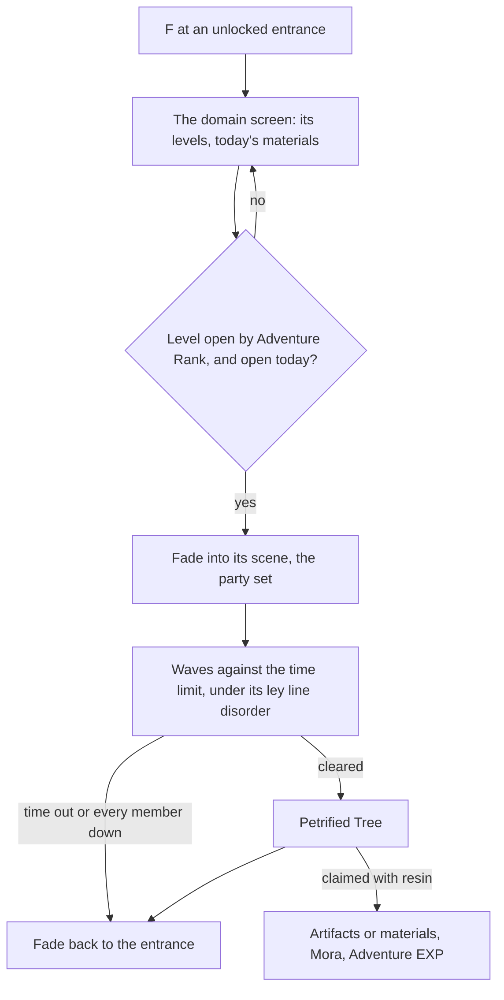

# Domains

A domain is the kind of instance the [domains](../../specs/genshin/domains/design.md) page defines: a challenge in a scene of its own, cleared for a reward. Challenge domains give artifacts, talent materials and weapon ascension materials, the materials every growth page here spends; one-time domains reward their first clear; the trounce domains, where the weekly bosses wait, are the bosses' page, which enters them as this page enters any. A domain's reward is claimed with [Original Resin](../../specs/genshin/original-resin/design.md), the domains open by [Adventure Rank](../genshin-adventure-rank/design.md), and they are fought with the [character kits](../genshin-character-kits/design.md), so this page waits on all three.

The [domains page](../../specs/genshin/domains/design.md) holds the opening rules, each kind by its Adventure Rank and by the day of the week. What is left here is the world's side of a domain and its challenge.

## Decisions

- **An entrance is a landmark, and a waypoint once unlocked.** Each permanent domain's entrance is a `LandmarkKind` of its own, and joins the jumps once unlocked, as the game teleports to it ([map unlocking](../genshin-map-unlocking/design.md)). No `LandmarkKind` is added until the reader that places it exists.
- **The arrival is provisionally the entrance's own place.** PROVISIONAL: a jump lands at the entrance's `arrival`, which the writer sets to the entrance's own place (its position, turn and height above the ground) until the domain's scene export gives its transfer point, which the fit then replaces. `JUMP_LANDMARK_KINDS` holds the kind, so an entrance is listed with the statues and waypoints, and an unlocked one is a jump target through `computeUnlockedJumpLandmarks`. Its area is filled and its mark drawn as a statue's are, and the HUD's pointer names a locked one within reach, both judgements the wiki does not settle and both PROVISIONAL until a recording shows them.
- **An entrance's place is its scene point.** `DungeonEntryExcelConfigData` names each entrance's scene and its point (`dungeonEntryId`), and the scene's points (`BinOutput/Scene/Point/scene3_point.json`, held) hold that point, under the category `points` and in a kind of its own, at `tranPos` (a `{x, y, z}` vector, each zero component left out), with its area at the point's `areaId` (a level-one area, mapped to its catalogue area and that area's region by its English name), and its sub-area at `EABBCMGNLEL` (left out when zero). The fit once filed each entrance by its nearest map point, which put Ridge Watch (point 282, in Bishui Plain) under Mondstadt's `starfell-valley`; it now files by the point's own area, the fields the transport points use: entry row 1's point 48 is a Domain of Blessing's, at about (2498, 264, -1558) in area 106. So no streaming record and no map fit is needed. The entry's `type` gives the kind: `DUNGEN_ENTRY_TYPE_RELIQUARY` is Blessing, `DUNGEN_ENTRY_TYPE_WEAPON_PROMOTE` Forgery and `DUNGEN_ENTRY_TYPE_AVATAR_TALENT` Mastery; the other types are one-time, trounce and event entrances, left for their own items.
- **An entrance draws a stand-in until its kit exists.** Each entrance draws one pillar, in one colour, at its published arrival, which is the entrance's own place until the scene export gives the transfer point. The kit is replaced, not extended, when the domain's artwork is built.
- **The screen's words are the game's, by text id.** The screen shows the Domain title (text hash 4043227537), the recommended level (`UI_QUEST_RECOMMEND_LEVEL`), the enemy level (hash 669745132, one of four ids that share its English), the Enter Domain button (`UI_DUNGEON_ENTRY_47`), the Adventure Rank a refused level asks for (`QUEST_DIALOG_DETAIL_PLAYER_LEVEL_NEED`) and the closed state. PROVISIONAL: the closed state borrows a hall's timer string (`UI_BEYOND_HALL_LIST_HALL_LEFTTIME_CLOSE`), not a domain's words, and a level's own name is not shown, since the published `domains` dataset holds no text id for a domain's name.
- **The stand-in arena is beside the entrance.** PROVISIONAL: an entered level lands on a flat place `DOMAIN_ARENA_OFFSET` (30 world units) east of its entrance's arrival, facing the same turn (`computeDomainScenePose`), on the jump's fade. The arena holds the player until they leave by its prompt, or until a timed-out or wiped challenge jumps them back to the arrival. The offset is replaced by the scene export's transfer point, and the arena pad is not drawn yet.
- **The challenge is the wiki's, PROVISIONAL.** Each domain's levels take the wiki's Domain Enemies table (`DOMAIN_CHALLENGE_LEVELS`, keyed by entry id and then by the level's recommended rank). The wiki's targets are the entry's tiers in ascending rank; each target's waves are the wiki's `//` waves of `;` groups, and its defeat target is the enemies its waves list, since the wiki's stated count disagrees with its list on two tiers (Forsaken Rift rank 45 says 8 against 6 listed, Inverted Glacier rank 40 says 7 against 3), and only the listed enemies can be defeated. The waves run in sequence: the next wave spawns when the last enemy of the current one falls. A domain's wiki page is named by its entrance point's title (`titleTextID`), else by its level's dungeon theme ("Domain of <theme>", then "<theme> (Domain)"), else by the entry's own dump description, which the page's infobox repeats (entries 38 to 40, the Snezhnaya domains). Every entry has a table, so no level reads Closed for want of one; a tier with no wiki table would still have no entry and read Closed. A level with no total time limit on the wiki, the protect levels and the between-kill levels, takes 360 seconds, PROVISIONAL. Enemies are stand-in kinds drawn as the outcrops' camps are, since the wiki's names have no kind in the game tables this build reads. The domain's scene export gives the real waves, time limits and spawns, which replace these.
- **The clock counts the world's open time.** A challenge's time limit runs only while the world is open: a frame with a menu open adds none, as the game's timer pauses (`computeDomainChallengeElapsed`). PROVISIONAL on the frame's delta as the tick.
- **The tree is claimed in the arena, and leaving forfeits it.** A clear raises the Petrified Tree and keeps the player in the arena, where the tree's prompt claims through `claimPetrifiedTree` at the blossom's claim offers (`computeBlossomClaimPrompt` for `BlossomKind.Domain`, resin 20, which every level's `statueCostCount` in the dump also reads). A level's tree rewards are the items of its `passRewardPreviewID` row (`treeRewards`) and, for a Forgery or Mastery level, its book, each drawn between its least and most count. Where the wiki gives an average, the draw matches it as well as the range (PROVISIONAL, cited in `treeRewardCounts.ts`): the least is paid, then the range's units are drawn at the chance that puts the mean on the average. A Domain of Blessing's claim draws each artifact row's count and rolls each artifact through `rollArtifact` from one of the domain's sets (`artifactSetIds`), kept in the bag as its own entry. Each Blessing domain's four sets are the wiki's names (`BLESSING_ARTIFACT_SET_NAMES`, cited to each domain's infobox), and `resolveBlessingArtifactSetIds` resolves each name to the one set whose equip affix the dump names, refusing a name that no set or two sets answer to. A claim with no sets to draw from is refused, with its resin still held. The arena's leave prompt asks 'Leave Domain?' (`UI_STC_Intee_DungeonExit`) and leaves on 'Leave Domain' (`INFO_AVATAR_TRANSPORT_DUNGEON_TITLE`), which forfeits an unclaimed tree. A timed-out or wiped challenge jumps back to the entrance with no tree. PROVISIONAL: the arena's prompts stand beside its centre until the scene export gives their places.
- **A domain is a scene of its own.** Its interior is the game's own dungeon scene, laid out from that scene's data and derived as a region is ([scene derivation](../../specs/genshin/scene-derivation/design.md)). F at the entrance opens the domain's screen, and entering fades to the scene as a jump fades to its landmark; leaving, or the challenge failing, fades back to the entrance.
- **Levels by Adventure Rank.** A challenge domain has several levels, each opened at its Adventure Rank, with its recommended level, its enemies' level and its ley line disorder, read from `DungeonExcelConfigData` (`limitLevel`, `levelRevise`, `previewMonsterList`) and its entry table. The player chooses one before entering.
- **The challenge is the domain's.** Its enemies come in the waves its scene sets, against its time limit, and a ley line disorder changes the fight. Each level's disorder is the one level config its dungeon row names (`levelConfigMap`, read through the entity table into `disorder`). The constant ones change the fight as their description says: a team-wide damage bonus to one element or Physical, or to CRIT Rate, given each deployed member for the challenge's time limit and ended on leaving. Five more are triggered, each by a reaction an enemy takes (`reactionTriggered`) or a change to a party member's HP (`partyHealthChanged`), and given to every member for its own seconds: a Hydro-related reaction's Hydro DMG bonus (at most every two seconds, capped at five stacks), a Cryo-related reaction's Elemental Mastery, a Dendro-related reaction's Elemental Mastery (at most once a second), a Swirl's Anemo DMG bonus, and a CRIT DMG bonus per HP change (every 0.1 seconds, capped at ten stacks). One table, `DOMAIN_DISORDERS` in `applyDomainDisorders`, holds all twelve with their kind, read from the descriptions; the reaction families they name follow the wiki's element pairs (the Elemental Reaction table and the Lunar Reaction list), with a Swirl or a Crystallize counted for the element it carries. Together they model 92 of the 307 daily fights, and the other 215 change nothing yet: the Nightsoul ones wait on the kits' Nightsoul primitive. Clearing it raises the Petrified Tree at the end.
- **The days each kind sets.** A Domain of Forgery's weapon materials and a Domain of Mastery's talent materials are each open on two set days and every Sunday, the days turning at the game's daily reset. The set days come from the entry's `descriptionCycleRewardList`: its three day lists are the Monday and Thursday, Tuesday and Friday, and Wednesday and Saturday materials in that order, which the wiki's location pages confirm for all sixteen entries. A level's reward preview names its material, so the level takes that pair's days. Four entries (2, 3, 10 and 11) have one level per rung whose preview names all three materials; those are open on Sunday only, and each pays the book of its first weekday pair (Monday and Thursday's) at the rung's counts. PROVISIONAL: the wiki's domain page says a Sunday's stages are consistent with the week's, which fixes the rewards to a counterpart but not which of the three, so the first pair is taken. A Domain of Blessing is open every day, so the three-day rule of the wiki's Domain page applies to Forgery and Mastery only. The rule is built ([domains page](../../specs/genshin/domains/design.md)); the daily table is not read, since the entries' lists give the same days.
- **The reward is the resin claim.** The Petrified Tree is claimed with resin as any blossom is ([Original Resin](../../specs/genshin/original-resin/design.md)), its artifacts rolled by the [artifact enhancement](../../specs/genshin/artifact-enhancement/design.md) page's rules.
- **One-time domains reward their first clear.** Their Adventure EXP, Primogems and any recipe are given once, by their reward table row, and they stay open with nothing more to give.
- **The stand-in numbers are PROVISIONAL until the scene export.** The challenge's waves, enemies and time limits are the wiki's (above), the stand-in arena and its fade wait on the scene export, and the Sunday counterpart is the first weekday pair's. Each is marked where it is used and replaced when the export or the owner's data lands.
- **A first clear is kept in the save.** The cleared one-time domains are a unique list of entry ids in the save (`clearedDomains`, read as `clearedDomainIds`). A merge of a guest save into an account keeps the domains cleared on either, so a clear made as a guest is not claimed again on the account.

## How it works



## Scope and order

**Today:** the opening rules are built, as the [domains page](../../specs/genshin/domains/design.md) records. Nothing enters a domain, and nothing gives a domain's materials.

**This adds, in order:**

```text
scripts/src/services/genshinAssets/domains/
├── toDomainEntrance.test.ts
└── writeDomainEntrances.ts
```

1. **The entrances, read from the scene points.** `DungeonExcelConfigData`, `DungeonEntryExcelConfigData` and `DailyDungeonConfigData` are in the dump at the install's build, so the step reads them from there with no fetch list to extend. Then `writeDomainEntrances.ts`, behind a `genshin:assets domains` subcommand on the pattern of `forgingCommand`, reads every entry row of scene 3 whose type names a `DomainKind`, takes its point from `scene3_point.json` (a row whose point is missing is counted and left out), files it under the fitted region of the official map point nearest it within reach, as a resident is, and under the landmark nearest it in that region, and writes it into that region's `packages/genshin-world/src/data/regions/<region>.json` landmarks as a `LandmarkKind.DomainEntrance` with its domain kind and the entry's id, its place carried round the Windrise origin (`readWorldOrigin`) as `chests/buildChestPlaces.ts` carries its points. `LandmarkKind` gains `DomainEntrance`, which no kit draws yet. The proof is `toDomainEntrance.test.ts`: a dumped entry row and its point become the landmark at the point's x less the origin's x and the origin's z less the point's z, with the kind its type names, and a row of `DUNGEON_ENTRY_TYPE_NORMAL` gives none.
2. **The entrance's kit and its screen**: a stand-in kit drawn at each entrance, then the screen F opens, listing its levels and today's materials over the built opening rules.
3. **The days' schedule and the levels by rank**, read from the tables item 1 fetches. The days' rule is built.
4. **Entering a domain's scene and leaving it**, on the jump's fade.
5. **The challenge**, its waves, time limit and failure, with the first domain of Mastery carried. A domain's scene is laid out from its own scene data, which waits on the scene export the other machine is making.
6. **Ley line disorders**: the constant, reaction-triggered and HP-triggered bonuses over the kits' buffs, from one table; the Nightsoul ones wait on the kits' primitive.
7. **One-time domains.**

## Data and measures

- **Read from the game's tables:** `DungeonExcelConfigData`, `DungeonEntryExcelConfigData`, `DailyDungeonConfigData` and the domains' reward rows; each domain scene's layout from its own scene data, as a region's is read. The first three are on AnimeGameData's master and are fetched into the dump by item 1.
- **Read from the wiki:** each domain's rolled drops by level, and the weekday schedule the daily table's fields are matched against. The wiki answers its API through the persona's reader (`readWikiPageText`), so neither waits on a source.
- **Measured:** the fade into and out of a domain, off a recording, as the jump's fade is. The clip is listed on the [roadmap](../genshin-roadmap/tasks.md).

## Blocked

- **The Petrified Tree's claim (3.3).** The claim is built: `claimPetrifiedTree` takes the offer the player chose from the claim prompt (`computeBlossomClaimPrompt` for `BlossomKind.Domain`, which offers one, two or condensed claims) and draws its rewards once per claim from the tree's items through `drawRewardItems`, then pays them through `claimResinReward`, the one resin claim the boss and ley line claims use. Its tests cover the single and the double spend and the refusal. Task 3.3 stays open for two parts: the prompt surface, which F reaches only from a cleared domain's tree (3.2), and the Blessing artifacts' sets: the dump's text names no reliquary set, so the wiki's four sets per domain have no ids, and a Blessing claim with artifact rows is refused until they are set. The tree's reward draw is built. The domain previews hold whole counts or none (92 domain previews: 276 whole counts, 613 count-less items, no range and no fraction): the whole counts are the tree's fixed items (Mora, Adventure EXP, Companionship EXP), and the count-less items are drawn, with their counts taken from the wiki's Domain Levels templates and cited in `scripts/src/services/genshinAssets/domains/treeRewardCounts.ts`. A Domain of Mastery's or Forgery's books and weapon materials are each drawn between the least and most their rarity has in the level's Adventure Rank's row, through `drawRewardItems`. A Domain of Blessing's artifacts are a guaranteed count and a chance of one more, by rarity, drawn through `drawChancedCount`. The uniform draw missed the wiki's average on the rows with a least of zero (Forgery at 40, five-star: 0.062 on the wiki against 2 drawn), so a range with an average is drawn to it now; a Sunday level pays its first weekday pair's book, as the Decisions say. The `BlossomChestExcelConfigData` rows are unread, so the counts are the wiki's, not the game's table's. A clear raises the tree (`raisedTreeEntryIds`, in memory, not saved), which the claim prompt will read.
- **The scene (3.1, 3.2).** A domain's scene is laid out from the client's scene data, which the dump does not hold: it has only `BinOutput/Scene/Point/scene3_point.json`. The PC's export must give, for each domain's scene (its `sceneId` in the dungeon rows): the scene's points file (`BinOutput/Scene/Point/scene<sceneId>_point.json`, for the point the player enters at and the one the player returns to), its `sceneGroups/*` (the wave monsters and the dummy points the members return to), and the challenge's time limit, which `DungeonExcelConfigData` does not hold (its `settleCountdownTime` is 999 on the domains read). Until the export lands, the arena is the stand-in in the Decisions, its waves spawned at once.
- **One-time domains (3.4).** The first-clear rule and the save field are built. The clear calls no first-clear reward: Ridge Watch is a Blessing, which repeats, and one-time domains are not in the dataset, so their entrances and rewards wait on that data. Their reward rows are unread, so the rewards are passed in until they are. Stored Genshin saves lack `clearedDomains`, so the dev backfill gives each one `clearedDomains: []`.

## Key files

| File                                                                          | Role after the change                                                                           |
| :---------------------------------------------------------------------------- | :---------------------------------------------------------------------------------------------- |
| `packages/genshin-world/src/models/world/LandmarkKind.ts`                     | Gains the domain entrance                                                                       |
| `packages/genshin-world/src/services/map/constants.ts`                        | `JUMP_LANDMARK_KINDS` gains the domain entrance                                                 |
| `packages/genshin-world/src/components/World/Session/Index.vue`               | Enters a domain's scene and returns to the world                                                |
| `packages/genshin-world/src/composables/useWorldDomains.ts`                   | The domain screen's levels and the challenge's run                                              |
| `packages/genshin-world/src/services/domains/applyDomainDisorders.ts`         | The ley line disorders' bonuses over the team, constant and triggered                           |
| `packages/genshin-world/src/services/domains/drawDomainArtifacts.ts`          | A Blessing claim's artifacts, each rolled and kept in the bag                                   |
| `packages/genshin-world/src/models/enemy/EnemyCamp.ts`                        | A domain's waves, as camps of its scene                                                         |
| `packages/genshin-world/src/models/domains/DomainSchedule.ts`                 | A domain's kind and levels, the schema the screen reads                                         |
| `packages/genshin-world/src/services/domains/checkIsDomainLevelOpen.ts`       | Whether a level is open at the rank on the day                                                  |
| `scripts/src/services/genshinAssets/domains/toDomainLevels.ts`                | Builds each domain's levels and days from the tables                                            |
| `scripts/src/services/genshinAssets/domains/resolveBlessingArtifactSetIds.ts` | Resolves each Blessing domain's four wiki set names to set ids through the dump's equip affixes |

## Sources

- [Domain](https://genshin-impact.fandom.com/wiki/Domain), Genshin Impact Wiki (read through `api.php?action=parse&prop=wikitext&page=Domain`, since the page itself refuses scripted fetches): entrances acting as waypoints, the ranks and quests that open each kind, each Forgery or Mastery stage open on two set days a week and Sunday, a Domain of Blessing every day, one-time domains, and the Petrified Tree claimed with resin. Also read: [Domain of Blessing](https://genshin-impact.fandom.com/wiki/Domain_of_Blessing), [Domain of Forgery](https://genshin-impact.fandom.com/wiki/Domain_of_Forgery) and [Domain of Mastery](https://genshin-impact.fandom.com/wiki/Domain_of_Mastery) (the ranks and the reserved days), and the template [Domain by Weekday](https://genshin-impact.fandom.com/wiki/Template:Domain_by_Weekday) (Monday/Thursday, Tuesday/Friday and Wednesday/Saturday pairs of stages, Sunday common).
- [AnimeGameData](https://github.com/DimbreathBot/AnimeGameData), the community's per-patch dump: the dungeon, dungeon entry and daily dungeon tables, the last with its weekday fields scrambled.

## Reference

- `domain-entry.mkv` — standing at a domain's entrance and pressing F to enter, the fade into its scene, then the fade back out when the domain is left, 30 seconds at most. The fade's durations are measured from it, as the teleport's are. Partly found 2026-10-11: https://www.youtube.com/watch?v=V7SVLH8V5RE; still sought: the fade-out when the domain is left, not clipped; the candidate was found from its title only and its timestamps are not verified.
