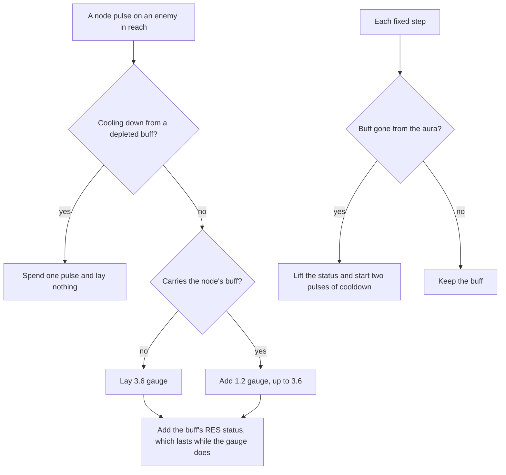

# Elemental Nodes and Infusion Stones

Elemental Nodes are the world's own elements: a node pulses its element on a fixed clock, and each pulse lays that element on the enemies it reaches. A buffed enemy resists more while the buff lasts, and a reaction that spends the buff ends it. Infusion Stones, which hold an element over the ground around them, are not built: the data for placing and destroying them is not in the build (see Notes). The [puzzles](../genshin-puzzles/design.md) change waits on the same placements.

## Decisions

- **A node's pulse is the infusion.** The wiki describes a node as setting the gauge of its element on an enemy in reach, not as changing the attacker's element. So the pulse writes the enemy's aura through `applyElement`, the path `applyEnemyElement` wraps, with the node as the source where a combatant would be. Rejected: an infusion that gives a combatant's attacks the node's element, which is what a character's weapon infusion does (`KitInfusion`), since the wiki's buff belongs to the enemy.
- **The buff lasts as long as its gauge, not a timer.** The wiki says the gauge does not decay and ends only when reactions deplete it. So the buff has no seconds of its own: its resistance status carries `secondsRemaining: Infinity`, and the aura's decay rate is zero. Rejected: a timed buff, which the wiki contradicts, and decay at the aura's rate.
- **The resistance is a status, not an aura.** `createElementalNodeStatus` gives the enemy 50% more RES to every element and to physical hits, and 50% more again to the node's own element, through `resistanceReduction` and `physicalResistanceReduction`, which `getEnemyResistance` already reads. Rejected: resistance held on the aura, which `getEnemyResistance` does not read.
- **A reaction ends the buff at the next step, not in the reaction.** `stepElementalNodeBuffs` runs each fixed step, finds each node buff whose aura is gone, lifts its status and starts the cooldown. So reactions know nothing of nodes, and a buff lifts within one step of its depletion. Rejected: a hook in the reaction path, which would make every reaction aware of nodes.
- **The cooldown is counted in pulses on the enemy, not in seconds on the node.** The wiki counts two pulses after a depletion, and the wait belongs to each enemy, since one node pulses every enemy in its reach. So `elementalNodePulsesLeft` lives on `Enemy`, set by `stepElementalNodeBuffs` and spent by `pulseElementalNode`. Rejected: a per-node cooldown, which would let a node's depletion on one enemy stall its pulses on every other.
- **A node's clock is seconds to the next pulse.** `stepElementalNode` subtracts the step's seconds and counts each fifteen-second pulse the step crosses, so a long step passes more than one pulse.

## How it works

## Key files

| Path                                                                               | Role                                                                                                               |
| :--------------------------------------------------------------------------------- | :----------------------------------------------------------------------------------------------------------------- |
| `packages/genshin-world/src/models/elementalNode/ElementalNode.ts`                 | The node's element and its seconds to the next pulse.                                                              |
| `packages/genshin-world/src/services/elementalNode/constants.ts`                   | The fifteen-second clock, the gauges, the cooldown in pulses, the RES values and the buff's source and status ids. |
| `packages/genshin-world/src/services/elementalNode/stepElementalNode.ts`           | Advances a node's clock and counts the pulses a step crosses.                                                      |
| `packages/genshin-world/src/services/elementalNode/pulseElementalNode.ts`          | Lays a pulse's gauge on an enemy, or spends a cooldown pulse.                                                      |
| `packages/genshin-world/src/services/elementalNode/checkIsElementalNodeBuffed.ts`  | Whether an enemy's aura of an element still carries a node's share.                                                |
| `packages/genshin-world/src/services/elementalNode/createElementalNodeStatus.ts`   | The buff's resistance status for an element.                                                                       |
| `packages/genshin-world/src/services/elementalNode/getElementalNodeStatusId.ts`    | The status id of an element's buff, one per element.                                                               |
| `packages/genshin-world/src/services/elementalNode/stepElementalNodeBuffs.ts`      | Lifts each depleted buff and starts its enemy's cooldown.                                                          |
| `packages/genshin-world/src/models/enemy/Enemy.ts`                                 | The `elementalNodePulsesLeft` field a cooldown is held in.                                                         |
| `packages/genshin-world/src/services/enemy/createEnemy.ts`                         | Starts `elementalNodePulsesLeft` at zero.                                                                          |
| `packages/genshin-world/src/services/elementalNode/stepElementalNode.test.ts`      | The clock's scenarios.                                                                                             |
| `packages/genshin-world/src/services/elementalNode/pulseElementalNode.test.ts`     | The pulse's, the buffed resistance's and the cooldown's scenarios.                                                 |
| `packages/genshin-world/src/services/elementalNode/stepElementalNodeBuffs.test.ts` | The depletion and the kept buff's scenarios.                                                                       |

## Notes

- A node's element is one of the wiki's three: Cryo, Electro and Pyro. An element that leaves no aura, Anemo and Geo, lays nothing, since `ElementAuraTypeMap` has no entry for it.
- The reach radius is in no source the build holds, so the pulse takes the enemies the caller supplies as in reach, and that radius is provisional until the world wires the pulse, which waits on placements (task 2.3).
- A gauge laid over an aura the enemy already holds keeps that aura's decay rate, because `applyAura` merges the two at the first aura's rate. The wiki's no-decay holds only on an enemy with no other aura, so a buff on a decaying aura decays with it. This is provisional until a recording measures it.
- Not built: the DEF bonus of Cryo, the ATK bonus of Pyro, the CD reduction of Electro, and the interruption hyperarmor. `EnemyStatus` has no field for a DEF or CD bonus, and its `attackReduction` is an enemy's reduction, not the party's bonus.
- Infusion Stones are not built. The dump's `SceneObj_Gear_Other_RockTotem_Fire`, `_Ice` and `_Electric` gadgets look like them by element, but none is confirmed in the world, and the dump holds no stone hit points or weakness data for destroying one. Destroying a stone removes its buffs, so it waits on that data.
- No gadget row in the dump is named as an Elemental Node, so the node gadget's id is unidentified and no node is placed.

## Sources

- The Elemental Node page on the Genshin Impact wiki, [Elemental Node](https://genshin-impact.fandom.com/wiki/Elemental_Node), read on 2026-10-18 through its MediaWiki API (`api.php?action=parse&page=Elemental_Node&prop=wikitext`). It gives the fifteen-second pulse, the gauges and their cap, the two-pulse cooldown, the lasting gauge without decay, the 50% RES and the three element bonuses.
