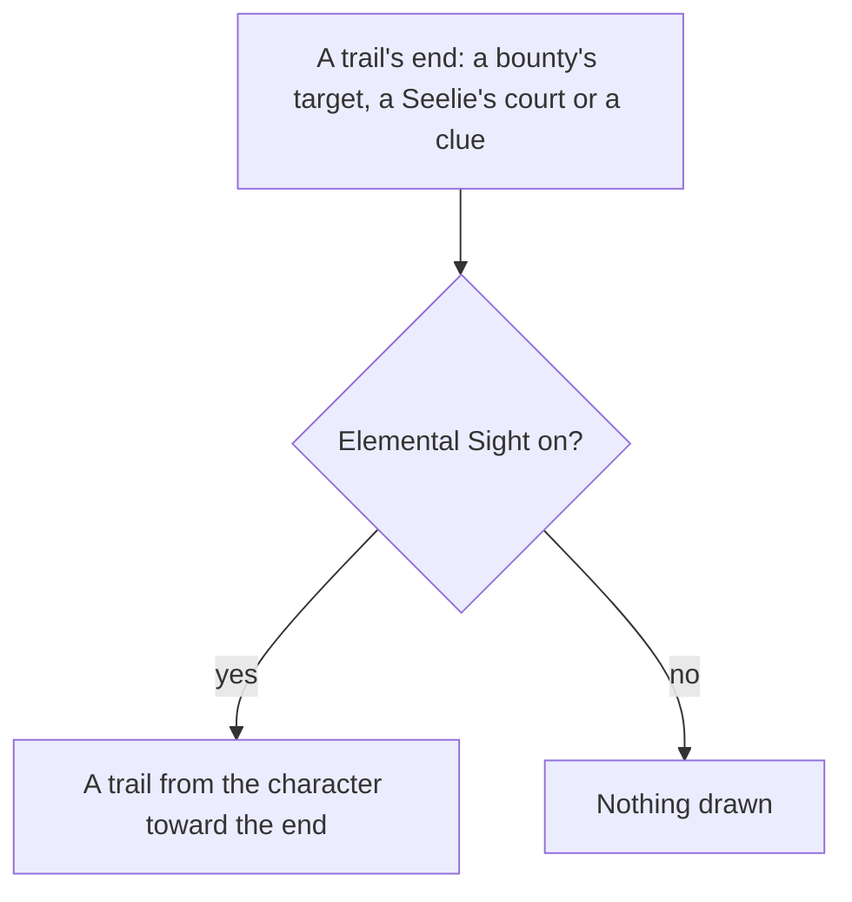

# Elemental Sight

The range, the mute, the white and element-coloured highlights, the enemies' colours and names, and the trails toward the Seelies' courts are built, as [Elemental Sight](../../specs/genshin/elemental-sight/design.md) describes. What is left is the trails toward a bounty's target and a quest's clue, which the pages that place those ends draw the sight toward.

## Decisions

- **Trails lead somewhere.** A [reputation](../genshin-reputation/design.md) bounty's target, a Seelie's court ([puzzles](../genshin-puzzles/design.md)) and a quest's or a hidden objective's clue leave an elemental trail that the sight draws from where the player stands toward its end.
- **Each trail comes with the page that leaves it.** A trail is drawn when the page that places its end is built, so none is drawn for an end nothing places yet.
- **A trail is a ground ribbon, white, cut at the reach.** It runs on the ground from the character's current position toward its end, redrawn each step as the character moves, as the game draws it, and not from where the sight was turned on. It is sampled every `SIGHT_TRAIL_STEP` metres on the world's height, and is drawn in the sight's lit scene as the stand-ins are, so the mute leaves it bright. White is the colour of what no element affects ([Elemental Sight](../../specs/genshin/elemental-sight/design.md)). Its width and fade are provisional constants until the owed `elemental-sight.mkv` measures them.

## How it works

## Scope and order

**Today:** the Seelies' trails are built and recorded in the [as-built page](../../specs/genshin/elemental-sight/design.md). A bounty's target and a quest's clue are not placed in the world yet, so no trail is drawn toward either.

**This adds, each with its page:**

1. **Reputation's bounties**, once [Reputation](../genshin-reputation/design.md) places each bounty's target, from the wiki's bounty locations, marked provisional where they give none.
2. **Quests' clues**, once the [quests](../genshin-quests/design.md) page places the go-to places its carried quests name. A trail runs to each of those places that is placed in the region data, and to none that is not.

## Data and measures

- **Read from the wiki:** which ends leave a trail, and that the sight leads toward them.
- **Measured:** the trail's width and how it fades toward its end, off the recording owed in the roadmap beside the sight's own measures, each provisional until it lands.

## Key files

| File                                                            | Role after the change                          |
| :-------------------------------------------------------------- | :--------------------------------------------- |
| `packages/genshin-world/src/components/World/Session/Index.vue` | Where the trails' ends are handed to the sight |
| `packages/genshin-world/src/components/Quest/Beam/Index.vue`    | The beam a quest's target already rises over   |

## Sources

- [Elemental Sight](https://genshin-impact.fandom.com/wiki/Elemental_Sight), Genshin Impact Wiki: the trails of bounties, Seelie and quests, and the sight's end after a short move.

## Reference

- `elemental-sight.mkv` — standing in the open world with a hilichurl and a drop in view, Elemental Sight turned on with the middle mouse button, its white range left to spread to its reach, then the character walked away until the sight ends, and turned on again standing still, 20 seconds at most; the reach, the spread, the walk that ends it, the muted and highlighted colours and whether the camera resets on the same press are measured from it. On the wiki and YouTube, none found (searched 2026-10-11).
