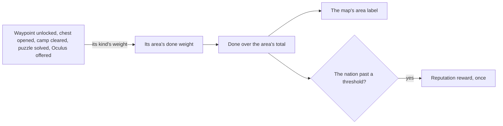

# Exploration progress

The game's map shows, for every area, how much of it a player has explored as a percentage, and a nation's exploration raises its Reputation at set thresholds. It is a count over what the other exploring pages do, so it waits on the [map unlocking](../genshin-map-unlocking/design.md), [chests](../genshin-chests/design.md), [puzzles](../genshin-puzzles/design.md) and [Statues of The Seven](../genshin-statues-of-the-seven/design.md) whose doings it counts. The [as-built page](../../specs/genshin/exploration-progress/design.md) holds the count and the percentage for Galesong Hill; what follows is what remains.

## Decisions

- **A share of the area's total.** An area's progress is the weight of what has been done in it over its total, which `ExploreAreaTotalExpExcelConfigData` holds for every area, shown as a percentage on the map's area label.
- **Each doing adds its kind's weight.** A waypoint unlocked, a chest opened, a camp cleared, a puzzle solved and an Oculus offered each add their kind's weight to the area they stand in. `WorldAreaExploreEventConfigData` lists the first three for the first four areas, each with a weight of ten, but those weights do not fit the totals, so each kind's weight is read off a recording of the map's percentage stepping as one of each is done. The puzzle and Oculus kinds have no event in the table, so they are read off the same recording.
- **The table's other events are not kinds of this page.** The table also lists gathered ingredients (`EXPLORE_EVENT_ITEM_ADD`) and a force entered (`EXPLORE_EVENT_ENTER_FORCE`). The public accounts of what counts toward a region's exploration name chests, Oculi, waypoints and challenges, and none names gathering, so the progress counts the kinds above alone. The recording's stepping includes one gathered ingredient, which settles whether gathering moves the percentage.
- **Windrise's area is Galesong Hill.** The table counts per level-one area, and Windrise is a level-two area of Galesong Hill, so Windrise's statue completes Galesong Hill's waypoint and its count is Galesong Hill's.
- **The percentage is rounded down.** Once the measured weights fit the totals, an area reads 100 only with all its weight done, so a near-complete area never shows as complete. Until then the table's weights overshoot, so an area can read 100 early and pass it.
- **Counted once.** A doing counts once, kept with the player's progress, so a chest that never comes back and a waypoint unlocked once each add their weight a single time.
- **A nation's thresholds raise its Reputation.** A nation's exploration reaching each of `ReputationExploreExcelConfigData`'s thresholds gives its Reputation reward once ([reputation](../genshin-reputation/design.md)).
- **An unlock waits for the reads it counts.** Nothing in the save records a paid threshold, so the composable keeps the landmarks whose thresholds are paid: the saved unlocks at the session's start, advanced at each settle. A settle runs once the areas, Mondstadt's Reputation and every region are read, and counts each unlock made since the last one from the percentage the paid landmarks reach, so an unlock made before then pays its threshold at the first settle, once.
- **A nation's percentage is read off its areas the way the tables weigh them.** `ReputationCityExcelConfigData` names the areas each nation's exploration counts (`exploreAreaVec`; Mondstadt's are areas 1 to 4, the four level-one areas the slice holds), and `ExploreAreaTotalExpExcelConfigData` gives each area a `reputationRatio`. Liyue's six ratios sum to one, so a nation's percentage is its areas' percentages weighted by their ratios, rounded down. Every Mondstadt ratio reads 0 at this revision, so a nation whose ratios are all 0 takes its areas' done weight over their summed totals, rounded down, as an area's own percentage is.

## How it works



## Scope and order

**This adds, in order:**

```text
packages/genshin-world/src/services/exploration/computeNationExplorationPercentage.ts
```

1. **Mondstadt's Reputation thresholds, paid as a statue is unlocked.**
   - `computeNationExplorationPercentage.ts`: takes the nation's `ExplorationArea`s and the unlocked landmarks, and returns the percentage by the rule under Decisions: each area's done share (`computeExploredDoingIds`, `computeDoneWeight`) weighted by its ratio where the ratios are set, and Mondstadt's all-zero ratios read as done over total, rounded down. Its test, `computeNationExplorationPercentage.test.ts` beside it, asserts two areas of totals 100 and 300 with 40 done read 10, and that nothing unlocked reads 0.
   - `packages/genshin-world/src/composables/useWorldMap.ts`: `activateLandmark` unlocks and runs `settleExplorationThresholds`, which waits until the areas, `readMondstadtReputation()` and every region are read (a `watch` runs it again as they land), then passes the percentage of the paid landmarks and of the unlocked ones to `computeReputationExploresReached` with the `explores`, and pays each reached threshold: its `reward.exp` through `addReputationExp` with the slice's `levels`, and its `reward.items` (Mora, item 202) into the wallet through `setWallet`, as `payFirstUnlockReward` pays Primogems. The composable takes a `reputation` ref and a `setReputation` callback beside `wallet` and `setWallet`.
   - `packages/genshin-world/src/components/World/Session/Index.vue`: holds the reputation in a `shallowRef` from `savedState.reputation`, passes it to `useWorldMap`, and saves the ref rather than the saved value.
   - Data: the generated `exploration/mondstadt.json` and `reputation/mondstadt.json` slices already hold every number; nothing is regenerated.
2. **Chests and camps done.** Waits on the placed chests and camps, from the official map's chest points and enemy marks, as the [chests](../genshin-chests/design.md) and [spawned places](../genshin-spawned-places/design.md) proposals place them. Each is then done once opened or cleared, kept with the player's progress.
3. **Oculi and puzzles done.** The Oculi offered and the puzzles solved join the count once [offerings](../genshin-offering-systems/design.md) and the puzzles record them.
4. **Each kind's weight, re-measured.** The table's weight of ten stays in use; the owed `exploration-steps.mkv` re-measures the scale and each kind's weight, with whether a gathered ingredient counts, and gates nothing above.

## Data and measures

- **Read from the game's tables:** `ExploreAreaTotalExpExcelConfigData`'s totals and `WorldAreaExploreEventConfigData`'s events for the four level-one areas, and `ReputationExploreExcelConfigData`'s thresholds, whose rows name each nation by its city and the progress of its three levels.
- **Measured:** each kind's weight, off a recording of the English PC client's map before and after one statue, one chest, one camp, one puzzle solved, one Oculus offered and one gathered ingredient in Galesong Hill, the step in its percentage times its total. The clip is listed as owed on the [roadmap](../genshin-roadmap/tasks.md).

## Key files

| File                                                                         | Role after the change                                                                 |
| :--------------------------------------------------------------------------- | :------------------------------------------------------------------------------------ |
| `packages/genshin-world/src/services/exploration/computeExploredDoingIds.ts` | Which doings are done: chests and camps once recorded, Oculi and puzzles once counted |
| `packages/genshin-world/src/models/exploration/ExplorationKind.ts`           | The kinds the progress counts; the Oculus and puzzle kinds join it                    |

## Sources

- [Reputation](https://genshin-impact.fandom.com/wiki/Reputation), Genshin Impact Wiki: world exploration progressed by puzzles, chests and offerings to the statues, and its share of a nation's Reputation.
- [AnimeGameData](https://github.com/DimbreathBot/AnimeGameData), the community's per-patch dump: every area's exploration total, the exploration events listed for the first areas alone, and the nations' exploration thresholds.
- [Do World Quests count as exploration in Genshin?](https://cyberpost.co/do-world-quests-count-as-exploration-genshin/), CyberPost: the chests, Oculi, waypoints and challenges a region's exploration counts, and the world quests it does not.
