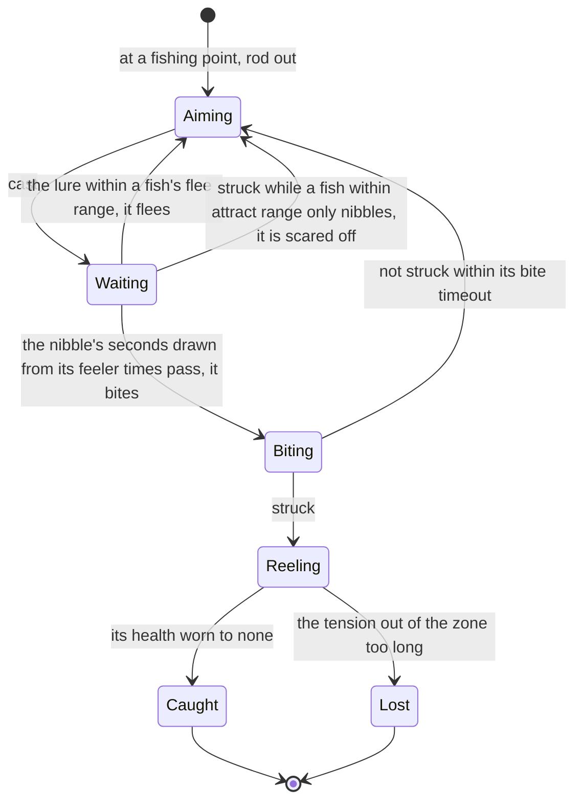

# Fishing

Fishing is one of the game's pastimes: bait crafted for the fish wanted, a line cast at a rippling fishing point, a bite struck, and the fish reeled in by keeping the line's tension in its zone. Fish are cooked, kept in the Serenitea Pot's ponds, and traded at each region's Fishing Association for rods and rewards. The game holds all of it in tables the client keeps whole, so it can be rebuilt to the number. Its bait is crafted ([crafting](../genshin-crafting/design.md)). The [fishing](../../specs/genshin/fishing/design.md) page holds the points, stocks, fish, rods and the cast's and reel's rules.

## Decisions

- **A point's stock is its region's pools, for now.** Each region's pools are the game's, filed by city. Neither the official map's points nor the dump's tables tie a point to one pool, so until a recording shows which pool a point draws from, a point draws from every pool of its region. Nod-Krai's city is filed under no pool, so its points draw nothing, and the fifty-four pools filed under city zero, which no region names, are left out until a recording places them.
- **Bait is not tied to a fish yet.** The bait table's feature tags name no fish, and no fish row names the tags it wants, so which bait draws which fish is read from the wiki's fish pages, each of which names its bait. Each kind is drawn only by its own bait, crafted from its recipe. A cast draws only among the fish its bait names (`drawFishingPointFish`), the set passed in until that reading fills it.
- **The bite is the fish's own.** A fish nibbles for a time within its feeler range and bites, and the bite is struck within its `biteTimeout` or lost. The timing and the caller's clock are not yet built.
- **The nibble's length is drawn from the fish's feeler times.** `feelerTimes` is a range in seconds, its least and its most (from `[0.75, 1]` to `[2, 8]` across the table), so a fish nibbles for a time drawn evenly between them by the caller's random source, as `claimExpedition` draws a count. A strike while it only nibbles scares it off and the cast is back to aiming, as a strike after `biteTimeout` seconds of biting is. The owed `fishing-reel.mkv` checks the scare; it does not gate the build.
- **The reel's zone travels by the fish's own fields, provisionally.** The zone's width is the fish's `bonusWidth`, and its offset, speed and duration are drawn from the fish's `bonusOffset`, `bonusSpeed` and `bonusDuration` ranges by the caller, as the nibble is. The zone starts at its offset, moves at its speed for its duration, holds where that leaves it and is kept within the bar (`computeFishingZone`). This is a best estimate, marked provisional as the Provisional section says: no table gives the travel's direction or its hold, and the `fishing-reel.mkv` recording re-measures it.
- **The tension moves at the gear's rates.** `FishProficient.gear`'s `inSpeed` moves the tension while it lies inside the zone and its `outSpeed` while it lies outside, rising while the reel is held and falling while it is not. The reel takes the gear row it is given, and which row a player holds is read by no table here, so the caller picks it. The bar is read as one hundred units (`REEL_BAR_MAX`), the scale the table's widths and speeds fit; the rates are cited as the table's and held provisional until the recording sets them.
- **The skills are not applied yet.** Each fish's skills from `FishSkillExcelConfigData` are read, but no field of a skill row has a plain meaning from the table. Its `bonusWidth`, `bonusOffset`, `bonusSpeed` and `bonusDuration` (the skill's own ranges, beside the fish's), `param`, `forceFactor`, `duration` and `strength` stay unapplied and are named here until the recording shows what each does. The reel moves on the fish's own zone fields and the gear alone.
- **The stock limits stay unread.** Each pool's two limit numbers have scrambled names, and their meaning is not settled by any table here, so they wait on a reading.
- **What a catch gives.** The items its fish's reward row gives go into the bag, the fish's own item only where that row names it: the two fish sharing row 242045 give item 131044 and not their own. No table gives proficiency per catch, so none is counted, and the Fishing Association's exchange of proficiency for rewards at its shop ([shops](../genshin-shops/design.md)) waits on a source for it.
- **Opened as the game opens it**, once the Serenitea Pot is owned and its quest is done, as the wiki gives the unlock. The realm's Adventure Rank 28 (`checkIsHomeRealmOpen`) opens the pot's realm and does not gate fishing; `checkIsFishingOpen` holds this rule.

## How it works



## Scope and order

**This adds, in order:**

```text
packages/genshin-world/src/
├── models/fishing/FishingBite.ts
└── services/fishing/stepFishingBite.ts
```

1. **The bite and the nibbles, as a pure rule.** No source is owed: the `fishing/fish` record already holds each fish's `feelerTimes` and `biteTimeout`.
   - `FishingBite.ts`: a bite under way, its `nibbleSeconds` and its `elapsedSeconds`. The caller draws `nibbleSeconds` as `feelerTimes[0] + random() * (feelerTimes[1] - feelerTimes[0])` when the fish turns to the lure, with no helper around it.
   - `stepFishingBite.ts`: the bite after `seconds`, given whether the strike was pressed, returning its next `FishingPhase` and bite: `Waiting` while it nibbles, `Biting` from `nibbleSeconds`, `Reeling` on a strike while biting, and `Aiming` on a strike while nibbling or once `biteTimeout` seconds of biting pass unstruck.
   - `stepFishingBite.test.ts` beside it asserts each of those four transitions on a fish with `biteTimeout: 5` and a bite with `nibbleSeconds: 1`.
2. **The reel's zone and tension.** The zone travels on the fish's own `bonusWidth`, `bonusSpeed`, `bonusOffset` and `bonusDuration`, and the tension moves at the gear's `inSpeed` and `outSpeed`; both are read provisionally until `fishing-reel.mkv` re-measures them. The skills from `FishSkillExcelConfigData` stay unapplied, as the decision above names.
3. **Bait and the rod's choice**, which fish each bait draws read from the wiki's fish pages, each naming its bait, through the repository's wiki reader, with the crafting recipes and the rod's multiplier and accuracy.
4. **The screen, the prompt in reach, the cast's input and the catch into the bag.**
5. **The Fishing Associations' exchanges.**

## Data and measures

- **Read from the game's tables:** the fish, pool, stock and rod tables, and now `FishSkillExcelConfigData`, `FishBaitExcelConfigData` and `FishProficientExcelConfigData` and each fish's catch reward row, published as `fishing/skills`, `fishing/baits`, `fishing/proficiency` and `fishing/rewards`.
- **Provisional until a clip shows them:** the gear's rates in the reel and the allowance, the zone's travel over its duration, and which pool a point draws from. Each ships as a best estimate, held provisional, and is listed on the [roadmap](../genshin-roadmap/tasks.md)'s References sought list until a published clip sets it.

## Key files

| File                                                                           | Role after the change                |
| :----------------------------------------------------------------------------- | :----------------------------------- |
| `packages/genshin-world/src/services/interaction/computeInteractionPrompts.ts` | Offers fishing at a point in reach   |
| `packages/genshin-engine/src/input/InputActionBindingMap.ts`                   | The cast, strike and reel            |
| `packages/genshin-world/src/services/fishing/addFishingCatch.ts`               | The catch's reward row, into the bag |
| `packages/genshin-world/src/services/inventory/addInventoryItem.ts`            | Each reward item, into the bag       |
| `packages/genshin-world/src/models/screen/ScreenKind.ts`                       | Gains the fishing view               |

## Sources

- [Fishing](https://genshin-impact.fandom.com/wiki/Fishing), Genshin Impact Wiki: the unlock after the Serenitea Pot, one bait per fish, the cast's distance, the bite and the tension, points emptied and back every 72 hours with separate day and night fish, and the Fishing Associations.
- [AnimeGameData](https://github.com/DimbreathBot/AnimeGameData), the community's per-patch dump: the skill, bait and proficiency tables, which the build does not read yet.

## Reference

- `fishing-reel.mkv` — a fish struck and reeled from its bite to its catch or the line's break, the reel held and released in turns with the tension bar in view, 60 seconds at most; how far the tension rises and falls a second (the gear's `inSpeed` and `outSpeed`, read from `FishProficient.gear`), the bar's full range (`REEL_BAR_MAX`), how long the line may lie out of its zone before it breaks (`REEL_LOST_OUT_OF_ZONE_SECONDS`) and how the zone travels over its duration are read from it, in `packages/genshin-world/src/services/fishing/constants.ts` and the reel's zone, each provisional until then ([fishing](../../specs/genshin/fishing/design.md)). On the wiki and YouTube, none found (searched 2026-10-11).
- `fishing-point-pool.mkv` — three fishing points of one region, each cast from in turn in the day and again at night, each catch's fish named, 3 minutes at most; which pool a point draws its fish from is read off the catches, and the region's pools it draws from are narrowed to the ones it shows ([fishing](design.md)). On the wiki and YouTube, none found (searched 2026-10-11).
