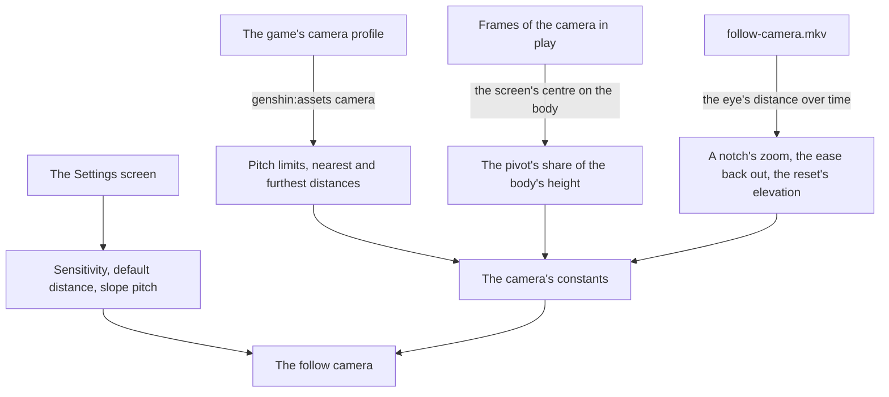

# Follow camera

The [follow camera](../../specs/genshin/follow-camera/design.md) stands behind the character today: it orbits a pivot at a share of the body's height, is pulled in by the ground, the water and the landmarks, and in photo mode orbits the held body. Its wheel's nearest and furthest distances are the game's own, read from the game's camera profile, while its pitch limits are provisional at 80 degrees up and 70 down until a recording reads the PC client's stop; its field of view is the game's too, the 45 degrees the game sets its world camera to at run time, as a published field-of-view tool reads it, since the profile holds none; and its pivot is read off recordings. How far a notch moves the eye, how fast it eases back out and how far a reset tilts it are still provisional, and the settings the game offers for the camera are not there yet.

## Decisions

- **What the camera profile cannot say is read off one recording.** The profile holds the zoom's input ratio and the radius's lerp-back ratios, but the Zoom module eases a velocity and what the game computes from each ratio lives in code no dump holds. So the wheel's step and the eye's return are measured on `follow-camera.mkv`, the clip the roadmap owes, as the eye's distance over time. Its reset before a flat horizon tells whether the game levels the camera or tilts it down by the default elevation the profile's first words hold, and its tilt from level to straight down whether the arm lengthens as the profile's radius added at the steepest elevation says.
- **The game's settings for this camera.** Its horizontal and vertical sensitivity, its default distance between 4.5 and 6.0, which the camera returns to after a zoom, after combat and after a teleport, and whether its pitch follows the slope as the character climbs or descends, are read from the [menu screens](../genshin-menu-settings/design.md)' Settings, each with the game's range and default. The default distance is metres of the arm: its span is the profile's setting adjustment and its top the profile's furthest radius on foot.
- **The slope pitch settles on the slope at a provisional rate.** With the slope pitch on, the pitch closes the gap to the slope the ground rises or falls at along the eye's side, a share of it each second (`FOLLOW_CAMERA_SLOPE_PITCH_SPEED`), so the eye keeps its height above the slope as the character climbs or descends, as the wiki's Settings page describes the Y-axis reset. The slope pitch is off until a player turns it on, since the wiki gives no default for it. The rate is provisional until a recording of a climb reads how fast the game's camera settles.
- **Photo mode's range is the game's, solved off recordings.** Photo mode moves its camera round the character by the game's two sliders, one horizontal and one vertical, and its zoom, within the game's range. Until a recording solves that range, photo mode shares the follow camera's range, a provisional call the [as-built page](../../specs/genshin/follow-camera/design.md) records.

## How it works

## Scope and order

**Today:** the field of view, the pitch limits and the wheel's range are the game's, and the pivot is measured; a notch's zoom and the ease back out are provisional, the reset levels the camera, its sensitivity, default distance and slope pitch are read from the stored Settings, at provisional defaults until the Controls tab's export gives the game's, and photo mode orbits the held character within the follow camera's range, not the game's.

**This adds, in order:**

1. **The recording.** `follow-camera.mkv` on the roadmap's References sought list, each of the four readings above kept in the character's reference and written over its provisional constant. Photo mode's sliders and zoom at their ends, `photo-mode-range.mkv`, solve its range.
2. **The defaults.** The settings' rows and the slope's pitch are built on the Settings screen's Controls tab by the [menu screens](../genshin-menu-settings/design.md). What waits is the defaults the camera starts at, read off that tab's export, which replaces `FOLLOW_CAMERA_DEFAULT_SETTINGS`' provisional values (3.2).

The camera is approved by its own measure: at each reading of the recording, the eye's distance and its ease match the camera's within the reading's noise.

## What this does not propose

- **The cameras of combat**: the automatic pans its setting turns on, the aimed shot's camera, the shake of a hit and the pull the profile's combat fields hold. Each comes with combat.
- **The boat's camera and the cameras of cutscenes**, which come with what they film.
- **Photo mode's own screen**: its blur, the character's expressions and poses, and its shutter. Photo mode here is the camera alone.

## Key files

| File                                                                        | Role after the change                                                                                                         |
| :-------------------------------------------------------------------------- | :---------------------------------------------------------------------------------------------------------------------------- |
| `packages/genshin-engine/src/camera/constants.ts`                           | The notch's zoom and the ease, read off the recording                                                                         |
| `packages/genshin-engine/src/camera/createFollowCamera.ts`                  | Reads the settings' sensitivity, distance and slope pitch, settles the pitch on the slope, and resets to the game's elevation |
| `packages/genshin-world/src/components/World/Character/Camera.reference.ts` | Each reading of the recording                                                                                                 |

## Sources

- [Settings](https://genshin-impact.fandom.com/wiki/Settings), Genshin Impact Wiki: the camera's horizontal and vertical sensitivity, each 1 to 5, and its default distance, 4.5 to 6.0, which a zoom, combat or a teleport resets; its pitch can follow slopes.
- [Photo Mode](https://genshin-impact.fandom.com/wiki/Photo_Mode), Genshin Impact Wiki: photo mode's camera moved round the character by sliders, one horizontal and one vertical, and a zoom.
- [WorldReverse](https://github.com/fengjixuchui/WorldReverse/tree/main/Assets/DummyScripts/Assembly-CSharp), fengjixuchui: the camera's modules as a 2022 build declared them, its Zoom module easing a velocity toward the wheel's target.

## Reference

- `follow-camera.mkv` — standing on flat open ground facing a flat horizon such as the sea, the camera reset with the middle mouse button and held still two seconds, then the wheel turned in one notch at a time to its nearest and out one notch at a time to its furthest, half a second between notches, then the camera tilted slowly from level to straight down and back, then the character walked backward into a wall until the camera is pulled in and walked away from it, 30 seconds at most, at 60 frames a second. The reset's elevation is read off the horizon's row, a notch's zoom, whether the arm lengthens as the camera looks down and the ease back out off the eye's distance over time ([follow camera](design.md)); published clips show the wheel's range but never a notch at a time. On the wiki and YouTube, none found (searched 2026-10-11).
- `photo-mode-range.mkv` — photo mode opened from the Paimon menu over a spot the follow camera has just framed at its default, its horizontal and vertical sliders each moved to both ends and its zoom to its nearest and furthest, each end held a second, 30 seconds at most; photo mode's range is solved off it ([follow camera](design.md)). On the wiki and YouTube, none found (searched 2026-10-11).
