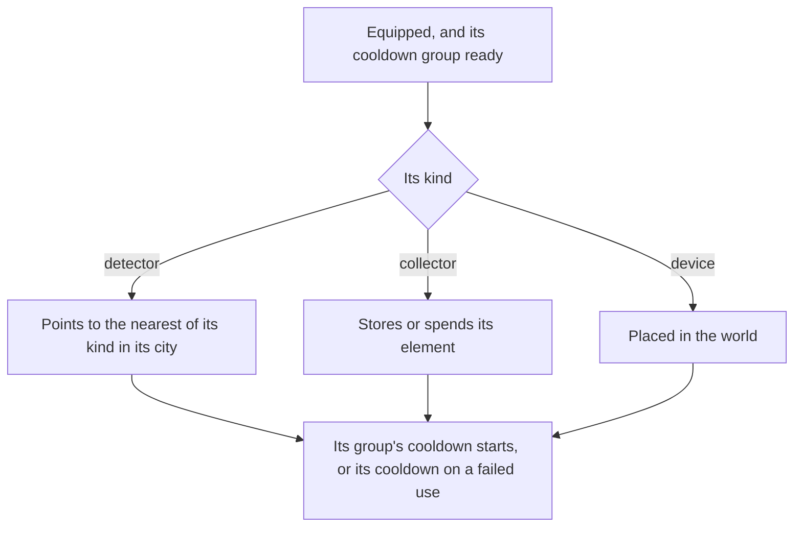

# Gadgets

Gadgets are the game's tools: the Wind Catcher, the Treasure Compasses and Oculus Resonance Stones that find chests and Oculi, the Portable Waypoint, the Kamera, the Parametric Transformer and many more. The bag already files them under their own tab ([inventory](../../specs/genshin/inventory/design.md)), and the controls already bind `Z` to the one equipped ([controls](../../specs/genshin/controls/design.md)). Most find or act on what the world spawns, so this page waits on the [spawned places](../genshin-spawned-places/design.md) and the [crafting](../archive/2026-10-18-genshin-crafting/design.md) bench most are made at. The [gadgets](../../specs/genshin/gadgets/design.md) page holds their data and cooldowns; what remains is below.

## Decisions

- **A gadget's kind is the game's own.** `BinOutput/Widget/ConfigWidget.json` names each gadget's kind, which the built data reads as the four kinds of the [gadgets](../../specs/genshin/gadgets/design.md) page. Each kind is one small module. The config's other widgets wait on the pages that name them, as the built page lists.
- **A detector points to what the config spawns.** A Treasure Compass (`ConfigWidgetClientDetector`) spawns a treasure box of its city, and the Seelie detector (`ConfigWidgetTreasureMapDetector`) a Seelie crystal. No widget of the config spawns an Oculus. The Oculus Resonance Stone is a `ConfigWidgetOneoffGatherPointDetector` whose `gatherPointType` names a row of `GatherExcelConfigData`, whose item is the Oculus (Anemoculus in Mondstadt), so its target is read from that other table; which option is taken is not yet decided, and its detector is not built until it is.
- **A compass works in its city's region.** The config's compass names its city (`allowCityId`): city 1, city 2 and city 3 are Mondstadt, Liyue and Inazuma, as `CityIdRegionMap` names them. The scripts builder maps each compass's city to its region, which the gadget row carries, and a compass points into that region's chest slice. All three slices are published, so no area is outlined.
- **A Seelie detector points into the region the player stands in.** The Seelie detector (`ConfigWidgetTreasureMapDetector`) names no city, so its region is the one the player stands in when it is used. `findSeelieDetectorTarget` gives the nearest Seelie of that region's puzzle places (`PuzzleKind.Seelie`) that is not settled. Not built: the lookup of the region the player stands in, and the pointer the HUD draws toward the target.
- **Equipped on Z, four on the quick swap.** One gadget is equipped to the quick-use slot and used with `Z`. Holding it opens the quick swap, which holds up to four gadgets chosen in the bag. Only a gadget the config marks equipable can be equipped.
- **A tap uses, a hold opens.** `Z` held under `QUICK_SWAP_HOLD_SECONDS` uses the equipped gadget when it is released, so a hold that opens the quick swap uses nothing. The hold is provisional at 0.3 seconds: the wiki's Gadget page, read through its wikitext API, gives no length and says only to hold `[Z]` in the Main Menu, so the attack's charged hold, the held key the code already uses, stands in until a recording measures it. The quick swap's panel is not built, its look having no reference yet.
- **Where a gadget may be used is the game's.** `WidgetUseableExcelConfigData` says where each may not be used: in another player's world, which waits on [co-op](../../deferred/genshin/co-op/design.md) being deferred, and in a domain's type or scene, which the [domains](../genshin-domains/design.md) page supplies. The open world refuses none, so this check is not yet built.
- **Made from instructions.** Most are crafted at the bench or forged once their instructions or diagram are used, which reputation and offerings give; a few come from quests and are kept.
- **A gadget is a bag item of the widget material type.** Each of the slice's gadgets (the `gadgets/gadgets` record, about a dozen) has a `MaterialExcelConfigData` row of type `MATERIAL_WIDGET`, so the bag holds it as any material, filed under `ItemCategory.Gadget`, and `writeItems` writes its row beside the drops' and the forge's items.
- **The equipped gadget is the bag's.** The bag's save holds the gadget equipped to the quick-use slot as `equippedGadgetItemId`, the gadget's item id, optional, so a bag saved before a gadget could be equipped holds none and no backfill is owed. The quick swap is not saved.
- **The bag's quick-use action is provisional in place.** A gadget the game marks equipable shows the game's "Quick-Use Gadget" (`UI_BEYOND_HALL_WIDGET_USE_BUTTON_SET`) under its detail panel, and equipping it adds nothing else. The controller recording shows the equipped gadget's action at the bottom bar's X slot as "Remove", which the game words as "Gadget Unequipped"; the slot is the only reference for a gadget's action, so the button's place is estimated from it until the keyboard's bag is recorded.
- **The equipped gadget shows at the keys' bottom right, provisionally.** Its disc stands above the burst's with its cooldown counted on it as the skill's is, and its Z key cap under it, placed from the keyboard world HUD still (`hud-world-keys.png` in the parity references) and bare, since no gadget's icon is read yet. Only the keys layout draws it: the touch layout's place is not recorded. The number the still shows under the disc is not read.
- **A compass points to the nearest unopened box of its region.** `findTreasureCompassTarget` takes the chests of the region its city joins and gives the unopened one nearest the player on the ground, or none once every one is opened. Not built: the pointer the HUD draws toward the target, its look having no reference yet.

## How it works

## Scope and order

**This still adds, in order:**

1. **Gadgets in the bag.**
   - `MaterialType` already holds `Widget = "MATERIAL_WIDGET"`, and `MaterialTypeItemCategoryMap` already maps it to `ItemCategory.Gadget`; nothing more is added to either.
   - `buildItems` (`scripts/src/services/genshinAssets/items/buildItems.ts`) adds every id of `readGadgetRows()`'s slice to the item ids it builds; rerunning `genshin:assets items` then `genshin:text names` republishes the materials and their names.
   - Test: every gadget the slice holds comes out of `buildItems` with `materialType` `MATERIAL_WIDGET`.
2. **The quick-use slot.** The equipped gadget and its use on `Z`, with the usable-here check once domains stand: `Inventory` gains the equipped gadget, the bag's screen equips one from its tab, and the HUD shows it with its cooldown. It touches the bag's screen, so the fleet offers it only while no inventory unit holds that folder.
3. **Detectors**, the Treasure Compass to treasure boxes once a compass's city joins a region's chest slice, then the Oculus Resonance Stone once its target is settled.
4. **Collectors and placed devices**, one kind at a time.
5. **The quick swap.**

## Data and measures

- **Read from the game's data:** `ConfigWidget.json`, read into the built slice. `WidgetUseableExcelConfigData` and `WidgetExcelConfigData` are fetched into the dump, and neither is read yet: the first waits on domains and co-op, the second on the bag's items.
- **Measured:** each gadget's effect where its kind's config leaves it open, off a recording, and the cooldown counting on through a menu, which is owed a recording ([References sought](../genshin-roadmap/tasks.md#references-sought)).

## Key files

| File                                                               | Role after the change                               |
| :----------------------------------------------------------------- | :-------------------------------------------------- |
| `packages/genshin-engine/src/input/InputActionBindingMap.ts`       | `Z` and the quick swap's hold                       |
| `packages/genshin-world/src/models/inventory/Inventory.ts`         | Gains the equipped gadget and the quick swap        |
| `packages/genshin-world/src/components/Inventory/Screen/Index.vue` | Equips a gadget from its tab                        |
| `packages/genshin-world/src/components/Hud/Screen/Index.vue`       | Shows the equipped gadget and its cooldown          |
| `packages/genshin-world/src/components/Hud/Skills/Index.vue`       | Draws the gadget's disc, its cooldown and its Z key |

## Sources

- [Gadget](https://genshin-impact.fandom.com/wiki/Gadget), Genshin Impact Wiki: gadgets as the bag's sixth tab, the quick-use slot, cooldowns that run while paused, gadgets crafted or forged from their instructions, and the quick swap of four. Its page refuses scripted fetches, so its wikitext is read through the API (`api.php?action=parse&page=Gadget&prop=wikitext`).
- [AnimeGameData](https://github.com/DimbreathBot/AnimeGameData), the community's per-patch dump: the widget config with each gadget's kind, cooldowns and ranges, and the widget tables.

## Reference

- `gadget-cooldown-pause.mkv` — a Treasure Compass or another gadget used, then the menu held open until its cooldown would have ended and closed, and the gadget used again at once, 45 seconds at most; it shows whether the cooldown counts on through the menu, as the wiki states and the [gadgets](../../specs/genshin/gadgets/design.md) page keeps it. On the wiki and YouTube, none found (searched 2026-10-11).
