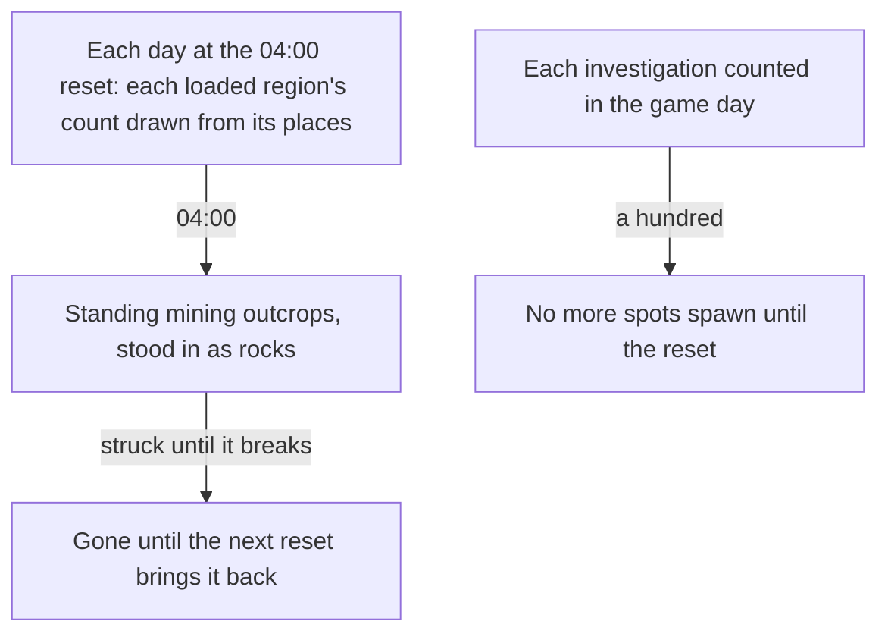

# Gathering

The [gathering](../../specs/genshin/gathering/design.md) page holds the plants, the specialties and the ores, struck until they break. The [mining outcrops](../../specs/genshin/mining-outcrops/design.md) and [investigation](../../specs/genshin/investigation/design.md) pages hold the outcrops' opening, respawn and the investigation cap as rules. This proposal keeps the mining outcrops' places and draw, and the investigation spots, each of which waits on a measure or on a system the points do not have yet.

## Decisions

- **Mining outcrops come daily, and a mined one comes back at the next draw.** From Adventure Rank 30, a region's mining outcrops of Magical Crystal Chunks stand at places drawn each day at the 04:00 reset in UTC+8, the shared daily reset. The wiki gives 06:00 for the respawn; the world takes the 04:00 reset as its one daily reset, provisional until a recording. The day's unmined outcrops are gone with the next draw, and a mined one stays gone until the next reset, drawn again only if that day's draw takes its place. The alternative, a draw on each visit, is rejected: a player could leave and return to reroll the day's places, so the set is fixed once for the day. Reputation's mining outcrop search marks them ([reputation](../genshin-reputation/design.md)).
- **Each region draws its own count, and the wiki gives three.** A region's daily draw takes Mondstadt's 6, Liyue's 10 or Inazuma's 8, the counts the [Mining Outcrop](https://genshin-impact.fandom.com/wiki/Mining_Outcrop) page gives. The other five regions give no count there, so they draw Mondstadt's 6 as a provisional default, and a region with fewer places than its count draws them all. An outcrop is one Magical Crystal Chunk place: the wiki's cluster of two or three of those with one other ore is not modelled, since the map's points carry one ore a place.
- **A mining outcrop breaks as an ore and drops one to three.** It is struck through the ore path the gathering ores use: a claymore's melee hit, or a blunt hit, adds poise against Magical Crystal Chunk's requirement, and a break drops `rollOreDropCount`. The wiki gives one to three for Magical Crystal Chunks, Iron Chunks, White Iron Chunks and Crystal Chunks alike, and the dump's gather rows give no counts, so the range is the wiki's and its spread is the gathering ore rule's, both provisional. A Geo hit breaks an outcrop only where its kit record is blunt or a reaction lands with poise, which a recording with a Geo character decides.
- **A mining outcrop is stood in as a rock.** Until the game's rock kit is read, each standing outcrop is a blue dodecahedron at its place, drawn by the stand-in component the Oculi share. A region's places are read when the world loads that region, and a region no publish wrote draws none.
- **Daily points come back at the shared daily reset.** The prompt settles that each point's respawn runs on the shared reset clock, so a daily gathering point, a cooking ingredient or an Iron Chunk, comes back at the first 04:00 reset after its pick, read in one call site (`computeGatheringRespawn`) that a change of the reset clock repoints. The [gathering](../../specs/genshin/gathering/design.md) page had the wiki's 0:00 midnight there, and the wiki's Reset page still reads 0:00 for these spawns, so the recording the gathering page owes decides which the game keeps.
- **Investigation spots.** A spot that sparkles gives a few artifacts, ingredients, ores or Mora once investigated, and its rewards come from the wiki's Investigation table, not from the game's local data. A player may investigate a hundred spots a day, after which no more spawn, and the Mora spots come back as their refresh says. The day is the game day, which starts at the 04:00 reset in UTC+8, so the count that the cap compares is kept from that reset. A rolling 24-hour window is rejected: the game counts its day from the reset, so a window would give a different cap from the one the player sees.
- **The daily cap keeps the day's count and key, not each investigation's instant.** A day's investigations are a count and a key, the moment its first investigation was made, shaped like the commissions' day: the save's `investigationDay` slice holds `{ count, dayKey }`, with `dayKey` an ISO instant or an empty string before the day's first investigation, and the schema caps `count` at a hundred. The day is current while its key is at or after the 04:00 reset, so a key before that reset starts again at none. A save that predates the slice is backfilled to `{ count: 0, dayKey: "" }`, the shape the backfill writes, since the schema has no default.
- **Blunt is one game concept, read off the hit by one rule in the kit, not by the kit's blunt flag.** `checkIsBluntHit` is the rule that Shatter (`strikeEnemy`), the Rock seal (`checkIsSealFreed`, which reads the resolved element for Pyro too) and the ores all call. A claymore's normal or charged attack, a plunge by a sword, claymore or polearm, and Geo damage the hit deals are blunt; Overloaded is blunt as its reaction's hit. Geo is read off the element the hit deals, as `strikeEnemy` deals it, so a Geo Traveler's skill, which takes her wielder's element, is blunt and a Geo character's physical normal attack is not. The wiki's Blunt Attack table, by character and action (`BluntActionMap`, beside the rule in the kit, provisional), overrides these where it names a blunt ability or an exception, and its gaps are listed in that map. The kit's blunt flag is removed from the schema, the generator and the records, so no kit carries it.

## How it works

## Scope and order

**This adds, in order:**

1. **Mining outcrops' places and draw**, drawn each day from Adventure Rank 30 at each loaded region's places, with the strike that breaks them.
2. **Investigation spots**, their places and rewards, with the daily cap's store counting them.

## Data and measures

- **Placed by the official map:** each outcrop's place is a point of the map's Magical Crystal Chunk label, the one ore the [gathering](../../specs/genshin/gathering/design.md) points leave out, published per region by `genshin:assets mining-outcrops`. The other ores are placed by the gathering page. Each investigation spot would be a point of the Investigation label, but that label holds no points on the map: its two children, Mysterious Conch and Tumbleweed, are empty in the map's point list read on 2026-10-18, so no spot can be placed from it. The [spawned places](../../specs/genshin/spawned-places/design.md) fit is one similarity over the whole map, so it carries every label's points into the game's coordinates.
- **Read from the game's tables:** the ores' categories of the official map, and the outcrops' item rows of `MaterialExcelConfigData`.
- **Read from the wiki:** the investigation rewards ([Mining Outcrop](https://genshin-impact.fandom.com/wiki/Mining_Outcrop), [Investigation](https://genshin-impact.fandom.com/wiki/Investigation), through the persona's wiki reader).

## Key files

| File                                                                             | Role after the change                                                |
| :------------------------------------------------------------------------------- | :------------------------------------------------------------------- |
| `packages/genshin-world/src/composables/useMiningOutcrops.ts`                    | Each loaded region's draw, the standing outcrops and the strike      |
| `packages/genshin-world/src/services/gathering/computeDailyMiningOutcrops.ts`    | A region's count drawn from its places, none below Adventure Rank 30 |
| `packages/genshin-world/src/services/gathering/computeStandingMiningOutcrops.ts` | The places standing at an instant: the day's draw, not mined since   |
| `packages/genshin-world/src/components/World/StandIns/Index.vue`                 | The stand-in at each standing place, shared with the Oculi           |
| `packages/genshin-world/src/services/time/computeNextDailyReset.ts`              | The respawn: the next 04:00 reset after the mining                   |
| `packages/genshin-world/src/services/leyLine/checkIsMiningOutcropStanding.ts`    | Whether a mined or unmined outcrop stands at an instant              |

## Sources

- [Mining Outcrop](https://genshin-impact.fandom.com/wiki/Mining_Outcrop), Genshin Impact Wiki: the daily places beside the ley line outcrops, and the rank and respawn the [mining outcrops](../../specs/genshin/mining-outcrops/design.md) page cites.
- [Investigation](https://genshin-impact.fandom.com/wiki/Investigation), Genshin Impact Wiki: the daily cap, which the [investigation](../../specs/genshin/investigation/design.md) page builds, and the spots this proposal places.
- [Daily Reset](https://genshin-impact.fandom.com/wiki/Daily_Reset), Genshin Impact Wiki: what comes back at the daily reset and around it.

## Reference

- `gather-pick.mkv` — a cooking ingredient and a local specialty picked with F from standing in reach, the point gone from the screen after each pick and the bag's count rising by one, 15 seconds at most; whether one press takes a point and whether a picked point is drawn again are read from it, and the respawns the wiki gives (46 hours, and the midnight after for an ingredient) are not checkable in one clip, so they wait on a longer sitting. On the wiki and YouTube, none found (searched 2026-10-11).
