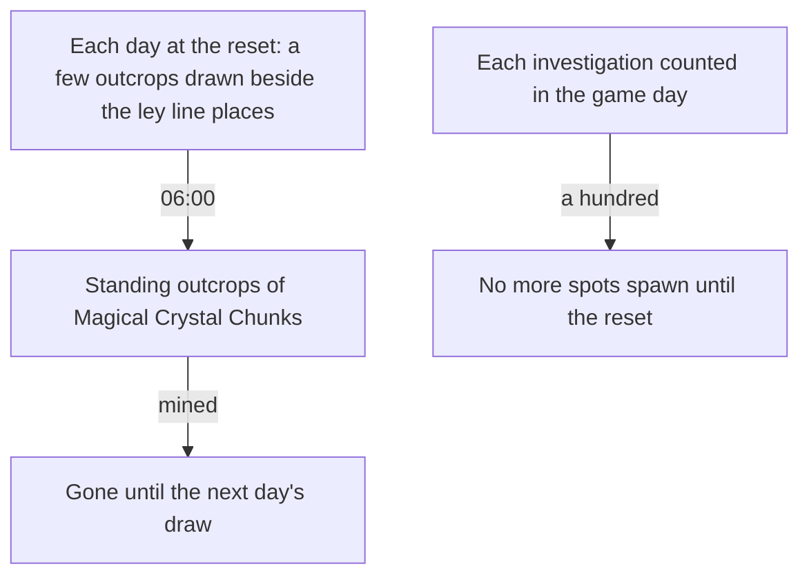

# Gathering

The [gathering](../../specs/genshin/gathering/design.md) page holds the plants, the specialties and the ores, struck until they break. The [mining outcrops](../../specs/genshin/mining-outcrops/design.md) and [investigation](../../specs/genshin/investigation/design.md) pages hold the outcrops' opening, respawn and the investigation cap as rules. This proposal keeps the mining outcrops' places and draw, and the investigation spots, each of which waits on a measure or on a system the points do not have yet.

## Decisions

- **Mining outcrops come daily, and a mined one comes back at the next draw.** From Adventure Rank 30, a region's mining outcrops of Magical Crystal Chunks stand at a few places drawn each day beside the ley line outcrops' places, and come at 06:00 in UTC+8, two hours after the daily reset. The day's unmined outcrops are gone with the next day. The alternative, a draw on each visit, is rejected: a player could leave and return to reroll the day's places, so the set is fixed once for the day. Reputation's mining outcrop search marks them ([reputation](../genshin-reputation/design.md)).
- **Daily points come back at the shared daily reset.** The prompt settles that each point's respawn runs on the shared reset clock, so a daily gathering point, a cooking ingredient or an Iron Chunk, comes back at the first 04:00 reset after its pick, read in one call site (`computeGatheringRespawn`) that a change of the reset clock repoints. The [gathering](../../specs/genshin/gathering/design.md) page had the wiki's 0:00 midnight there, and the wiki's Reset page still reads 0:00 for these spawns, so the recording the gathering page owes decides which the game keeps.
- **Investigation spots.** A spot that sparkles gives a few artifacts, ingredients, ores or Mora once investigated, and its rewards come from the wiki's Investigation table, not from the game's local data. A player may investigate a hundred spots a day, after which no more spawn, and the Mora spots come back as their refresh says. The day is the game day, which starts at the 04:00 reset in UTC+8, so the count that the cap compares is kept from that reset. A rolling 24-hour window is rejected: the game counts its day from the reset, so a window would give a different cap from the one the player sees.

## How it works

## Scope and order

**This adds, in order:**

1. **Mining outcrops' places and draw**, drawn each day from Adventure Rank 30, once the ley line places are placed.
2. **Investigation spots**, their places and rewards, with the daily cap's store counting them.

## Data and measures

- **Placed by the official map:** each outcrop's place is a point of the map's Magical Crystal Chunk label, the one ore the [gathering](../../specs/genshin/gathering/design.md) points leave out, published per region by `genshin:assets mining-outcrops`. The other ores are placed by the gathering page. Each investigation spot would be a point of the Investigation label, but that label holds no points on the map: its two children, Mysterious Conch and Tumbleweed, are empty in the map's point list read on 2026-10-18, so no spot can be placed from it. The [spawned places](../../specs/genshin/spawned-places/design.md) fit is one similarity over the whole map, so it carries every label's points into the game's coordinates.
- **Read from the game's tables:** the ores' categories of the official map, and the outcrops' item rows of `MaterialExcelConfigData`.
- **Read from the wiki:** the investigation rewards ([Mining Outcrop](https://genshin-impact.fandom.com/wiki/Mining_Outcrop), [Investigation](https://genshin-impact.fandom.com/wiki/Investigation), through the persona's wiki reader).

## Key files

| File                                                                     | Role after the change                                        |
| :----------------------------------------------------------------------- | :----------------------------------------------------------- |
| `packages/genshin-world/src/services/leyLine/computeDailyOutcrops.ts`    | The daily draw a mining outcrop's place reuses               |
| `packages/genshin-world/src/services/leyLine/computeNextOutcropPlace.ts` | Where an outcrop moves once mined, shared with the ley lines |

## Sources

- [Mining Outcrop](https://genshin-impact.fandom.com/wiki/Mining_Outcrop), Genshin Impact Wiki: the daily places beside the ley line outcrops, and the rank and respawn the [mining outcrops](../../specs/genshin/mining-outcrops/design.md) page cites.
- [Investigation](https://genshin-impact.fandom.com/wiki/Investigation), Genshin Impact Wiki: the daily cap, which the [investigation](../../specs/genshin/investigation/design.md) page builds, and the spots this proposal places.
- [Daily Reset](https://genshin-impact.fandom.com/wiki/Daily_Reset), Genshin Impact Wiki: what comes back at the daily reset and around it.

## Reference

- `gather-pick.mkv` — a cooking ingredient and a local specialty picked with F from standing in reach, the point gone from the screen after each pick and the bag's count rising by one, 15 seconds at most; whether one press takes a point and whether a picked point is drawn again are read from it, and the respawns the wiki gives (46 hours, and the midnight after for an ingredient) are not checkable in one clip, so they wait on a longer sitting. On the wiki and YouTube, none found (searched 2026-10-11).
