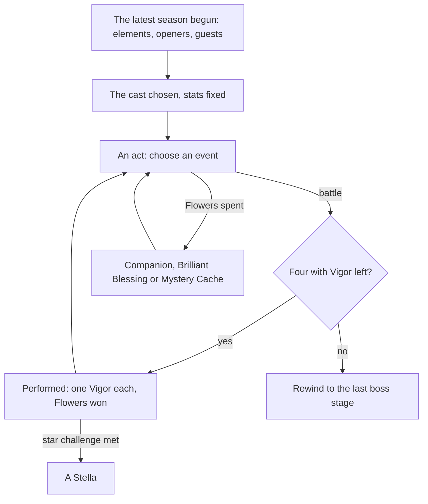

# Imaginarium Theater

The Imaginarium Theater is the game's roguelike combat challenge, held in the Mondstadt Library's Theater Lobby. Each season names three elements and a few characters; a player brings a cast of their own of those elements and plays through acts, each character able to perform twice, choosing events between battles that add characters or blessings. It is fought with the [character kits](../../specs/genshin/kits/README.md) and opens at [Adventure Rank](../archive/2026-10-22-genshin-adventure-rank/design.md) 35 with its quest, so this page waits on both.

The [as-built page](../../specs/genshin/imaginarium-theater/design.md) holds the season schedule, the difficulties and their level floors, Vigor, Blessing Level, the opening character's bonus and the Stella rewards. What stays here is the cast's makeup, the stage, the acts and events, and the screen.

## Decisions

- **The stages' enemies come from the wiki's season pages, joined to the game's monsters by exact name, codex entry and curve.** Each season's page (`Imaginarium Theater/Seasons/<day the season begins>`, one per season the wiki has written up, listed by the wiki's own `allpages` query and cached through `fetchEnemyWikiPages`) gives every battle's domain enemies block: each variant's enemy names, and its Easy Mode level. Only the Easy variants are stages here, the lowest difficulty: a variant the wiki gives no Easy level (the Defense Sequence and High-Pressure Defense battles) is not an Easy stage and is left out, 657 of the 957 variants. A name resolves to a codex entry, the describe id the enemies builder reads for each kind's describe row, when every monster whose English name (`readMonsterNames`, read by text id from the dump's English text map) is that name shares one describe id. A name whose monsters span several entries, or that no monster holds, is refused with its count of entries (`entries`), never guessed. The entry's canonical monster is the one its monster codex row names, filed under the same entry (`findCanonicalMonsterRow`); an entry whose codex names no such row, or whose monster has no base health, attack and defense curve, is refused (`codex`). The enemy's stats at the stage's Easy level are its monster row's base health, attack and defense times the multipliers its grow curves give at that level, read from the dump's monster curve table (`toImaginariumStageEnemy`), as the game computes them. The record is `imaginarium/stages`, one entry per Easy stage with its season, act, battle, variant, Easy level, its enemies (monster id, describe id, health, attack and defense) and its refusals. A stage with no refusals is complete.
- **A Companion event draws its offers at runtime from the run's eligible characters of its pool's element.** The wiki's Events page gives the three Companion events' pools: Select offers two characters of an element, Random two characters of any element, and Invite six of any element, for 80, 80 and 100 Fantasia Flowers. The dump's two Companion effect rows are `REFRESH_ADD_AVATAR_CARD_EVENT_CASE`, effect 1 `1,2,1,80` and effect 17 `1,3,1,80`, both 80 flowers, so Select's 80 agrees with the dump, and the element tags that name the pools are the Open item (b)'s chain. The dump holds no row for Random or for Invite: their prices are the wiki's, and Invite's 100 has no row in the dump. The draw is `drawImaginariumCompanionOffers`: the characters the season admits at the difficulty (`checkIsImaginariumCastEligible`) of the pool's element, or of any element when it names none, each given a draw from the world's one seeded random source (`createSeededRandom`), the first `offerCount` by draw taken. The price is `spendImaginariumCount`'s. The draw takes the pool's element as its input, so the element of each Companion event is read from the event's own pool row when a run dispatches it, which is not built.
- **The cast by the season's rules.** Four members perform each stage. The Alternate Cast is the player's own characters of the season's three elements, plus its four special guests whatever their element, at least level 60 for the lower difficulties and 70 above, as many as the difficulty asks. The opening characters are the player's own or their trial versions. A cast's stats are fixed once chosen: each member carries its priced Max HP and its Burst's energy cost, and every member starts each stage at full health and energy, a health share of one over its Max HP and its energy at its Burst's cost (`performImaginariumStage`).
- **Events between battles.** A Battle Event gives Fantasia Flowers and the choice of one of two Alternate Cast members to join the Principal Cast. The other events are paid in Fantasia Flowers: a Companion event invites a character, a Brilliant Blessing grants a reaction's buff, and a Mystery Cache grants an effect, some for the worse. Events can be rerolled, and a run can be rewound to the end of its last boss stage a limited number of times.
- **Vigor comes back only from a Mystery Cache's option.** A character with none left cannot perform again this run.
- **Stella for each act's star challenge.** An act's star challenge, enemies defeated in time, a number defeated, or a monolith kept above its health, gives one Stella, and none when it is not met (wiki, Stella). `gainImaginariumStella` answers it. The run's Stellas are counted and their rewards given as the built rule counts them.
- **Five difficulties**, each with its acts and cast, from the season's tables. The acts are the dump's `actCount` (`GOMPDDJNDAE`, see the difficulty fields below), and the cast's count is read from `alternateCastMinimum` and `alternateCastExtra`, also below. The five levels are read already.
- **A season's cast is the role combat avatar table's.** `RoleCombatAvatarConfigExcelConfigData`, joined to a schedule row by its `avatarConfigId`, holds each season's three elements, its six opening characters and its four special guests, under the dump's keys at 7.1, named by what they hold: `elementCodes` is `FMNCKJDCADH` (three codes, then a trailing 0), `openingCharacterIds` is `MFNFDFPOAMC` (the openers' avatar ids) and `specialGuestIds` is `FKFHFHFGMEM` (the guests' avatar ids). The wiki's elements, openers and guests match these in every season the schedule holds, the guests by name. The codes read 2 Pyro, 3 Hydro, 4 Dendro, 5 Electro, 6 Cryo, 7 Anemo and 8 Geo, as `ElementCodeElementMap` holds them. The writer keeps the check that each season's openers hold exactly its three elements (`checkIsOpeningElementsMatched`), so a renamed key or a shifted code fails the run rather than writing a wrong cast. Its six trial ids (`openingTrialIds`, `GCLLBFHCLFK`, the trial versions of the openers) are read from the trial avatar table as the season's `openingTrials`, each giving its opener's character and level; the writer keeps the check that they are the openers (`checkIsOpeningTrialsMatched`).
- **The cast's floor is the difficulty's.** A character joins the Alternate Cast when its element is one of the season's three or it is one of the season's special guests, whatever its element, and its level is at least the difficulty's level floor, which the difficulty slice already holds.
- **What this leaves out.** The Supporting Cast, characters lent by friends, needs other players and is left with [co-op](../../deferred/genshin/co-op/design.md).

- **Vigor and performers from the wiki, provisional.** Four stage members perform each stage, every stage costs each performer one of its two Vigor, and Vigor is restored only by a Mystery Cache option (wiki, [Imaginarium Theater](https://genshin-impact.fandom.com/wiki/Imaginarium_Theater), Cast). The constants are `IMAGINARIUM_PERFORMER_COUNT` and `IMAGINARIUM_VIGOR`.
- **Fantasia Flowers from the events page, provisional.** The Battle Event gives 90 (Battle: Normal; Elite Assault and High-Pressure Defense 110, the Climactic Showdown 125). A Companion event costs 80 (Companion: Select and Random; Companion: Invite costs 100). Brilliant Blessings cost 60 and the rare Mystery Cache 40 (wiki, [Imaginarium Theater/Events](https://genshin-impact.fandom.com/wiki/Imaginarium_Theater/Events), List of Events). Only the Battle Event's 90 and Companion's 80 are built; the others wait on their events. `IMAGINARIUM_BATTLE_FLOWERS` and `IMAGINARIUM_COMPANION_FLOWER_PRICE` hold them.
- **A Battle Event offers two Alternate Cast members.** The two are the lowest-keyed of one seeded roll each over the Alternate Cast, so no member is offered twice.
- **A Mystery Cache's full restore, provisional.** The option "Surprise: Explosive Excitement" fully restores one character whose Vigor is not full (wiki, Mystery Cache). `restoreImaginariumVigor` gives that restore; the options that restore one Vigor are not built.
- **Every counted spend goes through one primitive.** A paid event and a rewind both spend a count only when it covers the cost, so `spendImaginariumCount` answers both.
- **A stage is fought on the arena's rules.** `fightImaginariumStage` refuses a stage unless four performers each hold Vigor, and a fought stage spends each performer's one Vigor and gives its outcome through `resolveDomainChallenge`, so a stage's clear, time limit and party fall are the domain challenge's. Its enemy waves and time limit are the caller's: the wiki names no stage enemies, so none are read yet, and the kit fight that deals the damage is not built.
- **The rewind's limit is the caller's, open.** The wiki says a rewind may be used "a limited amount of times" without a figure. The run states its rewinds left and each rewind spends one through `spendImaginariumCount`, so the figure is set once it is read from the game. The run's checkpoint, the Principal Cast at the end of its last boss stage, is set by the caller, since the screen that ends a boss stage is not built: `rewindImaginariumRun` returns the run to it, and `startImaginariumStage` leads to that rewind when the cast cannot perform.
- **The difficulty fields, named.** `actCount` (`GOMPDDJNDAE`) is the acts a difficulty runs: 3, 6, 8, 10 and 10 at levels one to five. The wiki names Easy's three acts in 26 of its 29 seasons and Normal's six in 21; Hard, Visionary and Lunar are not labelled per act, so their 8, 10 and 10 are read, not confirmed. `alternateCastMinimum` (`DKAOJONAPHB`) is the Alternate Cast a difficulty needs beyond its six opening characters: 2, 6, 10, 16 and 22, which is the wiki's minimum to start of 8, 12, 16, 22 and 28 less six at every level. `alternateCastExtra` (`ADJGFDEJKFN`) is what a difficulty allows beyond that minimum: 2, 2, 4, 4 and 4, the wiki's maximum of 10, 14, 20, 26 and 32 less its minimum at each level (the dump leaves it out of the first seasons' rows, and the table reader writes it as protobuf's 0 there, so the record holds 0). So a difficulty's cast runs from six plus `alternateCastMinimum` up to that plus `alternateCastExtra`.
- **Rerolls, provisional.** The events page says the player "can reroll the events if they need to" and gives neither a base count nor a price, so a reroll spends one of the run's rerolls (`IMAGINARIUM_REROLL_COST`), and the run starts with the count it is given, which is open. A Mystery Cache's "Surprise: Reroll!" gives two chances (`IMAGINARIUM_REROLL_CHANCES`; wiki, [Imaginarium Theater/Events](https://genshin-impact.fandom.com/wiki/Imaginarium_Theater/Events), Mystery Cache). `rerollImaginariumEvents` spends one and takes the act's fresh set from the caller's draw, and `gainImaginariumRerolls` gives the two chances.

## How it works



## Scope and order

**This adds, in order:**

```text
scripts/src/models/genshinAssets/imaginarium/ExcelRoleCombatAvatarConfigRow.ts
scripts/src/services/genshinAssets/imaginarium/checkIsOpeningElementsMatched.ts
scripts/src/services/genshinAssets/imaginarium/checkIsOpeningTrialsMatched.ts
scripts/src/services/genshinAssets/imaginarium/toImaginariumOpeningTrials.ts
packages/genshin-world/src/services/imaginarium/checkIsImaginariumCastEligible.ts
```

1. **A season's cast.** `RoleCombatAvatarConfigExcelConfigData` is in the 7.1 dump, which the text fetch refreshes whole, so no table list names it. Model its row in `ExcelRoleCombatAvatarConfigRow.ts` under the dump's keys, each named in a comment by what it holds, add `avatarConfigId` to the schedule row, and add `ElementCodeElementMap` (the codes the Decisions read) to `scripts/src/services/genshinAssets/imaginarium/constants.ts`. `toImaginariumSeason.ts` takes the season's avatar config row as well and adds `elements`, `openingCharacterIds` and `specialGuestIds` to each season of the existing `imaginarium/seasons` record. `buildImaginarium.ts` reads each opener's element through `getCharacterDatas` (`scripts/src/services/genshinAssets/stats/`) and refuses a season whose openers do not hold its three elements, the check `checkIsOpeningElementsMatched` answers. In the world, `models/imaginarium/ImaginariumSeason.ts` gains the three fields in its interface and schema, and a new `services/imaginarium/checkIsImaginariumCastEligible.ts` answers whether a character of an element and a level may join a season's Alternate Cast at a difficulty. Tests: `toImaginariumSeason.test.ts` (the codes `[2, 5, 6, 0]` read Pyro, Electro and Cryo, the trailing 0 dropped), `checkIsOpeningElementsMatched.test.ts` (the openers' elements matching and differing from the season's three) and `checkIsImaginariumCastEligible.test.ts` (a character off the season's elements refused, a special guest of any element taken, a level under the floor refused).
2. **A stage**, at the lowest difficulty, fought with the character kits.
3. **The acts and Battle Events.**
4. **The paid events**, with the Mystery Cache's Vigor.
5. **The rewind, the star challenges and the other difficulties.**
6. **The Theater Lobby**, once the Mondstadt Library's interior stands.

## Data and measures

- **Read from the game's tables:** the rest of the `RoleCombat*` tables, once their fields are named: each difficulty's cast size and acts, the level, buff and reward tables. The schedule and difficulty tables are read already, and the avatar config table's fields for the season's cast are named in the Decisions.
- **Read from the wiki:** what each Mystery Cache and Brilliant Blessing does, where the game's own description is unclear.

## Key files

| File                                                            | Role after the change                               |
| :-------------------------------------------------------------- | :-------------------------------------------------- |
| `packages/genshin-world/src/models/party/Party.ts`              | The Principal Cast's four on each stage             |
| `packages/genshin-world/src/models/character/Character.ts`      | A character's stats as fixed for the run            |
| `packages/genshin-world/src/models/enemy/EnemyCamp.ts`          | A stage's enemies                                   |
| `packages/genshin-world/src/components/World/Session/Index.vue` | Enters the Theater's scene and returns to the world |

## Sources

- [Imaginarium Theater](https://genshin-impact.fandom.com/wiki/Imaginarium_Theater), Genshin Impact Wiki, read through its API's wikitext (`api.php?action=parse&page=Imaginarium_Theater&prop=wikitext`): the cast, the Vigor, the performers, the Blessing Level stats, the opening character's 20% bonus, the Stella and the difficulties' acts and cast counts. The rewind's figure and the reroll count are not on the page.
- [Imaginarium Theater/Events](https://genshin-impact.fandom.com/wiki/Imaginarium_Theater/Events), Genshin Impact Wiki, read the same way: the Fantasia Flower costs of each event, the Mystery Cache options and the rerolls.
- [AnimeGameData](https://github.com/DimbreathBot/AnimeGameData), the community's per-patch dump: the role combat schedule and the tables beside it.

## Open

- [x] **The stage's enemies: a fight rule's pool joins no monster in the dump. Closed as built by the wiki route (the Decisions' stages record).** Task 2.1 needs the monsters a stage fights. The chain is measured as far as the dump goes. A difficulty's level names a fight rule by its `monsterPreviewId` (`RoleCombatLevelExcelConfigData` to `RoleCombatFightRuleExcelConfigData.ruleId`), and the rule names its `poolId` and a weighted `tagList` (`AEBFNBKHBGI`). Each tag resolves to a scene level tag (`LevelTagExcelConfigData`, 342 rows, with `sceneId` and `loadDynamicGroupList`): tag 11 is scene 9's `2_8_BuDing_MDMD`, loading group 199004038, and tag 12 is scene 9's `2_8_BuDing_LYLY`, loading group 199004043. Other tags resolve to a scene tag (`SceneTagConfigData`) or a feature tag (`FeatureTagExcelConfigData`, which holds 22 of the 420 tags the rules name). The group ids name monsters only in the scene's group files, which the dump does not hold. No join from a pool to monsters is settled. The search, in the dump at `{data-root}/genshin-parity/text/`:
  - Every table of `ExcelBinOutput` (2,234 files) for the 142 distinct pool ids, under any field name. `RoleCombatFightRuleExcelConfigData` is the only table keyed by a pool, and `RoleCombatDifficultyExcelConfigData` holds 128 pool ids under `DIKFLAGKNGE` with no monster. Rows that hold a pool-range value and a monster id together (`BlessingScanExcelConfigData`, `InvestigationMonsterConfigData`, the `Hunting*` monster tables, `AnimalCodexExcelConfigData`, a dungeon's `previewMonsterList`) pair a pool-range number with a monster id by value alone: each belongs to another activity's table, and none is keyed by a fight rule's pool.
  - The 30 `RoleCombat*` tables for any monster id (`MonsterExcelConfigData`, 3,408 ids): none.
  - `DungeonLevelEntityConfigData`, whose ids 2001 to 2104 are buff entities, not monster groups.
  - `BinOutput` in both dumps (169 and 131 files) for any monster id: none. Its `Scene` holds `Point`, `SceneNpcBorn` and `WorldArea`, and `{data-root}/genshin-parity/extracted/lua/raw` holds scene 3's blocks only.
  - The asset index (`{data-root}/genshin-parity/asset-index/gi-7.1.0-derived.json`) and the scene group ids (199004038, 199004043, 199004117, 199001026, 610101101) in every text dump: the group ids appear only in `LevelTagExcelConfigData`.
    The probe of the scene group files ran on a copy of the client's Lua block `35323818` (11 MB, under `{data-root}/genshin-parity/game/GenshinImpact_Data/Persistent/AssetBundles/blocks/00`, exported with AnimeStudio into 29,564 objects named by path digest; its answer is `{data-root}/scratch/imaginarium-probe/answer.txt`). It holds the scene scripts of scenes 3, 9, 101 and 103, but none of the Imaginarium's group scripts (`scene9_group199004038`, `scene9_group199004043`, `scene9_group199004117`, `scene9_group199001026` and `scene101_group610101101`), none of the 63 group scripts the level tags load, and none of the 17,201 group names the community index lists. The client ships no group script (`openspec/specs/genshin/game-data-formats/design.md`), so a group's monsters are the server's, and no file the install holds names them. Only that one block was read, and the copy was deleted once answered. Task 2.1 stays blocked, and so do the kit fight and its scenario "A character with no Vigor cannot perform". Closing it needs a decision from the owner: a source that names each group's monsters, or a stage's enemy list from the wiki matched to monster ids by name, which invents a mapping unless the owner accepts that.
  - Closed as built. The route the coordinator accepted reads the game's own monster names and the wiki's enemy names, matched exactly, with no guess. A name resolves to the codex entry its monsters share, and then to the canonical monster row that entry's codex names, with its stats at the stage's Easy level. The published result: 300 Easy stages across 29 seasons (the schedule's three seasons with no page have none). 227 stages resolve every enemy, against 236 on the describe entry alone, and 73 have a refusal. 932 enemy slots resolve to a monster and its stats. 167 are refused, on two reasons. By name, 156 slots over 19 names: 17 that no monster's English name holds, and 2 whose monsters span several describe entries. By codex, 11 slots over 6 names, whose entry's codex names no monster row the game gives base curves to, or names one filed under another entry: the entries are 30801, 40613, 50902, 50903, 50904 and 61701. A monster with no base curve (`29010101`, one archive entry, named by no stage) is not a fightable row either. The lists:
    - No monster holds the name (17): `Annihilation Specialist Mek - Ousia`, `Annihilation Specialist Mek - Pneuma`, `Assault Specialist Mek - Ousia`, `Construction Specialist Mek - Ousia`, `Construction Specialist Mek - Pneuma`, `Geological Survey Mek - Pneuma`, `Geovishap (Electro)`, `Geovishap (Pyro)`, `Icewind Suite: Nemesis of Coppelius`, `Nimble Harvester Mek - Pneuma`, `Primo Geovishap (Electro)`, `Primo Geovishap (Hydro)`, `Primo Geovishap (Pyro)`, `Recon Log Mek - Ousia`, `Recon Log Mek - Pneuma`, `Tenebrous Mimesis - Crackling Axe Mitachurl`, `Tenebrous Mimesis: Tepetlisaurus`.
    - Monsters span several describe entries (2): `Hydro Tulpa` (2 codex entries), `Oprichniki Line Trooper` (2 codex entries).
    - The codex names no fightable monster row (6 names): `Close Combat Storm Landcruiser`, `Emperor of Fire and Iron`, `Maguu Kenki: Galloping Frost`, `Maguu Kenki: Lone Gale`, `Maguu Kenki: Mask of Terror`, `Veteran Arithmetic Enhancer Mek`.
  - The kit fight and the live arena are not built: see Open item (c). The stage's enemies are now the canonical monsters and their stats, so the fight's remaining gap is the enemy kinds (Open item (c)).
- [x] **The Companion's character: the chance-effect chain names an element pool, not a character. Closed as built: the offers are drawn from the eligible characters of the pool's element (the Decisions).** Task 2.3 needs the character a Companion event invites. The chain as far as the dump reads it, with its three examples:
  - Chance 1 (tag 1) gives effect 1, `REFRESH_ADD_AVATAR_CARD_EVENT_CASE`, with params `"1,2,1,80"`. Its first two numbers are avatar tags: tag 1 is typed `ROLE_COMBAT_AVATAR_TAG_TYPE_NOT_SELECTED`, and tag 2 is an element tag, Pyro, by its German text (`RoleCombatAvatarTagExcelConfigData`). The 80 is the price in Fantasia Flowers. The third number reads as a count of cards, which the dump does not name.
  - Chance 113 (tag 16) gives effect 17, params `"1,3,1,80"`: tag 3 is Hydro, at the same price.
  - Chance 3001 (tag 101) gives effect 30012, coins 90: the Battle Event's flowers, the lead the Decisions already use.
    The pool is an element and not-selected filter the dump names, but the character it yields is not in the dump, and the join from an act to its Companion chance is not settled. `NBCAHEEOOGJ` names Blessing builds (`RoleCombatBuildExcelConfigData` ids 100 and 160), not chances. `DBGKBFHEGDK` names a refresh bonus (chance 2 on 27 of the 29 rows at levels two and three and on every row at levels four and five, chance 1 on two rows at levels two and three, absent at level one). `IJOKMELBCOE` holds 128 values from 3001 to 3275, of which seven are chance rows (3001 to 3003 and 3101 to 3104). `MNMCAKOOEKH` holds values from 1001 to 1038, of which 1001 to 1003 are chance rows, and `NKACOEEOIKC` and `DOKNFGFEMGA` name NPCs. No field names chance 1 or 113 on the rows that offer a Companion. The Invitation's price, 100 in the wiki, has no effect row in the dump. The wiki says Select and Random's pool is smaller when an element is lacking, which fits an element pool, but the dump does not state the pool's rule.
  - The season's `GCLLBFHCLFK` is not the Companion's pool. Its six ids are the trial versions of the season's six openers: `TrialAvatarExcelConfigData` maps each `trialAvatarId` to `trialAvatarParamList` (the avatar id, then a level), and for all 30 avatar config rows the six resolve to that row's openers (`MFNFDFPOAMC`). So the openers' trial versions are read as the season's `openingTrials` (the Decisions take them up), and they are no route to the Companion's character.
  - Closed as built. The wiki's season pages name no Companion character, so the join through a named character was never available: the pools are the game's rule, drawn at runtime, and the join is the draw. `drawImaginariumCompanionOffers` draws them from the run's eligible characters of the pool's element, seeded; its tests are `drawImaginariumCompanionOffers.test.ts`, and the costs are `spendImaginariumCount`'s, with Select's 80 from the dump's rows and Random's and Invite's from the wiki.

- [ ] **The kit fight's runtime is headless-ready; its enemy side is blocked on the enemy kinds.** Task 2.5 builds the fight on the engine's kit runtime, one combat runtime and no second damage model. The import graph of `services/kit` reaches no Vue, Pinia, TresJS or DOM package, the `genshin-engine` barrel and `three` load in Node, and all 1,973 tests of the kit's 223 test files pass under vitest's Node environment (9 files hold no test). The driver `useWorldCombat` loads in Node too, and the frame that drives it is TresJS's `@before-loop`, which a headless run replaces with a fixed step. The enemy side: a fight builds each enemy with `createEnemy`, which reads its kind from `enemies/kinds` and throws when the kind is missing, and none of the stage monsters is there. Publishing them through the enemies builder fails: that builder gives every non-boss kind a drop family from its wiki article, and `Treasure Hoarders: Liuliu`'s article has none. Either the enemies builder accepts kinds that have no drop source, or the stage monsters' kinds get their own dataset built from the monster rows and curves, which the record's stats then check. This is the owner's decision.
