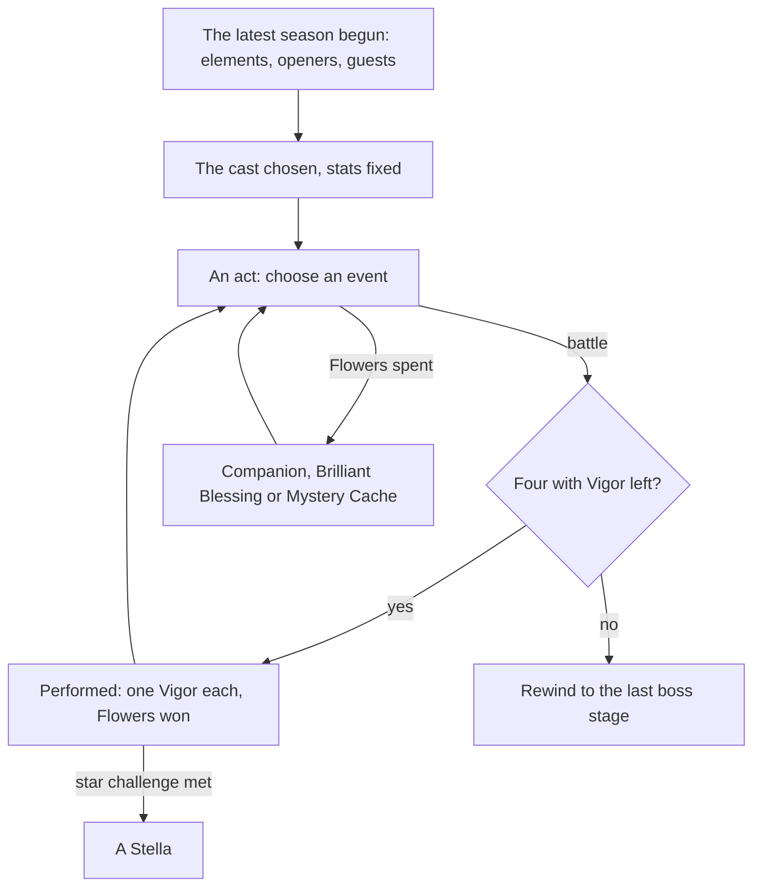

# Imaginarium Theater

The Imaginarium Theater is the game's roguelike combat challenge, held in the Mondstadt Library's Theater Lobby. Each season names three elements and a few characters; a player brings a cast of their own of those elements and plays through acts, each character able to perform twice, choosing events between battles that add characters or blessings. It is fought with the [character kits](../genshin-character-kits/design.md) and opens at [Adventure Rank](../genshin-adventure-rank/design.md) 35 with its quest, so this page waits on both.

The [as-built page](../../specs/genshin/imaginarium-theater/design.md) holds the season schedule, the difficulties and their level floors, Vigor, Blessing Level, the opening character's bonus and the Stella rewards. What stays here is the cast's makeup, the stage, the acts and events, and the screen.

## Decisions

- **The cast by the season's rules.** Four members perform each stage. The Alternate Cast is the player's own characters of the season's three elements, plus its four special guests whatever their element, at least level 60 for the lower difficulties and 70 above, as many as the difficulty asks. The opening characters are the player's own or their trial versions. A cast's stats are fixed once chosen, and every member starts each stage at full health and energy.
- **Events between battles.** A Battle Event gives Fantasia Flowers and the choice of one of two Alternate Cast members to join the Principal Cast. The other events are paid in Fantasia Flowers: a Companion event invites a character, a Brilliant Blessing grants a reaction's buff, and a Mystery Cache grants an effect, some for the worse. Events can be rerolled, and a run can be rewound to the end of its last boss stage a limited number of times.
- **Vigor comes back only from a Mystery Cache's option.** A character with none left cannot perform again this run.
- **Stella for each act's star challenge.** An act's star challenge, enemies defeated in time, a number defeated, or a monolith kept above its health, gives one Stella. The run's Stellas are counted and their rewards given as the built rule counts them.
- **Five difficulties**, each with its acts and cast, from the season's tables. The acts are the dump's `GOMPDDJNDAE` (see the difficulty fields below), and the cast's required count is the caller's, since its field is not settled. The five levels are read already.
- **A season's cast is the role combat avatar table's.** `RoleCombatAvatarConfigExcelConfigData`, joined to a schedule row by its `avatarConfigId`, holds each season's three elements, its six opening characters and its four special guests, under the dump's keys at 7.1: `FMNCKJDCADH` the element codes (three, then a trailing 0), `MFNFDFPOAMC` the openers' avatar ids and `FKFHFHFGMEM` the guests'. The codes read 2 Pyro, 3 Hydro, 4 Dendro, 5 Electro, 6 Cryo, 7 Anemo and 8 Geo, as `ElementCodeElementMap` holds them. The writer keeps the check that each season's openers hold exactly its three elements (`checkIsOpeningElementsMatched`), so a renamed key or a shifted code fails the run rather than writing a wrong cast. The openers' trial versions are not read yet. The 7.1 dry run passed on all 32 seasons.
- **The cast's floor is the difficulty's.** A character joins the Alternate Cast when its element is one of the season's three or it is one of the season's special guests, whatever its element, and its level is at least the difficulty's level floor, which the difficulty slice already holds.
- **What this leaves out.** The Supporting Cast, characters lent by friends, needs other players and is left with [co-op](../../deferred/genshin/co-op/design.md).

- **Vigor and performers from the wiki, provisional.** Four stage members perform each stage, every stage costs each performer one of its two Vigor, and Vigor is restored only by a Mystery Cache option (wiki, [Imaginarium Theater](https://genshin-impact.fandom.com/wiki/Imaginarium_Theater), Cast). The constants are `IMAGINARIUM_PERFORMER_COUNT` and `IMAGINARIUM_VIGOR`.
- **Fantasia Flowers from the events page, provisional.** The Battle Event gives 90 (Battle: Normal; Elite Assault and High-Pressure Defense 110, the Climactic Showdown 125). A Companion event costs 80 (Companion: Select and Random; Companion: Invite costs 100). Brilliant Blessings cost 60 and the rare Mystery Cache 40 (wiki, [Imaginarium Theater/Events](https://genshin-impact.fandom.com/wiki/Imaginarium_Theater/Events), List of Events). Only the Battle Event's 90 and Companion's 80 are built; the others wait on their events. `IMAGINARIUM_BATTLE_FLOWERS` and `IMAGINARIUM_COMPANION_FLOWER_PRICE` hold them.
- **A Battle Event offers two Alternate Cast members.** The two are the lowest-keyed of one seeded roll each over the Alternate Cast, so no member is offered twice.
- **A Mystery Cache's full restore, provisional.** The option "Surprise: Explosive Excitement" fully restores one character whose Vigor is not full (wiki, Mystery Cache). `restoreImaginariumVigor` gives that restore; the options that restore one Vigor are not built.
- **Every counted spend goes through one primitive.** A paid event and a rewind both spend a count only when it covers the cost, so `spendImaginariumCount` answers both.
- **One Stella for a met star challenge.** Each act's Star Challenge gives one Stella when it is met and none when it is not (wiki, Stella). `gainImaginariumStella` answers it, and the reward of each three Stellas is the built rule above.
- **A stage is fought on the arena's rules.** `fightImaginariumStage` refuses a stage unless four performers each hold Vigor, and a fought stage spends each performer's one Vigor and gives its outcome through `resolveDomainChallenge`, so a stage's clear, time limit and party fall are the domain challenge's. Its enemy waves and time limit are the caller's: the wiki names no stage enemies, so none are read yet, and the kit fight that deals the damage is not built.
- **The rewind's limit is the caller's, open.** The wiki says a rewind may be used "a limited amount of times" without a figure. The run states its rewinds left and each rewind spends one through `spendImaginariumCount`, so the figure is set once it is read from the game.
- **The difficulty fields, named.** `GOMPDDJNDAE` is the acts: 3, 6, 8, 10 and 10 at levels one to five, as the wiki's Easy, Normal, Hard, Visionary and Lunar acts (Lunar's ten normal acts, its two Arcanum Challenges aside). `DKAOJONAPHB` reads 2, 6, 10, 16 and 22, six below the wiki's 8, 12, 16, 22 and 28 members to start at each level. What its six stand for is not settled, so the cast's required count is not read from it yet.
- **Rerolls, provisional.** The events page says the player "can reroll the events if they need to" and gives neither a base count nor a price, so a reroll spends one of the run's rerolls (`IMAGINARIUM_REROLL_COST`), and the run starts with the count it is given, which is open. A Mystery Cache's "Surprise: Reroll!" gives two chances (`IMAGINARIUM_REROLL_CHANCES`; wiki, [Imaginarium Theater/Events](https://genshin-impact.fandom.com/wiki/Imaginarium_Theater/Events), Mystery Cache). `rerollImaginariumEvents` spends one and takes the act's fresh set from the caller's draw, and `gainImaginariumRerolls` gives the two chances.

## How it works



## Scope and order

**This adds, in order:**

```text
scripts/src/models/genshinAssets/imaginarium/ExcelRoleCombatAvatarConfigRow.ts
scripts/src/services/genshinAssets/imaginarium/checkIsOpeningElementsMatched.ts
packages/genshin-world/src/services/imaginarium/checkIsImaginariumCastEligible.ts
```

1. **A season's cast.** `RoleCombatAvatarConfigExcelConfigData` is in the 7.1 dump, which the text fetch refreshes whole, so no table list names it. Model its row in `ExcelRoleCombatAvatarConfigRow.ts` under the dump's keys, each named in a comment by what it holds, add `avatarConfigId` to the schedule row, and add `ElementCodeElementMap` (the codes the Decisions read) to `scripts/src/services/genshinAssets/imaginarium/constants.ts`. `toImaginariumSeason.ts` takes the season's avatar config row as well and adds `elements`, `openingCharacterIds` and `specialGuestIds` to each season of the existing `imaginarium/seasons` record. `buildImaginarium.ts` reads each opener's element through `getCharacterDatas` (`scripts/src/services/genshinAssets/stats/`) and refuses a season whose openers do not hold its three elements, the check `checkIsOpeningElementsMatched` answers. In the world, `models/imaginarium/ImaginariumSeason.ts` gains the three fields in its interface and schema, and a new `services/imaginarium/checkIsImaginariumCastEligible.ts` answers whether a character of an element and a level may join a season's Alternate Cast at a difficulty. Tests: `toImaginariumSeason.test.ts` (the codes `[2, 5, 6, 0]` read Pyro, Electro and Cryo, the trailing 0 dropped), `checkIsOpeningElementsMatched.test.ts` (the openers' elements matching and differing from the season's three) and `checkIsImaginariumCastEligible.test.ts` (a character off the season's elements refused, a special guest of any element taken, a level under the floor refused).
2. **A stage**, at the lowest difficulty, fought with the character kits.
3. **The acts and Battle Events.**
4. **The paid events**, with the Mystery Cache's Vigor.
5. **The rewind, the star challenges and the other difficulties.**
6. **The Theater Lobby**, once the Mondstadt Library's interior stands.

## Data and measures

- **Read from the game's tables:** the rest of the `RoleCombat*` tables, once their fields are named: each difficulty's cast size and acts, the level, buff and reward tables. The schedule and difficulty tables are read already, and the avatar config table's fields for the season's cast are named in the Decisions.
- **Read from the wiki:** what each Mystery Cache and Brilliant Blessing does, where the game's own description is unclear.

## Key files

| File                                                            | Role after the change                               |
| :-------------------------------------------------------------- | :-------------------------------------------------- |
| `packages/genshin-world/src/models/party/Party.ts`              | The Principal Cast's four on each stage             |
| `packages/genshin-world/src/models/character/Character.ts`      | A character's stats as fixed for the run            |
| `packages/genshin-world/src/models/enemy/EnemyCamp.ts`          | A stage's enemies                                   |
| `packages/genshin-world/src/components/World/Session/Index.vue` | Enters the Theater's scene and returns to the world |

## Sources

- [Imaginarium Theater](https://genshin-impact.fandom.com/wiki/Imaginarium_Theater), Genshin Impact Wiki, read through its API's wikitext (`api.php?action=parse&page=Imaginarium_Theater&prop=wikitext`): the cast, the Vigor, the performers, the Blessing Level stats, the opening character's 20% bonus, the Stella and the difficulties' acts and cast counts. The rewind's figure and the reroll count are not on the page.
- [Imaginarium Theater/Events](https://genshin-impact.fandom.com/wiki/Imaginarium_Theater/Events), Genshin Impact Wiki, read the same way: the Fantasia Flower costs of each event, the Mystery Cache options and the rerolls.
- [AnimeGameData](https://github.com/DimbreathBot/AnimeGameData), the community's per-patch dump: the role combat schedule and the tables beside it.
