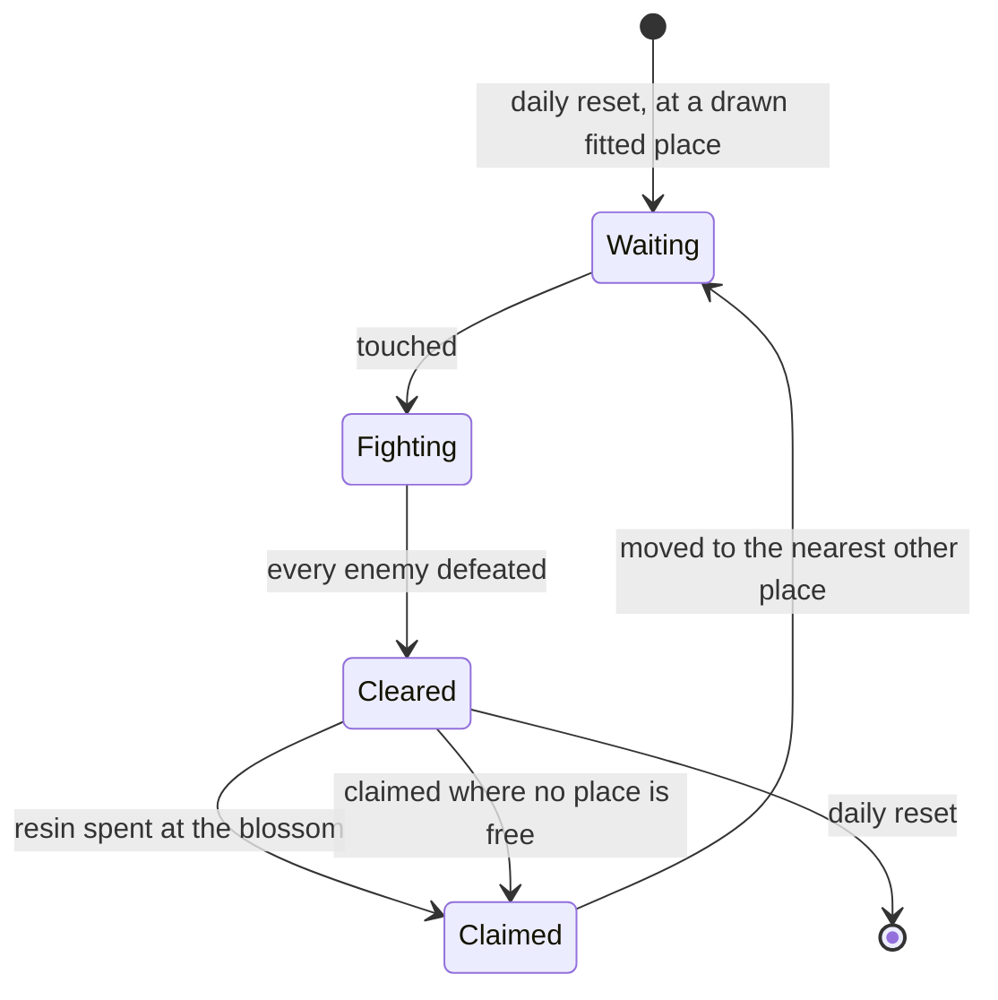

# Ley line outcrops

Ley line outcrops are the open world's resin challenges: a column of light at a known place, enemies when touched, and a blossom that gives Character EXP materials or Mora when claimed. They wait on [Original Resin](../genshin-original-resin/design.md), whose claim they spawn, on the [Adventure Rank](../genshin-adventure-rank/design.md) that opens them and sets their level, and on the [character kits](../genshin-character-kits/design.md) that fight them.

The [ley line outcrops](../../specs/genshin/ley-line-outcrops/design.md) page holds the rules. This proposal keeps what is unbuilt: the touch, the fight, the reveal, the claim and its rewards.

## Decisions

- **Touched, fought, revealed.** Touching a waiting outcrop starts its fight, which spawns a camp of `OUTCROP_CAMP_SIZE` members of the kinds `EnemyKindId` holds, spread within `OUTCROP_FIGHT_RADIUS` of its place at the World Level's level. Once every member is defeated the Ley Line Blossom appears, and its reward is the resin claim. The enemies drop what they always drop. Provisional: the wiki's per-place enemies are not paired with kinds, so the camp's size and kinds stand until they are.
- **Rewards by World Level, from the reward previews.** Each ley line refresh row lists its rewards under the dump's key `OFGHJMOLMNA`, one pair per World Level in order from World Level 0: `DANEGNOIKLH`, the `RewardPreviewExcelConfigData` id a claim draws from, and `EPOBLCBBIMB`, the server's own id, which the client holds no row for and no reader reads. The last preview stands for every World Level past the list, so World Level 9 claims World Level 8's. Mondstadt's Wealth row lists nine (4101 and 4103 to 4110, `摩拉玩法_11级` to `_56级`) paying 12,000, 20,000, 28,000, 36,000, 44,000 and 52,000 Mora, then 60,000 from World Level 6 on, as the wiki's table gives each World Level; its Revelation row's first preview gives 7 to 8 Wanderer's Advice and 3 to 4 Adventurer's Experience at World Level 0. Each preview also counts 100 Adventure EXP and the Companionship EXP (10, 15 or 20), which the claim leaves out of its draw. The Companionship EXP is granted apart, as the [original resin](../../specs/genshin/original-resin/design.md) page holds; the 100 Adventure EXP is settled under the decisions below.
- **Cleared but unclaimed stays until the reset.** One cleared but unclaimed stays where it is until the daily reset, and nothing moves meanwhile.
- **Claimed outcrops move on, or stay claimed.** Provisional: a claim moves the outcrop to the nearest other fitted place of its region, not the one the other kind stands at, where it waits again. It maps to the dump's place chain by position once the scene-group export lands. Where no place is free, it stays claimed in its place until the daily reset, as the [as-built page](../../specs/genshin/ley-line-outcrops/design.md) states.
- **Liyue opens at Adventure Rank 18, as the dump's table has it.** The dump is the game's latest data, so its table wins over the wiki's 8 and 12 for Liyue. The reference clip of the map at ranks 8 and 18 is a check of this, no longer the thing that decides it. The [as-built page](../../specs/genshin/ley-line-outcrops/design.md) already reads the table.
- **A claim grants the spent resin's Adventure EXP, once.** Each preview's 100 Adventure EXP is the EXP of the 20 resin a claim spends, five a point, which `claimOriginalResin` grants through `gainAdventureExp`. `claimResinReward` leaves the preview's Adventure EXP item out of the reward list it takes in, so it is granted once through that path and never again. Two claims at twice the price grant two claims' worth, and a Condensed Resin claim, which spends no resin, grants none.

- **Outcrops stand at the official map's blossom points.** No source joins a dump place to a map point, so Mondstadt's outcrops stand at the 35 Ley Line Blossom points (label 572 in area 1), fitted through `fit.json` as the waypoints were, each known by its map point's id. The dump's places and their `nextIds` rotation are not joined to them.
- **Which outcrops are open, and their kinds, are drawn each reset.** At each daily reset, which outcrops are open and each one's kind (Wealth or Revelation) are drawn from a random source seeded by the game day: half the places open, and half of those each kind. Provisional.
- **Enemies come from the wiki's table, by name.** Each place's enemies are the wiki's `Ley Line Outcrop Table` row for its location. Each named enemy is mapped to its `EnemyKindId` by its English name, matched against the monsters' names through the existing readers, and its count is the wiki's, provisional. An enemy no kind matches is left out. The wiki's locations carry no coordinates, so no source pairs a location with a map point; until one does, a place carries no enemies.
- **The enemies take a dynamic camp list.** Provisional: the enemies component takes a second list beside the static camps, the outcrop camps whose fights run. Each spawns whole as its fight starts, with no respawn time, and leaves the list on the reveal. No static camp changes.
- **A claim is an F offer.** Provisional: pressing F at a cleared outcrop's blossom offers the claims the held Original Resin and Condensed Resin afford, as a LeyLine blossom through `computeBlossomClaimPrompt`. Choosing one spends its resin through `claimResinReward`, which starts from the rank's live Adventure EXP, and grants the kind's World Level rewards once per claim the offer pays. The choice is drawn by `components/Interaction/OfferChoice`.

## How it works



## Scope and order

**Today:** no outcrop is placed, so enemies stand in camps placed by region data, nothing spawns them on a touch, and nothing gives Character EXP materials.

**This adds, in order:**

```text
packages/genshin-world/src/services/leyLine/
├── advanceOutcrop.ts
├── computeOutcropClaimRewards.test.ts
└── computeOutcropClaimRewards.ts
```

1. **The claims' rewards by World Level.** `scripts/src/models/genshinAssets/leyLine/ExcelBlossomRefreshRow.ts` gains the row's `OFGHJMOLMNA` list, each entry an `ExcelBlossomRefreshReward` whose `DANEGNOIKLH` and `EPOBLCBBIMB` are named in comments by what they hold, as the `genshin-parity` skill models an obfuscated field. `toLeyLineRegions.ts` gives each kind rule `worldLevelRewards: RewardItem[][]`, one per preview in the row's order, each the preview's items through `scripts/src/services/genshinAssets/rewards/toPreviewItems.ts`, and `writeLeyLineTables.ts` reads `RewardPreviewExcelConfigData` beside the blossom tables. `packages/genshin-world/src/models/leyLine/OutcropKindRule.ts` gains the field and its schema (`rewardItemSchema`), and `computeOutcropClaimRewards.ts` takes a rule's row at a World Level, the last row for a World Level past the list. `pnpm -C scripts genshin:assets outcrops` publishes each city's region record under `leyLine/regions/<cityId>`, city 8 among them, which the 7.1 dump's refresh rows now name, so no record is written by hand. Tests: `scripts/src/services/genshinAssets/leyLine/toLeyLineRegions.test.ts` lists two previews on a refresh row and asserts its kind's two reward rows; `computeOutcropClaimRewards.test.ts` asserts that World Level 0 takes the first row and World Level 9 the last of nine.
2. **The reset and the states**: the transitions in the diagram as `advanceOutcrop.ts` over an `OutcropStage` model (waiting, fighting, cleared, claimed), a claim moving the outcrop on with `computeNextOutcropPlace` and the daily reset starting each open kind over with `computeDailyOutcrops`, drawn through the composable's `drawDayOutcrops` at the game's 04:00 reset, tested transition by transition.
3. **An outcrop's challenge and blossom**, in Mondstadt first: the touch, the fight, the reveal and the claim through Original Resin's `claimResinReward`, its reward list drawn from `computeOutcropClaimRewards`' row. Each place is one of the official map's Ley Line Blossom points, fitted as the [spawned places](../genshin-spawned-places/design.md) page sets out; its enemies are each place's in the wiki's `Ley Line Outcrop Table` rows on the Ley Line Outcrops page, read through the persona's `readWikiPageText`.
4. **The regions the dump does not yet cover**: Fontaine, Natlan, Snezhnaya and city 8, whose refresh rows the 7.1 dump names but whose sections are not in the section order table, so their draw has no section to start in.

## Data and measures

- **Read from the game's tables:** the claims' rewards by World Level, from the `RewardPreviewExcelConfigData` rows each refresh row lists, which the dump holds.
- **Placed by the official map:** each place is one of the map's Ley Line Blossom points, fitted as the [spawned places](../genshin-spawned-places/design.md) page sets out. The table names each place by the game's scene group, which carries no position in the repository, so the table checks the placed points rather than placing them.
- **Read from the wiki:** each region's enemies at an outcrop, and what each World Level's claim gives.

## Key files

| File                                                                   | Role after the change                              |
| :--------------------------------------------------------------------- | :------------------------------------------------- |
| `packages/genshin-world/src/models/world/RegionData.ts`                | Gains the region's outcrop places                  |
| `packages/genshin-world/src/models/enemy/EnemyCamp.ts`                 | An outcrop's enemies, as a camp spawned on a touch |
| `packages/genshin-world/src/components/World/Enemies/Index.vue`        | Spawns an outcrop's camp when it is touched        |
| `packages/genshin-world/src/services/enemy/computeEnemyRespawnTime.ts` | Shares the daily reset the outcrops start over at  |

## Sources

- [Ley Line Outcrops](https://genshin-impact.fandom.com/wiki/Ley_Line_Outcrops), Genshin Impact Wiki: the enemies by region at the World Level, the claims' rewards by World Level, and a claimed outcrop moving within its group. The page was not reachable when this proposal was last checked.
- [Daily Reset](https://genshin-impact.fandom.com/wiki/Daily_Reset), Genshin Impact Wiki: the outcrops' places drawn afresh with each day's reset.
- [AnimeGameData](https://github.com/DimbreathBot/AnimeGameData), the community's per-patch dump: the chest rows' reward ids, which the dump's reward table does not hold.

## Reference

- `liyue-outcrop-rank.mkv` — the map on M opened in Liyue at Adventure Rank 8 and again at 18, with no statue of Liyue activated in the second, 10 seconds at most; each shows whether a ley line blossom is offered there, which checks the dump's table's opening at 18 for Liyue, the decision the Decisions settle. On the wiki and YouTube, none found (searched 2026-10-11).
- `ley-line-claim.mkv` — a ley line blossom claimed with resin at the reader's World Level, the reward window in view, then the map after the claim; the claim's rewards by World Level are read from it, and the outcrop's move after a claim is checked against the rule. On the wiki and YouTube, none found (searched 2026-10-11).
