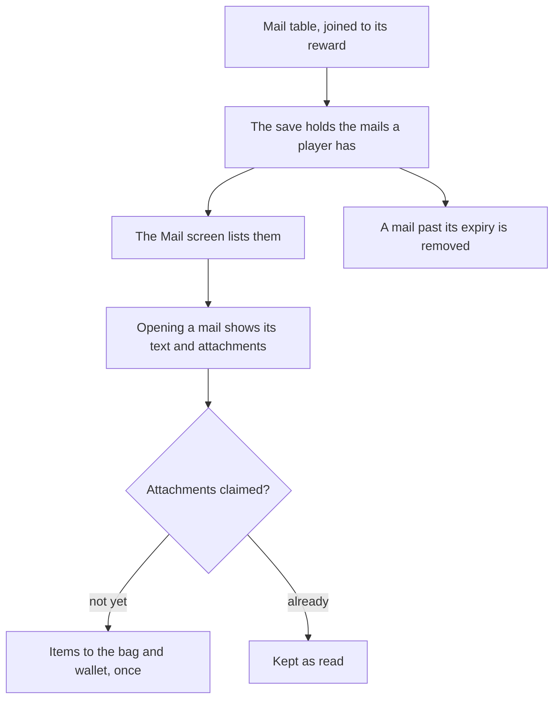

# Mail

Mail is a list of letters the save holds, each read from the game's mail table and claimed once for its attached items. The delivery rules and the screen's layout wait on the export and the parity loop.

## How it works

## Data

The game's mail is in the excel tables of the dump: `MailExcelConfigData` holds 323 mails, of which 226 are ordinary letters with no `type`, the rest activity and tower mails. Each mail names its title, sender and content by text hash, its `expireDays`, and optionally a `rewardId` that `readRewardMap` joins to its items, and `isStar` marks seven of them. Two of its keys are still unnamed in the dump, and the builder reads only the named ones until they are identified.

`BirthdayMailExcelConfigData` holds three rows, each a `mailId` with its `rewardId` and an `effectiveDate`. It is not one birthday mail per character: the dump names no character on those rows, so the per-character birthday mail is not read from this table.

## Decisions

- **The save holds the mails a player has, as a required list.** A save without it is refused, with no default, as the quick swap's slots were, and the backfill for existing saves is the main session's.
- **A mail's text is its game text, not a translated string.** The title, sender and content are referenced by text id through `genshin-text`, so the main session writes them and no string is typed here.
- **No mail is delivered until the rules are read.** The screen lists what the save holds; which mail a player receives, and when, waits on the export.
- **Claiming gives the items once.** A claimed mail stays in the list as read, so a reload cannot grant its items twice.

## Key files

| File                                                               | Role                                                                               |
| ------------------------------------------------------------------ | ---------------------------------------------------------------------------------- |
| `packages/genshin-world/src/services/screen/ScreenBehaviourMap.ts` | Gives the Mail screen its behaviour; the screen's contents replace its placeholder |
| `packages/genshin-world/src/services/save/constants.ts`            | Bounds the mail list at its longest, so the save's ceiling counts it               |
| `packages/genshin-world/src/models/save/GenshinSave.ts`            | Holds the mail list beside the other collections the save keeps                    |
| `scripts/src/services/genshinAssets/rewards/readRewardMap.ts`      | Joins a mail's `rewardId` to its reward's items                                    |

## Notes

- The dump's two unnamed mail keys are not guessed at; the builder skips them, and a mail with a key it cannot name is not delivered.
- A mail's expiry is `expireDays` from its delivery, which the delivery rules set; a mail never delivered does not expire.
