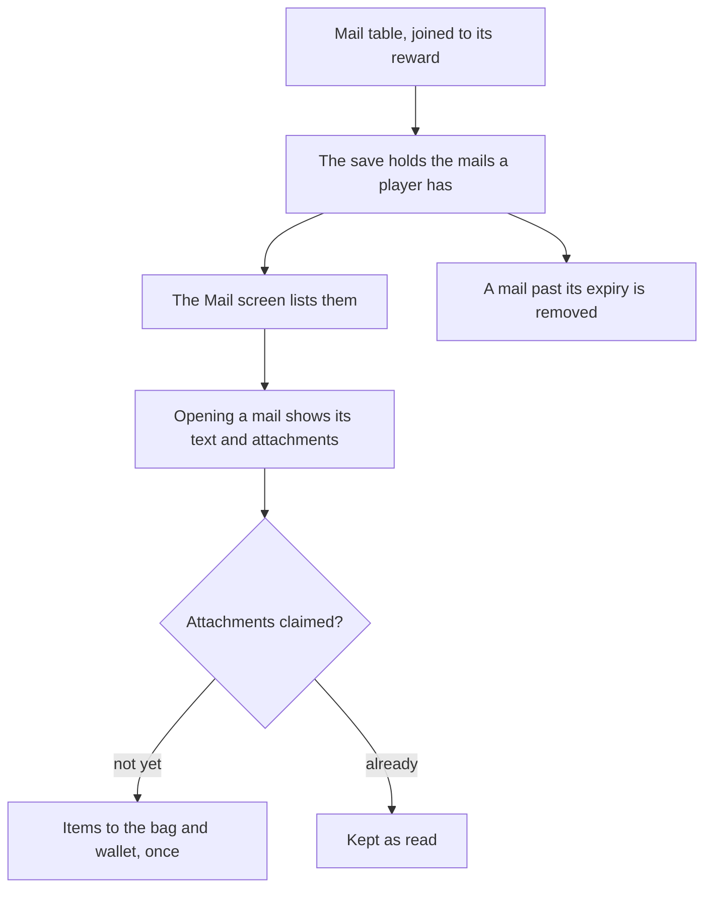

# Mail

Mail is a list of letters the save holds, each read from the game's mail table and claimed once for its attached items. The Traveler's birthday mail and the screen are built provisionally from the wiki; the other delivery rules and the screen's traced layout wait on the export and the parity loop.

## How it works



## Data

The game's mail is in the excel tables of the dump: `MailExcelConfigData` holds 323 mails, of which 226 are ordinary letters with no `type`, the rest activity and tower mails. Each mail names its title, sender and content by text hash, its `expireDays`, and optionally a `rewardId` that `readRewardMap` joins to its items, and `isStar` marks seven of them. Two of its keys are still unnamed in the dump, and the builder reads only the named ones until they are identified.

`BirthdayMailExcelConfigData` holds three rows, each a `mailId` with its `rewardId` and an `effectiveDate`. It is not one birthday mail per character: the dump names no character on those rows, so the per-character birthday mail is not read from this table.

## Decisions

- **The save holds the mails a player has, as a required list.** A save without it is refused, with no default, as the quick swap's slots were, and the backfill for existing saves is the main session's.
- **A mail's text is its game text, not a translated string.** The title, sender and content are referenced by text id through `genshin-text`, so the main session writes them and no string is typed here.
- **Only the Traveler's birthday mail is delivered, until the rules are read.** Every other mail waits on the export, so the mailbox holds no mail the rules have not yet placed. The birthday mail is the one the wiki states.
- **Claiming gives the items once.** A claimed mail stays in the list as read, so a reload cannot grant its items twice.
- **The dump's birthday letters are the Traveler's, not a character's.** Seven untyped rows name a birthday, all "Best Wishes on Your Birthday" from the Mailing System and addressed to the Traveler; three are dated by `BirthdayMailExcelConfigData`, which keys them by mail id. No mail is dated to a character's birthday, though `FetterInfoExcelConfigData` dates all 120 characters. So delivery on a held character's birthday has no letter to deliver: it waits on a source for that letter, and until then no mail is delivered on a character's birthday.
- **The save's mail list is backfilled with an empty list, and the Traveler's birthday is optional.** `mails` is required, so a save written before it is refused until the backfill sets it to `[]`; the main session adds that to its one backfill script and runs it on dev, and prod waits on the user. `travelerBirthday` is optional, since the profile sets it once and an unset birthday is a real state, so existing saves need no backfill.
- **The Traveler's birthday is set once in the profile.** The wiki says the birth date is the player's choice in profile customization and cannot be changed once set, so the save holds it once and nothing after.
- **The Traveler's birthday mail is delivered provisionally, on the birthday in the game's time zone.** The wiki says the mail arrives on the player's birthday, only that day, in the server's time (UTC+8, past midnight). The mail due is the latest row of `BirthdayMailExcelConfigData` taking effect by that birthday, and it is delivered once a birthday. The table's three rows end in 2022, so later birthdays repeat the last one, which is provisional until the export confirms it. Without a birthday set, nothing is delivered.
- **A mail expires `expireDays` after its delivery and is deleted then, except a mail in the Gift Mail Box.** The wiki's Mail page (https://genshin-impact.fandom.com/wiki/Mail) says the Gift Mail Box holds birthday mail once its rewards are collected, and that mail in the box is not quick-deleted and does not expire over time. The mail table's `isStar` flags seven rows, and all three birthday rows are among them, so the flag marks the box's mail and not the player's pin: a flagged mail is neither sorted first nor kept from Delete Read, and the pin is the player's `isPinned`. Claim and claim-all refuse a mail the bag cannot take whole, so a claim gives its items once or not at all.
- **The mail data is one index, `mail/mail`, read one mail at a time.** The builder publishes each mail under its id and the birthday rows under `birthdayMails`, in the game's own effective-date text, so the world reads a held mail by its id and never fetches the whole table. The world converts the effective date with its own game time zone, so the scripts carry none.

- **The Mail screen is built on the list screen's frame, provisionally.** Its words are `GameTextKey` members whose English text the main session writes, and its layout is the wiki's description until the parity loop traces it.- **Delete Read removes every read mail with nothing left to claim, and keeps pinned mail and the Gift Mail Box.** The wiki's Mail page (https://genshin-impact.fandom.com/wiki/Mail) says "all read Mail can be deleted by selecting 'Delete Read.'", and the dump's Delete Read confirm (`UI_MAIL_DELETE_ALL_DESC`) says any mail "with unclaimed attachments will not be deleted". The wiki's Pinned Mail section says pinned mail "cannot be deleted quickly", so the mail the player pins stays too. A mail with no row is kept, since its contents are unread. Delete Read asks for no confirm yet, since the dump's confirm text is not built.
- **The mail's title, sender and body are published per language as `mailText/<language>`, read as achievements' text is.** The builder writes every mail's text ids, so the screen reads them in the reader's language and English stands in where a language lacks one.
- **The mailbox loads as the world starts, so the birthday mail is due on login that day.** Expired mail is removed and the birthday mail delivered at load, before the Mail screen can open; the screen shows once the mailbox has loaded.
- **A held mail whose row is gone is left off the list and kept in the save.** The mailbox reads the rows of the held mails the table names, through `readGameDataIndex`, so a mail with no entry in the index has no row: the load does not fail on it, the Mail screen lists only the mails with a row, and the save keeps the mail, since its expiry cannot be read and `removeExpiredMails` keeps a mail with no row.
- **A mail in the Gift Mail Box is labelled as kept there, in place of its expiry.** The box keeps it past its expiry and out of Delete Read, so that label is the only difference the status draws. The Mailbox tab lists the mails outside the box and the Gift Mail Box tab those inside it.
- **A pin is the player's, saved as a required `isPinned` on every held mail, and it lists the mail first.** The wiki's Mail page (https://genshin-impact.fandom.com/wiki/Mail) has a Pinned Mail section: pinned mail "will be placed at the top of the mail list", "cannot be deleted quickly", and "can still expire". So the player pins it, Delete Read keeps it, and expiry deletes it. The save key is required, so a save written before the pin is refused until the backfill sets `isPinned` to `false` on every held mail; the main session runs that backfill on dev, and prod waits on the user. The button's labels are the dump's `UI_MAIL_STAR` ("Pin") and `UI_MAIL_CANCEL_STAR` ("Delete Pin"). A merge keeps a pin on either copy, as it keeps a claim or a read.
- **The save writes the Traveler's birthday only once it is set.** A save with no birthday has no `travelerBirthday` key, so a reload of an unset birthday is the same save it was.
- **The profile sets the birthday once.** The Paimon card's Set Birthday button opens the dialog that sets it, as `genshin-menu-paimon`'s design records. The save holds the date from then on, and the delivery reads it.

- **The mail's detail shows the date it was received, through `NuxtTime`.** The game's line `MAIL_DETAIL_DATE` reads "Time/Date: {0}"; the screen splits it at the `{0}` and renders the date between the two parts as a `NuxtTime`, which the vue skill's date rule requires. It formats `deliveredAt`, the moment the mail was delivered, in the reader's own locale and time zone.

## Key files

| File                                                               | Role                                                                               |
| ------------------------------------------------------------------ | ---------------------------------------------------------------------------------- |
| `packages/genshin-world/src/services/screen/ScreenBehaviourMap.ts` | Gives the Mail screen its behaviour; the screen's contents replace its placeholder |
| `packages/genshin-world/src/services/save/constants.ts`            | Bounds the mail list at its longest, so the save's ceiling counts it               |
| `packages/genshin-world/src/models/save/GenshinSave.ts`            | Holds the mail list beside the other collections the save keeps                    |
| `scripts/src/services/genshinAssets/rewards/readRewardMap.ts`      | Joins a mail's `rewardId` to its reward's items                                    |
| `packages/genshin-world/src/components/World/Session/Index.vue`    | Loads the mailbox as the world starts, and gives the Mail screen its slot          |
| `packages/genshin-world/src/models/data/GameDataset.ts`            | Names the `mail` and `mailText` datasets the builder publishes                     |
| `packages/genshin-text/src/models/GameTextKey.ts`                  | The mail screen's words, by the game's own keys                                    |
| `packages/genshin-world/src/models/save/GenshinSaveState.ts`       | Carries the mails and the Traveler's birthday beside the other saved state         |
| `packages/genshin-world/src/services/save/toGenshinSave.ts`        | Writes the mails, and the Traveler's birthday once it is set                       |
| `packages/genshin-world/src/services/save/readGenshinSave.ts`      | Reads the mails and the Traveler's birthday back                                   |

The new files sit in a tree:

```text
scripts/src/services/genshinAssets/mail/toMails.ts            ← the mail rows, skipping one with a key it cannot name or a missing reward, and counting both
scripts/src/models/genshinAssets/mail/ExcelMailRow.ts         ← the mail table's named keys
packages/genshin-world/src/models/mail/Mail.ts                ← a mail's text ids, expiry and items
packages/genshin-world/src/models/mail/MailSave.ts            ← a mail as the save holds it: when delivered, claimed, read
packages/genshin-world/src/models/save/TravelerBirthdaySave.ts ← the Traveler's birthday the profile sets once
packages/genshin-world/src/services/mail/constants.ts         ← the mailbox's capacity
packages/genshin-world/src/models/mail/MailboxState.ts        ← the bag, the wallet and the held mails a claim changes together
packages/genshin-world/src/services/mail/claimMail.ts        ← one held mail's items into the bag and wallet, once
packages/genshin-world/src/services/mail/claimAllMails.ts    ← every held mail claimed in order, the ones the bag cannot take left unclaimed
packages/genshin-world/src/services/mail/deleteReadMails.ts  ← the held mails without the read ones that have nothing left to claim, and the pinned ones
packages/genshin-world/src/services/mail/isGiftBoxed.ts      ← whether a held mail is in the Gift Mail Box: starred, or a birthday mail claimed
packages/genshin-world/src/services/mail/removeExpiredMails.ts ← the mailbox without the mails past their expiry
packages/genshin-world/src/services/mail/deliverBirthdayMail.ts ← the Traveler's birthday mail added when due
scripts/src/services/genshinAssets/mail/buildMailPublication.ts ← the mail table as one entry per mail, and the birthday rows
scripts/src/services/genshinAssets/commands/mailCommand.ts ← the `genshin:assets mail` publish, with its dry run
scripts/src/models/genshinAssets/mail/ExcelBirthdayMailRow.ts ← the birthday mail table's named keys
packages/genshin-world/src/models/mail/MailData.ts     ← the mail's and the birthday rows' schemas, read from the game data
packages/genshin-world/src/composables/useWorldMail.ts ← the mailbox read as the world starts, the birthday due, the claims applied
packages/genshin-world/src/services/mail/readMailText.ts ← one language's mail text, read by its key
packages/genshin-world/src/services/mail/readMailRows.ts ← the held mails' rows by id, the ones the mail table no longer names left out
packages/genshin-world/src/services/mail/getMailExpiry.ts ← a mail's time left in its largest unit
packages/genshin-world/src/services/mail/MailExpiryGameTextKeyMap.ts ← each expiry unit's line
packages/genshin-world/src/services/mail/sortMails.ts  ← the held mails, pinned first then newest first
packages/genshin-world/src/models/mail/MailExpiry.ts   ← a mail's time left, as a count of its unit
packages/genshin-world/src/models/mail/MailExpiryUnit.ts ← the unit a time left is shown in
packages/genshin-world/src/components/Mail/Screen/Index.vue ← the Mail screen: the list, the detail and the claims
```

- The dump's two unnamed mail keys are not guessed at; the builder skips them, and a mail with a key it cannot name is not delivered.
- A mail's expiry is `expireDays` from its delivery, which the delivery rules set; a mail never delivered does not expire.
