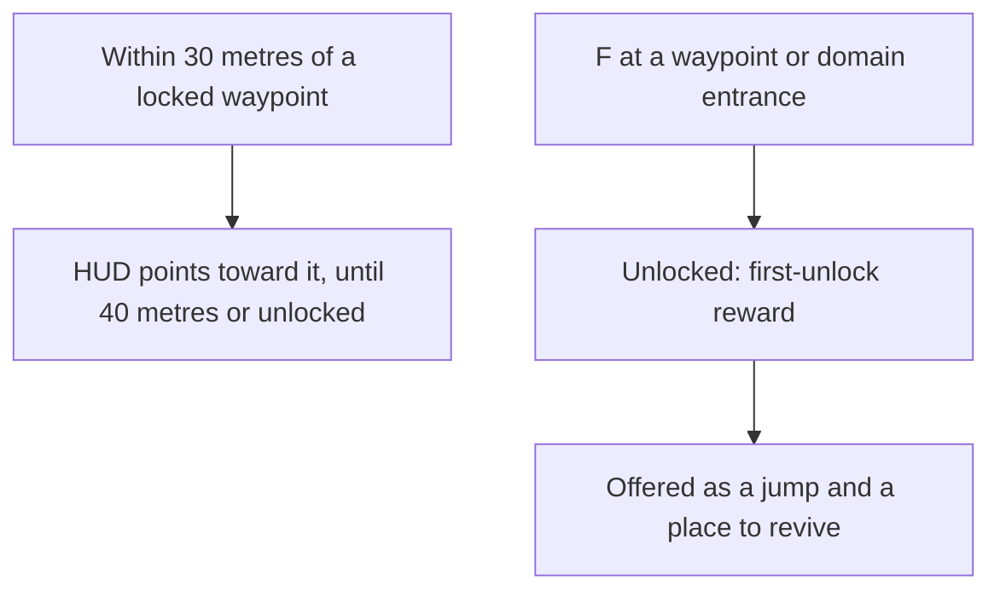

# Map unlocking

The [map unlocking](../../specs/genshin/map-unlocking/design.md) page holds the statues' unlocking, the filled areas and the jumps. What is left is a quest step that unlocks a waypoint outright. The waypoints are in from [exploring](../../specs/genshin/exploring/design.md), which makes Teleport Waypoints a landmark kind and lands a jump at the game's own arrival point. The unlock is made through the [interaction](../../specs/genshin/interaction/design.md) prompts a waypoint and a domain are unlocked through.

## Decisions

- **Reached, then unlocked.** A Teleport Waypoint or a domain's entrance is unlocked by interacting with it, as the statues are. An activation also emits the landmark's scene point as an Interact target, so a quest step that names a waypoint by its point (`QUEST_CONTENT_UNLOCK_TRANS_POINT`) finishes when the waypoint is unlocked. A step unlocking a waypoint outright is not built: the one `QUEST_EXEC_UNLOCK_POINT` in the quest data names point 7, a statue's point that `LandmarkIdStatuePointIdMap` does not hold (Windrise's is point 4), and point 6 appears only as a finish condition.
- **Its first unlock is rewarded.** Each one's Adventure EXP and Primogems are its row in `TransPointRewardConfigData`, given once.
- **A domain entrance unlocks as a waypoint does, and is a jump.** Mondstadt's region data places seven domain entrances as `DomainEntrance` landmarks, so each is unlocked by interacting with it and offered as a prompt row, and `JUMP_LANDMARK_KINDS` already lists the kind. The wiki says an unlocked domain acts as a waypoint, so it is a jump, landing at the landmark's `arrival` (`computeJumpPose`), which for each entrance is its own place. The scene points that carry a dungeon also carry a transfer position, which the fit would need to map into the region's frame as it does for waypoints; until that fit change lands, a domain lands at its own place.
- **A waypoint's reward is keyed by the point its id ends in.** The fit names each waypoint `<region>-waypoint-<point>`, so `computeLandmarkPointId` reads the point from the id and finds its row. Of Mondstadt's 43 waypoints, 32 have a row in the published `transPoints/scene3` record; the 11 with points 1865 to 2051 have none, so they pay nothing on their first unlock.
- **A first unlock is the only unlock that pays.** `activateLandmark` pays a landmark's reward only when it was not already unlocked, so a landmark reached again pays nothing.
- **A waypoint the game hides stays hidden until its step.** A listed transport point is hidden from the map and the prompt list while a quest step names it (as the target of an Interact objective) and no step has reached it. A step is reached once it is current or passed, so the step that reveals a point shows it before the step finishes, and the point is never hidden for good. A listed point no step names is shown, since nothing could reveal it. The list is the `transPoints/unlock` record, read as the world opens, and a read that fails shows every point. `computeHiddenTransPointIds` decides it over the named and reached targets that `computeQuestStepTargets` takes from the quests. The dump's quests name none of the listed points as a step target, so the rule hides nothing in the data this build holds.
- **A locked waypoint is pointed to near.** Within 30 metres of a locked waypoint, the HUD points toward it; past 40 metres, or once it is unlocked, the pointer goes, as the wiki gives the two distances.
- **The pointer points to every locked jump landmark.** The wiki gives the pointer for a locked Teleport Waypoint, and a Statue of The Seven is a waypoint too, so the rule reads the locked jump landmarks and points to the statues and the waypoints alike, which [exploring](../../specs/genshin/exploring/design.md) added to `JUMP_LANDMARK_KINDS`, with no change of its own.
- **The pointer is the game's navigation mark, drawn on the HUD.** It is the mark at the landmark's place on screen, held at the screen's edge with its arrow turned toward the landmark while the landmark is out of view. Its look is read from a public clip of a waypoint being reached, and its comparison waits on the user's eyes.

## How it works

## Scope and order

**Still to build:** a quest step that unlocks a waypoint outright (task 2.1). It is blocked, as the [first decision](#decisions) says: the quest data's one unlock names a statue's point, so the step waits on the data naming a waypoint. The pointer, the hidden waypoints, the offers and the first-unlock rewards are built, and their tasks are checked.

**Not here:** the achievements `TRIGGER_UNLOCK_TRANS_POINT` and `TRIGGER_UNLOCK_AREA` rows count unlocks, and the achievements proposal wires them as their pages land. The wiki says "Brush of a Thousand Winds" is every Teleport Waypoint in Mondstadt except those of Dragonspine, Windrest Peak and the Temple of Space, so a watcher needs each waypoint's region as well as its point. An area trigger names the game's own area ids, which no catalogue area holds yet.

## Data and measures

- **Read from the game's tables:** `TransPointRewardConfigData` (its rows, most of them in scene 3, keyed by scene and point id) and `RewardExcelConfigData` for each reward id's items. They are fetched as the [game data formats](../../specs/genshin/game-data-formats/design.md) page describes, and not committed; `pnpm -C scripts genshin:assets trans-points` writes the scene 3 rows, each joined to its reward's Adventure EXP and Primogems, as the hosted `transPoints/scene3` record. The table's reward ids run from 220310 to 220314: 220310 gives 10 Adventure EXP, 220311, 220313 and 220314 give 50 Adventure EXP and 5 Primogems, and 220312 gives 5 Primogems and 20 of item 101692, which the two currencies do not name and is left out until its item is read. Each field's name is the table's own (`playerExp` for Adventure EXP, `hcoin` for Primogems), not checked in game.
- **Matched by the scene points:** each scene 3 row's point id is a point of the text dump's `scene3_point.json`, all of them in one category, so a waypoint's row is found once exploring matches its point to its landmark.
- **Measured:** the unlock's animation and how long it holds the player, measured off a published clip like the jump's fade ([roadmap](../genshin-roadmap/tasks.md), where its References sought list holds it).

## Key files

| File                                                    | Role after the change                                             |
| :------------------------------------------------------ | :---------------------------------------------------------------- |
| `packages/genshin-world/src/composables/useWorldMap.ts` | Splits the unlocked jump landmarks off the ones the pointer reads |
| `packages/genshin-world/src/services/map/constants.ts`  | `JUMP_LANDMARK_KINDS` takes statues, waypoints, domain entrances  |

## Sources

- [Teleport Waypoint](https://genshin-impact.fandom.com/wiki/Teleport_Waypoint), Genshin Impact Wiki: waypoints unlocked by interacting, their first unlock's Adventure EXP and Primogems, statues and domains acting as waypoints, only unlocked ones as respawn points, locked ones shown once their area is lit, the pointer within 30 metres gone past 40, and quest unlocks.
- [AnimeGameData](https://github.com/DimbreathBot/AnimeGameData), the community's per-patch dump: the transport points' reward table.
