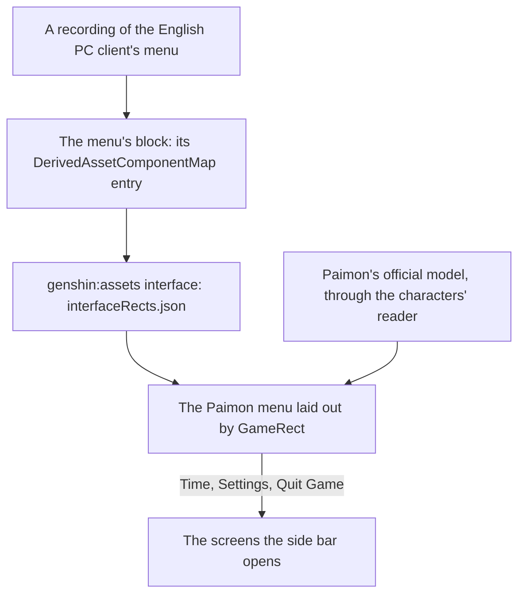

# Menu Paimon

This page builds on [screens](../../specs/genshin/screens/design.md) and the [Paimon menu](../../specs/genshin/paimon-menu/design.md), where the menu's shell, its pause of the world and its entries are built, on [characters](../genshin-characters/design.md), whose reader draws Paimon beside the menu, and on the [HUD](../../specs/genshin/hud/design.md), whose Paimon button opens it. What the menu lacks is Paimon floating beside it and the profile card's fields, which the systems behind them have not yet supplied. The screens its side bar opens are their own proposals: [Time](../genshin-menu-time/design.md), [Settings](../genshin-menu-settings/design.md) and the [quit prompt](../genshin-menu-quit-prompt/design.md).

## Decisions

- **Paimon is drawn as a character is.** She appears to the right of the menu with her idle animations, as the game shows her. She is read from her official model and drawn by [characters](../genshin-characters/design.md)' reader and toon material, her motion fitted to the game's own clips, so nothing of the game's files ships.
- **Paimon waits for an official model.** If HoYoverse's published packs hold no Paimon model, the menu ships without her: she is decoration, and the menu works whole without her. Characters are drawn only from official models, so no stand-in is made, and she is added once an official model is published.
- **Community and Feedback are drawn disabled, Training Guide is not drawn.** The still draws Community and Feedback as entries, so they keep their tiles disabled; the world opens no page of their own. Training Guide is in no still the references hold, so it stays out of the contents while its screen remains in the model.
- **The profile card shows what the world backs.** Signed in, it shows the account's name and avatar; signed out, the game's default name, Traveler. Adventure Rank and World Level join it with the [Adventure Rank](../genshin-adventure-rank/design.md) proposal's system, and the signature, namecard, birthday and UID each join when the system behind it lands.

## How it works



## Scope and order

1. **The reference.** `menu-paimon-current.png`, the menu on the current build at 1080 high with no screen open, replaces the one still held, which is the 1.3 build's and lacks the entries the current build adds. `menu-paimon.mkv` times its open and close once its clip lands, read with `pnpm -C scripts genshin:parity frames <file> 60 <start> <seconds>`.
2. **Paimon beside the menu** waits on her official model pack among the developer's extracted packs (the user, who downloads it), read as every character's is ([characters](../../specs/genshin/characters/README.md)).
3. **The profile card's fields.** The signature, namecard, birthday and UID each join as the system behind it lands, its rank and World Level being built.

## What this does not propose

- **The screens of features the world lacks**, among them the shop, the events, the battle pass, co-op, friends, mail and notices, and the Miliastra Wonderland's functions. Their entries stay disabled until each is built.
- **The shortcut wheel.** It offers the same screens as the menu and earns its place once the menu holds enough of them to choose from; its binding is read already.
- **The agent console's entries.** Where the console's sessions are reached from in the game's style is the console's rebuild, its own page.

## Key files

| File                                                                    | Role after the change                                       |
| :---------------------------------------------------------------------- | :---------------------------------------------------------- |
| `packages/genshin-world/src/components/Menu/Paimon/Index.vue`           | Laid out by the fitted rects, its icons drawn, Paimon by it |
| `scripts/src/services/genshinAssets/shared/DerivedAssetComponentMap.ts` | Gains each screen's block and roots                         |
| `scripts/src/services/genshinParity/shared/ParityReferenceMap.ts`       | Gains each screen's recordings                              |

New files:

```text
packages/genshin-world/src/components/Menu/Paimon/Index.fixture.ts
packages/genshin-world/src/components/Menu/Paimon/Index.reference.ts
```

## Sources

- [Paimon Menu](https://genshin-impact.fandom.com/wiki/Paimon_Menu), Genshin Impact Wiki: the menu's profile, contents and side bar, and Paimon floating to its right.
- [Shortcut Wheel](https://genshin-impact.fandom.com/wiki/Shortcut_Wheel), Genshin Impact Wiki: the wheel's entries, the same screens as the menu's.

## Reference

- `menu-paimon-current.png` — the Paimon menu on the current build at 1080 high with no screen open; the one still held is the 1.3 build's, which lacks the entries the current build adds. Partly found 2026-10-11: the wiki's `File:Paimon Menu Version 1.3.png`; still sought: A current-build Paimon menu at 1080 high with no screen open.
