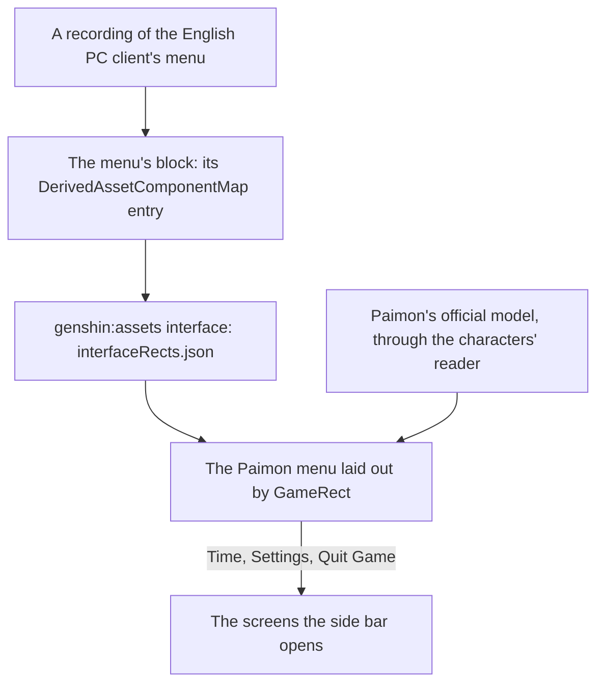

# Menu Paimon

This page builds on [screens](../../specs/genshin/screens/design.md) and the [Paimon menu](../../specs/genshin/paimon-menu/design.md), where the menu's shell, its pause of the world and its entries are built, on [characters](../genshin-characters/design.md), whose reader draws Paimon beside the menu, and on the [HUD](../../specs/genshin/hud/design.md), whose Paimon button opens it. What the menu lacks is Paimon floating beside it and the profile card's fields, which the systems behind them have not yet supplied. The screens its side bar opens are their own proposals: [Time](../genshin-menu-time/design.md), [Settings](../genshin-menu-settings/design.md) and the [quit prompt](../genshin-menu-quit-prompt/design.md).

## Decisions

- **Paimon is drawn as a character is.** She appears to the right of the menu with her idle animations, as the game shows her. She is read from her official model and drawn by [characters](../genshin-characters/design.md)' reader and toon material, her motion fitted to the game's own clips, so nothing of the game's files ships.
- **Paimon waits for an official model.** If HoYoverse's published packs hold no Paimon model, the menu ships without her: she is decoration, and the menu works whole without her. Characters are drawn only from official models, so no stand-in is made, and she is added once an official model is published.
- **Community, Version Highlights, Feedback and Survey are drawn disabled, Training Guide is not drawn.** The still draws Community and Feedback as entries, and the 2026 frame at 25 seconds of `yt-jHr2bERjkYc` draws Version Highlights and Survey beside them, so all four keep their tiles disabled; the world opens no page of their own, and no system backs them. Their labels come from the game's text by id, `UI_STC_GAMEENTRYPAGE_HANDBOOK` and `UI_STC_GAMEENTRYPAGE_SURVEY`. The links flow after the contents in the grid, as the other links do: the grid's pitch of 208 by 189 reference pixels is the 2026 frame's tile pitch, 164.33 by 149 frame pixels at 1.2658 reference pixels each. The frame shows its links after Map only because it hides the contents Adventure Rank has not unlocked; here every entry is drawn disabled, so the links follow CoOp, the last content. Training Guide is in no still the references hold, so it stays out of the contents while its screen remains in the model.
- **The profile card shows what the world backs.** Signed in, it shows the account's name and avatar, the avatar drawn over the Traveler's disc when the account has a picture; signed out, the game's default name, the text `Player_Default_Name`, which the English client shows as Traveler. Adventure Rank and World Level join it with the [Adventure Rank](../genshin-adventure-rank/design.md) proposal's system, and the signature, namecard, birthday and UID each join when the system behind it lands.
- **The 0.26 second fade stays until a 60 frames a second recording settles it.** The 2026 clip runs at 25 frames a second, so each frame is 40 milliseconds: its menu's panel is whole within one frame of the world, at 22.52 seconds of `yt-jHr2bERjkYc` against 22.48, which reads as an instant opening and cannot measure a 0.26 second fade. The timing the as-built page records, read from `yt-IegFADn-Lmk` at 60 frames a second, stays the reading. Task 1.1 stays open for a 60 frames a second clip of the 2026 build's opening and closing (`menu-paimon.mkv`).

## How it works



## Scope and order

1. **The reference.** `menu-paimon-current.png`, the menu on the current build at 1080 high with no screen open, is the frame at 25 seconds of `yt-jHr2bERjkYc`, a 2026 recording of the English PC client, and replaces the one still held, which is the 1.3 build's. The parity map's `paimon-menu` row names it. Its opening is read with `pnpm -C scripts genshin:parity frames <file> 25 21 3`. Its closing awaits `menu-paimon.mkv`, which must show Back closing the menu.
2. **Paimon beside the menu** waits on her official model pack among the developer's extracted packs (the user, who downloads it), read as every character's is ([characters](../../specs/genshin/characters/README.md)).
3. **The profile card's fields.** The signature, birthday and UID each join as the system behind it lands, its rank and World Level being built. The namecard joins with its picker: the profile card's namecard is the held one the player equips. The picker's title is the game's `Change Namecard` (text id 3755125824), read as `GameTextKey.ChangeNamecard`; it renders empty until that key's chunk is generated.

## What this does not propose

- **The screens of features the world lacks**, among them the shop, the events, the battle pass, co-op, friends, mail and notices, and the Miliastra Wonderland's functions. Their entries stay disabled until each is built.
- **The shortcut wheel.** It offers the same screens as the menu and earns its place once the menu holds enough of them to choose from; its binding is read already.
- **The agent console's entries.** Where the console's sessions are reached from in the game's style is the console's rebuild, its own page.

## Key files

| File                                                                    | Role after the change                                       |
| :---------------------------------------------------------------------- | :---------------------------------------------------------- |
| `packages/genshin-world/src/components/Menu/Paimon/Index.vue`           | Laid out by the fitted rects, its icons drawn, Paimon by it |
| `scripts/src/services/genshinAssets/shared/DerivedAssetComponentMap.ts` | Gains each screen's block and roots                         |
| `scripts/src/services/genshinParity/shared/ParityReferenceMap.ts`       | Gains each screen's recordings                              |

New files:

```text
packages/genshin-world/src/components/Menu/Paimon/Index.fixture.ts
packages/genshin-world/src/components/Menu/Paimon/Index.reference.ts
packages/genshin-world/src/components/Menu/Paimon/Index.browser.test.ts
```

The account's name and avatar reach the card through the world's props: the app's world host reads the session and passes it down the world screen, the session and the menu host, each of which takes the two props.

## Sources

- [Paimon Menu](https://genshin-impact.fandom.com/wiki/Paimon_Menu), Genshin Impact Wiki: the menu's profile, contents and side bar, and Paimon floating to its right.
- [Shortcut Wheel](https://genshin-impact.fandom.com/wiki/Shortcut_Wheel), Genshin Impact Wiki: the wheel's entries, the same screens as the menu's.
- The Paimon Menu page's wikitext, read through the wiki's API (`api.php?action=parse&page=Paimon_Menu`) on 2026-10-18: most of the contents unlock with Adventure Rank, so more buttons appear as the rank rises; the list it gives includes Training Guide, Version Highlights and Survey, which the still-based contents above do not draw.

## Reference

- `menu-paimon-current.png` — the Paimon menu on the current build at 1080 high with no screen open, the frame at 25 seconds of `yt-jHr2bERjkYc` (`captures/yt-jHr2bERjkYc-logout-tech4gamers.mp4`, the frame cut to `references/menu-paimon/menu-paimon-current.png`, never committed). Found 2026-10-18: https://www.youtube.com/watch?v=jHr2bERjkYc, a Tech4Gamers logout tutorial of 56 seconds at 1920 by 1080 and 25 frames a second, dated 2026-05-15, the English PC client; the account is at Adventure Rank 2, so the contents show thirteen of the entries, and a tutorial's arrows and logo sit over the frame's edges. What the frames show beyond the reference: the menu's panel is whole in the frame at 22.52 seconds, within one 40 millisecond frame of the world at 22.48, so the 0.26 second fade the 2025 clip gives is not seen at this rate; the menu's closing is not in this clip, so `menu-paimon.mkv` stays owed for it. The frame also draws Version Highlights and Survey among the contents, which the as-built page left out for want of a still; they are drawn disabled here, as the Decisions set out.
