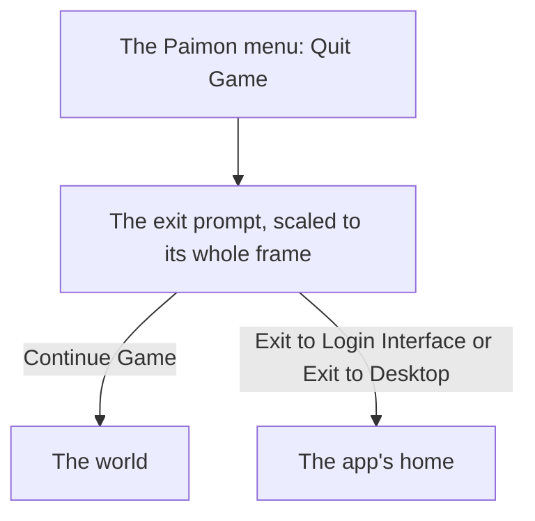

# Menu quit prompt

The [Paimon menu](../genshin-menu-paimon/design.md)'s side bar Quit Game opens an exit prompt over the menu, with Continue Game, Exit to Login Interface and Exit to Desktop. The prompt is built and its buttons work, as the [screens](../../specs/genshin/screens/design.md) page records, but it is drawn at a provisional scale and is not scored over its whole frame. This proposal scales it to the game's own frame.

## How it works

## Scope and order

1. **The prompt's scale, from a public clip.** `asw7VW5QM1g` on YouTube, 46 seconds at 1920 by 1080 (2026), logs out of the English PC client through the menu. It is clipped with `recreation clip --directory ~/Esposter/genshin-parity/captures ... --from 0 --to 46 --name logout`, and the first still holding the prompt whole replaces the `exit-prompt` reference's `wikiTitle` and `placement` with its `capture` and `seconds`, so `Menu/Exit` is scaled to the whole frame.
2. **The re-measure.** `menu-quit-prompt.mkv` re-measures it when it lands, its frame's scale being what the one still held lacks, without gating the build. The roadmap's Manual verification holds the clip.

## Key files

| File                                                              | Role after the change                                                         |
| :---------------------------------------------------------------- | :---------------------------------------------------------------------------- |
| `packages/genshin-world/src/components/Menu/Exit/Index.vue`       | The prompt, its buttons and their look, drawn at the scale the reference sets |
| `scripts/src/services/genshinParity/shared/ParityReferenceMap.ts` | Gains the `exit-prompt` reference's capture and second                        |
