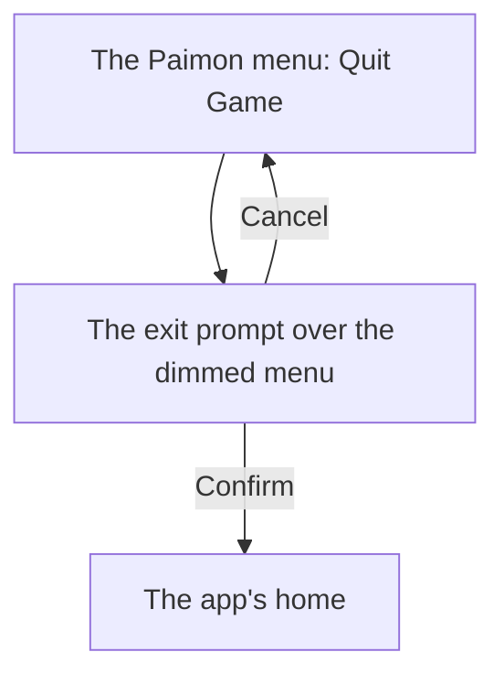

# Menu quit prompt

The [Paimon menu](../genshin-menu-paimon/design.md)'s side bar Quit Game opens an exit prompt over the menu. The current build's prompt asks "Are you sure you want to quit?" and offers two choices, Cancel and Confirm: Cancel and Confirm act as the [as-built Paimon menu](../../specs/genshin/paimon-menu/design.md) gives, and Confirm lands on the app's home, the login screen the recording shows. The prompt was first built with three choices, Continue Game, Exit to Login Interface and Exit to Desktop, from the 2024 build; this change re-specifies it to the current build. The [screens](../../specs/genshin/screens/design.md) page's state diagram and the [as-built Paimon menu](../../specs/genshin/paimon-menu/design.md) already draw the two choices.

## How it works

## Scope and order

1. **The prompt's scale, from the 2026 recording.** `yt-jHr2bERjkYc` (the recording [the Paimon menu change](../genshin-menu-paimon/design.md) describes) holds the current prompt whole at 30 seconds: the side bar's Quit Game is pressed at about 27 to 28 seconds, and by 29 seconds the dialog "Are you sure you want to quit?" sits over the dimmed menu. Confirm leads to the login screen, which the recording shows from about 37 seconds. The frame at 30 seconds is cut to `references/menu-quit-prompt/exit-prompt-current.png`, never committed. The HowTo Zone clip `asw7VW5QM1g`, clipped to `captures/yt-asw7VW5QM1g-logout.mp4`, does not show the prompt: it is a captioned infographic of Settings, Account and Log Out. The `exit-prompt` row of the parity reference map names where its screenshot was sampled from in `source`: `yt-kIDee7nyD0w` at 26.75 seconds, with the dialog's whole panel as its region. The first reading used the box above the buttons, 415 pixels high, which cut the choices off; the region is now 590 high.
2. **The measurements.** At 1080 high the frame's pixels are the game's, so the dialog and its choices are read off the frame directly:
   - the panel is 910 by 576 (`Exit/Index.vue`), read from the hover frame at 29 seconds of `yt-kIDee7nyD0w`, so it is centred on the screen; the 30-second frame gave 960 by 606 from (480, 237);
   - the question is centred across the panel's top, its line at about y 514 of the frame;
   - Cancel and Confirm are each 370 by 63, 66 and 475 pixels in from the panel's left (`Exit/Index.vue`);
   - each icon is a 40 unit disc 10 units in from its pill's left, centred on the pill's height;
   - the colours are sampled from clean bands of the 2026 frame at 29 seconds (`Exit/Index.vue`): panel `#e4e0da`, pills `#4a5365`, Cancel's cross `#50a5e0`, Confirm's ring `#f6cc52`, the question's ink `#4f5159`. The frame is a YouTube capture, so each carries a few units of compression error.
3. **The look.** The choices are Plain buttons with the dialog's own slate pill and hover and pressed rules (`Exit/Index.vue`), since the 2026 choices are slate. The Pill kind stays the World Level dialog's, which the frame draws cream. The menu behind the prompt is dimmed under a 66% backdrop, solved from the mean of the frame's margin round the panel (`Exit/Index.vue`), where the World Level dialog's 48% is the shared stylesheet's. Each icon is drawn as shapes, a blue cross and a yellow ring, since no glyph of either is traced.
4. **The re-measure.** `menu-quit-prompt.mkv` (3.1) re-measures the prompt at 60 frames a second, with each choice hovered and pressed. The public clip already gives the hover and pressed frames at 29 and 30.6 seconds (`menu-exit-hover`, `menu-exit-pressed`), so the longer clip re-measures them rather than supplying them. It does not gate the build. Searched 2026-10-29 for the 60 fps clip, on YouTube and in the Paimon menu's and quit-game queries: none found, and the public clip is 30 fps, so the 3.1 tick is PROVISIONAL on those rows; Cancel's hover and press still have no frame.

## Decisions

- **Cancel closes the prompt back to the menu.** No recording shows where Cancel goes. The menu is where the prompt opened from, and the World Level dialog closes back to its menu the same way, so Cancel returns there. This is unverified; the re-measure (3.1) is where a recording would settle it.
- **The prompt is a dialog inside the menu's screen.** The frame shows the menu behind the prompt, dimmed, so the prompt is drawn over it as the World Level dialog is, with the menu inert while it shows, rather than replacing it. Closing it with Cancel returns focus to Quit Game.

## Known gaps

- The frame's gold corners are drawn as four bracket shapes, not from the glyph, and the faint ornament inside the panel is not drawn. The corner glyph in `MenuDialogGlyphMap` is sized for the World Level dialog's frame, so reusing it on this panel is not verified.
- The tutorial's red arrow sits inside the panel above Confirm. The region includes it, so the parity score counts its pixels as a difference.
- The three-choice prompt's Continue Game key, `UI_LOGOUT_CONFIRM_CONTINUE_GAME`, is removed with its choice, and the Paimon browser test now expects the two choices.
- The prompt is scored by three rows, `exit-prompt`, `menu-exit-hover` and `menu-exit-pressed` in `ParityReferenceMap.ts`, none approved yet.
- `Exit/Index.vue` re-declares the `.exit` reference pixel and the absolute backdrop and centred dialog rules that `styles/menuDialog.css` owns for the World Level prompt, with the same comment copied. The values differ (66% against 48%, 910 by 576 against 960 by 606, another panel colour), so the duplicate is structure, not values. Whether the sheet owns the shared structure is open (4.1), and it waits on a visual parity check because importing the sheet also brings its `.choice` pill rules into Exit.

## Key files

| File                                                                    | Role after the change                                                                                                   |
| :---------------------------------------------------------------------- | :---------------------------------------------------------------------------------------------------------------------- |
| `packages/genshin-world/src/components/Menu/Exit/Index.vue`             | The prompt: the question, Cancel and Confirm over the dimmed menu, at the 2026 frame's measurements                     |
| `packages/genshin-world/src/components/Menu/Exit/Index.browser.test.ts` | The prompt's scale and its two choices' outcomes, unrun in this worktree                                                |
| `packages/genshin-world/src/components/Menu/Paimon/Index.vue`           | Hosts the prompt inside the menu's screen, the menu inert while it shows, and refocuses Quit Game when Cancel closes it |
| `packages/genshin-world/src/models/menu/MenuPromptIcon.ts`              | The prompts' icons, now the World Level dialog's only                                                                   |
| `packages/genshin-world/src/services/menu/MenuPromptGlyphMap.ts`        | The World Level dialog's lowering icon, traced                                                                          |
| `packages/genshin-text/src/models/GameTextKey.ts`                       | The question's, Cancel's and Confirm's text ids, and the three-choice keys removed                                      |
| `scripts/src/services/genshinParity/shared/ParityReferenceMap.ts`       | The `exit-prompt` reference: its screenshot, the dialog's whole panel                                                   |
