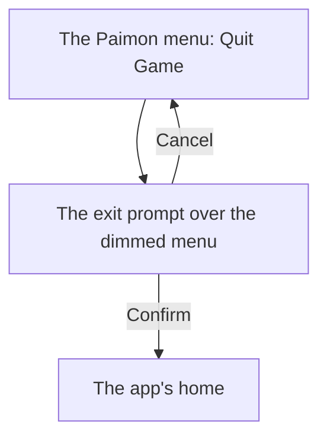

# Menu quit prompt

The [Paimon menu](../genshin-menu-paimon/design.md)'s side bar Quit Game opens an exit prompt over the menu. The current build's prompt asks "Are you sure you want to quit?" and offers two choices, Cancel and Confirm: Cancel closes it back to the menu, and Confirm leaves the world for the app's home, the login screen the recording shows. The prompt was first built with three choices, Continue Game, Exit to Login Interface and Exit to Desktop, from the 2024 build; this change re-specifies it to the current build. The [screens](../../specs/genshin/screens/design.md) page and the [as-built Paimon menu](../../specs/genshin/paimon-menu/design.md) record the three-choice prompt that this change replaces.

## How it works

## Scope and order

1. **The prompt's scale, from the 2026 recording.** `yt-jHr2bERjkYc` (Tech4Gamers, 56 seconds at 1920 by 1080 and 25 frames a second, dated 2026-05-15, the English PC client) holds the current prompt whole at 30 seconds: the side bar's Quit Game is pressed at about 27 to 28 seconds, and by 29 seconds the dialog "Are you sure you want to quit?" sits over the dimmed menu. Confirm leads to the login screen, which the recording shows from about 37 seconds. The frame at 30 seconds is cut to `references/menu-quit-prompt/exit-prompt-current.png`, never committed. The HowTo Zone clip `asw7VW5QM1g`, clipped to `captures/yt-asw7VW5QM1g-logout.mp4`, does not show the prompt: it is a captioned infographic of Settings, Account and Log Out. The `exit-prompt` row of the parity reference map names `yt-jHr2bERjkYc` at 30 seconds, with the dialog's whole panel as its region. The first reading used the box above the buttons, 415 pixels high, which cut the choices off; the region is now 606 high.
2. **The measurements.** At 1080 high the frame's pixels are the game's, so the dialog and its choices are read off the frame directly:
   - the panel is 960 by 606, from (480, 237), so it is centred on the screen;
   - the question is centred across the panel's top, its line at about y 514 of the frame;
   - Cancel is at (550, 735) and Confirm at (980, 735), each 390 by 67, with 40 between them and 70 in from the panel's sides;
   - each icon is a 38 unit box 14 units in from its pill's corner, so it is centred 33 units in;
   - the colours are sampled from clean bands of the frame: panel `#e2dfd8`, pills `#404a5e`, Cancel's cross `#2998dc`, Confirm's ring `#f7ca33`, the question's ink `#3a434b`. The frame is a YouTube capture, so each carries a few units of compression error.
3. **The look.** The choices use the interface's Row kind, with its cream pill look replaced by the slate, since the 2026 choices are slate. The Pill kind stays the World Level dialog's, which the frame draws cream. The menu behind the prompt is dimmed under the World Level dialog's 48% backdrop; this frame's own dim is not measured against an undimmed reference, so 48% is the game's dialog backdrop, not sampled here. Each icon is drawn as shapes, a blue cross and a yellow ring, since no glyph of either is traced.
4. **The re-measure.** `menu-quit-prompt.mkv` (3.1) re-measures the prompt at 60 frames a second, with each choice hovered and pressed, which no still of the current build holds. It does not gate the build.

## Decisions

- **Cancel closes the prompt back to the menu.** No recording shows where Cancel goes. The menu is where the prompt opened from, and the World Level dialog closes back to its menu the same way, so Cancel returns there. This is unverified; the re-measure (3.1) is where a recording would settle it.
- **The prompt is a dialog inside the menu's screen.** The frame shows the menu behind the prompt, dimmed, so the prompt is drawn over it as the World Level dialog is, with the menu inert while it shows, rather than replacing it. Closing it with Cancel returns focus to Quit Game.

## Known gaps

- The frame's gold corners and the faint ornament inside the panel are not drawn. The corner glyph in `MenuDialogGlyphMap` is sized for the World Level dialog's frame, so reusing it on this panel is not verified.
- The tutorial's red arrow sits inside the panel above Confirm. The region includes it, so the parity score counts its pixels as a difference.
- `UI_LOGOUT_CONFIRM_CONTINUE_GAME` (`GameTextKey.ContinueGame`) is kept only for the Paimon browser test, which still expects a Continue Game button. No part of the prompt draws it, so that test fails until it is updated.
- The prompt is not scored yet: `genshin:parity compare exit-prompt` is for the main session to run.

## Key files

| File                                                                    | Role after the change                                                                                                   |
| :---------------------------------------------------------------------- | :---------------------------------------------------------------------------------------------------------------------- |
| `packages/genshin-world/src/components/Menu/Exit/Index.vue`             | The prompt: the question, Cancel and Confirm over the dimmed menu, at the 2026 frame's measurements                     |
| `packages/genshin-world/src/components/Menu/Exit/Index.browser.test.ts` | The prompt's scale and its two choices' outcomes, unrun in this worktree                                                |
| `packages/genshin-world/src/components/Menu/Paimon/Index.vue`           | Hosts the prompt inside the menu's screen, the menu inert while it shows, and refocuses Quit Game when Cancel closes it |
| `packages/genshin-world/src/models/menu/MenuPromptIcon.ts`              | The prompts' icons, now the World Level dialog's only                                                                   |
| `packages/genshin-world/src/services/menu/MenuPromptGlyphMap.ts`        | The World Level dialog's lowering icon, traced                                                                          |
| `packages/genshin-text/src/models/GameTextKey.ts`                       | The question's, Cancel's and Confirm's text ids, and the three-choice keys removed                                      |
| `scripts/src/services/genshinParity/shared/ParityReferenceMap.ts`       | The `exit-prompt` reference: `yt-jHr2bERjkYc` at 30 seconds, the dialog's whole panel                                   |
