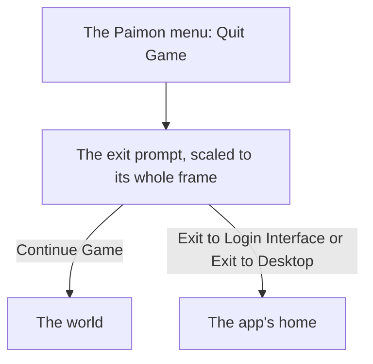

# Menu quit prompt

The [Paimon menu](../genshin-menu-paimon/design.md)'s side bar Quit Game opens an exit prompt over the menu, with Continue Game, Exit to Login Interface and Exit to Desktop. The prompt is built and its buttons work, as the [screens](../../specs/genshin/screens/design.md) page records, but it is drawn at a provisional scale and is not scored over its whole frame. This proposal scales it to the game's own frame.

## How it works

## Scope and order

1. **The prompt's scale, from a public clip.** `asw7VW5QM1g` (HowTo Zone, 46 seconds at 1920 by 1080, 2026-06-04) is clipped to `captures/yt-asw7VW5QM1g-logout.mp4` with `recreation clip --directory ~/Esposter/genshin-parity/captures ... --from 0 --to 46 --name logout`, but it does not show the prompt: it is a captioned infographic of Settings, Account and Log Out, whose logout opens "Are you sure you want to log out?" with Cancel and Confirm, and it never shows the side bar's Quit Game. The frame that holds the current prompt whole is in `yt-jHr2bERjkYc` (Tech4Gamers, 56 seconds at 1920 by 1080 and 25 frames a second, dated 2026-05-15, the English PC client), at 30 seconds: the side bar's Quit Game is pressed at about 27 to 28 seconds, and by 29 seconds the dialog "Are you sure you want to quit?" with Cancel and Confirm sits over the dimmed menu. Confirm returns to the login screen, which the recording shows from about 37 seconds. The `exit-prompt` row of the parity reference map names that capture and second, and its region is the dialog's box above its buttons, so `Menu/Exit` is scored against the game's own frame.
2. **The re-measure.** `menu-quit-prompt.mkv` re-measures it when it lands, its frame's scale being what the one still held lacks, without gating the build. The roadmap's Manual verification holds the clip.

## Open

The current build's prompt has two choices, Cancel and Confirm, where this proposal names three: Continue Game, Exit to Login Interface and Exit to Desktop, which come from the 2024 build's prompt (`yt-kIDee7nyD0w`, the reference the as-built screens page records). Confirm leads to the login screen, with no exit to the desktop in that recording. Tasks 2.1 and 2.2 wait on the user's decision: re-specify the prompt to the two choices the current build draws, or keep the three choices and accept that the reference scores them apart. Until then the `exit-prompt` row scores the current frame, and the component draws the three choices, so that row is expected to differ.

## Key files

| File                                                              | Role after the change                                                         |
| :---------------------------------------------------------------- | :---------------------------------------------------------------------------- |
| `packages/genshin-world/src/components/Menu/Exit/Index.vue`       | The prompt, its buttons and their look, drawn at the scale the reference sets |
| `scripts/src/services/genshinParity/shared/ParityReferenceMap.ts` | Gains the `exit-prompt` reference's capture and second                        |
