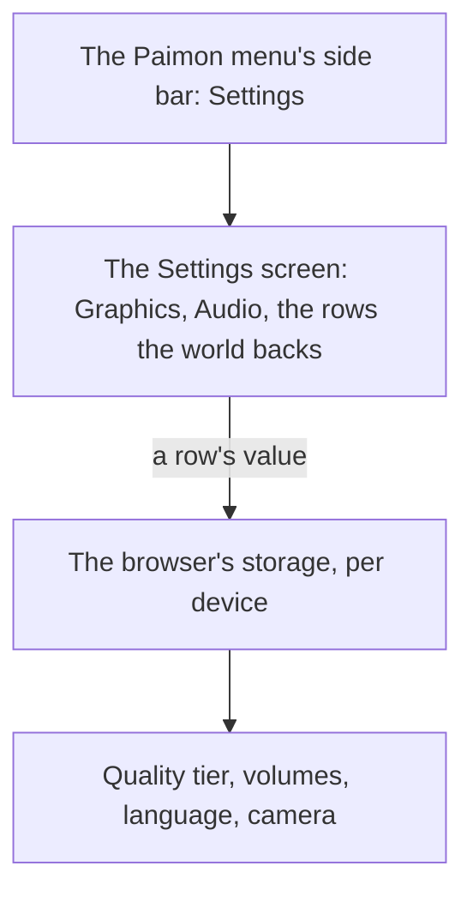

# Menu Settings screen

The [Paimon menu](../genshin-menu-paimon/design.md) opens a Settings screen from its side bar. Its tabs and the Graphics and Audio tabs' rows are drawn, laid out from a public recording and scored over the whole frame ([Paimon menu](../../specs/genshin/paimon-menu/design.md)), and the world does not yet open the screen. This proposal makes its rows work. It builds on the [screens](../../specs/genshin/screens/design.md) shell, on the [renderer's quality tiers](../../specs/genshin/rendering-style/design.md), on [game text](../../specs/genshin/game-text/design.md) for the language row, and on the [follow camera](../../specs/genshin/follow-camera/design.md), whose sensitivities and default distance this screen's Controls tab would show.

## Decisions

- **Settings shows only the rows the world has.** Each row the world backs is laid out with the game's name, range and default. Graphics Quality is the renderer's quality tier. Volume, Music Volume and SFX Volume run from 1 to 10 over the music's player and the sound effects. Game Language offers the fifteen languages of [game text](../../specs/genshin/game-text/design.md). The camera sensitivities and default distance belong to the follow camera. Settings are kept in the browser, as the game keeps its settings per device. A row the world does not back is drawn disabled with the value the recording shows, as the Paimon menu draws an entry whose screen is not built, so the screen says what the game has.

## How it works

## Scope and order

1. **Settings' rows**: the Graphics Quality row's choices and the store its value is kept in, and the Audio tab's volumes over the music's player and the sound effects.
2. **The Controls tab's defaults**, once the interface export holds the Settings screen itself: [follow camera](../genshin-follow-camera/design.md) owns the values.

## Key files

| File                                                                   | Role after the change                                                       |
| :--------------------------------------------------------------------- | :-------------------------------------------------------------------------- |
| `packages/genshin-world/src/components/Menu/Settings/Index.vue`        | The tabs and the Graphics and Audio tabs' rows, not yet opened by the world |
| `packages/genshin-engine/src/renderer/QualityTierSettingsMap.ts`       | The tiers the Graphics Quality row chooses between                          |
| `packages/genshin-text/src/models/GameTextKey.ts`                      | Gains every label of Settings                                               |
| `packages/genshin-world/src/components/Menu/Settings/Index.fixture.ts` | The fixture the screen is shot with, already in the tree                    |

## Sources

- [Settings](https://genshin-impact.fandom.com/wiki/Settings), Genshin Impact Wiki: the graphics quality, the volumes from 1 to 10, the fifteen game languages and the camera's rows, and settings kept per device.
