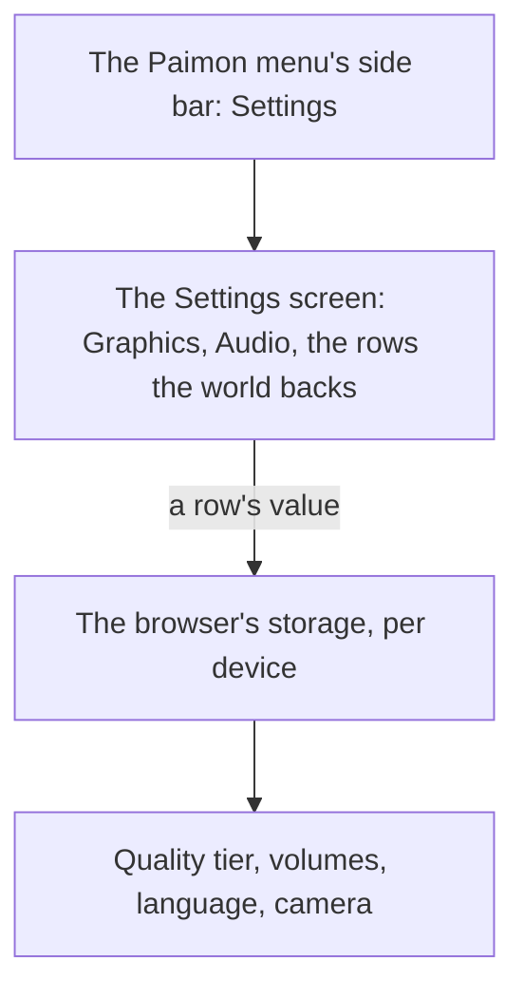

# Menu Settings screen

The [Paimon menu](../genshin-menu-paimon/design.md) opens a Settings screen from its side bar. Its tabs and the Graphics and Audio tabs' rows are drawn, laid out from a public recording and scored over the whole frame ([Paimon menu](../../specs/genshin/paimon-menu/design.md)), and the world does not yet open the screen. This proposal makes its rows work. It builds on the [screens](../../specs/genshin/screens/design.md) shell, on the [renderer's quality tiers](../../specs/genshin/rendering-style/design.md), on [game text](../../specs/genshin/game-text/design.md) for the language row, and on the [follow camera](../../specs/genshin/follow-camera/design.md), whose sensitivities and default distance this screen's Controls tab would show.

## Decisions

- **Settings shows only the rows the world has.** Each row the world backs is laid out with the game's name, range and default. Graphics Quality is the renderer's quality tier. Volume, Music Volume and SFX Volume run from 1 to 10 over the music's player and the sound effects. Game Language offers the fifteen languages of [game text](../../specs/genshin/game-text/design.md). The camera's sensitivities, default distance and slope pitch are kept here, and the follow camera reads them. Settings are kept in the browser, as the game keeps its settings per device. A row the world does not back is drawn disabled with the value the recording shows, as the Paimon menu draws an entry whose screen is not built, so the screen says what the game has.
- **Volumes are linear shares of the overall Volume, provisional.** The wiki gives each volume's range, 1 to 10, but not the curve between its levels. A channel plays at its level's share of the highest, times the overall Volume's share, in a straight line. Provisional until a recording measures the curve. `getChannelGain` owns it.
- **A tier chosen now renders from the world's next start, provisional.** The renderer, Windrise and the grass read the tier at setup, so the world keeps the tier it started with while the Graphics Quality row shows the one chosen. The wiki does not say when the game applies a change; the recreation takes it at the start of a world.
- **The settings are one JSON object under one browser key.** `genshin-settings` holds the language, the quality tier and the three volumes. A read keeps each stored field its schema accepts and takes the rest from the defaults, so a damaged or outdated value reads as the default for its field alone.
- **A chosen game language changes the Settings screen's labels only, provisional.** Its words load when the language is chosen, and the world keeps the reader's language. The wiki gives the fifteen languages and not which text each one changes; the recreation reads the choice as the screen's own.
- **Music and sound effects take their gains as they start.** The login's music and door sound, and the Oculus chime, read the stored gains when they start. The Settings screen is open only inside the world, so a change reaches the next sound that starts.
- **The Controls tab shows the camera rows the follow camera reads, provisional.** The rows come from the English PC client's Controls tab in the current-version recording `yt-5EmJX_RyuY8-menu-settings`, read at 13 seconds: the horizontal and vertical sensitivity, the default camera distance and the Y-axis reset are backed, and the aimed-shot sensitivities, combat camera settings, boat correction and control type are drawn disabled at the values it shows. The ranges come from the wiki's [Settings](https://genshin-impact.fandom.com/wiki/Settings) page: sensitivities 1 to 5, distance 4.5 to 6.0. The recording's values are the player's, not the defaults, so the defaults stay the follow camera's provisional 3, 3 and 5 until the Controls tab's export gives the game's ([follow camera](../genshin-follow-camera/design.md) 3.2).
- **The Key Bindings tab draws the Actions keys as key caps, and they are not rebindable.** The first page of Actions in the same recording, at 30 seconds, gives the twelve rows of the list, with mouse buttons written Left Click and Right Click since the recording draws them as icons. The labels are game text; the key names are literal, since the dump's key names are editor strings. The wiki's [Controls](https://genshin-impact.fandom.com/wiki/Controls) Basic Settings column agrees with the page except that it also lists Rotate Camera, which the recording's list does not show. The rest of Actions and the Menus group are not built yet.
- **The Y-axis reset is a switch the follow camera follows.** "Camera Y-Axis Resets Automatically" is the slope pitch: On has the camera's Y-axis adjust itself to the terrain as the character climbs or descends, as the wiki's [Settings](https://genshin-impact.fandom.com/wiki/Settings) page describes it. The row is a two-state choice that flips between On and Off on a click, and it starts Off, since the wiki gives no default for it. A click flips it rather than opening a list, because the game's list is not read yet. The [follow camera](../genshin-follow-camera/design.md) reads it when it is made.
- **A range slider snaps to its steps, and a volume's drag runs straight across its track.** The sensitivities step by 1 and the distance by 0.1, the distance's step provisional. A volume's drag now runs from its first level to its last across the track, replacing the rounded tenth share, so both ends land exactly.
- **The follow camera reads the stored camera settings when it is made.** A change applies from the next follow session, as a tier applies from the next world start.

## How it works

## Scope and order

1. **Settings' rows**: the Graphics Quality row's choices and the store its value is kept in, the Audio tab's volumes over the music's player and the sound effects, the Language tab's game language, and the Controls tab's camera rows and Actions keys.
2. **The Controls tab's defaults**, once the interface export holds the Settings screen itself: [follow camera](../genshin-follow-camera/design.md) owns the values.

## Key files

| File                                                                   | Role after the change                                                                            |
| :--------------------------------------------------------------------- | :----------------------------------------------------------------------------------------------- |
| `packages/genshin-world/src/components/Menu/Settings/Index.vue`        | The tabs and the Graphics, Audio and Language tabs' rows, opened from the Paimon menu's side bar |
| `packages/genshin-world/src/services/menu/readGenshinSettings.ts`      | Reads the stored settings over the defaults, one field at a time                                 |
| `packages/genshin-world/src/services/menu/getChannelGain.ts`           | The gain a channel plays at, from the stored volumes                                             |
| `packages/genshin-world/src/components/World/Session/Index.vue`        | Keeps the settings on this device and gives the Settings screen its slot                         |
| `packages/genshin-world/src/components/Login/Music/Index.vue`          | The login's music and door sound, through the stored gains                                       |
| `packages/genshin-world/src/services/statue/playOculusSound.ts`        | The Oculus chime, through the stored sound-effect gain                                           |
| `packages/genshin-engine/src/renderer/QualityTierSettingsMap.ts`       | The tiers the Graphics Quality row chooses between                                               |
| `packages/genshin-text/src/models/GameTextKey.ts`                      | Gains every label of Settings                                                                    |
| `packages/genshin-world/src/services/menu/getFollowCameraSettings.ts`  | The follow camera's sensitivities, default distance and slope pitch, from the stored settings    |
| `packages/genshin-world/src/components/World/Character/Index.vue`      | The follow camera, made with the stored sensitivities and default distance                       |
| `packages/genshin-world/src/services/menu/snapToRange.ts`              | Holds a slider's value to its range's steps, for the Range rows and the volumes                  |
| `packages/genshin-world/src/models/menu/ToggleSetting.ts`              | The setting a toggle row flips, by its name in the stored settings                               |
| `packages/genshin-world/src/components/Menu/Settings/Index.fixture.ts` | The fixture the screen is shot with, already in the tree                                         |

## Sources

- [Settings](https://genshin-impact.fandom.com/wiki/Settings), Genshin Impact Wiki: the graphics quality, the volumes from 1 to 10, the fifteen game languages and the camera's rows, and settings kept per device.
- [Controls](https://genshin-impact.fandom.com/wiki/Controls), Genshin Impact Wiki: the Basic Settings' default keys for the Actions list, the PC column.
