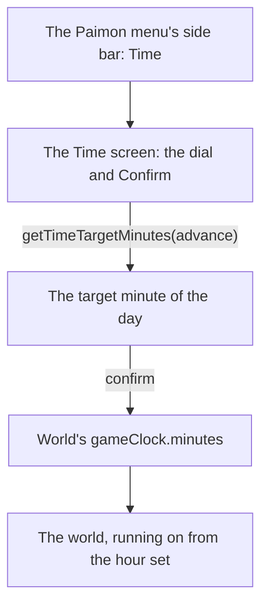

# Menu Time screen

The [Paimon menu](../../specs/genshin/paimon-menu/design.md) opens a Time screen from its side bar, which the menu's shell reaches but does not yet draw. It builds on the [menu screens](../../specs/genshin/screens/design.md) shell, on the [sky and time](../../specs/genshin/sky-and-time/design.md) clock, whose control of the hour it becomes, and on the [Paimon menu](../genshin-menu-paimon/design.md) proposal, which lays out the menu it opens from.

## Decisions

- **Time is the game's own control of the clock.** Its screen sets an hour at least half an hour ahead of the current one and at most two days on, never back, as the game allows. It sets the running clock's minute, `gameClock.minutes` of `World/Windrise`, and never `heldMinutes`, which holds the clock still for a reference's frame; the clock runs on from the hour set. Its dial counts whole turns as days, as the game's does, and a confirm lands at the target's minute of the day. It is the world's one control of the hour, and that control is the game's: no clock control of the world's own is drawn.
- **Time is laid out from a public clip until its recording lands.** `a4_J84iMqR0` on YouTube, 60 seconds at 1920 by 1080, shows the English PC client's Time screen opened from the menu, its dial turned and confirmed. Its frame is the screen's reference, and `menu-time.mkv` re-measures it later without gating the build.
- **The dial keeps its advance within the bounds as the pointer turns it.** `stepTimeDialAdvance` adds the shorter turn the pointer makes, a full turn being a day, and clamps the result, so a drag back past thirty minutes moves the hand again as soon as the pointer comes forward; `getTimeTargetMinutes` clamps the same bounds as the rule for any caller. The hour is drawn on a 24-hour face under the label `TimeWaitUntil` (`UI_CLOCK_PAGE_TO_TIME`, "Wait Until"). Its confirm is `TimeConfirm`, given the level-up dialog's OK, the one "Confirm" text the main UI holds, until the clip's own label is checked at the compare.

## How it works



## Scope and order

1. **Time, built now from the public clip.**
   - **The rule.** A new `getTimeTargetMinutes.ts` takes the clock's minute and the advance the dial asks for, clamps the advance to `TIME_MINIMUM_ADVANCE_MINUTES` (30) and `TIME_MAXIMUM_ADVANCE_MINUTES` (2880), both added to `services/menu/constants.ts`, and returns the target's minute of the day modulo the engine's `MINUTES_PER_DAY`. `getTimeTargetMinutes.test.ts` beside it asserts an advance of 10 lands 30 on, one of 3000 lands 2880 on, and an advance past midnight wraps.
   - **The reference.** `pnpm -C scripts recreation clip --directory ~/Esposter/genshin-parity/captures https://www.youtube.com/watch?v=a4_J84iMqR0 --from 0 --to 60 --name time`, then `pnpm -C scripts genshin:parity frames yt-a4_J84iMqR0-time.mp4 2` for its contact sheet. The builder picks the first still showing the dial at rest with nothing hovered and names it in `ParityReferenceMap` as `"menu-time": { capture: "yt-a4_J84iMqR0-time.mp4", screen: "MenuTime", seconds: <second> }`.
   - **The screen.** `components/Menu/Time/Index.vue` with `Index.fixture.ts` draws the dial, the hour it points at and the Confirm button, laid out in the reference's own pixels as `Menu/Paimon` is, with its words as `GameTextKey`s found by `pnpm -C scripts genshin:text find "<regex>"` and written with `genshin:text write`. A pointer dragged round the dial adds its turns to the advance, and Confirm emits `confirm` with `getTimeTargetMinutes`'s result.
   - **The wiring.** `World/Windrise` adds `gameClock` to its `defineExpose`, and `World/Session` fills `#[ScreenKind.Time]` with `MenuTime`, setting `windrise.value.gameClock.minutes` on `confirm` and closing back to the world.
   - **The check.** `pnpm -C scripts genshin:parity compare menu-time` writes its row, and the comparison is queued for the user's eyes.

## Key files

| File                                                             | Role after the change                                |
| :--------------------------------------------------------------- | :--------------------------------------------------- |
| `packages/genshin-world/src/components/World/Windrise/Index.vue` | Exposes `gameClock`, the minute the Time screen sets |
| `packages/genshin-text/src/models/GameTextKey.ts`                | Gains the Time screen's labels                       |

New files:

```text
packages/genshin-world/src/services/menu/getTimeTargetMinutes.ts
packages/genshin-world/src/components/Menu/Time/Index.vue
packages/genshin-world/src/components/Menu/Time/Index.fixture.ts
```

## Sources

- [Time](https://genshin-impact.fandom.com/wiki/Time), Genshin Impact Wiki: one in-game minute a second, the Time option advancing from half an hour to two days ahead, and the clock paused in the menu but not in photo mode.
