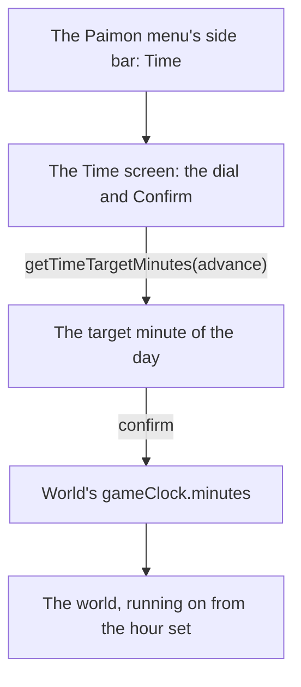

# Menu Time screen

The [Paimon menu](../../specs/genshin/paimon-menu/design.md) opens a Time screen from its side bar, which the menu's shell reaches but does not yet draw. It builds on the [menu screens](../../specs/genshin/screens/design.md) shell, on the [sky and time](../../specs/genshin/sky-and-time/design.md) clock, whose control of the hour it becomes, and on the [Paimon menu](../genshin-menu-paimon/design.md) proposal, which lays out the menu it opens from.

## Decisions

- **Time is the game's own control of the clock.** Its screen sets an hour at least half an hour ahead of the current one and at most two days on, never back, as the game allows. It sets the running clock's minute, `gameClock.minutes` of `World/Windrise`, and never `heldMinutes`, which holds the clock still for a reference's frame; the clock runs on from the hour set. Its dial counts whole turns as days, as the game's does, and a confirm lands at the target's minute of the day. It is the world's one control of the hour, and that control is the game's: no clock control of the world's own is drawn.
- **Time is laid out from a public clip until its recording lands.** `a4_J84iMqR0` on YouTube, 60 seconds at 1920 by 1080, shows the English PC client's Time screen opened from the menu, its dial turned and confirmed. Its frame is the screen's reference, and `menu-time.mkv` re-measures it later without gating the build.
- **The dial keeps its advance within the bounds as the pointer turns it.** `stepTimeDialAdvance` adds the shorter turn the pointer makes, a full turn being a day, and clamps the result, so a drag back past thirty minutes moves the hand again as soon as the pointer comes forward; `getTimeTargetMinutes` clamps the same bounds as the rule for any caller. The hour is drawn on a 24-hour face under the label `TimeWaitUntil` (`UI_CLOCK_PAGE_TO_TIME`, "Wait Until"). The clock's own time sits under `TimeCurrent` ("Current Time", "UI_CLOCK_PAGE_CURRENT_TIME"), and the day under the hour is `TimeToday` ("Today", "UI_TIMECHANGE_TODAY"), drawn while the hour falls on the clock's own day; past midnight the game's day words are "Tomorrow" ("UI_TIMECHANGE_TOMORROW") and "Day After Tomorrow" ("UI_TIMECHANGE_AFTERTOMORROW"), which the screen does not draw yet. Its confirm is `TimeConfirm`, given the level-up dialog's OK, the one "Confirm" text the main UI holds, until the clip's own label is checked at the compare.
- **The 10-second frame is settled, so the reference stays as cut, and the game draws no Confirm pill at rest.** The clip's Time screen was sampled at every second from 0 to 16 s and every 2 s from 17 to 59 s (ffmpeg frames, read by eye), and the world strip's luminance was measured frame by frame. The screen is up by about 6.7 s: the strip's luminance settles at 66.1 by then and holds through 8.6 s, so 10 s is not a fade, and hypothesis (a) is refuted. At 7, 8 and 9 s the game shows a controller hint at the bottom right ("L Time", "X Confirm", "O Return") while the hour turns from 07:46 to 18:00 Today; at 10 s the hint is gone and the dial rests, and the frames from 10 to 19 s show the same settled screen. No sampled frame from 10 to 59 s shows a Confirm pill, a title or a close cross. Hypothesis (b) holds for those three, since the game draws them in no state the clip shows, but the one Confirm the game draws is a hint in another place, shown in the screen's first seconds while the hour turns (the clip cannot separate the turn from the opening, since the hint goes as the dial rests), so the pill has no state of its own to match. Gating the pill to the dial's input would leave Confirm unreachable by pointer at rest, so the pill, the title and the cross stay as the screen's deliberate deviations (parity is not the goal; deviations are listed), and no state is built to match them.
- **The 1.53% split by rectangle.** An independent read of both files gives a frame mean of 1.55%, with the Confirm pill's rectangle (810, 880, 300 by 72) holding 0.74 points, the dial's right rim (1280 to 1600 by 360 to 720) 0.44, the cross 0.05 and the title 0.01. Without the pill the row would read about 0.8%, under the bar, so the pill decides the row; the rim is the dial's own art, which the gear art would settle if the install's extraction held it.

## How it works



## Scope and order

1. **Time, built now from the public clip.**
   - **The rule.** A new `getTimeTargetMinutes.ts` takes the clock's minute and the advance the dial asks for, clamps the advance to `TIME_MINIMUM_ADVANCE_MINUTES` and `TIME_MAXIMUM_ADVANCE_MINUTES`, both added to `services/menu/constants.ts`, and returns the target's minute of the day modulo the engine's `MINUTES_PER_DAY`. `getTimeTargetMinutes.test.ts` beside it asserts an advance of 10 lands on the minimum, one of 3000 on the maximum, and an advance past midnight wraps.
   - **The reference.** `pnpm -C scripts genshin:parity recordings clip https://www.youtube.com/watch?v=a4_J84iMqR0 --from 0 --to 60 --name time`. The still at ten seconds is picked by hand from the clip, cut into the references, and named in `ParityReferenceMap` as `"menu-time": { source: "yt-a4_J84iMqR0-time.mp4 at 10s", screen: "MenuTime" }`; no contact sheet. It shows the dial already turned to 18:00 Today from the clock's 03:52, not at rest, so the entry seeds the dial's `initialAdvance` at 848 minutes, and it shows no title, close cross or Confirm.
   - **The screen.** `components/Menu/Time/Index.vue` with `Index.fixture.ts` draws the dial, the hour it points at and the Confirm button, laid out in the reference's own pixels as `Menu/Paimon` is, with its words as `GameTextKey`s found by `pnpm -C scripts genshin:text find "<regex>"` and written with `genshin:text write`. A pointer dragged round the dial adds its turns to the advance, and Confirm emits `confirm` with `getTimeTargetMinutes`'s result.
   - **The wiring.** `World/Windrise` adds `gameClock` to its `defineExpose`, and `World/Session` fills `#[ScreenKind.Time]` with `MenuTime`, setting `windrise.value.gameClock.minutes` on `confirm` and closing back to the world.
   - **The check.** `pnpm -C scripts genshin:parity compare menu-time` writes its row: 1.53% against a 1% bar, above it. The split of that error by rectangle is in the Decisions entry above; the Confirm pill decides the row. The gear art is not in the install's extraction (no extracted asset is named for the Time dial), so the disc stays hand-drawn, and task 4.1 stays open for the owner's call on the pill.

## Key files

| File                                                             | Role after the change                                |
| :--------------------------------------------------------------- | :--------------------------------------------------- |
| `packages/genshin-world/src/components/World/Windrise/Index.vue` | Exposes `gameClock`, the minute the Time screen sets |
| `packages/genshin-text/src/models/GameTextKey.ts`                | Gains the Time screen's labels                       |

New files:

```text
packages/genshin-world/src/services/menu/getTimeTargetMinutes.ts
packages/genshin-world/src/components/Menu/Time/Index.vue
packages/genshin-world/src/components/Menu/Time/Index.fixture.ts
```

## Sources

- [Time](https://genshin-impact.fandom.com/wiki/Time), Genshin Impact Wiki: one in-game minute a second, the Time option advancing from half an hour to two days ahead, and the clock paused in the menu but not in photo mode.
