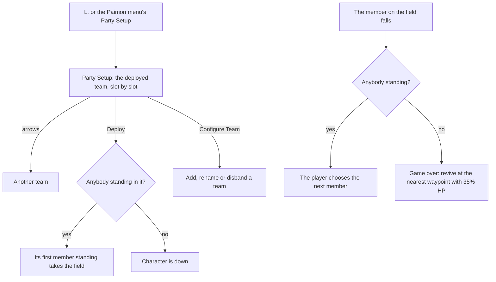

# Party

This page builds on the [party](../../specs/genshin/party/design.md) as built: the teams, their rules, the deployed one and the member on the field, switched by `1` to `4` and `Left Alt` with them, and the Elemental Resonance effects built so far. It also builds on the [HUD](../../specs/genshin/hud/design.md), whose portraits down the right show the deployed team, and on [combat](../../specs/genshin/combat/design.md), whose damage makes a character fall.

## Decisions

- **Party Setup is a screen of its own on `L`.** It shows the deployed team, slot by slot, over the region's background, and arrows at its edges step between the teams. Configure Team lists every team with its name, members and elements, and adds or disbands one; Quick Setup picks members in order. The [screens](../../specs/genshin/screens/design.md)' placeholder holds its shortcut until then.
- **The choice of the next member and the game over screen.** The game plays the fall, lets nobody switch until it ends, then asks the player for the next member; once every member is down, the game over screen offers a revive at the nearest teleport waypoint with 35% HP. The next member is the player's choice from the end of the fall, the world bringing none on its own; the HUD does not yet prompt for it. Until the game over screen is built, a fallen team revives on its own at the nearest unlocked teleport waypoint, at 35% HP, and stays where it fell when none is unlocked; the [party](../../specs/genshin/party/design.md) page still describes the statue it replaces.
- **The fall lasts two seconds, provisionally.** The wiki gives no length for a fall, which the game plays as its fallen animation and voice-over, so `PARTY_FALL_SECONDS` is an estimate until a recording of a fall is measured. The fall is a countdown on the party that the save does not keep, so a reload onto a fallen member asks for the next one at once.
- **A Moondrift counts as a shield for Enduring Rock.** The [Enduring Rock](https://genshin-impact.fandom.com/wiki/Enduring_Rock) page of the Genshin Impact Wiki gives the Moondrift clause in those words: DMG dealt rises and enemies' Geo RES falls "when characters protected by a shield or when Moondrifts formed by Lunar-Crystallize reactions are nearby". The check takes the Moondrifts the party holds and the field character's position, within the radius a Moondrift is near a character at. The kit paths that strike or price a hit pass that position, and a read without one, the healing path, counts no Moondrift, since healing takes none of Enduring Rock's DMG.
- **A downed member's kit takes no press.** While the member on the field is down, its kit starts nothing from a press, while the team's effects, Moondrifts and enemy statuses keep stepping, so a fall ends the member's own actions and not the world's.
- **The party is kept between visits**, as the game keeps it on its server: the teams, the deployed one, the member on the field and who is down, beside the player's characters. It is a slice of the world's [save](../../specs/genshin/save-data/design.md), added as every slice after the wallet is, [latest shape only](../../specs/architecture/persisted-data-latest-shape-only/design.md), and a new player's save holds the new player's party. The save is kept by the account as well as in the browser, so the party is too.
- **The save holds who is down, not each member's HP.** A reload brings every standing member back at full HP, with no energy or cooldown spent, which is the down state the [party spec](specs/genshin/party/spec.md) keeps. A guest's party merges into the account's by the account's copy, as the bag does. The world reads the kits of the deployed team the save holds rather than the starting team's, so a team deployed on a visit has its kits built before the world opens.
- **Party Setup's layout is the 4.0 screen, read off a public clip.** The current Party Setup, its region's background behind four standing members, is shown at 1080p and 60 frames a second in a public clip ([NEW PARTY SETUP SCREEN](https://www.youtube.com/watch?v=greLeGJE-Jg), 57 seconds). The screen is built from that clip's frames; the build does not wait for a recording, which measures it again later.

## How it works



## Scope

**Today:** the party's state and rules, switching on `1` to `4` and a pad's directions in play, a burst on a switch with `Left Alt`, the teams added, renamed and disbanded as rules, Elemental Resonance as a rule with its built effects on the stats, the strikes, the reactions, the skills and the stamina, the deployed team down the [HUD](../../specs/genshin/hud/design.md)'s right, and the [character screen](../../specs/genshin/character-screen/design.md) on `C`.

**This adds, in order:**

```text
packages/genshin-interface/src/components/PartySetupScreen/Index.vue
packages/genshin-world/src/components/Party/Screen/Index.vue
```

1. **Party Setup's screen, built from its clip's frames.** Its 57-second clip (`greLeGJE-Jg`, `--from 0 --to 57 --name party-setup`) is cut and framed the way [the cooking screen](../archive/2026-10-18-genshin-cooking/design.md) is, then `genshin:parity frames` over it at one a second; the builder looks through them and keeps, through `genshin:parity frame <capture> --at <s> --name party-setup`, one showing the deployed team at rest with its name, arrows and buttons in view. Build `PartySetupScreen` in `genshin-interface` (`components/PartySetupScreen/Index.vue` and `Index.fixture.ts`): the team's name, the arrows stepping between teams, four slots each naming its member with level and element mark (an empty slot's plus), and the Deploy, Configure Team and Quick Setup buttons, placed off that frame and worded by text id where `GameTextKey` holds the word. The added team's name, "Team Standing By", is an English constant marked provisional until the decoded text holds its text id. Its world wrapper `components/Party/Screen/Index.vue` holds the `Party` and emits the team stepped to and the deploy through `deployPartyTeam`'s rules, and `components/World/Session/Index.vue` fills `MenuScreen`'s `ScreenKind.PartySetup` slot with it, as it fills the Wish slot, in place of `Menu/Placeholder`. The members stand as 2D name plates in this slice; their models follow the character screen's in a later one. A reference for the frame goes in `ParityReferenceMap`, its compare is queued for the user's eyes, and the standing members' models and Configure Team and Quick Setup's screens follow over the same rules.
2. **The choice of the next member and the game over screen**, in place of the automatic next member and the statue's revive.
3. **Elemental Resonance's effects that need a mechanism not built yet**, each one the party's or the combat's to add when the mechanism lands:
   - The affliction durations: Fervent Flames' Cryo, Soothing Water's Pyro, High Voltage's Hydro and Shattering Ice's Electro, each affecting the party member for 40% less time. The party members hold no elemental state and enemies' strikes apply none to them, so there is no duration to shorten. An aura's decay rate is set in `applyAura` with no party context, so the resonances must reach `applyElement` first.
   - High Voltage's Electro particle, 100% on Superconduct, Stellar-Conduct, Overloaded, Electro-Charged, Lunar-Charged, Quicken, Aggravate and Hyperbloom, on a 5 second cooldown. No reaction gives a particle yet, since an enemy drops energy only at its health thresholds, and no cooldown is kept for the team.
   - Enduring Rock's Moondrift clause. A Moondrift formed by Lunar-Crystallize nearby gives the same DMG and Geo RES as a shield does; Moonsign is built, so this clause is built with this change.
   - Sprawling Greenery's Hyperbloom and Burgeon, which a Dendro Core's reactions give and no strike triggers yet.
4. **The party kept between visits**, as the save's party slice the Decisions describe, which the account and the browser keep as they keep the rest of the save.

## Key files

| File                                                                     | Role                                                 |
| :----------------------------------------------------------------------- | :--------------------------------------------------- |
| `packages/genshin-world/src/models/party/Party.ts`                       | The state Party Setup edits and the HUD reads        |
| `packages/genshin-world/src/services/party/addPartyTeam.ts`              | The team rules Configure Team's add goes through     |
| `packages/genshin-world/src/services/party/disbandPartyTeam.ts`          | The team rules Configure Team's disband goes through |
| `packages/genshin-world/src/components/World/Session/Index.vue`          | Fills Party Setup's screen slot                      |
| `packages/genshin-world/src/services/screen/ScreenKindGameTextKeyMap.ts` | Party Setup's title, already the game's              |

## Sources

- [Party](https://genshin-impact.fandom.com/wiki/Party), Genshin Impact Wiki: Party Setup, Configure Team and Quick Setup, the four default teams, "Team Standing By", fifteen teams at most, the deployed team never disbanded, and the region's background.
- [Fallen Character](https://genshin-impact.fandom.com/wiki/Fallen_Character), Genshin Impact Wiki: the fall, nobody switching during it, the game over and the revive at the nearest waypoint with 35% HP.
- [Team Bonus](https://genshin-impact.fandom.com/wiki/Team_Bonus), Genshin Impact Wiki: each affliction duration, High Voltage's particle and its cooldown, and the Moondrift and Lunar-Bloom clauses.
