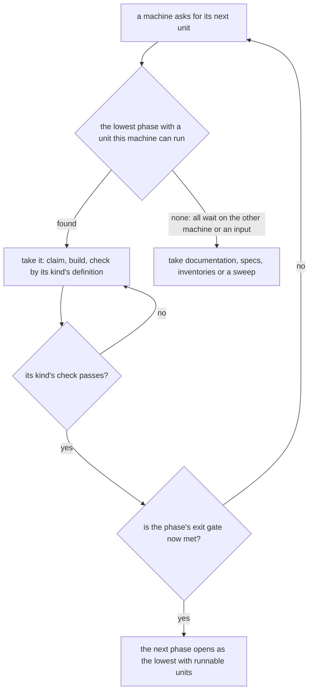

# Genshin phases

The recreation is a large set of units of work: assets converted from the game, datasets, render passes, regions, screens, systems and quests. They depend on one another in a known order, but the work is taken in the order a machine can run it, so a screen is redrawn while the pass under its backdrop is still open, a quest is specified before the dialogue engine it plays on exists, and no unit says what finished means. This page orders the units into phases with gates, defines done for each kind, and fixes how the next unit is chosen.

## Decisions

- **A phase is a gate, not a priority.** It is a finished state of the whole recreation, and a unit belongs to the lowest phase whose gate fails without it. The roadmap's order inside a phase is still the priority, and the building-proposals rule against a hand-kept priority field stands: nothing here ranks units, it only says which gate they hold.
- **Done is defined by the kind of unit, once.** Every kind has one definition (below) that names its check. A unit is not done on its author's say; it is done when its kind's check passes.
- **A machine takes the lowest phase's runnable unit.** A unit the machine cannot run, because it needs the other machine's game install or a recording nobody has, is passed over, so the Mac and the PC both stay busy and neither waits on the other. Documentation, specs, inventories and sweeps are runnable everywhere and never wait.
- **Progress is computed, never written.** A report reads the tree and prints each phase's units by kind as done, runnable here, waiting and blocked, so no page carries a count.
- **No phase is built strictly after the last.** Rejected: a waterfall that holds every unit until the one before it is done, because a unit that needs the PC would stop the Mac's whole queue. The pick rule gets the order without the idle time.
- **No vertical slice per region before the shared layers hold.** Rejected: building Mondstadt end to end first, then Liyue, because each slice would reopen the engine, the passes and the interface it stands on, and those are measured once. The regions are slices only after the layers under them are done.

## The phases

| Phase | Name              | What it holds                                                                                                                                                           | Exit gate                                                                                                                                                       |
| :---- | :---------------- | :---------------------------------------------------------------------------------------------------------------------------------------------------------------------- | :-------------------------------------------------------------------------------------------------------------------------------------------------------------- |
| 0     | Foundation        | The conversion pipeline, a spec and a recipe for every asset family, the measures and gates, the definitions of done, the progress report                               | A fresh PC and Mac pair reproduces every published dataset and fit from the install; every asset family has a spec and a recipe; every kind of unit has a check |
| 1     | The look          | The engine and the recreation passes, proven on the first scenes (the login, Windrise): camera, shapes, surface, display, light, air, sky                               | Every pass of the login and of Windrise holds and is frozen at every hour and weather, each reference scores under its bar, and the frame cost holds            |
| 2     | The interface     | The shared interface pieces, the opening and the login screens, the Paimon menu and every screen every region needs                                                     | Every screen's parity ids are under their bars in every state it shows, with the game's words by key and every art gap on the roadmap                           |
| 3     | The playable core | The character controller, the follow camera, the HUD, the kit framework with the Traveler, combat and enemy frameworks, inventory, save, the quest and dialogue engines | A scripted session plays from the opening: walk, climb, glide, swim, fight, collect, open the menu, save and load, and a quest runs from its table              |
| 4     | Mondstadt         | The first region at its bar, with its quests, puzzles, domains, shops, residents and spawned places                                                                     | The region's passes hold and are frozen, its spawned places and residents are placed, and its first quest chain plays through in a scripted session             |
| 5     | The other regions | Each remaining region in the game's release order, as a slice of the same shape as Mondstadt                                                                            | Each region meets Mondstadt's gate, region by region                                                                                                            |
| 6     | The systems       | The breadth: every character kit, crafting, cooking, fishing, the card game, the Abyss, the Theater, the realm, achievements and the archive                            | Each system's scenarios pass, it is reachable through a finished screen, and its data is read from the hosted game data                                         |
| 7     | Fidelity          | Effects, audio and music, performance, accessibility and every client language                                                                                          | Each reference of the game in a state a person can reach scores under its bar, the frame and load budgets hold, and no art gap is left unrecorded               |

A unit that serves one region sits in that region's phase, a shared interface piece in phase 2, a shared engine page in phase 1. A unit that two gates need sits in the lower one.

## Done, by kind of unit

| Kind         | Done when                                                                                                                                                                                                                               | Checked by                                                                           |
| :----------- | :-------------------------------------------------------------------------------------------------------------------------------------------------------------------------------------------------------------------------------------- | :----------------------------------------------------------------------------------- |
| Asset family | The recipe was followed from the install: an extraction, a fit that writes our parameters, our generator drawing them, the parameters published, and no game art in the repository, the build or the deployment                         | the fit and publish dry runs, then `genshin:parity compare` of what it draws         |
| Dataset      | The builder is proven by its dry run, the lock is committed, the reader is typed at the boundary that awaits it, and a test reads it                                                                                                    | `genshin:data`, `genshin:text` and `genshin:assets` dry runs, then the reader's test |
| Render pass  | The pass's measure holds its gate on every reference of the scene and is frozen                                                                                                                                                         | `genshin:parity passes`                                                              |
| Region       | Its passes are frozen, its layout is read from the game's tiles, its kits, flora and weather are drawn, its spawned places are placed, and the frame cost holds                                                                         | `genshin:parity passes`, the load-budget tests                                       |
| Screen       | Every parity id of the screen is under its bar in every state it shows (rest, hover, pressed, disabled), its words are `GameTextKey` keys, a missing art piece is a roadmap line and not a private one-off, and its browser test passes | `genshin:parity compare` for each id, the visual suite                               |
| System       | Its scenarios have tests, its tables come from the hosted game data, a stored shape it adds is backfilled, and a finished screen reaches it                                                                                             | the scenario tests and the screen's check                                            |
| Quest        | Its steps, conditions and rewards run from the game's tables, a scripted session plays it to its end including a save and a load in the middle, its words are keys, and what it changes in the world persists                           | a scenario test over a scripted session                                              |

Two checks do not exist yet: the scripted-session harness a quest's and the playable core's gate need, and the check that a system is reachable through a finished screen. Each is a Phase 0 unit until it is built; until then a unit of that kind is done on its other checks and the report lists the missing one.

## How the pick works

`pnpm ai:fleet:next` reads the unit's phase and takes the lowest phase's first unit that the machine's capabilities satisfy and no claim holds. A machine without the game install cannot take a unit that needs it, so on the Mac the lowest runnable phase is often above the PC's; that is the rule working, since the PC takes the lower unit. `pnpm ai:proposals:report` lists the open proposals grouped by phase for the same reason.

## Classifying

Every open roadmap item sits under its phase's heading in the Genshin roadmap, every Genshin change names its phase in its metadata, and a compute item takes the phase of the area it measures. The classification question is one: which phase's gate fails without this unit. A unit that spans two gates is split along the gate.

## The progress report

The report prints, for each phase, its units by kind, each as done, runnable on this machine, waiting on a named blocker, or blocked on the other machine, and the state of each exit check that a command can read today: a region's passes frozen, a screen's ids under their bars, a dataset's lock current. It is computed from the checkboxes, the compute pages, the parity snapshots and the locks. A check with no command yet prints as not measurable, never as passing.

## Key files

| File                                                  | Role                                                                |
| :---------------------------------------------------- | :------------------------------------------------------------------ |
| `openspec/changes/genshin-roadmap/tasks.md`           | the open work, grouped under the phase each unit holds              |
| `openspec/changes/genshin-program/design.md`          | the program's order of pages, which the phases supersede with gates |
| `openspec/specs/genshin/compute/README.md`            | the compute pages, whose items take their area's phase              |
| `.agents/skills/throughput/references/fleet.md`       | the pick of the next entry, which reads the phase                   |
| `scripts/src/services/fleet/parseProposalMetadata.ts` | the change metadata model, which gains the phase field              |

## Sources

- The program page's four phases and its order of pages, which this change gives gates.
- The recreation passes' rule that a later pass is worked only once every earlier pass holds, which the phases lift from one scene to the whole recreation.
