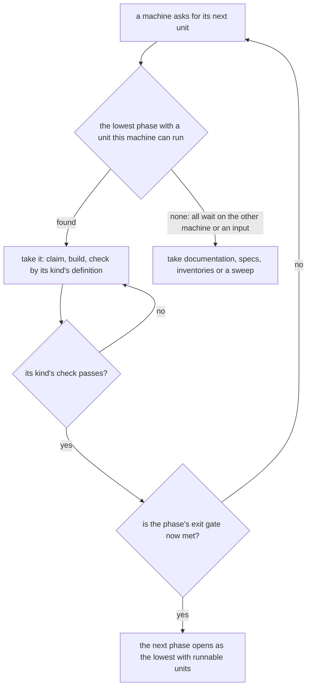
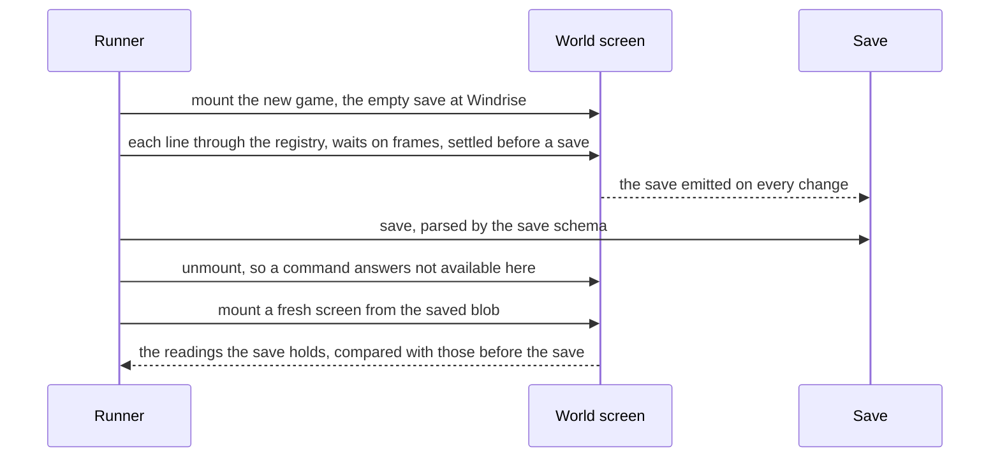

# Genshin phases

The recreation is a large set of units of work: assets converted from the game, datasets, render passes, regions, screens, systems and quests. They depend on one another in a known order, but the work is taken in the order a machine can run it, so a screen is redrawn while the pass under its backdrop is still open, a quest is specified before the dialogue engine it plays on exists, and no unit says what finished means. This page orders the units into phases with gates, defines done for each kind, and fixes how the next unit is chosen.

## Decisions

- **A phase is a gate, not a priority.** It is a finished state of the whole recreation, and a unit belongs to the lowest phase whose gate fails without it. The roadmap's order inside a phase is still the priority, and the building-proposals rule against a hand-kept priority field stands: nothing here ranks units, it only says which gate they hold.
- **Done is defined by the kind of unit, once.** Every kind has one definition (below) that names its check. A unit is not done on its author's say; it is done when its kind's check passes.
- **A machine takes the lowest phase's runnable unit.** A unit the machine cannot run, because it needs the other machine's game install or a recording nobody has, is passed over, so the Mac and the PC both stay busy and neither waits on the other. Documentation, specs, inventories and sweeps are runnable everywhere and never wait.
- **Progress is computed, never written.** A report reads the tree and prints each phase's units by kind as done, runnable here, waiting and blocked, and a quest as scripted or not measurable, so no page carries a count.
- **A change's `x-phase` is the lowest phase whose gate fails without it, and a task in another phase says so.** A task with no marker holds its change's `x-phase`; a task of a mixed change carries `[phase <n>]` after its number when it holds another one. Each open task is needed by its own phase's gate, so the lowest phase whose gate fails without the change is the lowest phase among its open tasks, and `x-phase` is that value: closing the last task of the lowest phase raises `x-phase` in the same commit, and a workspace test fails when the two differ. A change with no open task keeps its last value. The pick reads the lowest phase among a change's open tasks, and the report counts each task in its own phase. Rejected: one change per phase for every mixed change, because it renumbers the tasks other pages cite and scatters one design and its Key files over several changes. Rejected: one phase per change with no task markers, because a phase's gate then stays open on work it does not need, or the change's later tasks are pulled into an early phase.
- **The table's "What it holds" column places a unit it names, and a system sits where its every-region work sits.** The HUD is phase 3 and the Paimon menu phase 2 because the table says so; a system whose open tasks serve every region (the domains, the shops, the reputation) is phase 6, and the tasks that place it in Mondstadt carry `[phase 4]`. Rejected: placing a system by the first region it ships in, because the gate for a region would then wait on the system's other regions.
- **No phase is built strictly after the last.** Rejected: a waterfall that holds every unit until the one before it is done, because a unit that needs the PC would stop the Mac's whole queue. The pick rule gets the order without the idle time.
- **No vertical slice per region before the shared layers hold.** Rejected: building Mondstadt end to end first, then Liyue, because each slice would reopen the engine, the passes and the interface it stands on, and those are measured once. The regions are slices only after the layers under them are done.

## The phases

| Phase | Name              | What it holds                                                                                                                                                           | Exit gate                                                                                                                                                                    |
| :---- | :---------------- | :---------------------------------------------------------------------------------------------------------------------------------------------------------------------- | :--------------------------------------------------------------------------------------------------------------------------------------------------------------------------- |
| 0     | Foundation        | The conversion pipeline, a spec and a recipe for every asset family, the measures and gates, the definitions of done, the progress report                               | A fresh PC and Mac pair reproduces every published dataset and fit from the install; every asset family has a spec and a recipe; every kind of unit has a check              |
| 1     | The look          | The engine and the recreation passes, proven on the first scenes (the login, Windrise): camera, shapes, surface, display, light, air, sky                               | Every pass of the login and of Windrise holds and is frozen at every hour and weather, each reference scores under its bar, and the frame cost holds                         |
| 2     | The interface     | The shared interface pieces, the opening and the login screens, the Paimon menu and every screen every region needs                                                     | Every screen's parity ids are under their bars in every state it shows, with the game's words by key and every art gap on the roadmap                                        |
| 3     | The playable core | The character controller, the follow camera, the HUD, the kit framework with the Traveler, combat and enemy frameworks, inventory, save, the quest and dialogue engines | A scripted session plays from the opening: walk, climb, glide, swim, fight, collect, open the menu, save and load, and a quest runs from its table                           |
| 4     | Mondstadt         | The first region at its bar, with its quests, puzzles, domains, shops, residents and spawned places                                                                     | The region's passes hold and are frozen, its spawned places, residents, shops, domains and puzzles are placed, and its first quest chain plays through in a scripted session |
| 5     | The other regions | Each remaining region in the game's release order, as a slice of the same shape as Mondstadt                                                                            | Each region meets Mondstadt's gate, region by region                                                                                                                         |
| 6     | The systems       | The breadth: every character kit, crafting, cooking, fishing, the card game, the Abyss, the Theater, the realm, achievements and the archive                            | Each system's scenarios pass, it is reachable through a finished screen, and its data is read from the hosted game data                                                      |
| 7     | Fidelity          | Effects, audio and music, performance, accessibility and every client language                                                                                          | Each reference of the game in a state a person can reach scores under its bar, the frame and load budgets hold, and no art gap is left unrecorded                            |

A unit that serves one region sits in that region's phase, a shared interface piece in phase 2, a shared engine page in phase 1. A unit that two gates need sits in the lower one.

## Done, by kind of unit

| Kind         | Done when                                                                                                                                                                                                                               | Checked by                                                                           |
| :----------- | :-------------------------------------------------------------------------------------------------------------------------------------------------------------------------------------------------------------------------------------- | :----------------------------------------------------------------------------------- |
| Asset family | The recipe was followed from the install: an extraction, a fit that writes our parameters, our generator drawing them, the parameters published, and no game art in the repository, the build or the deployment                         | the fit and publish dry runs, then `genshin:parity compare` of what it draws         |
| Dataset      | The builder is proven by its dry run, the lock is committed, the reader is typed at the boundary that awaits it, and a test reads it                                                                                                    | `genshin:data`, `genshin:text` and `genshin:assets` dry runs, then the reader's test |
| Render pass  | The pass's measure holds its gate on every reference of the scene and is frozen                                                                                                                                                         | `genshin:parity passes`                                                              |
| Region       | Its passes are frozen, its layout is read from the game's tiles, its kits, flora and weather are drawn, its spawned places are placed, and the frame cost holds                                                                         | `genshin:parity passes`, the load-budget tests                                       |
| Screen       | Every parity id of the screen is under its bar in every state it shows (rest, hover, pressed, disabled), its words are `GameTextKey` keys, a missing art piece is a roadmap line and not a private one-off, and its browser test passes | `genshin:parity compare` for each id, the visual suite                               |
| System       | Its scenarios have tests, its tables come from the hosted game data, a stored shape it adds is backfilled, and a finished screen reaches it                                                                                             | the scenario tests and the screen's check                                            |
| Quest        | Its steps, conditions and rewards run from the game's tables, a scripted session plays it to its end including a save and a load in the middle, its words are keys, and what it changes in the world persists                           | a scenario test over a scripted session                                              |

Two checks do not exist yet: the scripted-session harness a quest's and the playable core's gate need, and the check that a system is reachable through a screen. Each is a Phase 0 unit until it is built; until then a unit of that kind is done on its other checks and the report lists the missing one.

A system is reached through a screen when the screen kind it opens by has one way the player opens it, and that way holds. The world package keeps a table giving each screen kind its opener: the Paimon menu, a shortcut (an input action or the shortcut wheel), or an interaction that names what opens it, such as a resident, a gadget or a trigger. The table is typed over every screen kind, so a new kind cannot be added without naming its way in, and a pure check reads the menu's contents, the input actions' map and the wheel's entries and fails naming a kind whose claimed way they do not hold. The screen's own finish is the check of its compute area, a screen's ids under their bars, so reachable and finished are two readings of one screen, and a system is done only when both hold. Rejected: a source scan for assignments of a screen kind, which passes on dead code and breaks on any rewrite of how the session opens a screen; and a table from each system to its screen kind, a second record of what the screen kind's own name already says.

## How the pick works

`pnpm ai:fleet:next` reads each unit's phase, the lowest among a change's open tasks, and takes the lowest phase's first unit that the machine's capabilities satisfy and no claim holds. A machine without the game install cannot take a unit that needs it, so on the Mac the lowest runnable phase is often above the PC's; that is the rule working, since the PC takes the lower unit. `pnpm ai:proposals:report` lists the open proposals grouped by phase for the same reason.

## Classifying

Every open roadmap item sits under its phase's heading in the Genshin roadmap, every Genshin change names its phase in its metadata, and a compute item takes the phase of the area it measures. The classification question is one: which phase's gate fails without this unit. A unit that spans two gates is split along the gate: the tasks of a change that hold another phase than the change's say so with the `[phase <n>]` marker, and an arguable unit takes the lower of its two candidates.

## The progress report

The report prints, for each phase, its units by kind, each as done, runnable on this machine, waiting on a named blocker, or blocked on the other machine, a quest as scripted or not measurable, and the state of each exit check that a command can read today: a region's passes frozen, a screen's ids under their bars, a dataset's lock current. It is computed from the checkboxes, the compute pages, the parity snapshots and the locks. A check with no command yet prints as not measurable, never as passing.

A unit is one of three things, each read from its own source. A compute area is a unit whose kind (Screen, Region, Scene, Pieces or Dataset) is a column of the compute README's phase table; it is done when its page holds no queue item and no waiting item, runnable when a queue item's needs this machine meets, waiting when only waiting items remain, and blocked on the other machine when every queue item needs a capability this machine lacks. A change is a unit of kind Change counted by its open tasks, each in its task phase, with the same four states read from the change's `x-needs` and `x-waiting`. A roadmap item is a unit of kind Item counted under its phase heading, or of kind Quest when it names a quest as `quest <id>`: done when ticked, scripted when a session names the quest, and not measurable when none does. Rejected: a kind field in every change's metadata, because a hand-set value in each of the changes goes stale and nothing but the report would read it; the done-by-kind table still defines what finishes a kind, and the compute areas already carry the kinds that have a check.

## The scripted-session harness

A scripted session is one played run of the world: the world screen mounted in a browser, the game changed and read only through the developer registry, the frame clock moved by a runner, and a save taken and loaded in the middle. The playable core's gate and every quest's check wait on it, so it is a phase 0 unit. Its tasks in `tasks.md` section 4 run in the order the decisions below give.

- **A script runs in the genshin-world browser project, against the world screen itself.** `packages/genshin-world/src/components/World/Screen/Index.browser.test.ts` already mounts the screen in that project, so the session test mounts it the same way with the registry handed in as the screen's `devRegistry`. The walk, the fight, the pickup, the menu and the save then run the session's own components and composables, drawn in the machine's Edge through `packages/genshin-world/vitest.browser.config.ts`. Game data comes from the hosted mirror that suite already fetches, so the Mac runs it with Microsoft Edge and no game install, and CI restores the same mirror in its Coverage job. No CI job runs the browser project today, so the first script adds one job for its one session test. Rejected: a Node test over the stores, which skips the session component and the composables it owns, and cannot mount the screen's canvas outside a browser; the parity page driven by `genshin:parity`, which opens its own Edge per command, mounts the world screen from a fixture that passes no registry, and runs in no workflow; and the app's dev server driven by Playwright, which needs the Nuxt boot, a sign-in or the guest save, and the Azure dev resources, a cost the driven-browser reference keeps for one-time checks.
- **A script is a list of registry lines and four harness steps, not a DSL.** A step is either a command line, a string run through the registry; `{ kind: "wait", seconds }`, which advances the frame clock, since only the runner moves time; `{ kind: "expect", line, equals, field? }`, which compares the line's value, or one `key=value` field of the `state` record, with the expected text exactly; or `{ kind: "save" }` and `{ kind: "load" }`. A run of consecutive lines goes to `runDevScenario` unchanged, which already stops at the first failure and names its line. Rejected: a language with variables, loops or conditions, since the registry's lines already name every action and read and a second language would need its own review; and scripts as saved scenario files, which the playtest design rejected because they rot with the save's shape, while a TypeScript list is read in review.
- **Each command a script names exists, or is one small read beside its owner.** The table gives every step and the commands it uses. The session registers `hold`, `quest`, `bag`, `kills` and `screen`, since it already holds the quests, bag, Archive and screen stores and the window the input reads. The terrain residency registers `settled`, since it alone knows which tiles it has asked for. `give`, `level`, `ar` and `unlock` exist but the app registers them (`apps/web/app/composables/genshin/useGenshinDevSaveCommands.ts`), where a browser test in the package cannot reach them. The first script needs none of them, so they stay in the app; a script that needs an item the world's own grants do not give moves that registration into the package then.

| Step of a script                                                                                                                   | Commands and steps                                                                             | Status                                                                                                                                                 |
| :--------------------------------------------------------------------------------------------------------------------------------- | :--------------------------------------------------------------------------------------------- | :----------------------------------------------------------------------------------------------------------------------------------------------------- |
| The opening: the new game, the empty save mounted at Windrise; the splashes and the login stay with the opening's own browser test | `state`, `quest`                                                                               | `state` exists in `packages/genshin-world/src/services/dev/commands/createStateCommand.ts`; `quest` exists                                             |
| A walk: the Traveler holds forward, then time passes                                                                               | `hold forward 2`, a `wait` of two seconds, `state`                                             | `hold` is in `createHoldCommand.ts`; the move keys are in `packages/genshin-engine/src/input/constants.ts`                                             |
| A place reached, a go-to or a landmark                                                                                             | `teleport` to the place, or a walk                                                             | `teleport` exists in `packages/genshin-world/src/services/dev/commands/createTeleportCommand.ts`                                                       |
| A fight: a camp reached, its enemies attacked                                                                                      | `teleport`, `hold NormalAttack` repeated, `kills`                                              | `kills` is new                                                                                                                                         |
| A pickup: a gathering point or a chest picked                                                                                      | `teleport`, `hold Interact`, `bag`                                                             | `bag` exists                                                                                                                                           |
| A talk: Interact at its resident, Confirm through its lines                                                                        | `hold Interact`, `hold Confirm` repeated, `screen`                                             | `screen` is new                                                                                                                                        |
| Opening the menu                                                                                                                   | `hold OpenPaimonMenu`, `screen`                                                                | `screen` is new                                                                                                                                        |
| The clock and the health a step needs                                                                                              | `time`, `heal`                                                                                 | exist in `packages/genshin-world/src/services/dev/commands/createTimeCommand.ts` and `createHealCommand.ts`                                            |
| A save and a load                                                                                                                  | the runner's `save` and `load` steps, then `time` and `teleport` where a later step needs them | the runner is new                                                                                                                                      |
| Waiting for the terrain                                                                                                            | `settled`                                                                                      | new, registered by `packages/genshin-world/src/composables/useTerrainResidency.ts`, which reads the tiles in flight from its streamer's `pendingCount` |

- **"Plays a quest to its end" is read off the quest runtime, and the script sets no state.** The script writes no progress and starts no quest. The world starts an Archon quest at its first step when it mounts, and a talk, a place reached, an item collected and an enemy defeated each reach the quest through the world's own events. At every step boundary `quest` must read the step the quest's record names, counted from the record's steps as the quest reader returns them from the hosted game data, and the last read must be `finished`, the runtime's own finish (`checkIsQuestFinished`). Each item the record's rewards name must be in the bag after the finish, by the count the record gives. Adventure EXP and Character EXP are not bag items and are not asserted here. Rejected: asserting the Travel Log or the achievements alone, which follow the same finish event and so pass on a finish that paid nothing; and typing expected counts into the script, where a wrong number beside the code that pays it passes when both are wrong.
- **What a quest changed persists across the load, and the save itself is compared.** Before the save the script reads the quest's step, each item count it touched and the Archive's defeats; after the load the same readings must match. The first save a fresh session emits must then equal the saved blob field for field. A difference fails the script, and the task that finds it fixes it or moves it to the owning spec's open list, with no carve-out in the script. Position and the hour are not compared, since the save holds neither: the character controller starts at the Windrise start point and the clock at its Windrise start minutes on every mount, so a later step that needs either sets it after the load.
- **A save is the page's save, and a load is a fresh session from it.** `save` takes the last save the screen emitted (its save sync emits on every change, so it is current), round-trips it through JSON, and parses it with `genshinSaveSchema`, the schema `apps/web/server/models/genshin/SaveGenshinInput.ts` applies to what the page sends. A save the schema refuses fails the script with the schema's message. The screen then unmounts, so a command in the gap answers "not available here". `load` mounts a new screen on the same registry with the parsed save and waits for its ready signal. The server's write, its ETag and its lease stay outside the harness: they need the Azure container and the app's tRPC, which the package's browser project does not boot, and the app's server tests cover them. Rejected: loading by reloading the page, which a browser test cannot keep on its fake clock; and sending each save through the server's write, for the same Azure and tRPC reasons.
- **The browser driver's mount waits for the world's first save, and its tests seed the save they read.** A mount steps frames until the screen is ready and has emitted its first save: the quests load after the screen is up, and that load is the first change the save sync sees. Under the faked clock the ready signal needs frames too, so the mount steps them as `settle` does, bounded by `SCRIPTED_FRAME_LIMIT`. The driver's tests seed a save holding one step of Wanderer's Trail, one defeat and one Mora, so each reading is off its empty value, and the refusal test seeds a traveler's name one character past its bound, which the world carries through as it was saved. Rejected: a mount that resolves on ready alone, which can read the quests before they load.
- **Determinism rests on fixed frames, a seeded random source, a fixed clock and a settle rule.** The browser test fakes the frame clock, its timers and the performance clock as the opening's browser test does, and the runner moves them one step of 1000 / 60 milliseconds at a time; a wait is a count of such steps. The step is the scripted clock's own constant, since the parity page's constant lives in the scripts package the browser suite does not import. `Math.random` is replaced by `createSeededRandom(WORLD_RANDOM_SEED)`, the seed the combat kit already uses, because the weather, the commissions, the enemy drops and the reputation requests draw from `Math.random`. `Temporal.Now` is replaced by a clock that reads a fixed start plus the frame clock's elapsed time, so the daily resets and the respawns move only with frames. After each run of consecutive lines, the runner steps frames until `settled` reads yes, with real frames between steps so worker results arrive between frames, and it fails with "not settled" past `SCRIPTED_FRAME_LIMIT` frames. That one constant, in `services/dev/constants.ts`, also bounds the browser driver's ready wait and the settle it runs before each save, so the bound has one definition. The driver settles before a save, so the runner does not settle again there. A run is the unit `runDevScenario` takes at once, so the lines inside it settle together, not one by one. A window blur releases every held key by the input reader's own rule, so the runner keeps the document focused for a hold and the reader is not changed. Rejected: real time, since a reset or a worker answer landing inside a frame changes the run; and a fixed seed alone, since the clock and the frame timing would still move.
- **The first full script plays the opening to the end of the prologue's first chain, and waits on the chain's go-tos.** The opening is the new game, the empty save at Windrise; the splashes and the login are the opening's own browser test's and are not replayed. The chain is Wanderer's Trail (351), then Bird's-Eye View (352), the prologue's first two in `QuestIds` order. The Archon rule starts the second once the first is finished, provided both are Archon quests, and task 4.11 reads both records' kinds before it writes the script. Its first step is a go-to to trigger 1053, and no region file under `packages/genshin-world/src/data/regions` lists trigger 1053, so the script stops at that step until genshin-quests task 1.4 places it. The chain's other go-tos are genshin-quests tasks 1.5 to 1.9 (triggers 1100, 1016, 1172, 1003 and 1101), and trigger 1017 is already placed by its task 1.3; the session task waits on those placements and does not make them. Rejected: The Seventh Samurai and Candidature Analysis, whose steps the quests design already leaves out or notes (a filming, a scripted performance with no lines), so a script over either would end on a step the world does not hold. The climb, glide and swim the phase 3 gate names run through the same hold lines where the route needs them; a movement script of their own belongs to the character controller's unit.
- **A quest a session names is reported as scripted, and never as done.** A quest is a roadmap item that names it as `quest <id>`, so its checkbox is that item's: the progress report prints the quest as `scripted` and keeps it open until the item is ticked after its browser test passes in CI. The names come from the plain string lines `"quest <id>"` in the session files, read as text, and a quest no session names is `not measurable`. The report runs no browser and records no pass. Rejected: a list of quests in the report's code, since no file would hold a checkbox to tick; the report running the sessions, which starts a world and an Edge per report; and a committed result file, a second record of a pass that goes stale the day a script changes.

The order of one session, from the new game to the comparison after the load:

## Key files

| File                                                                                                                                                                                                                               | Role                                                                                                                                                                                                                                                                                                                                     |
| :--------------------------------------------------------------------------------------------------------------------------------------------------------------------------------------------------------------------------------- | :--------------------------------------------------------------------------------------------------------------------------------------------------------------------------------------------------------------------------------------------------------------------------------------------------------------------------------------- |
| `openspec/changes/genshin-roadmap/tasks.md`                                                                                                                                                                                        | the open work, grouped under the phase each unit holds                                                                                                                                                                                                                                                                                   |
| `openspec/changes/genshin-program/design.md`                                                                                                                                                                                       | the program's order of pages, which the phases supersede with gates                                                                                                                                                                                                                                                                      |
| `openspec/specs/genshin/compute/README.md`                                                                                                                                                                                         | the compute pages, whose items take their area's phase                                                                                                                                                                                                                                                                                   |
| `.agents/skills/throughput/references/fleet.md`                                                                                                                                                                                    | the pick of the next entry, which reads the phase                                                                                                                                                                                                                                                                                        |
| `scripts/src/services/fleet/parseProposalMetadata.ts`                                                                                                                                                                              | the change metadata model, which gains the phase field                                                                                                                                                                                                                                                                                   |
| `packages/genshin-world/src/components/World/Session/Index.vue`                                                                                                                                                                    | The session that registers the holds and reads beside the state they answer                                                                                                                                                                                                                                                              |
| `packages/genshin-world/src/services/dev/runDevScenario.ts`                                                                                                                                                                        | The line runner a script's runs of lines reuse, unchanged                                                                                                                                                                                                                                                                                |
| `packages/genshin-world/src/composables/useTerrainResidency.ts`                                                                                                                                                                    | The terrain tiles asked for and not yet given, which the settled read counts                                                                                                                                                                                                                                                             |
| `packages/genshin-world/src/components/World/Screen/Index.browser.test.ts`                                                                                                                                                         | The browser test that mounts the world screen, which the session test follows                                                                                                                                                                                                                                                            |
| `packages/genshin-world/vitest.browser.config.ts`                                                                                                                                                                                  | The browser project the session test runs in                                                                                                                                                                                                                                                                                             |
| `apps/web/server/models/genshin/SaveGenshinInput.ts`                                                                                                                                                                               | The save schema a saved save must parse under                                                                                                                                                                                                                                                                                            |
| `.github/workflows/CI.yaml`                                                                                                                                                                                                        | Gains the one job that runs the session test, with the mirror it already restores                                                                                                                                                                                                                                                        |
| createHoldCommand.ts, createQuestCommand.ts, createBagCommand.ts, createKillsCommand.ts, createScreenCommand.ts and createSettledCommand.ts, one per file in the world commands folder beside the existing ones (tasks 4.1 to 4.6) | The harness's hold and reads, each a command with its own test                                                                                                                                                                                                                                                                           |
| createScriptedClock.fixture.ts and runScriptedSession.ts, in the dev services folder, with the step model and the driver interface in `models/dev` (tasks 4.7 and 4.8)                                                             | The fixed clock, a `.fixture.ts` because it imports vitest and the barrel exports every other module in the folder; and the runner that moves a script's steps through the driver, naming a failed step as `step N: …`, counted from 1, and settling the terrain through `settleScriptedSession.ts` after each run of lines              |
| The session's browser test and its driver fixture, beside the session component (task 4.9)                                                                                                                                         | The browser driver: mount, settle, save, unmount, load                                                                                                                                                                                                                                                                                   |
| packages/genshin-world/src/models/dev/ScriptedSessionDriver.ts (task 4.8)                                                                                                                                                          | The driver interface the browser driver of task 4.9 implements, the one definition it reads: `run` a registry line, `frame` one fixed step of the scripted clock and then one real frame, `save` settles the world, then takes the screen's last save through the save schema and keeps it, and `load` a fresh screen from the kept save |
| packages/genshin-world/src/models/dev/ScriptedStep.ts, ScriptedStepKind.ts and ScriptedSessionOutcome.ts (task 4.8)                                                                                                                | The step model: a string is a registry line, an object is one of the four harness kinds, and an expect's `field` is optional; a save or a load answers `ScriptedSessionOutcome`, done or its error                                                                                                                                       |
| One file per session, in the sessions folder packages/genshin-world/src/services/dev/sessions/, the path `GENSHIN_SESSIONS_DIRECTORY` names, beside the scenarios (task 4.11)                                                      | The scripts the session test runs, the first being the prologue's chain; a quest's read line is written as the plain string `"quest <id>"`, which the report reads                                                                                                                                                                       |
| `parseScriptQuestIds.ts`, the pure reader, and `readScriptedQuestIds.ts`, its file reader, beside the report in the scripts package (task 4.10)                                                                                    | The quests a session names, which the report prints as scripted on the roadmap item that names each quest (`getRoadmapUnit.ts`)                                                                                                                                                                                                          |

## Sources

- The program page's four phases and its order of pages, which this change gives gates.
- The recreation passes' rule that a later pass is worked only once every earlier pass holds, which the phases lift from one scene to the whole recreation.
