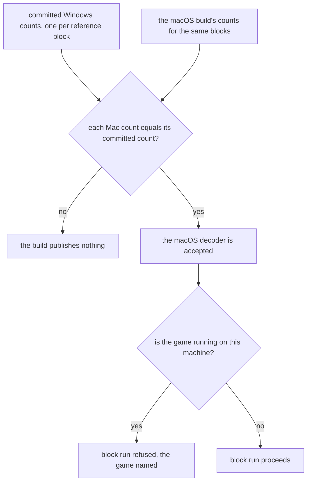

# Genshin pipeline acceptance

A macOS decoder and the game-running guard are accepted only by a recorded parity run, every hand-set or measured value names its capture, and a fresh PC and Mac pair publishes the same lock. This change is built on [pipeline provenance](../genshin-pipeline-provenance/design.md), whose pinned Windows build its counts come from, and on [pipeline hygiene](../genshin-pipeline-hygiene/design.md), whose lock check the reproduction run relies on. It closes the unit of [Phase 0, Foundation](../genshin-phases/design.md), and the derived assets page it amends is [derived assets](../../specs/genshin/derived-assets/design.md).

## Decisions

- **The decoders are accepted by a parity record, and the game-running guard runs on macOS.** The file counts of the reference blocks, from the Windows build and from the macOS build, are committed beside the build, and the macOS build is accepted only when its counts equal the Windows counts. The game-running guard gains a macOS branch. Rejected: accepting the macOS build because it compiles and its exception check passes, since a decoder that writes fewer assets without raising an exception passes that check too, which is the shape of the defect the decoder upstream page records; and extracting only on Windows, since the Mac is the second machine and must decode its own.
- **Hand-set constants and measured values carry their basis.** Each hand-set fit constant and each value measured from a capture moves into a measurement file for its family, which names the capture, the frame and the value. The fit reads the constant from that file, and a reader refuses an entry that names no capture. Rejected: a comment beside the constant, which no reader can check.

## How it works

The Windows counts come from the PC, and the macOS build is accepted only when its counts equal them. The game-running guard reads the process list before a block run, on macOS as on Windows. Measured values need no machine: each entry names its capture and frame, and a reader refuses an entry that names none. The reproduction run needs both machines, each holding the install.



## Gaps and the decision that closes each

The rows below are the gaps that the decoders and the measured values leave open. Each one names its evidence and the machine that runs its step, and the decision column names the decision that closes it.

| Decision | Gap                                       | Step            | Evidence                                                                                                                                                                                                                          | Runs on                                    |
| :------- | :---------------------------------------- | :-------------- | :-------------------------------------------------------------------------------------------------------------------------------------------------------------------------------------------------------------------------------- | :----------------------------------------- |
| Decoders | Mac and Windows decoders differ           | decoders        | [AnimeStudio upstream](../../specs/genshin/derived-assets/animestudio-upstream/design.md), lines 5-7 and 39, records the Ooz defect and a Leviathan count of 483 against the Windows count of 485                                 | PC for the Windows counts, Mac for its own |
| Decoders | Parity acceptance has never run           | parity          | [AnimeStudio on macOS](../../specs/genshin/derived-assets/animestudio-macos/design.md), line 45, records no parity output on disk, and the counts it checks are in `scripts/src/services/genshinAssets/shared/constants.ts`:71-80 | PC for the Windows counts                  |
| Decoders | Game-running guard is off on macOS        | guard           | `scripts/src/services/genshinParity/shared/checkIsGameRunning.ts`:7 reports the game as not running on any platform but Windows                                                                                                   | Mac                                        |
| Measured | Glow scales have no basis                 | glow scales     | `scripts/src/services/genshinAssets/fit/fitLoginStone.ts`:30 sets the glow scales by hand, and their basis lives only in the fit's design                                                                                         | game-exports and the captures              |
| Measured | Measured spreads and colours have no file | measured values | [derived assets](../../specs/genshin/derived-assets/design.md), lines 216-217, records the spreads, colours and light strengths as measured with no checked file                                                                  | captures, on any machine                   |

## Scope and order

The decoder record and the macOS guard need a machine with the install, and the measured values are independent of the rest. Task 1.1 waits on [genshin-pipeline-provenance](../genshin-pipeline-provenance/design.md) tasks 2.4 and 3.1, which pin the decoder constants and build the Windows archive. The reproduction run comes last: task 4.1 waits on task 3.4 of [genshin-pipeline-provenance](../genshin-pipeline-provenance/design.md) and task 4.3 of [genshin-pipeline-hygiene](../genshin-pipeline-hygiene/design.md), and the owning pages in task 3.1 wait on the same code.

## Key files

| File                                                                  | Role after the change                                                       |
| :-------------------------------------------------------------------- | :-------------------------------------------------------------------------- |
| `scripts/src/services/genshinAssets/shared/constants.ts`              | Holds the reference blocks' counts, which move to the committed counts file |
| `scripts/src/services/recreation/animeStudio/buildAnimeStudio.ts`     | Records the macOS build's counts                                            |
| `scripts/src/animeStudio/index.ts`                                    | Passes the parity check the committed counts                                |
| `scripts/src/services/genshinAssets/shared/checkAnimeStudioParity.ts` | Compares each reference block with the committed counts                     |
| `scripts/src/services/genshinParity/shared/checkIsGameRunning.ts`     | Reads the process list on macOS too                                         |
| `scripts/src/services/genshinAssets/fit/fitLoginStone.ts`             | Reads its glow scales from the measurement file                             |

The change also creates these, which are named here and not linked:

```text
packages/genshin-world/parity/
  measurements/             one file per family: each value, its capture and its frame
  animestudio/              the reference blocks' file counts for each build
```
