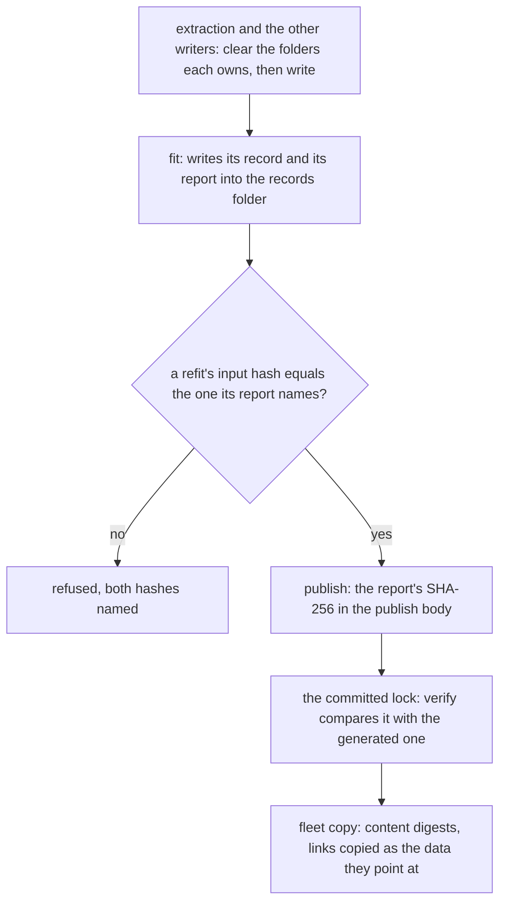

# Genshin pipeline hygiene

Exports and records hold only paths relative to the data root, each record has one writer, and each fit, copy and re-extraction touches only what it owns. This change is built on [pipeline provenance](../genshin-pipeline-provenance/design.md), whose stamp each fit's record carries, and its sister [pipeline acceptance](../genshin-pipeline-acceptance/design.md) closes the unit, which is the reproducibility of [Phase 0, Foundation](../genshin-phases/design.md). The hosted datasets whose records and lock change are described in [hosted game data](../../specs/genshin/hosted-game-data/design.md).

## Decisions

- **Paths are relative to the data root.** `{data-root}` is one constant, derived from the home folder in one place. Several constants restate the home folder today, among them the content cache, the fleet's parity default, the parity folder and the tools folder, and each derives from the one constant instead. An export or a record holds only paths relative to `{data-root}`, and a symlink in an export becomes a relative link or a recorded relative path. Rejected: keeping absolute paths and rewriting them on copy, because a copy that rewrites its paths is a second writer for every file, and a link made on one machine names a folder the other machine lacks.
- **Every record has one writer.** Each record is registered once, in one table that names the command that writes it. `references pack --kind record` reads that table and refuses a path that no row names. A record with no writer gets one when something reads it, and is retired when nothing does. The derived asset index, which the pipeline recomputes on each run, and the gate-walls archive, which nothing in the repository writes, are the first cases. One key already has two writers in the [hosted game data](../../specs/genshin/hosted-game-data/design.md) page: `catalogue/catalogue` is published both by the authored file and by the catalogue's outline fit. The fitted outlines become their own key, and the reader joins the two. Rejected: the hand-typed path list the pack takes today, which names nothing a family owns.
- **Fits write records, and only records.** A fit writes its record and the report beside it, into the records folder under `{data-root}/genshin-parity`, and never into a file a person edits. The publish reads the record from that file and puts the report's SHA-256 in its publish body. A refit of a published record (`notes`, `expression`, `instruments` and `calibrate --write`) names the hash of the record it reads in its report, and refuses to run when the record's last publish hashes differently. Rejected: in-place writes, which overwrite a file people edit and mix two histories into one; a printed report, which cannot be compared later; and a refit reading publish history unchecked, since its output would then depend on more than its exports.
- **Re-extraction clears what its writer owns, the fleet copy compares content, and verify compares the lock.** A writer clears each folder it owns before it writes, as the clips, shaders and avatar writers already do. The fleet copy decides each file by a digest of its content, copies a link as the data it points at, and leaves a file only the target holds as it is. `genshin:data verify` fails when the generated lock differs from the committed one. Rejected: deciding by size and time, since a changed file of the same size passes; committing the lock by hand, which no check sees; refusing a link, since the peer would then lack the data the link points at; and removing a file only the target holds, which would make each copy a mirror that deletes whatever the source never made.

## How it works

Each fit writes its record and its report into one records folder, and the publish, the refit and the lock check read those records by their hashes. Paths relative to the data root let a copy made on another machine resolve every link without being rewritten, and the fleet copy decides each file by its content, so a changed file of the same size is not missed. Either machine runs these steps, since a fit or a publish needs only the exports or the container.



## Gaps and the decision that closes each

The rows below are the gaps that paths, records, fits and the fleet copy leave open, with the file that shows each one and the machine that runs its step. The decision column names the decision that closes each.

| Decision           | Gap                                           | Step             | Evidence                                                                                                                                                                                                                                                                                                                            | Runs on                                                                                 |
| :----------------- | :-------------------------------------------- | :--------------- | :---------------------------------------------------------------------------------------------------------------------------------------------------------------------------------------------------------------------------------------------------------------------------------------------------------------------------------- | :-------------------------------------------------------------------------------------- |
| Paths              | Absolute paths in block links and map sources | block links, map | `scripts/src/services/genshinAssets/blocks/linkBlockFiles.ts`:13 links each block from its absolute source path, and the map holds this machine's folder                                                                                                                                                                            | game-install                                                                            |
| Paths              | Home folder restated across roots             | roots            | `scripts/src/services/genshinParity/shared/constants.ts`:10-11 and `scripts/src/services/recreation/animeStudio/constants.ts`:6 restate it, as `packages/shared-node/src/services/cache/constants.ts`:8 and `scripts/src/services/fleet/data/constants.ts`:18 do                                                                    | either                                                                                  |
| Records            | Derived asset index has no writer             | asset index      | `scripts/src/services/genshinAssets/world/readDerivedPathNames.ts`:8-15 computes the names on each run, and its manifest row in `packages/genshin-world/parity/references/manifest.json` has no writer                                                                                                                              | either                                                                                  |
| Records            | Placements and gate walls have no writer      | references       | the records are named in [recoverability](../../specs/architecture/recoverability/design.md), and `scripts/src/services/genshinParity/reference/getRecordPath.test.ts`:14 is the only code that names the placements file                                                                                                           | game-install, by hand for the gate walls                                                |
| Records            | Packed records come from a typed list         | record packing   | `scripts/src/services/genshinParity/commands/referencesPackCommand.ts`:45 reads the record paths from the command line, and nothing names the records a family owns                                                                                                                                                                 | any machine with the container                                                          |
| Fits               | Fits write files people edit                  | fit outputs      | `scripts/src/services/genshinAssets/shared/writeWorldData.ts`:12-13 writes into the world data folder, which `scripts/src/services/genshinAssets/fit/fitAreaOutlines.ts`:88 and `scripts/src/services/genshinAssets/fit/fitRegionCamps.ts`:43 call, and `scripts/src/services/genshinAssets/fit/fitRegionCapitals.ts`:52 reads back | game-exports                                                                            |
| Fits               | Fit reports are not kept                      | fit reports      | [scene derivation](../../specs/genshin/scene-derivation/design.md), lines 178-179, says the printed report is not kept                                                                                                                                                                                                              | game-exports                                                                            |
| Fits               | Refits read the last publish, not a file      | refits           | `.agents/skills/genshin-parity/references/data-sources.md`:13 has the refits read the record from its last publish and never from a file                                                                                                                                                                                            | any machine with the container                                                          |
| Clearing and fleet | Fleet copy compares size and time             | fleet copy       | `scripts/src/services/fleet/data/selectChangedFiles.ts`:8 compares size and time, `scripts/src/services/fleet/data/getDirectoryDigest.ts`:11-12 digests names, sizes and times, and `scripts/src/services/fleet/data/getTarArguments.ts`:7-8 passes no dereference flag                                                             | either                                                                                  |
| Clearing and fleet | Re-extraction keeps stale files               | re-extraction    | `scripts/src/services/genshinAssets/blocks/extractComponent.ts`:58 clears three folders, and the interface, playlist, inventory and witness writers clear none                                                                                                                                                                      | game-install for the interface and playlist, game-exports for the inventory and witness |
| Clearing and fleet | Lock verify never compares the lock           | lock verify      | `scripts/src/services/gameData/commands/verifyCommand.ts`:16-23 checks each object's hash and never the lock against the committed copy, and `scripts/src/services/gameData/commitGameDataLock.ts`:19-20 writes the lock and its keys file                                                                                          | any machine                                                                             |

## Scope and order

The data root comes first, since every export, copy and derived path is made from it. The record table comes next, and the fits follow it, because each fit writes a record the table registers, and a refit depends on the report its fit keeps. Clearing, the fleet copy and the lock check do not depend on one another. Task 3.1 is the one task that waits on another change: it writes each record with the stamp from [pipeline provenance](../genshin-pipeline-provenance/design.md) task 1.2.

## Key files

| File                                                                   | Role after the change                                                               |
| :--------------------------------------------------------------------- | :---------------------------------------------------------------------------------- |
| `scripts/src/services/genshinAssets/blocks/extractComponent.ts`        | Clears the folders its writer owns                                                  |
| `scripts/src/services/genshinAssets/blocks/linkBlockFiles.ts`          | Links each block by a path relative to the data root                                |
| `scripts/src/services/genshinAssets/blocks/rebaseSource.ts`            | Writes the map's sources relative to the data root                                  |
| `scripts/src/services/genshinAssets/world/readDerivedPathNames.ts`     | Computes the derived names for their one writer                                     |
| `scripts/src/services/genshinParity/shared/constants.ts`               | Derives the parity folder from the one data root                                    |
| `packages/shared-node/src/services/cache/constants.ts`                 | Derives the content cache from the one data root                                    |
| `scripts/src/services/fleet/data/constants.ts`                         | Derives the fleet's parity default from the one data root                           |
| `scripts/src/services/recreation/animeStudio/constants.ts`             | Places the tools under the data root                                                |
| `packages/genshin-world/parity/references/manifest.json`               | Its records section gains only the rows the record table names                      |
| `packages/genshin-world/src/services/world/readCatalogue.ts`           | Reads the catalogue and its fitted outlines, joined from their two keys             |
| `scripts/src/services/genshinAssets/shared/writeWorldData.ts`          | Writes a fit's record and report into the records folder, not the world data folder |
| `scripts/src/services/genshinAssets/fit/fitAreaOutlines.ts`            | Publishes the outlines under their own key                                          |
| `scripts/src/services/genshinAssets/fit/fitRegionCamps.ts`             | Publishes the camps as a record                                                     |
| `scripts/src/services/genshinAssets/fit/fitRegionCapitals.ts`          | Reads the published record, not a file a fit may have written                       |
| `scripts/src/services/genshinAssets/commands/fitCommand.ts`            | Publishes each record with its report                                               |
| `scripts/src/services/gameData/publishObjectsStep.ts`                  | Puts the report's SHA-256 in the publish body                                       |
| `scripts/src/services/gameData/commands/verifyCommand.ts`              | Fails when the lock differs from the committed copy                                 |
| `scripts/src/services/genshinParity/commands/referencesPackCommand.ts` | Packs only the paths the record table names                                         |
| `scripts/src/services/genshinParity/commands/notesCommand.ts`          | Checks its input hash before a refit                                                |
| `scripts/src/services/genshinParity/commands/expressionCommand.ts`     | Checks its input hash before a refit                                                |
| `scripts/src/services/genshinParity/commands/instrumentsCommand.ts`    | Checks its input hash before a refit                                                |
| `scripts/src/services/genshinParity/commands/calibrateCommand.ts`      | Checks its input hash before `calibrate --write`                                    |
| `scripts/src/services/fleet/data/selectChangedFiles.ts`                | Decides each file by its content digest                                             |
| `scripts/src/services/fleet/data/getDirectoryDigest.ts`                | Digests each file's content                                                         |
| `scripts/src/services/fleet/data/getTarArguments.ts`                   | Dereferences each link into the data it points at                                   |

The change also creates these, which are named here and not linked:

```text
scripts/src/services/genshinParity/reference/
  recordTable.ts            each record, its path and its one writer command
{data-root}/genshin-parity/records/
  <key>.json                a fit's record, and <key>.report.txt beside it
```
