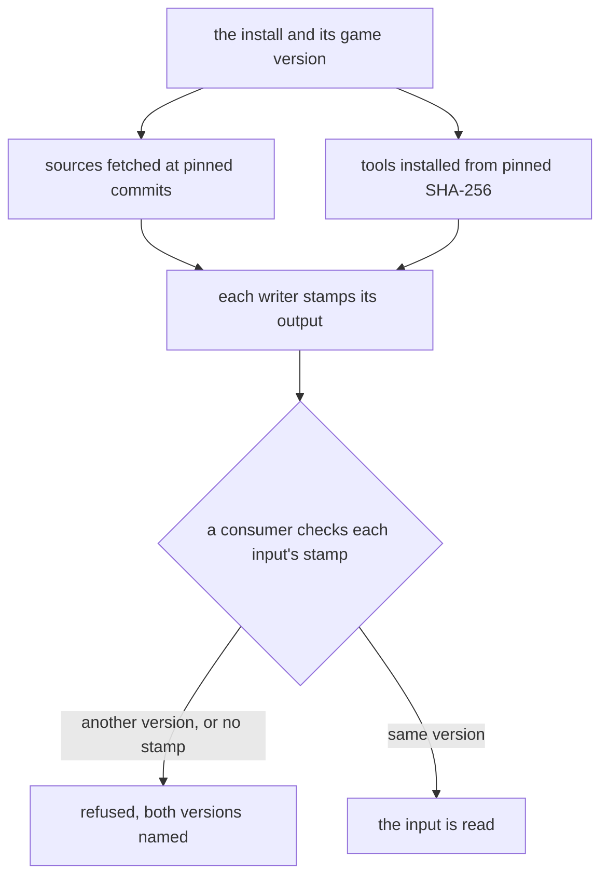

# Genshin pipeline provenance

Every export, fit input and record the conversion pipeline writes carries one provenance stamp, and every source and tool it fetches or runs is pinned, the system's own `tar` and `sysctl` excepted, so a consumer refuses an input it cannot vouch for. It is the first of the sister changes that make the pipeline reproducible, the unit of [Phase 0, Foundation](../genshin-phases/design.md): its sisters are [pipeline hygiene](../genshin-pipeline-hygiene/design.md), which fixes the paths, writers and fit outputs, and [pipeline acceptance](../genshin-pipeline-acceptance/design.md), which accepts the decoders and runs the closing reproduction. The derived assets page it amends is [derived assets](../../specs/genshin/derived-assets/design.md).

## Decisions

- **One provenance stamp.** Every writer of an export, a fit's input or a record writes `provenance.json` beside its output, through one function and one schema. The stamp holds the game version read from the install's `config.ini`, the tool's name and version, the operating system and its build, and the command that ran. A version of the tool is the repository commit and its dirty flag for one of our commands, and the SHA-256 of the binary for a pinned tool. The stamp holds no absolute path, since the install is named by its version and not its folder. The `producer.json` that `extractComponent.ts` writes is generalised into this stamp, and the old file is deleted, so no second form survives. A consumer refuses an input whose stamp names another game version than the install's or has no stamp, and that refusal is one reader shared by a fit, the map and the fleet copy. Outputs made before this change are re-made by their writers and never stamped by a script, since a stamp written after the fact would vouch for output that no run of its writer produced. The map is the one large cost, a full run on each machine. Rejected: stamping only the lock, because the exports are what drift first; recording versions in docs, because a page cannot be compared by a command; a backfill that stamps the existing outputs, because it vouches for them.
- **Sources are pinned by commit.** Every external source a command fetches is fetched at a commit SHA kept in one constant per source, and that SHA goes into the output's stamp. The sources are the text repository, the asset-path index, the gcsim kits and the decoder constants. The decoder constants come from the pinned commit whose decoder matches the install's version, or from the install's own chunks when no commit does. A pin bump is a commit of its own. Rejected: following `main` or `master`, because a run against a moving branch cannot be repeated, and a stamp that names a commit no run fetched proves nothing.
- **Tools are installed pinned.** Every tool a stage runs comes through `installPinnedTool` with its SHA-256, and no stage reads `PATH`, the system's own `tar` and `sysctl` excepted. The Windows AnimeStudio CLI, the vkd3d compiler and 3Dmigoto take that route, and vgmstream takes it on each platform, its Windows and macOS archives pinned beside each other and the archive chosen by platform (task 3.3). The upstream AnimeStudio repository publishes no release to take the CLI from, so its Windows archive is the pinned commit built for Windows and held as a record. Beyond the disassembler, the stages also read `PATH` for ffmpeg outside Windows, for the GitHub CLI behind the gcsim kit read, and for the system `tar` that `installPinnedTool` runs to unpack a zip off Windows. ffmpeg's macOS archive is pinned, the kit is read raw at its pinned commit so the GitHub CLI drops out, and `tar` and `sysctl` are named by their system paths, the one exemption the requirement makes: `sysctl` is part of macOS and has no archive to pin, and `tar` ships with the operating system. Rejected: pinning `tar` and `sysctl` like the other tools, since that pins the machine rather than a tool; unpacking the Windows CLI by hand under the Downloads folder, a step that no command runs; and keeping the `PATH` lookups with a version written into a log, because a log does not stop the next machine running a different tool.

## How it works

The pins gate what is fetched, the tool installs gate what runs, and the stamp gates what a consumer reads. One reader serves the fit, the map and the fleet copy, so a refusal names both versions the same way in each of them, and no consumer keeps a check of its own.



## Gaps and the decision that closes each

Each row is one gap the stamp, the pins or the tools close, with the file that shows it, the step it sits in and the machine that runs it. The decision column names the decision that closes it.

| Decision | Gap                                                 | Step                    | Evidence                                                                                                                                                                                                                                                                                                                   | Runs on                                                |
| :------- | :-------------------------------------------------- | :---------------------- | :------------------------------------------------------------------------------------------------------------------------------------------------------------------------------------------------------------------------------------------------------------------------------------------------------------------------- | :----------------------------------------------------- |
| Stamp    | Install version is unrecorded                       | install and its version | `scripts/src/services/genshinAssets/shared/readGameVersion.ts`'s `readGameVersion` reads the version from `config.ini`, and no stamp carries it                                                                                                                                                                            | either machine, the install placed by hand             |
| Stamp    | Exports and lock carry no game version              | extraction, lock        | `scripts/src/services/producerStamp/writeProducerStamp.ts`'s `writeProducerStamp` writes a commit and a dirty flag and no version; `scripts/src/services/gameData/formatGameDataLock.ts`'s `formatGameDataLock` writes no version                                                                                          | game-install for the exports, any machine for the lock |
| Stamp    | Map is kept by presence                             | map                     | `scripts/src/services/genshinAssets/commands/mapCommand.ts`'s `run` skips while both of its files exist                                                                                                                                                                                                                    | game-install                                           |
| Stamp    | Adopted map has no origin                           | map adoption            | `scripts/src/services/genshinAssets/blocks/adoptCabMap.ts`'s `adoptCabMap` moves the CLI's map in with no record of its binary or version                                                                                                                                                                                  | game-install                                           |
| Stamp    | Shaders omit the operating system                   | shader disassembly      | `scripts/src/services/genshinAssets/materials/disassembleDxbcDirectory.ts`'s `disassembleDxbcDirectory` picks the disassembler by platform, and no output records the operating system's build                                                                                                                             | game-install, with the Windows disassembler on the PC  |
| Pins     | Asset-path index on a moving branch                 | asset index             | `scripts/src/services/genshinAssets/world/constants.ts`'s `ASSET_PATH_INDEX_URL` reads the `master` branch, and `scripts/src/services/genshinAssets/world/ensureAssetPathIndex.ts`'s `ensureAssetPathIndex` fetches only when the file is missing                                                                          | either machine                                         |
| Pins     | Text, kits and decoder constants on moving branches | text and kits           | `scripts/src/services/genshinText/constants.ts`'s `ANIME_GAME_DATA_BRANCH` names the `main` branch, `scripts/src/services/genshinAssets/kits/constants.ts`'s `GCSIM_MAIN_BRANCH` names the kits' `main` branch, and the decoder constants predate the install ([game text](../../specs/genshin/game-text/design.md), Open) | either to fetch, game-install to decode                |
| Tools    | Windows CLI unpacked by hand                        | Windows CLI             | `scripts/src/services/genshinAssets/shared/constants.ts`'s `ANIMESTUDIO_CLI_PATH` defaults to a CLI under the Downloads folder, and no command builds it ([AnimeStudio on macOS](../../specs/genshin/derived-assets/animestudio-macos/design.md), Windows section)                                                         | PC only                                                |
| Tools    | Compiler found on the PATH                          | vkd3d disassembly       | `scripts/src/services/genshinAssets/materials/disassembleWithVkd3d.ts`'s `disassembleWithVkd3d` reads `VKD3D_COMPILER` or the compiler on `PATH`                                                                                                                                                                           | Mac and PC, on the non-Windows branch                  |

## Scope and order

The stamp comes first, since every writer, fit and copy goes through it, and the fleet copy's refusal in task 1.3 follows the reader in task 1.1. The pins and the tools follow, because a stamp names their commits and hashes. Existing outputs are re-made rather than stamped, so the first run of each writer after the change is its real check. The derived assets requirement that an extraction records the code that produced it is superseded by the first requirement of this capability when the change ships, and its owning page is carried by [pipeline acceptance](../genshin-pipeline-acceptance/design.md) task 3.1, once the code it describes is in.

## Key files

| File                                                                       | Role after the change                                                      |
| :------------------------------------------------------------------------- | :------------------------------------------------------------------------- |
| `scripts/src/services/producerStamp/writeProducerStamp.ts`                 | Generalised into the one stamp writer, then deleted                        |
| `scripts/src/services/producerStamp/readProducerStaleness.ts`              | Reads the stamp's commit, from the one reader                              |
| `scripts/src/services/genshinAssets/blocks/extractComponent.ts`            | Stamps each extraction                                                     |
| `scripts/src/services/genshinAssets/commands/mapCommand.ts`                | Skips a map only when its stamp names the install's version                |
| `scripts/src/services/genshinAssets/blocks/adoptCabMap.ts`                 | Refuses to adopt a map with no stamp                                       |
| `scripts/src/services/genshinAssets/shared/readGameVersion.ts`             | The one reader of the install's version                                    |
| `scripts/src/services/genshinAssets/shared/constants.ts`                   | Holds the vgmstream pins                                                   |
| `scripts/src/services/genshinAssets/world/constants.ts`                    | Names the asset-path index at a pinned commit                              |
| `scripts/src/services/genshinAssets/world/ensureAssetPathIndex.ts`         | Fetches the pinned commit and records its SHA-256                          |
| `scripts/src/services/genshinText/constants.ts`                            | Names the text repository at a pinned commit                               |
| `scripts/src/services/genshinText/selectDumpFiles.ts`                      | Selects the dump files whose content hash differs from the pinned commit's |
| `scripts/src/services/genshinAssets/kits/constants.ts`                     | Names the kits' pinned commit                                              |
| `scripts/src/services/genshinAssets/kits/gcsim/readGcsimMainCharacters.ts` | Reads the kits raw at the pinned commit, not through the GitHub CLI        |
| `scripts/src/services/shared/runGh.ts`                                     | Removed once no stage calls the GitHub CLI                                 |
| `scripts/src/services/shared/installPinnedTool.ts`                         | Unpacks a zip off Windows with the system `tar` at its fixed path          |
| `scripts/src/services/shared/resolvePinnedTool.ts`                         | Installs each pinned tool, the macOS archives included                     |
| `scripts/src/services/genshinAssets/music/resolveVgmstream.ts`             | Picks the pinned archive for the platform                                  |
| `scripts/src/services/recreation/video/resolveFfmpeg.ts`                   | Installs the pinned ffmpeg outside Windows, not the `PATH` lookup          |
| `scripts/src/services/genshinAssets/music/encodeMusicRecording.ts`         | Runs the pinned ffmpeg outside Windows                                     |
| `scripts/src/services/genshinAssets/materials/disassembleWithVkd3d.ts`     | Runs the pinned vkd3d compiler only                                        |
| `scripts/src/services/genshinAssets/materials/disassembleDxbcDirectory.ts` | Writes the operating system's build into the shaders' stamp                |
| `scripts/src/services/recreation/animeStudio/constants.ts`                 | Names the Windows archive                                                  |
| `scripts/src/services/recreation/animeStudio/buildAnimeStudio.ts`          | Builds the Windows archive from the pinned commit                          |

The change also creates these, which are named here and not linked:

```text
scripts/src/services/provenance/
  writeProvenance.ts        the one writer, its schema and the game version it reads
  readProvenance.ts         the one reader, refusing a stamp of another version or none
```

## Sources

- [AnimeStudio](https://github.com/Escartem/AnimeStudio): the exporter the Windows archive and the macOS build are built from, pinned at the commit the constants name. Its default branch is `master`, and it publishes no release, which is why the Windows CLI is built from the pinned commit rather than downloaded.
- [DimbreathBot/AnimeGameData](https://github.com/DimbreathBot/AnimeGameData): the text source. Its `main` branch holds the TextMap folder the dump reads, and this change pins the text to a commit of its own.
- [radioegor146/gi-asset-indexes](https://github.com/radioegor146/gi-asset-indexes): the asset-path index. Its `mapped` folder holds the file the pipeline fetches, and this change pins the fetch to a commit.
- [genshinsim/gcsim](https://github.com/genshinsim/gcsim): the source of the character kits, which the pipeline reads on its `main` branch through the GitHub CLI today. This change reads the kits raw at a pinned commit.
- [3Dmigoto 1.3.16](https://github.com/bo3b/3Dmigoto/releases/tag/1.3.16): the release lists `cmd_Decompiler-1.3.16.zip`, the decompiler archive the pipeline already pins by SHA-256.
- [vgmstream r2117](https://github.com/vgmstream/vgmstream/releases/tag/r2117): the release lists `vgmstream-win64.zip`, pinned today, and `vgmstream-mac.zip`, the macOS archive this change pins beside it.
