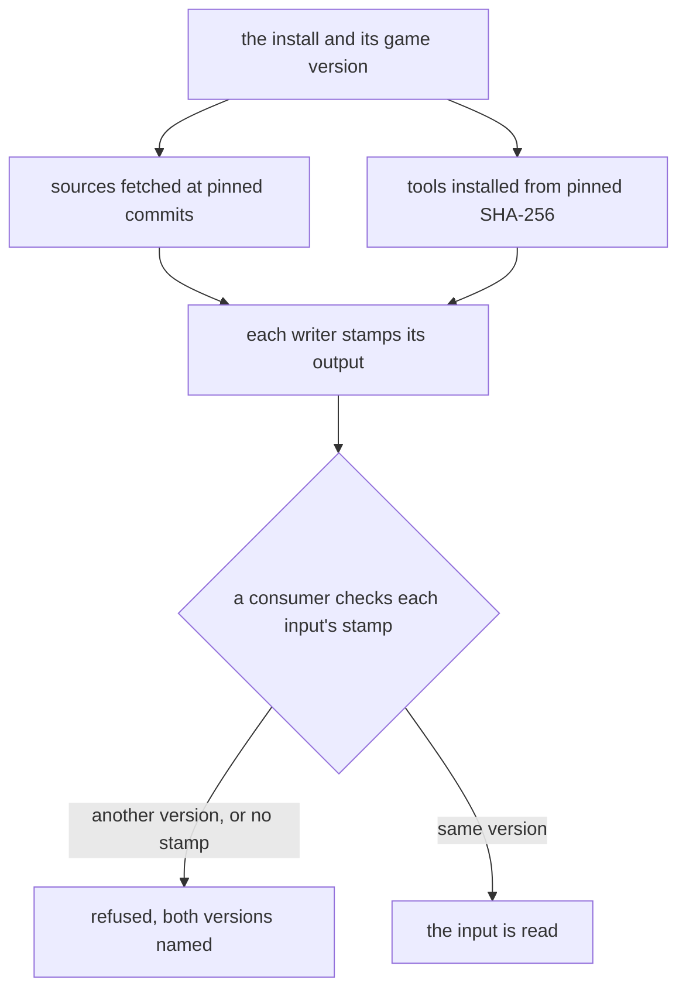

# Genshin pipeline provenance

Every export, fit input and record the conversion pipeline writes carries one provenance stamp, and every source and tool it fetches or runs is pinned, the system's own `tar` and `sysctl` excepted, so a consumer refuses an input it cannot vouch for. It is the first of the sister changes that make the pipeline reproducible, the unit of [Phase 0, Foundation](../genshin-phases/design.md): its sisters are [pipeline hygiene](../genshin-pipeline-hygiene/design.md), which fixes the paths, writers and fit outputs, and [pipeline acceptance](../genshin-pipeline-acceptance/design.md), which accepts the decoders and runs the closing reproduction. The derived assets page it amends is [derived assets](../../specs/genshin/derived-assets/design.md).

## Decisions

- **One provenance stamp.** Every writer of an export, a fit's input or a record writes its stamp through one builder and one schema, `Provenance`. A folder output holds `provenance.json` inside the folder, and a file output holds a sidecar `<file name>.provenance.json` beside the file. The witness layout, the inventory, the avatar, the scene scripts, the city areas, the CAB map, the asset map and its index, and each fit record in the world-data folder are file outputs, so a folder holding two producers holds two stamps and never one shared file. The lock is the publish's report of the objects it published, and it is not stamped: each record's sidecar is its stamp. The stamp holds the game version read from the install's `config.ini`, the command that ran, the operating system's platform, release and build, the producer's commit with its dirty flag and producer paths, the sources the output was built from, and the SHA-256 of each pinned tool's binary. A source is a name with the commit or SHA-256 it was fetched at; a writer takes them through its `sources` option, which is the name the text and asset-path index pins write through. The stamp holds no absolute path, since the install is named by its version and not its folder. The `producer.json` that `extractComponent.ts` wrote is generalised into this stamp, and the old file is deleted, so no second form survives. A consumer refuses an input whose stamp names another game version than the install's or has no stamp: a fit reads a folder or a record through `readVouchedProvenance` or `readVouchedFileProvenance` before its bytes, the map is kept only while its CAB map's sidecar names the install's version, and the fleet copy reads its peer's stamps before it chooses a file. Outputs made before this change are stamped by a backfill only where a wired reader reads them (the next decision); the rest are re-made by their writers when they next run. The map is the one large cost, a full run on each machine. Rejected: stamping only the lock, because the exports are what drift first; recording versions in docs, because a page cannot be compared by a command; a backfill of every existing output, since only what a wired reader reads needs a stamp to run; one `provenance.json` for a folder that holds several producers, because it would describe one of them.
- **Sources are pinned by commit.** Every external source a command fetches is fetched at a commit SHA kept in one constant per source, and that SHA goes into the output's stamp. The sources are the text repository, the asset-path index, the gcsim kits and the decoder constants. The decoder constants come from the pinned commit whose decoder matches the install's version, or from the install's own chunks when no commit does. A pin bump is a commit of its own. Rejected: following `main` or `master`, because a run against a moving branch cannot be repeated, and a stamp that names a commit no run fetched proves nothing.
- **Tools are installed pinned.** Every tool a stage runs comes through `installPinnedTool` with its SHA-256, and no stage reads `PATH`, the system's own `tar` and `sysctl` excepted. The Windows AnimeStudio CLI, the vkd3d compiler and 3Dmigoto take that route, and vgmstream takes it on each platform, its Windows and macOS archives pinned beside each other and the archive chosen by platform (task 3.3). The upstream AnimeStudio repository publishes no release to take the CLI from, so its Windows archive is the pinned commit built for Windows and held as a record. Beyond the disassembler, the stages also read `PATH` for ffmpeg outside Windows, for the GitHub CLI behind the gcsim kit read, and for the system `tar` that `installPinnedTool` runs to unpack a zip off Windows. ffmpeg's macOS archive is pinned, the kit's files are read raw at its pinned commit, and the GitHub CLI that still lists the kit's tree drops out in task 3.4, and `tar` and `sysctl` are named by their system paths, the one exemption the requirement makes: `sysctl` is part of macOS and has no archive to pin, and `tar` ships with the operating system. Rejected: pinning `tar` and `sysctl` like the other tools, since that pins the machine rather than a tool; unpacking the Windows CLI by hand under the Downloads folder, a step that no command runs; and keeping the `PATH` lookups with a version written into a log, because a log does not stop the next machine running a different tool.
- **The copy reads stamps before it chooses files.** A copy lists the changed directories on both sides, then reads the source's stamps: the folder stamp of each changed directory and of every directory above it, since a folder's stamp covers its subtree, and the sidecar of each file the source lists. A stamp that names another game version than this install's refuses the paths it covers: a folder's stamp refuses every path under its folder, and a sidecar refuses the file beside it and itself. A machine with no install has no version to hold a stamp to, so it takes every file. The stamps come from the peer's `ai:fleet:data stamps`, which reads its paths on stdin and prints only the stamps that exist. The peer's `files` reads its directories from stdin with `--stdin`, since a Windows peer's command line cannot carry a long list. Rejected: refusing from the manifest's digests, because a digest says a directory changed and not which game version wrote it.
- **The first stamps are a backfill, once.** A committed record, and each output the wired readers read on the machine, was made by this repository's own commands from the install the machine holds. Its first stamp is therefore the stamp its writer would write now, so it claims the install's version at the backfill, and the next run of its writer replaces it. The backfill covers the region records and the ground record the wired readers read, the witness layouts of the components whose waterfall and river fits read them, the interface trees of the character and login components, and the login playlist folder. It is a throwaway script, run once and never kept in the repository, so the repository carries only the sidecars it wrote. Rejected: a reader exemption for unstamped committed records, a second code path for data that is stamped anyway; re-running every fit, a compute round for no changed byte.
- **Every fit input is read through its stamp, except the authored catalogue.** The readers of the region files (the landmark list, the region-source reader, the region key writer, the region capitals, and `readFittedRegions`, which the camp, outcrop, waypoint, domain-entrance and residents writers read through), the witness layout, the interface trees and the playlist refuse a stamp of another version or none. The catalogue is the exception: it is the source people edit by hand, and `fitAreaOutlines` writes its outlines back into it, so a stamp on it goes stale at the next edit and vouches for nothing. Its readers (`readRegionAreas`, `fitRegionCamps`, `fitRegionWaypoints`, `readCatalogueAreaPlaceMap` and `fitAreaOutlines`) read it unrefused, and the sidecar its own fit writes is read by no reader. Readers outside the fit pipeline are not wired: `readWorldData`, which the scene arrangement check reads through, and `readAuthoredGameData`, the authored publish, which also reads the ground files as authored sources.

## How it works

The pins gate what is fetched, the tool installs gate what runs, and the stamp gates what a consumer reads. One reader serves the fit, the map and the fleet copy, so a refusal names both versions the same way in each of them, and no consumer keeps a check of its own.



## Gaps and the decision that closes each

Each row is one gap the stamp, the pins or the tools close, with the file that shows it, the step it sits in and the machine that runs it. The decision column names the decision that closes it.

| Decision | Gap                                                 | Step                    | Evidence                                                                                                                                                                                                                                                                                                                                                                              | Runs on                                               |
| :------- | :-------------------------------------------------- | :---------------------- | :------------------------------------------------------------------------------------------------------------------------------------------------------------------------------------------------------------------------------------------------------------------------------------------------------------------------------------------------------------------------------------ | :---------------------------------------------------- |
| Stamp    | Install version is unrecorded                       | install and its version | `scripts/src/services/genshinAssets/shared/readGameVersion.ts`'s `readGameVersion` reads the version from `config.ini`, and no stamp carries it                                                                                                                                                                                                                                       | either machine, the install placed by hand            |
| Stamp    | Exports and fit records carry no game version       | extraction, fit records | the producer stamp writer, deleted by this change, wrote a commit and a dirty flag and no version, and `scripts/src/services/genshinAssets/shared/writeWorldData.ts`'s `writeWorldData` writes a fit record with no stamp beside it                                                                                                                                                   | game-install                                          |
| Stamp    | Map is kept by presence                             | map                     | `scripts/src/services/genshinAssets/commands/mapCommand.ts`'s `run` skips while both of its files exist                                                                                                                                                                                                                                                                               | game-install                                          |
| Stamp    | Adopted map has no origin                           | map adoption            | `scripts/src/services/genshinAssets/blocks/adoptCabMap.ts`'s `adoptCabMap` moves the CLI's map in with no record of its binary or version                                                                                                                                                                                                                                             | game-install                                          |
| Stamp    | Shaders omit the operating system                   | shader disassembly      | `scripts/src/services/genshinAssets/materials/disassembleDxbcDirectory.ts`'s `disassembleDxbcDirectory` picks the disassembler by platform, and no output records the operating system's build                                                                                                                                                                                        | game-install, with the Windows disassembler on the PC |
| Pins     | Asset-path index on a moving branch                 | asset index             | Before this change `scripts/src/services/genshinAssets/world/constants.ts`'s `ASSET_PATH_INDEX_URL` named the `master` branch; it now names `ASSET_PATH_INDEX_COMMIT`, and `scripts/src/services/genshinAssets/world/ensureAssetPathIndex.ts`'s `ensureAssetPathIndex` fetches only when the file is missing                                                                          | either machine                                        |
| Pins     | Text, kits and decoder constants on moving branches | text and kits           | Before this change the text and the kits read a branch's head, never a commit; `scripts/src/services/genshinText/constants.ts`'s `ANIME_GAME_DATA_COMMIT` and `scripts/src/services/genshinAssets/kits/constants.ts`'s `GCSIM_MAIN_COMMIT` now name the commits they read, and the decoder constants predate the install ([game text](../../specs/genshin/game-text/design.md), Open) | either to fetch, game-install to decode               |
| Tools    | Windows CLI unpacked by hand                        | Windows CLI             | `scripts/src/services/genshinAssets/shared/constants.ts`'s `ANIMESTUDIO_CLI_PATH` defaults to a CLI under the Downloads folder, and no command builds it ([AnimeStudio on macOS](../../specs/genshin/derived-assets/animestudio-macos/design.md), Windows section)                                                                                                                    | PC only                                               |
| Tools    | Compiler found on the PATH                          | vkd3d disassembly       | `scripts/src/services/genshinAssets/materials/disassembleWithVkd3d.ts`'s `disassembleWithVkd3d` reads `VKD3D_COMPILER` or the compiler on `PATH`                                                                                                                                                                                                                                      | Mac and PC, on the non-Windows branch                 |

## Scope and order

The stamp comes first, since every writer, fit and copy goes through it, and the fleet copy's refusal in task 1.3 follows the reader in task 1.1. The pins and the tools follow, because a stamp names their commits and hashes. The records and inputs the wired readers read are stamped once by the backfill, the first decision above; every other output that predates the change is re-made by its writer, so that writer's first run after the change is its real check. The derived assets requirement that an extraction records the code that produced it is superseded by the first requirement of this capability when the change ships, and its owning page is carried by [pipeline acceptance](../genshin-pipeline-acceptance/design.md) task 3.1, once the code it describes is in.

As built, the one writer, the one reader and the sidecar pair exist, and every writer of an export, a scene script, a city area, the map, a witness layout, an inventory, an avatar and a fit record calls one of them. The map's skip and its adoption read the CAB map's sidecar through the one reader, the fit's readers of the witness layout, the interface tree, the playlist and the region files refuse on the stamp, and the fleet copy refuses on its peer's stamps. Not stamped, by decision: the lock, the interactive map's fit file under the points folder, which sits outside the world-data folder, and the map's shards, which are removed once the map is built. The residents' and domains' readers read the fitted regions through `readFittedRegions`, which is wired. The committed records were backfilled once, as the decision above says, and every fit input is read through its stamp except the catalogue, as the decision above says.

## Key files

| File                                                                        | Role after the change                                                                                               |
| :-------------------------------------------------------------------------- | :------------------------------------------------------------------------------------------------------------------ |
| `scripts/src/services/producerStamp/readProducerStaleness.ts`               | Reads the stamp's commit, from the one reader                                                                       |
| `scripts/src/services/genshinAssets/scene/writeWitnessLayout.ts`            | Stamps the witness layout with a sidecar                                                                            |
| `scripts/src/services/genshinAssets/materials/writeComponentInventory.ts`   | Stamps the inventory with a sidecar                                                                                 |
| `scripts/src/services/genshinAssets/avatar/writeAvatar.ts`                  | Stamps the avatar's binary and manifest, each with a sidecar                                                        |
| `scripts/src/services/genshinAssets/shared/writeWorldData.ts`               | Stamps each fit record with a sidecar, whose command names the record                                               |
| `scripts/src/services/genshinAssets/residents/readFittedRegions.ts`         | Reads each fitted region's record through the refusal of its sidecar                                                |
| `scripts/src/services/genshinAssets/shared/readWorldRecord.ts`              | Reads a fit record through the refusal of its sidecar                                                               |
| `scripts/src/services/genshinAssets/fit/readWitnessWorldMeshes.ts`          | Reads the witness layout through the refusal of its sidecar                                                         |
| `scripts/src/services/genshinAssets/fit/fitLoginMusic.ts`                   | Reads the playlist's folder through the refusal of its stamp                                                        |
| `scripts/src/services/genshinAssets/fit/fitLoginScene.ts`                   | Reads the interface tree's folder through the refusal of its stamp                                                  |
| `scripts/src/services/genshinAssets/fit/createInterfaceRectsFit.ts`         | Reads the interface tree's folder through the refusal of its stamp                                                  |
| `scripts/src/services/genshinAssets/fit/fitRegionCapitals.ts`               | Reads the region and ground records through the refusal of their sidecars                                           |
| `scripts/src/services/genshinAssets/fit/readRegionLandmarks.ts`             | Reads each region record through the refusal, and skips the sidecars beside them                                    |
| `scripts/src/services/genshinAssets/fit/writeRegionKey.ts`                  | Reads the region record through the refusal before it writes a key                                                  |
| `scripts/src/services/genshinAssets/shared/readRegionLandmarkSources.ts`    | Reads the region record through the refusal, for the fit and the landmark check                                     |
| `scripts/src/services/fleet/data/syncPeer.ts`                               | Reads the source's stamps, then copies only the paths no stamp refuses                                              |
| `scripts/src/services/fleet/data/readRemoteStamps.ts`                       | Reads a peer's stamps over ssh, through its `stamps` verb                                                           |
| `scripts/src/services/fleet/data/commands/stampsCommand.ts`                 | Prints the stamps named on stdin that exist, the peer's side of the copy's read                                     |
| `scripts/src/services/fleet/data/commands/filesCommand.ts`                  | Reads its directories from stdin with `--stdin`, as the copy's remote listing sends them                            |
| `scripts/src/fleet/data/index.ts`                                           | Registers the `stamps` verb beside `files`, `manifest`, `pull` and `push`                                           |
| `scripts/src/services/genshinAssets/blocks/extractComponent.ts`             | Stamps each extraction                                                                                              |
| `scripts/src/services/genshinAssets/commands/mapCommand.ts`                 | Skips a map only while its CAB map's sidecar names the install's version                                            |
| `scripts/src/services/genshinAssets/blocks/adoptCabMap.ts`                  | Adopts a map only when its sidecar names the install's version and the tool's SHA-256                               |
| `scripts/src/services/genshinAssets/shared/readGameVersion.ts`              | The one reader of the install's version, and `checkHasGameInstall` beside it for the copy                           |
| `scripts/src/services/genshinAssets/blocks/buildAssetMap.ts`                | Stamps the completed map, its CAB map, asset map and index, with sidecars, last                                     |
| `scripts/src/services/genshinAssets/interface/extractComponentClips.ts`     | Stamps each component's clips                                                                                       |
| `scripts/src/services/genshinAssets/interface/extractComponentInterface.ts` | Stamps each component's interface tree                                                                              |
| `scripts/src/services/genshinAssets/music/extractComponentPlaylist.ts`      | Stamps each component's playlist, with vgmstream when it decodes a source                                           |
| `scripts/src/services/genshinAssets/materials/extractComponentShaders.ts`   | Stamps each component's shaders                                                                                     |
| `scripts/src/services/genshinAssets/scene/exportSceneScript.ts`             | Stamps each scene script with a sidecar beside its file                                                             |
| `scripts/src/services/genshinAssets/world/buildCityAreas.ts`                | Stamps the city area file with a sidecar beside it                                                                  |
| `scripts/src/services/genshinAssets/shared/constants.ts`                    | Names AnimeStudio as a tool a stamp keeps the SHA-256 of, the genshin assets' producer paths and the vgmstream pins |
| `scripts/src/services/genshinAssets/world/constants.ts`                     | Names the asset-path index at a pinned commit                                                                       |
| `scripts/src/services/genshinAssets/world/ensureAssetPathIndex.ts`          | Fetches the pinned commit, refuses a fetched or held index whose SHA-256 is not the pinned one                      |
| `scripts/src/services/genshinText/constants.ts`                             | Names the text repository at a pinned commit                                                                        |
| `scripts/src/services/genshinText/selectDumpFiles.ts`                       | Selects the dump files whose content hash differs from the pinned commit's                                          |
| `scripts/src/services/genshinAssets/kits/constants.ts`                      | Names the kits' pinned commit                                                                                       |
| `scripts/src/services/genshinAssets/kits/gcsim/readGcsimMainCharacters.ts`  | Reads the kits' files raw at the pinned commit; the tree listing still goes through the GitHub CLI until task 3.4   |
| `scripts/src/services/shared/runGh.ts`                                      | Stays for the review and triage commands; the kit read stops calling it in task 3.4                                 |
| `scripts/src/services/shared/installPinnedTool.ts`                          | Unpacks a zip off Windows with the system `tar` at its fixed path                                                   |
| `scripts/src/services/shared/resolvePinnedTool.ts`                          | Installs each pinned tool, the macOS archives included                                                              |
| `scripts/src/services/genshinAssets/music/resolveVgmstream.ts`              | Picks the pinned archive for the platform                                                                           |
| `scripts/src/services/recreation/video/resolveFfmpeg.ts`                    | Installs the pinned ffmpeg outside Windows, not the `PATH` lookup                                                   |
| `scripts/src/services/genshinAssets/music/encodeMusicRecording.ts`          | Runs the pinned ffmpeg outside Windows                                                                              |
| `scripts/src/services/genshinAssets/materials/disassembleWithVkd3d.ts`      | Runs the pinned vkd3d compiler only                                                                                 |
| `scripts/src/services/genshinAssets/materials/disassembleDxbcDirectory.ts`  | Writes the operating system's build into the shaders' stamp                                                         |
| `scripts/src/services/recreation/animeStudio/constants.ts`                  | Names the Windows archive                                                                                           |
| `scripts/src/services/recreation/animeStudio/buildAnimeStudio.ts`           | Builds the Windows archive from the pinned commit                                                                   |

The change also creates these, which are named here and not linked:

```text
scripts/src/models/provenance/Provenance.ts             the stamp's schema, its sources included
scripts/src/models/provenance/ProvenanceOptions.ts      the writer's options: command, producer paths, sources and tools
scripts/src/models/fleet/data/StampEntry.ts             a stamp by its path, as a peer or this machine holds it
scripts/src/models/fleet/data/ChangedDirectory.ts       a directory whose digests differ, with each side's files
scripts/src/services/provenance/
  buildProvenance.ts             the stamp a command's output is written with, read now
  writeProvenance.ts             a folder's stamp, provenance.json
  writeFileProvenance.ts         a file's sidecar, <file name>.provenance.json
  readStamp.ts                   the stamp at a path, parsed and checked, or none
  readProvenance.ts              a folder's stamp, or none
  readFileProvenance.ts          a file's sidecar, or none
  readVouchedProvenance.ts       a folder's stamp for a consumer, refused when missing or another version
  readVouchedFileProvenance.ts   a file's sidecar for a consumer, refused the same way
  assertVouched.ts               the refusal both consumer readers share
  checkIsVouchedBy.ts            whether a stamp names the install's game version
  getFileSha256.ts               the SHA-256 of a tool's binary, streamed
  getSidecarPath.ts              a file's sidecar path
  constants.ts                   provenance.json and the sidecar suffix
scripts/src/services/genshinAssets/shared/readWorldRecord.ts        a fit record, read through the refusal
scripts/src/services/genshinAssets/shared/checkHasGameInstall.ts    whether this machine has the game installed
scripts/src/services/fleet/data/
  readRemoteStamps.ts, readLocalStamps.ts     the copy's reads of the source's stamps
  getStampCandidates.ts          the stamps a copy reads: each changed directory's and its ancestors' folder stamps, and its sidecars
  selectVouchedPaths.ts          the paths no stamp of another version refuses
  parseStampEntry.ts, checkIsStampPath.ts     a peer's stamp line, and a path that names a stamp
  commands/printStamps.ts, commands/readStdinLines.ts     the stamps verb's print and its stdin
```

## Sources

- [AnimeStudio](https://github.com/Escartem/AnimeStudio): the exporter the Windows archive and the macOS build are built from, pinned at the commit the constants name. Its default branch is `master`, and it publishes no release, which is why the Windows CLI is built from the pinned commit rather than downloaded.
- [DimbreathBot/AnimeGameData](https://github.com/DimbreathBot/AnimeGameData): the text source. Its `main` branch holds the TextMap folder the dump reads, and this change pins the text to a commit of its own.
- [radioegor146/gi-asset-indexes](https://github.com/radioegor146/gi-asset-indexes): the asset-path index. Its `mapped` folder holds the file the pipeline fetches, and this change pins the fetch to a commit.
- [genshinsim/gcsim](https://github.com/genshinsim/gcsim): the source of the character kits, which the pipeline reads on its `main` branch through the GitHub CLI today. This change reads the kits' files raw at a pinned commit, and task 3.4 moves the tree listing off the GitHub CLI.
- [3Dmigoto 1.3.16](https://github.com/bo3b/3Dmigoto/releases/tag/1.3.16): the release lists `cmd_Decompiler-1.3.16.zip`, the decompiler archive the pipeline already pins by SHA-256.
- [vgmstream r2117](https://github.com/vgmstream/vgmstream/releases/tag/r2117): the release lists `vgmstream-win64.zip`, pinned today, and `vgmstream-mac.zip`, the macOS archive this change pins beside it.
