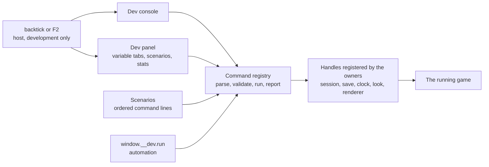

# Design

## Context

`createGenshinRenderer` hands every Vite development scene three's Inspector (`attachInspector`), and `useGenshinTuning` builds a Look group on it for the hour, clouds, wind, ramp, rim, outline, fog, water, grade, god rays and bloom. The Inspector is a renderer tool: it shows the profiler, the scene graph and shader parameters, and nothing of the game (the party, the save, the quest, the clock's meaning). It overlays the canvas and is the owner's complaint. The owner plays the game to check features and needs the game to reach a state, not a view of its graphics objects.

The aim is to re-create Genshin, not to build an engine's editor. A command, a variable or a view is here only if checking a feature or measuring parity needs it. Taken from the engines' developer consoles (Unreal's `stat` and `slomo`, Source's variables, Minecraft's `/tp` `/time` `/give`): named commands with typed arguments, variables with a range, one stats toggle, a time scale. Left: a scene-tree editor, an entity inspector, completion of ids, a profiler timeline, an assertion language, a headless runner. Each of those is work that does not move the game toward Genshin, and any of them can be added later by the change that needs it.

## Flow



## Decisions

- **The registry is the one source of truth, and the console and the panel are two faces over it.** A command is `{ name, summary, args (a zod object), run(args) => Result }`; a variable is `{ name, group, kind, get, set, range or choices }`. The panel's controls and the console's `set name value` are generated from the same variables, so a tuning value is never written twice. Rejected: a panel and a console each with their own code (they drift), and the Inspector's parameter API (it is three's, it renders over the canvas, and it cannot show a game state).
- **Handles are registered by whoever owns the state, and removed with it.** The session registers `teleport`, `heal`, `god`, `timescale` and `state`; the save registers `give`, `level`, `ar` and `unlock`; the clock registers `time`; the look registers its variables. Each registers when it mounts and unregisters on scope disposal, so a command exists exactly when the thing it changes does, and a call to one that is not mounted answers "not available here" instead of failing. Rejected: a global object everything reaches into (it makes the registry know the session) and provide/inject (the registry must work from a plain module for tests).
- **Development only, decided at the import.** The host mounts the console and the panel behind the development build flag, so a production build drops them and their commands with them. A browser driven by automation (a parity run, an agent) registers the commands and mounts no surface, because a panel would cover and slow the scene it is shooting or timing; it reaches the registry through `window.__dev.run(line)`. Rejected: a runtime switch or a URL parameter (the code would ship, and a player could reach it), and registering nothing under automation (the agents that profile and check the game would each rebuild a harness, as the frame profile had to). The signal is `navigator.webdriver`, which a browser under automation sets and a person's browser does not; `World.vue` reads it once, when the world mounts.
- **Results are small structured values.** A command returns `{ ok: true, value }` or `{ ok: false, error, usage }`, with `value` a count, a rounded number or a name, never a dump; the console prints it as one line and `window.__dev.run` returns it as data. `state` answers the position, place, hour, weather, health and party in one record, so an agent reads the game's state without a screenshot. Nothing costs a frame while closed: the overlay and the stats sampling are off until toggled, and the registry is a map lookup. Rejected: a dump of the whole session (most of it is not the question).
- **The registry and the handles live in the game package, the two faces live in the app.** `genshin-world` is a published package that cannot depend on the app's interface library, so the registry, the commands, the variables and the scenarios are plain TypeScript there and are exported, and the console and the panel are components of the app's `Genshin` folder drawn with its own library. Rejected: the faces in the package drawn with the game's interface kit (the kit draws the game's own look, and a developer surface should not look like a screen of the game it is checking).
- **Typed arguments.** An argument that names an item, a landmark, a region or a weather is checked against the names the game already loaded, so `give` takes the names the owner reads in the game. A bad argument answers with the schema's message and the usage line, and the command does not run. An unknown command lists the names that contain it. Rejected: free text parsed by hand per command, and a completion UI over the ids (a typed, listed name is enough for the one owner who uses it).
- **A scenario is an ordered list of command lines that stops at the first failure.** It is a file under `services/dev/scenarios/`, one scenario per file, named for the change that shows (`bosses-dvalin`, `chests-every-tier`). Running one applies its commands in order, shows each result, and on a failure stops and says which line. A feature change registers its scenario in the same change, or states in its design why it has none; the `building-proposals` skill carries the rule. Rejected: scenarios as saved game files (they rot with the save's shape, and a command list is read in review).
- **The Inspector goes, and its Look group moves.** `attachInspector`, its call in `createGenshinRenderer` and the group in `useGenshinTuning` are deleted; the look's uniforms register as variables in a Look tab with the same ranges, which is where the look is tuned against reference screenshots. The Vite optimizer exclusion for the Inspector module stays, because the fluid simulator page (`apps/web/app/composables/visual/useFluidSimulator.ts`), which is not a Genshin scene, keeps its own Inspector. Rejected: keeping it behind a switch (it would be the thing in the owner's way, one flag from always on).
- **Stats are the renderer's own counters.** The overlay shows the median frame time over the last 60 frames, draw calls and triangles. The pass switches are variables for the passes the world's chain draws, so the owner can see which pass a slow frame pays for: the temporal anti-aliasing (off falls back to SMAA) and the sun's shadows. The chain draws no bloom (its `isBloomed` is off), no god rays (no god-ray light is passed) and no occlusion (its radius is zero), so those have no switch. Rejected: a profiler timeline (a frame profile found the cost in one enemy function by a CPU profile, which no overlay shows).
- **Keys do not reach the game while the console is focused.** Opening the console takes the keyboard from the controls and gives it back on close; the panel never takes it, so the game keeps running under the panel.
- **History and the open tab are the viewer's convenience.** They are kept in the browser's local storage, wrapped so a blocked store changes nothing else; a variable's value is not kept, so a reload starts every variable at the game's own value.

## Key files

| File                                                                       | Role                                                                                                    |
| :------------------------------------------------------------------------- | :------------------------------------------------------------------------------------------------------ |
| `packages/genshin-world/src/services/dev/createDevRegistry.ts`             | Registers handles, parses a line, runs it, reports                                                      |
| `packages/genshin-world/src/models/dev/DevCommand.ts` and `DevVariable.ts` | The two registered shapes                                                                               |
| `packages/genshin-world/src/services/dev/commands/**`                      | One command per file, grouped by the owner that registers it                                            |
| `packages/genshin-world/src/composables/useWorldDevHandles.ts`             | Registers the world's commands with the registry while the session mounts, and removes them on disposal |
| `apps/web/app/components/Genshin/Dev/Console/Index.vue`                    | The console                                                                                             |
| `apps/web/app/components/Genshin/Dev/Panel/Index.vue`                      | The panel: variable tabs, scenarios and stats                                                           |
| `apps/web/app/components/Genshin/World.vue`                                | Mounts both behind the development flag                                                                 |
| `packages/genshin-world/src/composables/useGenshinTuning.ts`               | Registers the look's variables instead of an Inspector group                                            |

Scenario files are added beside the runner as the changes that show them land, one scenario per file:

```text
packages/genshin-world/src/services/dev/scenarios/
```

## Notes

- The first world commands are those the world has the state for: `state`, `teleport` (a landmark, a region or coordinates, through the pose the map overlay's jump uses), `time`, `timescale` and `heal`. `weather` waits: the shown weather is a read-only result of the area's own chain, with no writable state to set. `god` waits: the world has no invulnerability state. `noclip` waits: the free camera moves the camera, not the character's body. The save's commands (`give`, `level`, `ar` and `unlock`) come with task 3.2. A command whose state does not exist yet is added by the change that builds that state, with its scenario.
- Nothing here changes a rule a player meets; a command writes the same save fields the game's own acts write.

## Sources

- The engines' public developer-console documentation named in the Context: Unreal's console variables and commands, the Source engine's console variables, and Minecraft's command syntax. Read from general knowledge of those pages; none was re-fetched for this design.
- The owner's request: an easy way to play-test and check features, no more of three's Inspector, which "seems to be getting in my way more than not, and not really informative", tools that are agent-first and not wasteful, and nothing that rebuilds a game engine.
- `packages/genshin-engine/src/renderer/createGenshinRenderer.ts` and `packages/genshin-world/src/composables/useGenshinTuning.ts` for what exists today.
