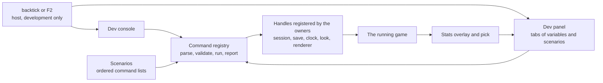

# Design

## Context

`createGenshinRenderer` hands every Vite development scene three's Inspector (`attachInspector`), and `useGenshinTuning` builds a Look group on it for the hour, clouds, wind, ramp, rim, outline, fog, water, grade, god rays and bloom. The Inspector is a renderer tool: it shows the profiler, the scene graph and shader parameters, and nothing of the game (the party, the save, the quest, the clock's meaning). It overlays the canvas and is the owner's complaint. The owner plays the game to check features and needs the game to reach a state, not a view of its graphics objects.

What the engines whose developer surfaces are best known do, and what each gives this game:

| Engine surface                                                      | Taken                                                                                | Left                                                                              |
| :------------------------------------------------------------------ | :----------------------------------------------------------------------------------- | :-------------------------------------------------------------------------------- |
| Unreal console (`stat fps`, `slomo`, `ghost`, `teleport`)           | Named commands with typed arguments; `stat` as an overlay toggle; time scale; noclip | Its blueprint and class vocabulary                                                |
| Source engine cvars with `sv_cheats`                                | Variables with a type, a range and a group, listed and set by name                   | A global cheat gate: the whole surface is development-only instead                |
| Minecraft and server commands (`/tp`, `/time`, `/weather`, `/give`) | The grammar a player already reads, completion of names and ids                      | Selectors and permission levels                                                   |
| Unity: Inspector and Hierarchy, Game-view stats, `Time.timeScale`   | Naming the entity under the pointer with its state; the stats overlay; time scale    | An editable scene tree: the game's state is the save and the session, not objects |
| Godot: remote scene tree, monitors, visible collision shapes        | Monitors as the stats overlay; later, collision drawing as a variable                | The live tree editor                                                              |
| Test scenes in Unity and Godot                                      | A scenario: one named setup that is the feature's own test bench                     | Scene files: a scenario is a list of commands over the save, not a separate scene |

## Flow

## Decisions

- **The registry is the one source of truth, and the console and the panel are two faces over it.** A command is `{ name, summary, args (a zod object), run(args) => Result }`; a variable is `{ name, group, kind, get, set, range or choices }`. The panel's controls and the console's `set name value` are generated from the same variables, so a tuning value is never written twice. Rejected: a panel and a console each with their own code (they drift), and the Inspector's parameter API (it is three's, it renders over the canvas, and it cannot show a game state).
- **Handles are registered by whoever owns the state, and removed with it.** The session registers `teleport`, `heal`, `god` and `timescale`; the save registers `give`, `level` and `unlock`; the clock registers `time`; the look registers its variables. Each registers when it mounts and unregisters on scope disposal, so a command exists exactly when the thing it changes does, and a call to one that is not mounted answers "not available here" instead of failing. Rejected: a global object everything reaches into (it makes the registry know the session) and provide/inject (the surface must work from a plain module for tests).
- **Development only, decided at the import.** The host mounts the console and the panel behind the development build flag, so a production build drops them and their commands with them. A browser driven by automation (a parity run, an agent) registers the commands and mounts no surface, because it is shooting or timing the scene and a panel would cover and slow it; it reaches the registry through `window.__dev`. Rejected: a runtime switch or a URL parameter (the code would ship, and a player could reach it), and registering nothing under automation (the agents that profile, check and verify the game would each rebuild a harness, as the frame profile of 2026-10-29 had to).
- **The tools are built for an agent first, and the owner's surfaces are two of its callers.** The same registry is what a session, a script and a test call. A command returns a small structured result (`{ ok: true, value }` or `{ ok: false, error, usage }`) that the console prints as a line and `window.__dev.run(line)` returns as data, in magnitudes (a count, a rounded millisecond, a name), never a dump. A read-only family answers what a session would otherwise discover by running the game and screenshotting it: `state` (position, place, hour, weather, health, party, flags in one record), `near <kind>` (the entities within a radius with their ids and states), `inventory`, `stat` (the renderer's counters and the frame's median) and `step <n>` (advance the fixed step n times with no wall clock, so a check waits for ticks rather than time). A scenario carries `expect` steps (`expect state.health > 0`, `expect inventory Mora >= 100`) that fail it, so a scenario is both the owner's one-click state and an agent's regression check. `pnpm -C scripts genshin:dev run <scenario or line>` starts the parity page headless once, runs it and prints the compact result, and `genshin:dev stat` prints the frame's counters; the command reuses the parity harness's page and its memory gate instead of a second one. Nothing costs a frame while closed: the overlay, the pick and the stats sampling are off until toggled, and the registry is a map lookup. Rejected: a surface only a person can click (an agent would drive the game through screenshots, the most expensive way to learn a state), a JSON dump of the whole session (most of it is not the question), and a headless node simulation of the world beside the real one (a second implementation that drifts from the first).
- **The registry and the handles live in the game package, the two faces live in the app.** `genshin-world` is a published package that cannot depend on the app's interface library, so the registry, the commands, the variables and the scenarios are plain TypeScript there and are exported, and the console and the panel are components of the app's `Genshin` folder drawn with its own library. Rejected: the faces in the package drawn with the game's interface kit (the kit draws the game's own look, and a developer surface should not look like a screen of the game it is checking).
- **Typed arguments, names completed from the game's own data.** An argument that names an item, a landmark, a region, an enemy kind or a weather is a choice list drawn from the name records and the catalogue the game already loaded, so `give` takes the names the owner reads in the game. A bad argument answers with the schema's message and the usage line, and the command does not run. Rejected: free text parsed by hand per command.
- **A scenario is an ordered list of commands that stops at the first failure.** It is a file under `services/dev/scenarios/`, one scenario per file, named for the change that shows (`bosses-dvalin`, `chests-every-tier`). Running one applies its commands in order, reports each, and on a failure stops and says which line. A feature change registers its scenario in the same change, or states in its design why it has none; the `building-proposals` skill carries the rule. Rejected: scenarios as saved game files (they rot with the save's shape, and a command list is read in review).
- **The Inspector goes, and its Look group moves.** `attachInspector`, its call in `createGenshinRenderer`, the Vite optimizer exclusion for it and the group in `useGenshinTuning` are deleted; the look's uniforms register as variables in a Look tab with the same ranges. The profiler the Inspector offered is replaced by the stats overlay. Rejected: keeping it behind a switch (it would be the thing in the owner's way, one flag from always on).
- **Stats are read from the renderer's own counters, and the overlay is a variable.** The overlay shows the median frame time over the last 60 frames, draw calls, triangles, geometries, textures and, where the browser gives it, the heap. The pass toggles (shadows, god rays, ambient occlusion, bloom, anti-aliasing) are variables, so the owner can see which pass a slow frame pays for. Rejected: a profiler timeline (the engine profile is a tool run by an agent, not played with).
- **The pick names game entities, not objects.** An entity kind that can be picked registers a label function (its kind, id, place and state); an Alt-click on the canvas asks each for the nearest within the pointer's ray and shows the answer in the panel. Kinds register as they gain a handle, enemies and interactables first. Rejected: raycasting the whole scene and naming meshes (a mesh name is not a game fact).
- **Keys do not reach the game while the console is focused.** Opening the console takes the keyboard from the controls and gives it back on close; the panel never takes it, so the game keeps running under the panel.
- **History and the open tab are the viewer's convenience.** They are kept in the browser's local storage, wrapped so a blocked store changes nothing else; a variable's value is not kept, so a reload starts every variable at the game's own value.

## Key files

| File                                                                       | Role                                                                     |
| :------------------------------------------------------------------------- | :----------------------------------------------------------------------- |
| `packages/genshin-world/src/services/dev/createDevRegistry.ts`             | Registers handles, parses a line, runs it, completes names               |
| `packages/genshin-world/src/models/dev/DevCommand.ts` and `DevVariable.ts` | The two registered shapes                                                |
| `packages/genshin-world/src/services/dev/commands/**`                      | One command per file, grouped by the owner that registers it             |
| `packages/genshin-world/src/services/dev/scenarios/**`                     | One scenario per file                                                    |
| `packages/genshin-world/src/composables/useDevHandles.ts`                  | Registers an owner's commands and variables and removes them on disposal |
| `apps/web/app/components/Genshin/Dev/Console/Index.vue`                    | The console                                                              |
| `apps/web/app/components/Genshin/Dev/Panel/Index.vue`                      | The panel: variable tabs, scenarios, stats and pick                      |
| `apps/web/app/components/Genshin/World.vue`                                | Mounts both behind the development flag                                  |
| `packages/genshin-world/src/composables/useGenshinTuning.ts`               | Registers the look's variables instead of an Inspector group             |
| `packages/genshin-engine/src/renderer/attachInspector.ts`                  | Deleted                                                                  |

## Notes

- The commands the first slice ships are those the world already has the state for: `teleport` (a landmark, a region or coordinates, through the pose the map overlay's jump uses), `time` and `timescale` (the game clock), `weather`, `god`, `heal`, `noclip` (the free camera's mode) and `give`, `level` and `unlock` over the save. A command whose state does not exist yet is added by the change that builds that state, with its scenario.
- Nothing here changes a rule a player meets; a command writes the same save fields the game's own acts write.

## Sources

- The engines' public developer-surface documentation, as listed in the table: Unreal's console variables and commands, the Source engine's console variables, Minecraft's command syntax, Unity's Inspector, Game-view statistics and `Time.timeScale`, and Godot's remote scene tree and monitors. Read from general knowledge of those pages; none was re-fetched for this design.
- The owner's request of 2026-10-29: an easy way to play-test and check features, and no more of three's Inspector, which "seems to be getting in my way more than not, and not really informative".
- `packages/genshin-engine/src/renderer/attachInspector.ts`, `createGenshinRenderer.ts` and `packages/genshin-world/src/composables/useGenshinTuning.ts` for what exists today.
