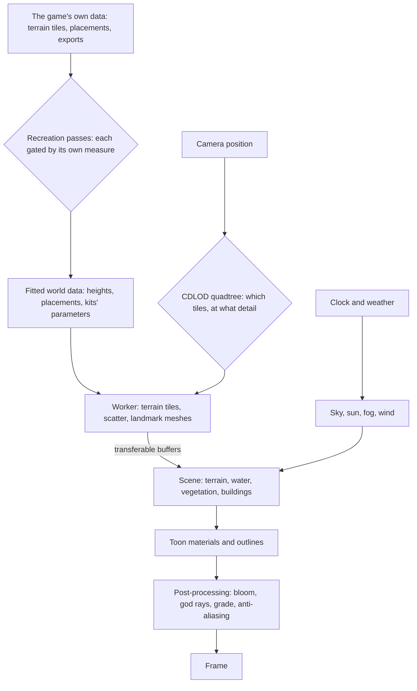

# Genshin

Genshin Impact is set on one continent: seven nations, each with its own element, climate and architecture, plus the borderlands around them. This proposal rebuilds it in the app with TresJS and Three.js's WebGPU renderer. The goal is a recreation you can explore, as close to the game's regions as careful reference can make it. The world comes first: its look, its sky, its ground, water and plants, then the regions one by one. After that, the game's features are copied one at a time, starting with the character and how it moves. It is the [agent console](../../specs/infra/claude-interface/agent-console/README.md)'s world. The console is shown in the app as Genshin at `/genshin`, and the Genshin world replaces its voxel world outright, with no voxel option kept. The console's Claude sessions keep working over the new world until they get a Genshin-style interface of their own.

## Decisions

- **A fan work, labelled as one.** Region, place and landmark names are the game's own, since the point is the game's world. The page says it is an unofficial, non-commercial fan recreation and does not pass itself off as HoYoverse's. HoYoverse's written rules for fans cover merchandise rather than software, so this area follows what they ask of any derivative work: it is marked as fan-made, never counterfeits official art, and claims no rights of its own. This supersedes the console's [voxel open world](../../rejected/infra/voxel-open-world/design.md), whose realm was original, since the realm is now the game's own.
- **Every asset is authored here.** Geometry is generated in code from parameters, textures are procedural nodes in the Three.js Shading Language (TSL), and shaders are written in the repository. No model, texture, sound or image file taken from the game or its media is committed or served. The one exception is decided: the interface matches the game's exactly, so its glyphs are traced from the game's own marks into paths of our own, the way the [parity](../../specs/genshin/parity/README.md) loop does it. The other is decided too: the music's voices, which no oscillator of ours makes sound like an orchestra, may play public-domain recordings of real instruments layered over the synthesizer, never the game's ([sampled instruments](../../specs/genshin/sampled-instruments/design.md)). The characters are drawn from HoYoverse's official MMD models, which it publishes for fans apart from the game, and they are no exception: their bundled terms forbid redistributing them, 「请勿二次配布」, so the app hosts none and reads only a copy its reader holds ([characters](../../specs/genshin/characters/README.md)). The world stays generated, which is also what makes the project a showcase of the renderer rather than an asset viewer. Generated is not approximate: a scene is re-derived from the game's own assets as closely as they allow, by our own shaders, generators and data, with no fidelity ceiling short of copying the game's files ([scene derivation](../../specs/genshin/scene-derivation/design.md)).
- **The game's files are references, never shipped.** The installed game keeps its content in encrypted asset bundles. AnimeStudio, a third-party exporter, reads them locally with the game closed, and its exports sit in the references folder beside every screenshot and recording, outside the repository ([derived assets](../../specs/genshin/derived-assets/design.md)). Nothing is injected into the running game, which an anti-cheat driver watches. The game's code metadata may be decrypted offline from the user's own install where what it decodes, such as the tables' real field names or a script's type data, is worth far more than the dumps give, and nothing it reads is committed (the `genshin-parity` skill). What a player can see stays a reference too, gathered as [parity](../../specs/genshin/parity/README.md) gathers any: the community wiki and published recordings searched first, and the game recorded only for what nothing published shows. None of it is committed.
- **As close to the real region as the game's own data allows.** Every scene is rebuilt in the [recreation passes](../genshin-recreation-passes/design.md): its layout read from the game's terrain tiles and streaming records, its shapes and surfaces fitted against the game's own exports, a recording's camera read off it by the exports' landmarks, and only its display transform, light, air and sounds read off a recording's colour, each pass judged by its own measure and frozen ([scene derivation](../../specs/genshin/scene-derivation/design.md)). The frame's perceptual score against its references is its acceptance, never its loop.
- **An engine of modules.** The [engine architecture](../../specs/genshin/engine-architecture/design.md) divides the world into a package of single-purpose modules that the app mounts, so each system is built, tested and replaced on its own; a page adds the module it first needs.
- **WebGPU through TresJS.** `TresCanvas` takes a renderer factory, so the scene runs on three's `WebGPURenderer` while components stay declarative. Materials and post-processing are TSL node graphs, as the [fluid simulator](../../specs/fluid-simulator/README.md) already does. TresJS comes first, and raw Three.js is used only where TresJS and cientos have nothing, with the reason given on the page that does it.
- **TSL takes the full lint.** Type-aware oxlint loops forever on the fluid simulator's composable, which `oxlint.config.ts` excludes. The engine's modules import the same `three/webgpu` and TSL types and lint in about a second, so the engine takes no exclusion, and a new one is added only for a file measured to hang.
- **The world keeps a budget.** Its cost grows with what the camera can see, never with the size of the continent. Every page here applies the rules the [engine architecture](../../specs/genshin/engine-architecture/design.md) sets out: instancing, level of detail, off-thread generation, and transferable buffers.
- **The game's systems settle their open questions this way (2026-10-08).** The spawned places, such as chests, Oculi, puzzles, camps and shrines, are read from the official interactive map's public point data, fitted to world coordinates on the statues and waypoints both sources hold. Poise and the other frame-level combat numbers come from gcsim's data up to v2.47.2, its last MIT release, cross-checked against KQM. The Serenitea Pot editor, the card game and Imaginarium Theater are in scope, as the whole world is. Time-limited events and a server-backed world for co-op stay [deferred](../../deferred/genshin/). Each character's kit is written from its talent descriptions, never decompiled.

## How it works

## The pages of this proposal

### Phase one: the world engine

| Page                                                            | What it adds                                                                 |
| :-------------------------------------------------------------- | :--------------------------------------------------------------------------- |
| [Recreation passes](../genshin-recreation-passes/design.md)     | a screen rebuilt in ordered passes, each gated by its own measure and frozen |
| [Localized opening](../genshin-localized-opening/design.md)     | the publisher's splash and layouts as each client language shows             |
| [Flowing water](../genshin-flowing-water/design.md)             | rivers along their courses, and waterfalls over cliff bands                  |
| [Trees and scatter](../genshin-trees-and-scatter/design.md)     | every placed plant's species, instanced and culled on the GPU                |
| [Windrise derivation](../genshin-windrise-derivation/design.md) | Windrise's open world rebuilt from every object the game streams             |
| [Ground detail](../genshin-ground-detail/design.md)             | the ground's layers' detail, each at its own texture's metres per texel      |
| [Weather](../genshin-weather/design.md)                         | rain, storms, snow, fog and sandstorms, set per area as the game sets them   |
| [Exploring](../genshin-exploring/design.md)                     | waypoints to jump to, the game's arrival points, and the map's pan and zoom  |

### Phase two: the regions

Each region is built on the whole engine above. It adds its palette, a parametric building kit, its flora, its weather and its landmarks.

| Page                                        | Region                                               |
| :------------------------------------------ | :--------------------------------------------------- |
| [Mondstadt](../genshin-mondstadt/design.md) | the Anemo nation, and Dragonspine                    |
| [Liyue](../genshin-liyue/design.md)         | the Geo nation, the Chasm and Chenyu Vale            |
| [Inazuma](../genshin-inazuma/design.md)     | the Electro archipelago, and Enkanomiya              |
| [Sumeru](../genshin-sumeru/design.md)       | the Dendro rainforest and desert                     |
| [Fontaine](../genshin-fontaine/design.md)   | the Hydro nation, above and under water              |
| [Natlan](../genshin-natlan/design.md)       | the Pyro nation of volcanoes, springs and tribes     |
| [Nod-Krai](../genshin-nod-krai/design.md)   | the moonlit borderland archipelago                   |
| [Snezhnaya](../genshin-snezhnaya/design.md) | the Cryo nation of tundra, factories and its capital |

### Phase three: the play features

| Page                                                      | What it adds                                                                                                                              |
| :-------------------------------------------------------- | :---------------------------------------------------------------------------------------------------------------------------------------- |
| [Follow camera](../genshin-follow-camera/design.md)       | a notch's zoom and the ease read off a recording, the camera's settings, and how far photo mode may go                                    |
| [HUD](../genshin-hud/design.md)                           | the HUD's fitted places and its pieces' measured looks                                                                                    |
| [Characters](../genshin-characters/design.md)             | the game's characters from HoYoverse's official models                                                                                    |
| [Party](../genshin-party/design.md)                       | Party Setup's screen and Quick Setup, the next-member and game-over screens, Elemental Resonance's remains, the party kept between visits |
| [Character screen](../genshin-character-screen/design.md) | the screen measured, the character in its middle, Details, the other tabs, levelling and ascending                                        |
| [Menu Paimon](../genshin-menu-paimon/design.md)           | the Paimon menu's traced icons and fitted layout, Paimon beside it, and the profile card's fields                                         |
| [Menu Time](../genshin-menu-time/design.md)               | the Time screen the side bar opens, setting the world's held hour                                                                         |
| [Menu Settings](../genshin-menu-settings/design.md)       | the Settings screen's body: its Graphics quality, Audio and language rows                                                                 |
| [Menu quit prompt](../genshin-menu-quit-prompt/design.md) | the exit prompt Quit Game opens, scaled to its whole frame                                                                                |
| [Combat](../genshin-combat/design.md)                     | the Stellar Glimmer reactions, waiting on the Cryo Traveler's or Odette's kit                                                             |
| [Inventory](../genshin-inventory/design.md)               | using food on the party, and the destroy mode on the bag's screen                                                                         |
| [Wish](../genshin-wish/design.md)                         | the banners' pools, a charted course, Character Event Wish-2 and the history                                                              |
| [Quests](../genshin-quests/design.md)                     | the go-to triggers placed, the world quest series, the commissions dealt at the reset, and the quests' clues                              |

### Phase four: the game's systems

What still separates the recreation from the whole game once the world and its play features stand: how characters fight and grow, what the world gives back for exploring it, and the pastimes and challenges beside it. Each page is one system, in the order the systems wait on each other. The game's tables a page names are read from the user's installed game at its own patch once that file's reading lands, and from the community's dump until then, as the `genshin-parity` skill settles. The systems that need a server or other players are [deferred](../../deferred/genshin/) instead, since the world keeps no server.

| Page                                                              | What it adds                                                                                                                                                               |
| :---------------------------------------------------------------- | :------------------------------------------------------------------------------------------------------------------------------------------------------------------------- |
| [Character kits](../genshin-character-kits/design.md)             | every character's skill, burst and passives on the framework the Traveler's kit runs on, priced by combat as built                                                         |
| [Talents](../genshin-talents/design.md)                           | the Talents tab's upgrade, with the levelling, the passives and the constellations' additions built                                                                        |
| [Constellations](../genshin-constellations/design.md)             | each constellation's effect in its character's kit, the Traveler's sets by element, and the Constellation tab; the table and activation are built                          |
| [Weapon enhancement](../genshin-weapon-enhancement/design.md)     | a weapon's passive at its refinement rank, once the character kits stand                                                                                                   |
| [Artifact enhancement](../genshin-artifact-enhancement/design.md) | each artifact set's conditional bonus, a module as the set is carried                                                                                                      |
| [Adventure Rank](../genshin-adventure-rank/design.md)             | the rank's EXP sources, Katheryne's rewards, the systems each rank opens and the profile card's values                                                                     |
| [Original Resin](../genshin-original-resin/design.md)             | resin regenerating while the page is closed, and the claim every resin challenge shares                                                                                    |
| [Save data](../genshin-save-data/design.md)                       | the world's state kept per player as one blob, with conditional writes, a server clock and merges on conflict                                                              |
| [Domains](../genshin-domains/design.md)                           | entrances, levels by rank, scenes of their own, the days' materials and the Petrified Tree                                                                                 |
| [Ley line outcrops](../genshin-ley-line-outcrops/design.md)       | each region's two blossoms, fought, claimed and moved on by the game's own groups                                                                                          |
| [Bosses](../genshin-bosses/design.md)                             | normal bosses' arenas, moves and blossoms, and weekly bosses claimed once a week                                                                                           |
| [Spawned places](../genshin-spawned-places/design.md)             | where the servers' chests, Oculi, puzzles and camps stand, fitted from the official map's points                                                                           |
| [Map unlocking](../genshin-map-unlocking/design.md)               | Teleport Waypoints and domain entrances unlocked by reaching them, their first-unlock rewards, and a near locked waypoint pointed to                                       |
| [Statues of The Seven](../genshin-statues-of-the-seven/design.md) | Oculi offered for the region's levels and stamina, the Statue's Blessing, and the Traveler                                                                                 |
| [Offering systems](../genshin-offering-systems/design.md)         | the regions' sacred trees, fountains and shrines, each taking its items for its levels                                                                                     |
| [Elemental Sight](../genshin-elemental-sight/design.md)           | the trails drawn to a bounty's target, a Seelie's court and a quest's clue, once their pages place them                                                                    |
| [Chests](../genshin-chests/design.md)                             | five kinds at their fitted places, locked, dug or sealed, and their rewards                                                                                                |
| [Puzzles](../genshin-puzzles/design.md)                           | mechanisms as state machines, monuments, Seelies, time trials and the Shrines of Depths                                                                                    |
| [Exploration progress](../genshin-exploration-progress/design.md) | each area's percentage on the map, and a nation's thresholds of Reputation                                                                                                 |
| [Commissions](../genshin-commissions/design.md)                   | the game's daily tasks, their rewards, Katheryne's bonus and Encounter Points                                                                                              |
| [Reputation](../genshin-reputation/design.md)                     | each nation's levels from bounties, requests and exploration, and their rewards                                                                                            |
| [Gathering](../genshin-gathering/design.md)                       | the ores struck, the mining outcrops' places and the investigation spots; the plants but for five left out, the outcrops' rank and respawn and the daily cap are built     |
| [Wildlife](../genshin-wildlife/design.md)                         | animals that flee, charge or fight back, and the materials picked off them                                                                                                 |
| [Crafting](../genshin-crafting/design.md)                         | the bench's place and screen, the regional talent materials, and the gadgets once their instructions are named; the recipes and the talents' doubles and refunds are built |
| [Cooking](../genshin-cooking/design.md)                           | the stove and cooking screen, eating a dish, and the passives that bonus a kind of dish; the dishes, Auto Cook, specialties, processing and campfires are built            |
| [Forging](../genshin-forging/design.md)                           | the forge screen and the blacksmith's place; the recipes, queues, orders, daily cap, talents, the Serenitea Pot's refusal and the drop-table Mystic are built              |
| [Gadgets](../genshin-gadgets/design.md)                           | each gadget's kind from the game's config on Z, cooldowns that run while paused                                                                                            |
| [Shops](../genshin-shops/design.md)                               | every vendor's goods and restocks, Paimon's Bargains and the Souvenir Shops, nothing for crystals                                                                          |
| [Fishing](../genshin-fishing/design.md)                           | points, bait, the bite and the tension minigame, every number from the fish tables                                                                                         |
| [Expeditions](../genshin-expeditions/design.md)                   | characters sent out for hours in real time, and their places' rewards                                                                                                      |
| [Companionship](../genshin-companionship/design.md)               | Friendship Levels from the party's EXP, and the stories, voice-overs and namecard they open                                                                                |
| [Resident schedules](../genshin-resident-schedules/design.md)     | Night spots for the residents in region data, the other regions' residents once their scenes' birth records are dumped, and vendors' hours once the shops sell             |
| [Achievements](../genshin-achievements/design.md)                 | the game's achievements as watchers of their own triggers, paid in Primogems and namecards                                                                                 |
| [Archive](../genshin-archive/design.md)                           | the Living Beings' kills, Tutorials and the Geography's viewpoints, each opened as its doing lands; the built sections are on the Archive page                             |
| [Serenitea Pot](../genshin-serenitea-pot/design.md)               | the player's realm, its placement editor and load, the depot, companions, gardens and ponds; Tubby's furnishings, Trust Rank and the realm's stores are built              |
| [Spiral Abyss](../genshin-spiral-abyss/design.md)                 | the chambers' scenes and enemy camps, the screen and the carried health, the blessings and the wormhole; the floors, clock, stars and periods are built                    |
| [Imaginarium Theater](../genshin-imaginarium-theater/design.md)   | the season's cast, the acts and events paid in Fantasia Flowers, the rewind and the Lobby; the season, Vigor, Blessing Level and Stella are built                          |
| [Genius Invokation TCG](../genshin-genius-invokation/design.md)   | the duel screen, the opponents' cards, invitationals and the Card Shop, past its built rules engine and its tutorial deck and decks 3 and 4                                |

## Scope and order

1. **The recreation passes' runner and measures first.** Every later page is judged by them, so they are the base the rest stands on. The rest of the engine follows in the table's order, each built when Windrise's passes reach what it draws and shown first there, in the scene the [rendering style](../../specs/genshin/rendering-style/design.md) is built in.
2. **Mondstadt first among the regions.** It is where the game begins, and its opening areas are the ones the Windrise scene already holds. The rest follow in the game's release order.
3. **Then the play features, one page each.** First the [character controller](../../specs/genshin/character-controller/design.md) (run, sprint, jump, climb, glide, swim and stamina) and its [follow camera](../genshin-follow-camera/design.md). Then the [HUD](../genshin-hud/design.md), whose stamina meter the controller needs. Then [characters](../genshin-characters/design.md), from HoYoverse's official MMD models, read from the copy each reader holds. Then the [menu screens](../genshin-menu-paimon/design.md), whose Paimon is drawn as a character is. Then elemental reactions, and after that each feature in turn. Each feature is built when its turn comes, not before, so nothing is built against an engine that does not yet exist; a feature's page may be written earlier, as combat's, inventory's and wish's are, and states only its proposed scope.
4. **Then the game's systems, in phase four's order.** The [character kits](../genshin-character-kits/design.md) come first, since every character's strike is a kit's and every growth system, reward and challenge after them acts through a kit. Phase four's pages are written ahead of their turn as the map of what is left, each holding only what the game's tables and the wiki settle, and each is re-read against the engine when its turn comes.

## What this does not propose

- **Assets from the game.** Nothing exported is committed, served or converted into a file of ours; only what our own fits and generators write ships.
- **Multiplayer.** The world is the person's own, as the game's is outside co-op ([co-op](../../deferred/genshin/co-op/design.md) is deferred).
- **A monetised or official-looking product.** No payment, no HoYoverse branding in the chrome, and no claim to be the game.

## Key files

| File                                                   | Role after the change                                        |
| :----------------------------------------------------- | :----------------------------------------------------------- |
| `apps/web/app/composables/visual/useFluidSimulator.ts` | The WebGPU and TSL setup the area's renderer factory follows |

## Notes

- **As-built pages form a Genshin area.** Each engine page, once built, is rewritten in the [Genshin](../../specs/genshin/README.md) area, beside the [agent console](../../specs/infra/claude-interface/agent-console/README.md)'s docs, which keep only the console that works the sessions.
- **The geography is the game's own, fitted.** Heights and placements are read from the game's terrain tiles and streaming records on its own coordinates and fitted by our generators ([scene derivation](../../specs/genshin/scene-derivation/design.md)), so no region is laid out by hand and none needs a transform from a map's pixels.

## Sources

- [Genshin Impact: Crafting an Anime Style Open World](https://www.gdconf.com/news/learn-about-making-genshin-impacts-open-world-gdc-2021), Haoyu Cai's GDC 2021 talk: the studio's own account of the anime-style open world this area recreates.
- [miHoYo lists rules on overseas Genshin Impact fan-made merchandise](https://www.siliconera.com/mihoyo-lists-rules-on-overseas-genshin-impact-fan-made-merchandise/), Siliconera: the fan guide's terms, which are to label the work as fan-made, never counterfeit official art and claim no copyright. This area applies them.
- [The world of Genshin Impact](https://genshin-impact.fandom.com/wiki/Teyvat), Genshin Impact Wiki: the nations, the borderlands and the regions this proposal lists.
- [TresCanvas](https://docs.tresjs.org/api/components/tres-canvas), TresJS: the `renderer` factory that puts `WebGPURenderer` under declarative components.
