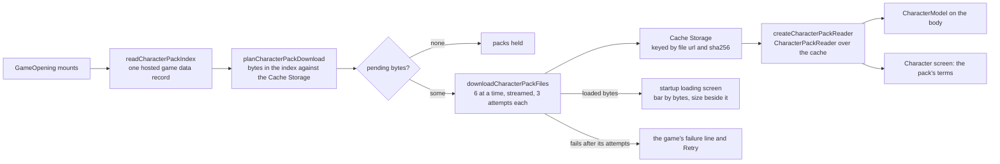

# Design

## Context

`openspec/specs/genshin/characters/published-packs/design.md` records that every official pack is published under `characterPacks/<avatar id>/<path>` in the public game data container, with the pack's own `manifest.json` (`{ avatarId, name, files: [{ path, bytes, sha256 }] }`), and that the world does not read them yet. Three routes deliver a pack today and none reaches a production build with a pack in it: the development server's route (answered only under `nuxt dev`, from the developer's folder), a signed-in account's kept packs (served one file at a time by hash to that player) and a pack the player loads from a zip or folder into the browser's storage. When none holds the character, `World/Windrise` draws the capsule of the body. The startup loading screen takes `progress` from the host, which `apps/web/app/components/Genshin/Index.vue` computes as `(save + chunk + ready) / 3`, and a pack does not gate ready.

The owner wants every character drawn from its real model, no stand-in, and the loading screen to download everything the world needs before it shows, with the bar and the size to download visible.

## Flow

## Decisions

- **One hosted index record lists every pack.** The publish writes `characterPacks/index` as a game data record: for each avatar id its name and its files with their bytes and sha256, taken from the manifests. The world reads it with `readGameData` like every dataset, so the lock covers it and it arrives as one small request. Rejected: reading the 13 per-pack manifests, which is 13 requests before the first byte is planned for and puts nothing under the lock; and a hand-kept list of ids, which drifts from what is published.
- **Files are kept in Cache Storage under a url that carries the file's hash.** A file's request url is `<base>/characterPacks/<id>/<encoded path>?v=<first 16 hex of sha256>`. A republished file with new bytes has a new hash, so it is a different key and is fetched; the blob server ignores the parameter. Whether a file is held is `cache.match`, so the plan knows the bytes still to fetch before any request. Rejected: the HTTP cache alone, which cannot tell the plan what is held; and IndexedDB blobs, which add a store, a schema and a rollback (the browser-kept pack code this change deletes) where `Response` already streams from the Cache.
- **The opening starts the download, the loading screen shows it.** `GameOpening` calls the preload when it mounts, so the splashes and the login play while bytes arrive, and a returning player's cache makes the plan empty. The startup loading screen is where the bar and the size appear, because that is where the world waits on it. Rejected: starting at the click that opens the door, which wastes the splashes and the login; and downloading only the party's packs, which the owner did not ask for and which leaves a character missing the moment the party changes.
- **Every published pack downloads, not the party's.** The roster is 13 packs and 85 MB today and a cached player pays it once. The index lists the packs, so a later narrowing to the party is one filter in the plan if the roster grows past what a first visit should cost; it is not built ahead of that.
- **The bar is bytes while there are bytes, then the world's own steps.** With pending bytes the first 70% of the bar is `loadedBytes / pendingBytes` and the rest is the host's existing thirds (save, chunk, ready). With none pending the bar is the thirds alone, as today. The 70% is a named constant. Rejected: weighting the steps in bytes, which invents a size for work that has none; and two bars, which the game's single startup bar does not have.
- **The size is read in the reader's language, with the game's words.** The line under the marks is the game's `Downloading resources...` (id 1323480176) and `loaded / total` formatted by `Intl.NumberFormat` with the `megabyte` unit and the reader's language tag. No English literal ships. The game's `Expected download size: {0}\nDownload now?` is a confirmation the app does not ask (the download is not optional), so it is not used.
- **A failed file is retried, then the loading stops.** A file gets three attempts with a short growing wait. After the third the loading holds with the game's `Resource download failed...` line (id 3595641979) and a Retry that plans again, so the files already held are not fetched twice. Rejected: continuing into the world without the model, which is the capsule again under another name.
- **A character without a published pack is not selectable.** The party picker and the save's active character are restricted to ids in the index; the Traveler's pack always exists. There is no stand-in to fall back to, so a save naming an id outside the index loads the Traveler. Rejected: keeping the capsule for the unpublished roster, which is the stand-in this change removes.
- **The three routes are deleted in this change.** The development server draws from the same dev container the production build reads, so its route has no reason left; the account's kept packs and the browser's kept packs existed because the packs could not be published. Keeping any of them as a second reader beside the published one is the compatibility debt the repository forbids. The account deletion still owes the removal of a `{userId}/character-packs.json` that an existing account may hold: that cleanup stays until a listing of both accounts shows none, then goes in its own commit.
- **The terms travel with the model.** The published `terms` folder is read from the cache by the same reader and shown by the existing `Character/Terms` component beside the character on the Character screen, as the publish's design requires. The loader that offered a pack to load goes.
- **Scope ends at characters.** Enemies, wildlife, interactables and the frostbearing tree draw capsules as their bodies, not as stand-ins for a model that exists; they have none yet. The development-only Traveler export (`useCharacterAvatar`) is the developer's own game extraction for parity work and is untouched.

## Key files

| File                                                                                 | Role                                                                |
| :----------------------------------------------------------------------------------- | :------------------------------------------------------------------ |
| `scripts/src/services/genshinAssets/characterPacks/buildCharacterPackIndex.ts`       | Builds the index record from the packs' manifests                   |
| `scripts/src/services/genshinAssets/commands/characterPacksCommand.ts`               | Publishes the files and the index, and reports both in a dry run    |
| `packages/genshin-world/src/models/character/CharacterPackIndex.ts`                  | The index record's model and schema                                 |
| `packages/genshin-world/src/services/character/readCharacterPackIndex.ts`            | Reads the index through the hosted game data                        |
| `packages/genshin-world/src/services/character/planCharacterPackDownload.ts`         | The files and bytes the cache lacks                                 |
| `packages/genshin-world/src/services/character/downloadCharacterPackFiles.ts`        | Fetches the missing files with progress and retries into the cache  |
| `packages/genshin-world/src/services/character/createCharacterPackReader.ts`         | A `CharacterPackReader` over the cache                              |
| `packages/genshin-world/src/composables/useCharacterPackPreload.ts`                  | The preload's state: bytes loaded, bytes pending, failure and retry |
| `packages/genshin-world/src/components/Loading/Startup/Index.vue`                    | The size line under the marks                                       |
| `packages/genshin-world/src/components/Game/Opening/Index.vue`                       | Starts the preload when it mounts                                   |
| `apps/web/app/components/Genshin/Index.vue`                                          | Composes the bar from the bytes and the thirds                      |
| `packages/genshin-world/src/components/World/Windrise/Index.vue`                     | Draws the character's model from the reader, with no capsule        |
| `apps/web/server/development/genshinCharacterPacks.ts` and its services              | Deleted                                                             |
| `apps/web/server/services/genshin/accountCharacterPack/**` and its routes and models | Deleted                                                             |
| `packages/genshin-world/src/components/Character/PackLoader/Index.vue`               | Deleted                                                             |

## Notes

- `GameTextKey` gains the download line and the failure line, written by `genshin:text write` in every language.
- The index and the packs publish with `pnpm -C scripts genshin:assets character-packs`, which already uploads the files to both accounts; the main session runs it and then `genshin:data verify`.
- A pack's files keep their own names (a Chinese model file name among them), so the reader finds the model with `chooseCharacterPackModel` and the terms with `chooseCharacterTermsFile`, which stay.

## Sources

- The map of the three routes, the model reader and the startup progress, from the session's read of `packages/genshin-world/src/services/character`, `apps/web/server/services/genshin` and `apps/web/app/components/Genshin/Index.vue`.
- The game's own download words, ids 1323480176, 3202095352, 378928540 and 3595641979 in the dump's English text map.
- The owner's statement that HoYoverse permits redistributing the packs, and their request to remove the capsule and download the assets in the loading screen with the size shown.
