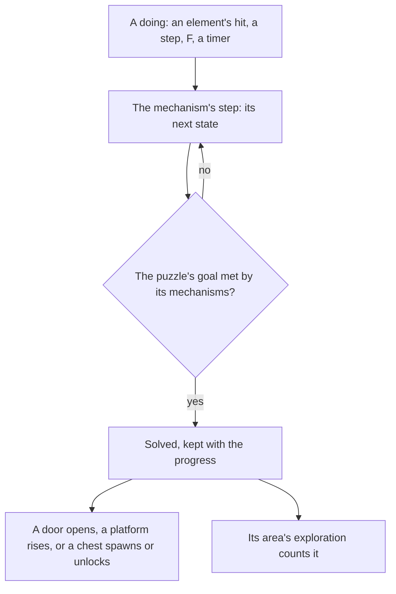

# Puzzles

Much of the game's exploration is puzzles: monuments lit by an element, Seelies led to their courts, timed challenges, sealed shrines, and every region's own devices. Solving one opens a door, raises a platform or spawns a chest. The mechanisms stand at the [spawned places](../genshin-spawned-places/design.md), they are struck by the [character kits](../genshin-character-kits/design.md), and they unlock the [chests](../genshin-chests/design.md) beside them, so this page waits on all three. The [as-built page](../../specs/genshin/puzzles/README.md) holds its places and the state machines of the monument, the Seelie and the Time Trial Challenge; what follows is what remains.

## Decisions

- **A mechanism is a small state machine.** Each kind of mechanism is a deterministic step in the world, as an enemy's AI is, moved by the doings that reach it: a hit of an element through [combat](../../specs/genshin/combat/design.md)'s rules, the character stepping on it, an interaction, or a timer on the fixed step. Its states are the wiki's description of the kind, and nothing else in the world knows its kind.
- **A puzzle is placed by its label, and its mechanisms and goal are written per kind.** The official map's puzzle label points place each puzzle, and the label names its kind. Which mechanisms make a kind and what solving it does is written as data per kind from the wiki's page for that kind, marked provisional where the wiki does not state one. A puzzle solved stays solved, kept with the player's progress, unless the wiki says it resets.
- **What the map and the wiki leave open is provisional.** A monument's element and a challenge's limit and targets are in no source the build holds: the official map's monument marks carry no element (45 of its 200 carry one other attribute, of three values, which the monument label does not name), and the wiki's monument page names seven element variants and no element per place. Each is set per kind from the wiki where it gives one and marked provisional where it does not; the clips sought for them measure what stays provisional.
- **A Mondstadt monument is provisional until it is measured.** The wiki's [Elemental Monument](https://genshin-impact.fandom.com/wiki/Elemental_Monument) page names seven element variants, shows only Pyro's temporary monument, and names no element for a place, so it gives neither an element nor a timing for the monuments' kind (read on 2026-10-18 through the wiki's MediaWiki API, `api.php?action=parse&page=Elemental_Monument`). `toMonumentPlace` gives each monument mark the provisional Pyro element and timed, the Pyro monument being the one the wiki shows as temporary, and marks the place `isProvisional`; `buildPuzzlePlaces` writes it onto the place. The 14 Mondstadt monuments carry that stand-in, with the 186 monuments of the other regions, until the monument recordings measure them.
- **Mondstadt's Seelie courts are the map's.** The official map marks thirty Seelie Courts (label 147, under its Experience category), all in Mondstadt, each 8 to 125 of the map's units from its nearest Seelie, and none in any other region. Each court is paired with one Seelie, closest pairs first, no court or Seelie taken twice, so thirty Seelies are led home and the rest rest where they stand until their courts are placed. A Seelie carries its map point's id, which the save names it by once it settles. A Seelie is followed while the character stands within `SEELIE_FOLLOW_DISTANCE` of it, provisional until `seelie-led-home.mkv` measures it.
- **Elemental Monuments.** A monument lights when struck by its element, a reaction's included. Some stay lit once lit; others go out after their time. A puzzle of monuments is solved once all of them are lit together. Settled: the element that lights a monument is the strike's own or a reaction's, as the [puzzles page](../../specs/genshin/puzzles/README.md) records; a timed monument counts its time from its last strike on its own clock. A puzzle whose monuments must be lit in a set order, such as the Minacious Isle sequence a Seelie shows on a pillar, is written with its own sequence as its goal, once its region's puzzles are wired.
- **Seelies led home.** A Seelie moves along its route toward its court as the player follows it, and goes back to its start if it is not led home in time. Settled in its court it spawns its chest. Elemental Sight draws its trail ([Elemental Sight](../genshin-elemental-sight/design.md)). Its route is the game's server path, so it is the walk on the ground between its fitted start and court until a recording measures its turns.
- **A settled Seelie spawns an Exquisite Chest.** A court gives the chest its own wiki page names; where its page names none, an Exquisite Chest. The [Seelie](https://genshin-impact.fandom.com/wiki/Seelie) page's general rule is that chests "will appear once the Seelie has settled back into the court", and it names no kind for any Seelie kind's court, so every court takes the Exquisite Chest, one of the two kinds the [Chest](https://genshin-impact.fandom.com/wiki/Chest) page lists as spawned by a followed Seelie (read on 2026-10-18 through the wiki's MediaWiki API, `api.php?action=parse&page=Seelie&prop=wikitext`). `computeSeelieChestPlaces` gives that chest on the court's ground for each settled Seelie, and `SEELIE_CHEST_KIND` holds its kind.
- **Time Trial Challenges.** Interacting with the challenge's marker starts its timer, and its targets, rings to pass, objects to strike or enemies to defeat, must all be done before it ends; done in time, it spawns its chest.
- **A Time Trial Challenge's limit, targets and chest are provisional.** The wiki gives a limit only as "X second(s)" and no target count, so the limit stands at 45 seconds, the banner of the one challenge in `captures/yt-B_l5b_KXt-o-time-trial-limit.mp4`, and one target stands in until a recording counts them (`TIME_TRIAL_CHALLENGE_LIMIT_SECONDS`, `TIME_TRIAL_CHALLENGE_TARGET_COUNT`). A challenge starts once the character stands within ten metres of its marker, a stand-in for the interaction (`TIME_TRIAL_MARKER_REACH_DISTANCE`). A solved challenge spawns an Exquisite Chest at its marker (`TIME_TRIAL_CHEST_KIND`): the [Chest](https://genshin-impact.fandom.com/wiki/Chest) page lists Time Trial chests under Common, Exquisite and Precious, and Exquisite is the kind the Seelie chest takes, so this kind is a choice for the main session to confirm. No save holds a challenge's state yet, so a reload starts each one idle again. Not built: the chest is not yet merged into the chests list, and nothing strikes a target yet, since the rings, objects and enemies it counts are not in the world.
- **Shrines of Depths.** A shrine is opened with one of its region's Shrine of Depths keys, which the region's statues give ([Statues of The Seven](../genshin-statues-of-the-seven/design.md)), and holds a Luxurious chest. Each region keeps its own keys.
- **The map's labels settle each kind.** The official map gives each mark a label, and the label names the kind: the Seelie variants it names beside the Seelie (Electro and Warming) are Seelies, and each nation's shrine label is one Shrine of Depths kind. A mark's element, timing and wiring are not on the map, so those come from the wiki or a recording, never from the points.
- **A region's own mechanisms come with it.** Sumeru's ruins and Withering, Fontaine's devices, Natlan's and every other region's are each written on this framework by the page that builds the region.
- **Settled Seelies and solved puzzles are a save slice.** The save's `puzzles` slice holds `settledSeelieIds` and `solvedPuzzleIds`, each a unique list of ids bounded like the other id slices, with no default: a save stored before the slice is backfilled to it, never defaulted, as the [save data](../../specs/genshin/save-data/design.md) page's rule says. Two copies of a save merge by the union of both copies' ids, since a Seelie settled or a puzzle solved is kept once it has happened.

## How it works



## Scope and order

**Today:** the [as-built page](../../specs/genshin/puzzles/README.md) records what stands, and nothing is yet placed, drawn, struck or solved.

**This adds, in order:**

```text
scripts/src/services/genshinAssets/puzzles/toMonumentPlace.ts
```

1. **Mondstadt's Seelies led to their courts.** Add `SeelieCourt` to `PuzzleKind` (`packages/genshin-world/src/models/puzzle/PuzzleKind.ts`) and `SeelieCourt: [147]` to `PuzzleKindLabelIdsMap`, and run `pnpm -C scripts genshin:assets puzzles`, so the courts join the published `puzzles/mondstadt` record through the same points pipeline. In the world, `services/puzzle/readMondstadtPuzzlePlaces.ts` fetches that record by key as `services/gathering/readMondstadtGatheringPlaces.ts` does, and a new `services/puzzle/pairSeelieCourts.ts` pairs each court with one Seelie place, the closest pair first, none taken twice, giving a resting `Seelie` for each pair. `composables/useWorldPuzzles.ts` loads the places as `useGatheringPoints.ts` does, steps each Seelie through `stepSeelie` on the fixed step, reporting it followed while the character is within `SEELIE_FOLLOW_DISTANCE` (a provisional constant in `services/puzzle/constants.ts`), and `components/World/Puzzles/Index.vue` draws each Seelie at its point along its route as a small glowing stand-in and each court as a stand-in ring, queued for the user's eyes; it is mounted beside `World/Interactables` in `World/Session`. Test: `pairSeelieCourts.test.ts` (two courts and three Seelies pair closest first, the third Seelie left unpaired, and a court never taken twice).
2. **Elemental Monuments in Mondstadt, placed and struck**, once each Mondstadt monument's element is set. A new `toMonumentPlace.ts` gives each monument mark of the published `puzzles/mondstadt` record its kind's element and whether it is timed, from the wiki where its monument page gives them and provisional where it does not, and `buildPuzzlePlaces.ts` writes that element and timing onto the place in the same slice. In the world, `services/puzzle/readMondstadtPuzzlePlaces.ts` imports the slice on demand as `readMondstadtGatheringPlaces.ts` does, `composables/useWorldPuzzles.ts` makes each placed monument an `ElementalMonument` and steps it on the fixed step, and `components/World/Puzzles/Index.vue` draws each in a stand-in tint of its element, queued for the user's eyes. A kit's landed hit strikes the monuments within its area through `strikeElementalMonument`, and a group's monuments lit together solve it through `checkIsMonumentPuzzleSolved`. Test: `toMonumentPlace.test.ts` (a mark takes its kind's element and timing, and a kind the wiki gives neither for is left provisional).
3. **The other Seelies**: each court the map does not mark read from the wiki's Seelie pages, provisional where they give none.
4. **Time Trial Challenges**: each challenge's limit and targets read from the wiki's Time Trial Challenge pages, provisional where they give none, then placed and started from its marker in the world. The chest a solve spawns is granted by the [chests](../genshin-chests/design.md) opening.
5. **Shrines of Depths**, with the keys the statues give.
6. **Each region's own mechanisms**, with its region.

## Data and measures

- **Read from the wiki, per kind:** each mechanism kind's states, each puzzle kind's mechanisms and goal, each monument's element and whether it stays lit once lit, each Seelie's court and each challenge's limit and targets, provisional where the wiki states none.
- **Measured:** a timed monument's time lit, a Seelie's route and speed, and each challenge's limit where the wiki gives none, off recordings, provisional until then. A timed monument's time lit is provisional at sixty seconds until a recording measures it.
- **Not in the map:** the map gives one point per Seelie and a court for thirty of Mondstadt's alone, and no target count for a challenge. The other courts and the targets are read from the wiki, provisional where it gives none, before a Seelie or a challenge is placed.

## Key files

| File                                                                           | Role after the change                               |
| :----------------------------------------------------------------------------- | :-------------------------------------------------- |
| `packages/genshin-world/src/components/World/Character/Index.vue`              | The kit's landed hits strike the monuments in reach |
| `packages/genshin-world/src/services/interaction/computeInteractionPrompts.ts` | A mechanism in reach to act on                      |
| `packages/genshin-world/src/models/world/RegionData.ts`                        | Gains each region's mechanisms and puzzles          |
| `packages/genshin-world/src/components/World/Session/Index.vue`                | Steps the mechanisms in reach on the fixed step     |

## Sources

- Read on 2026-10-18: the four wiki pages below returned HTTP 402 Payment Required to a page fetch, and were read through the wiki's MediaWiki API (an anonymous `api.php?action=parse` request, the page's wikitext). What they give, and none of it is in the build yet: the Elemental Monument page names seven element variants, its temporary gallery shows only the Pyro one, and it names no element per place; the Seelie page names no chest kind, and the Chest page lists a Seelie's chest under both Common and Exquisite; the Time Trial Challenge page names three objective kinds, each with its limit left as X seconds, and no limit or target count per challenge; the Shrine of Depths page gives ten shrines per region, seven in Nod-Krai, each opened with its region's key.
- [Puzzle](https://genshin-impact.fandom.com/wiki/Puzzle), Genshin Impact Wiki: the mechanisms of the open world and of each region, and what solving them does.
- The Elemental Monument and Minacious Isle sequence sources are the [puzzles](../../specs/genshin/puzzles/README.md) page's, which the monument's state machine is built from.
- [Seelie](https://genshin-impact.fandom.com/wiki/Seelie), Genshin Impact Wiki: Seelies led to their courts, returning if left, Elemental Sight's trail, and the chest a settled Seelie gives.
- [Time Trial Challenge](https://genshin-impact.fandom.com/wiki/Time_Trial_Challenge), Genshin Impact Wiki: the challenges, their limits and their rewards.
- [Shrine of Depths](https://genshin-impact.fandom.com/wiki/Shrine_of_Depths), Genshin Impact Wiki: shrines opened with their region's keys, each holding a Luxurious chest.

## Reference

- `monument-timed.mkv` — a timed Elemental Monument in the world struck with its element from a few metres, then filmed until it goes out, two minutes at most; the time it stays lit after its last strike is measured from it, and `ELEMENTAL_MONUMENT_LIT_SECONDS` (`packages/genshin-world/src/services/puzzle/constants.ts`) holds it provisionally at sixty seconds until then. On the wiki and YouTube, none found (searched 2026-10-11).
- `seelie-led-home.mkv` — a Seelie in the open followed from where it rests to its court, the route filmed in full, then one left unfollowed until it goes back to its start, five minutes at most; the route's walk time and the time left unfollowed before it goes back are measured from it, and `SEELIE_ROUTE_SECONDS` and `SEELIE_RETURN_SECONDS` (`packages/genshin-world/src/services/puzzle/constants.ts`) hold provisionally until then. Partly found 2026-10-11: https://www.youtube.com/watch?v=sN0MlNE-ByM at 0–40 s (`captures/yt-sN0MlNE-ByM-seelie-led-home.mp4`); still sought: the route's full walk time to its court and the time an unfollowed Seelie stays before it returns to its start are not in the window.
- `monument-mondstadt-pillars.mkv` — each elemental monument near Windrise struck once with each of the seven elements from a few metres, three minutes at most; which element lights each monument, and which stay lit once lit, are read from it, and the Mondstadt puzzles' wiring is written from them. On the wiki and YouTube, none found (searched 2026-10-11).
