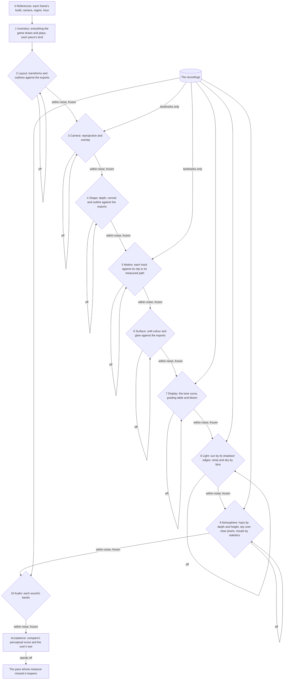

# Recreation passes

This page is the order a Genshin screen is rebuilt in, built on the [scene derivation](../../specs/genshin/scene-derivation/design.md)'s three kinds of information and its witness render, and on the [parity](../../specs/genshin/parity/README.md) loop's commands. The login scene has been worked for a long time by one loop: change something, shoot the whole frame, score it against a recording, rank every term of its error by the most it could recover, and work the largest. Each turn of that loop moves the frame by hundredths of its perceptual score, and the loop does not converge, because every unknown is judged through every other one:

- **A placement read as a haze.** By day the stone twenty metres up and some way out read twice as bright as the recording's, which the light and the haze were solved against pass after pass. The light map of `rank` found it on two towers standing where the recording shows sky: a placement that no light or haze could ever fix, absorbed by both.
- **A light traded for a haze.** Solved free, the light went below none to cancel a haze too bright over the far stone. Two unknowns landing in one score settled at whatever hid both.
- **Random content against a pixel score.** The game's cloud layer, ported from its own program and drawn over its own textures, scored the frame worse at every setting, as the particle clouds did before it: clouds the game scatters at random can never win a score comparing pixels, whatever their amount.

The interface did not have this problem. Its pieces are placed from the game's own rect tree, moved by its own clips, and compared over the recording's own frame with everything else held, so each difference points at the one piece that caused it, and it reached a few tenths of a percent in a handful of passes. This proposal runs every part of a screen the way the interface runs.

## Decisions

- **Passes in dependency order, each answering one kind of unknown.** An unknown is answered after everything it depends on and before anything that depends on it: what exists, where it stands, the camera that sees it, its shape, its motion, its surface, the transform from scene colour to the screen, the light on it, the air around it and the sounds it makes. A later pass's solve absorbs an earlier one's error, so a pass is never begun on a red pass before it.
- **Each pass has its own measure, in screen units at the references' cameras.** A placement is measured in metres against the exports' transforms and in pixels where it lands, a shape by its depth, normal and outline against the exports' drawn at the same camera, a surface by its unlit colour against theirs, a sound by its bands' envelopes against the game's own sound. No pass is judged by the frame's score, which every other pass moves too.
- **A pass is done when its measure is within the reference's own noise, and then it is frozen.** Its gate is a threshold its measure must meet on every reference, and what it produced is held by a test (as the arrangement's cross-ratios already are), so no later pass may move it to make its own numbers better. A later pass that finds an earlier one wrong reopens that pass, never compensates for it.
- **The recording's colour enters only for what exists at run time.** Layout, shape, motion a clip holds and surface are the game's own data, so they are judged against the game's own exports through the witness render, aligned to the pixel and free of any light. A recording's camera, and any motion no clip holds (a flight a script drives, the walkway's rise), live only in that recording, and are read off it through the frozen layout alone: its landmarks located in the frame and its outlines overlaid, with no colour of the recording in the reading. The display transform, the light, the atmosphere and the sounds are set at run time, and only for them is the recording's colour consulted, each pass over a mask where only its own unknown moves the reading.
- **Random content is judged by its statistics.** Clouds, wisps and anything else the game scatters is matched by its cover by height, its size and its colour spread, never by a pixel score.
- **The frame's perceptual score is acceptance.** Once every gate holds, `compare` scores each reference and the user's eye checks it. A frame that still stands off names a pass whose measure missed something, which is the measure's defect to fix.
- **Ceilings order the work inside a pass, never across passes.** Within one pass, the items are worked largest first by what they could recover, as `rank` prices them; a term in a later pass waits for every earlier gate however large it is.
- **The layout reads a placement in pixels by its pairs, before any render.** Each fitted part beside the export nearest it, both carried as the scene carries their family in a current build's reference's state, at every copy of a row the scene repeats it along, and projected from the scene's camera there, read only where the export lands on the frame and gated at a recording's two pixels of softness. A family with no part on a reference's frame has nothing to read there and is skipped for it, said so in the pass's notes, while a family on no reference's frame at all is a miss, since no frame has placed it. The camera is the next pass's, but a camera a little off moves both points of a pair alike, so their gap reads the placement alone. A family's outline in pixels is the shape pass's, drawn at the same camera, so the layout needs none.
- **The light reads the sun's direction on its shadows' edges over flat receivers.** The receivers are the exports' parts facing up; the reference's shadow on them is its shading, its colour over the exports' albedo, split by Otsu's threshold; ours is the exports' occluders cast by the scene's own shadow map from the direction tried. The two edges are priced both ways in the reference's pixels and gated as any place on the frame is, and the direction is solved by its heading and its height over the horizon from the scene's, solved on an older build's reference seen from its own camera, itself solved on its landmarks.
- **`MHYBloom_Z`'s bloom fields are read in the order the prefilter takes them.** The profile's parameters are override and value pairs of eight bytes in field order, and its overridden values at bytes 60, 76 and 84 leave one pair between the first two, at 68, at its default. The prefilter reads `_MHYBloomThreshold`, then `_MHYBloomThresholdCharacter` where a character's pixels stand, then `_MHYBloomScaler`, and the compose `_MHYBloomIntensity` (`Login/Scene/Display.reference.ts`). So the threshold is the 0.75 at byte 60, the character threshold the default left at 68, which the login never needs since it draws no character, the scaler the 2.5 at 76 and the intensity the 0.75 at 84. The bloom's own reading confirms it once the bloom draws, and does not gate the build.
- **The audio pass reads each sound's bands, never its onset.** Each effect is scored against the game's sounds it was fitted from in both channels every 5 milliseconds and gated at a second take of our own noise seeded apart, the grain only the game's samples would close. Its delay after what sets it off is read once off the recording's frames and written straight into its constant, nothing solved over it, and its own rise is already its first frames' bands.

## How it works



The interface runs beside these as a pass of its own, placed from the rect tree, moved by its clips and compared over the recording's frame, as [parity](../../specs/genshin/parity/README.md) describes.

### The passes

| Pass       | Its source of truth                                     | Its measure                                                                           | Tools today                                           | Missing                                                      |
| :--------- | :------------------------------------------------------ | :------------------------------------------------------------------------------------ | :---------------------------------------------------- | :----------------------------------------------------------- |
| References | The wiki, the data dumps, recordings                    | Each frame's build, camera, region and hour, written down                             | `fetch`, `frames`                                     | Nothing                                                      |
| Inventory  | `extract`, `tree`, `inventory`, `behaviours`            | Every renderer, material, shader, texture, clip, sound and spawn named with its kind  | `genshin:assets` commands, `passes`                   | Effects, clips and sounds in its checklist                   |
| Layout     | Placements, spawns, anchors and the rows scripts scroll | Metres against the exports' transforms, then pixels where each part lands             | `parts`, `passes`                                     | Nothing                                                      |
| Camera     | Landmarks on the frozen layout                          | Reprojection error and the overlay's edge distance                                    | `pose`, `track`, `overlay`, `passes`                  | Nothing                                                      |
| Shape      | Each mesh                                               | Depth, normal and outline per family against the exports at the same camera           | `rank`'s second table, shaded, `passes`               | Nothing                                                      |
| Motion     | Decoded clips, the rows scripts move                    | Each animated part's track against its clip, and fieldless motion against its measure | `clips`, `glide`, `film`, `passes`                    | The walkway's rise and the glide's easing against the script |
| Surface    | Textures and materials                                  | Unlit colour and glow per family against the exports                                  | `gbuffer`, `plan`, `passes`                           | Nothing                                                      |
| Display    | The post program, the grading tables, the post profile  | Which table, which curve and what bloom, before any light                             | `passes`                                              | The game's bloom, its fields named                           |
| Light      | The recordings, everything before held                  | The stone's shown colour by bins, the sun's direction by its shadows' edges           | `calibrate`, `shadows`, `passes`                      | Nothing                                                      |
| Atmosphere | The recordings, the emitters' anchors, the cloud layer  | Haze by depth and height, sky over its clear pixels, clouds by statistics             | `calibrate --haze`, `sky`, `cover`, `layer`, `passes` | Each hour's cloud layer settings                             |
| Audio      | The game's sound banks, recordings to find each sound   | Each sound's octave bands over time; the music by `listen`                            | The music tools, `sounds`, `fitSoundEffect`, `passes` | Nothing                                                      |

### Why it converges

Judged through the frame, each of the scene's unknowns is confounded by every other one, and fixing one re-prices the rest, so the work grows with the square of the unknowns and the loop can stall forever on a pair of them trading error. Judged by its own measure, each unknown is solved once against data that only it moves, most of them in closed form from exact data, and frozen: the work grows with the number of unknowns, and every pass's result stays true as later passes land. The interface is the case that already runs this way.

## The first run: the login

The login runs through every pass from its inventory as its measures land, each gate holding before the next pass begins. What each pass has in question there, a row shifted by a fitted value, a camera the old recordings may not share, a rise read by eye, a transform left out, suns set by hand, a cloud layer waiting on its settings and the sounds still unmatched, is that pass's item on the [roadmap](../genshin-roadmap/tasks.md), in the passes' order. Windrise starts at the references the same way once the login's gates hold.

## The login's open steps

Each step is answered by its pass, in the order above, and is done once the pass's gate holds and its result is frozen.

- **Inventory.** Name every field of the login's environment and scripts (`EnviroSky`, `LoginSceneEnviro`, `LoginSceneWeather` and the rest) by matching it against what it sets, so later passes read the game's values rather than solve them from recordings. Each effect, clip and sound the exports hold is claimed by a part of ours or named as not drawn.
- **Layout.** Place the towers that stand a dozen pixels or more off: the dawn's left tower, the dusk's middle towers, the day's two wide towers top left and the lantern tower's crown. Edges cannot place them, since the day's towers fit within 10 to 12 pixels along the whole loop, so the measure needs each tower's upper sky outline held against ours. Each hour's frame is checked again on a current build's recording, as the older references were taken on older builds.
- **References.** A frame of the title at each hour, and of the door at rest, from a current build's recording.
- **Shape.** Judge each stand-in's outline, depth and normal against the exports before its surface or light. Sunk recesses of four units or more are carved as openings; shallow ones stay painted, since boxing them scored worse. Relief that tilts the light along a recess's edge needs carved geometry of our own, the crown's colonnade first, because bump maps did not move the towers against the exports.
- **Motion.** Check the walkway's two easing curves and the distances beside its rows against the current recording, and the glide's two speeds against the script.
- **Surface.** Judge each unlit colour against the exports at the references' cameras. The towers' stone needs a procedural grain of our own, fitted to scale and contrast. Gilding needs an environment map of the login's sky before it reads as metal. The walkway's surface needs its finest scale (joints, pocket rims, lane borders), its rims at the game's one-centimetre width, and the dais wings' shadow. The door's front needs its carved relief and light, the largest term on the phone's door frame.
- **Display.** The night's red needs a white balance matrix (`_WhiteBalanceMat`) before the tone curve, set per sky state, and the curve's contrast is held by the display pass on the current recording. The game's bloom fields are read by the bloom reading in Scope. Windrise's palette is tuned again under the curve.
- **Light.** Solve the light apart from the haze, over bins the haze barely reaches, and then solve the haze's colours under it. Then the falloff with height past the haze, the reflection pass's ambient with its clamp and highlight, the dusk sun's direction from its shadows' edges (`genshin:parity shadows`), and the phone door frame's light under the PC client's day light.
- **Atmosphere: haze.** Solve the day's and the dusk's haze, which the haze measure does not settle, by the difference between haze that adds and light that scales. Give the cloud sea its two side banks, under 2 metres beneath the walkway some 215 metres to either side, and each emitter's spread from its particle system.
- **Atmosphere: sky.** Solve the dusk's clear sky under its thin cloud and wisps, then check it against a frame that shows the sky beneath. Solve the cover at the horizon, where our haze reads as cloud, and overhead, where no hour but the dusk draws any cloud.
- **Atmosphere: clouds.** Brighten and soften the night's and the day's clouds to the recordings' brightness, solve the day's horizon cloud, and give a cloud its inside: a lit crown grading into a pale shade, with cirrus between.
- **Audio: music.** Layer recordings of real instruments, or a fixed equaliser held out across time, over the synthesizer, since its octave bands sit five to seven decibels off. The first piece's lowest band is overfilled by the noise. The synthesizer's notes die about twice as fast as the game's, and its top voice's overtones are heard as notes, so telling them from a doubled melody is its next unknown.
- **Audio: sounds.** Match the clicks on the screen's buttons, the door's assembly sound and the wind to the game's own sounds, each fitted by its octave bands and started when the game starts it, as the door's opening is.

## Scope

Every pass has its measure in `genshin:parity passes` ([parity](../../specs/genshin/parity/README.md)), and each run it owes is an item of the [compute queue](../../specs/genshin/compute/README.md). What the passes still lack is in two of them, the display's bloom and the atmosphere's cloud layer, in this order:

```text
packages/genshin-engine/src/post/createGameBloomNode.ts
```

1. **Display's bloom, drawn as the game's programs draw it.** A TSL node, `createGameBloomNode.ts`, follows the bloom programs `Login/Scene/Display.reference.ts` reads: the prefilter takes `max(0, colour - threshold) * scaler` of the scene colour, the chain box-downsamples by four taps and blurs by four taps down its levels, and the compose sums the four levels by the profile's weights 0.3, 0.3, 0.26 and 0.15, times the intensity, onto the scene colour before the white balance and the tone curve (`toneMapGenshinNode`). Its threshold, scaler, intensity and weights are constants beside `GENSHIN_TONE_CONTRAST` in `packages/genshin-engine/src/renderer/constants.ts`, valued as the Decisions read them. `createPostPipeline` draws it in place of three's `BloomNode` wherever `isBloomed` holds, and `Login/Scene/Index.vue` turns `isBloomed` on. It is proved by one `[page]` compute-queue item the build queues: `pnpm -C scripts genshin:parity passes login --pass Display` still holds its contrast gate, and `compare` on each login reference reads a mean no worse than its row in `ParityReferenceMap.snapshot.md`.
2. **The bloom's own reading.** `measureDisplay` gains a reading around the brightest pixels: on each current build's reference, the pixels within 32 of its own pixels of those it shows at the curve's white, our frame against the reference there with the bloom drawn and with it off, gated where the bloom drawn reads closer. A miss reopens the field reading in the Decisions.
3. **Atmosphere's cloud layer.** The cloud layer's settings are solved on its statistics over the game's own textures, drawn over textures of ours, though no hour's settings hold every gate yet.

Everything the passes already have is reused as it is, and each measure, once built, retires its row's gap in the toolbox.

## Key files

| File                                                                     | Role after the change                                                        |
| :----------------------------------------------------------------------- | :--------------------------------------------------------------------------- |
| `scripts/src/services/genshinParity/passes/ParityPassMeasureMap.ts`      | The passes' measures, run in order by `passes`, each held to its gate        |
| `scripts/src/services/genshinParity/witness/solveReferenceShadows.ts`    | The light pass's shadows' edges, priced and solved for the sun's direction   |
| `scripts/src/services/genshinParity/shared/ParityReferenceMap.ts`        | The references every pass is judged over                                     |
| `packages/genshin-world/parity/witness/renderWitnessTargets.ts`          | Draws our parts' albedo and glow beside the exports', for the surface's diff |
| `scripts/src/services/genshinParity/witness/rankReferenceGains.ts`       | Orders the work inside a pass, never across passes                           |
| `scripts/src/services/genshinAssets/scene/DerivedAssetArrangementMap.ts` | The layout pass's frozen invariants, grown to every placement it settles     |
| `scripts/src/services/genshinAssets/fit/fitSoundEffect.ts`               | The fit every matched sound goes through                                     |
| `packages/genshin-engine/src/post/createPostPipeline.ts`                 | Draws the display transform the display pass finds                           |

## Notes

- **A measure that passes while the frame still stands off is the measure's defect.** Acceptance reopens the pass whose measure missed it, and that measure is fixed before the pass is run again, so the next screen is not caught the same way.
- **A gate is the reference's noise, not zero.** A recording's compression and softness, an export's texels, a clip's sampling: each sets how close a measure can read, and a pass worked past it is polishing what no frame can show.
