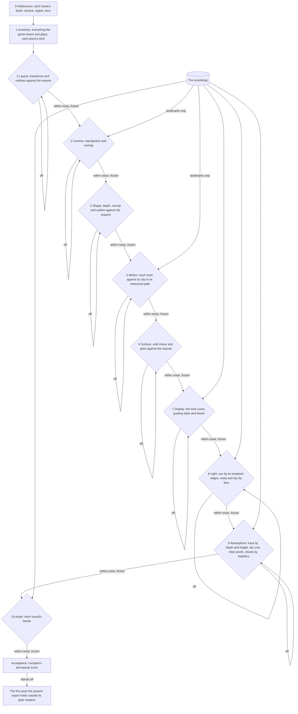

# Recreation passes

This page is the order a Genshin screen is rebuilt in, built on the [scene derivation](../../specs/genshin/scene-derivation/design.md)'s three kinds of information and its witness render, and on the [parity](../../specs/genshin/parity/README.md) loop's commands. The login scene has been worked for a long time by one loop: change something, shoot the whole frame, score it against a recording, rank every term of its error by the most it could recover, and work the largest. Each turn of that loop moves the frame by hundredths of its perceptual score, and the loop does not converge, because every unknown is judged through every other one:

- **A placement read as a haze.** By day the stone twenty metres up and some way out read twice as bright as the recording's, which the light and the haze were solved against pass after pass. The light map of `rank` found it on two towers standing where the recording shows sky: a placement that no light or haze could ever fix, absorbed by both.
- **A light traded for a haze.** Solved free, the light went below none to cancel a haze too bright over the far stone. Two unknowns landing in one score settled at whatever hid both.
- **Random content against a pixel score.** The game's cloud layer, ported from its own program and drawn over its own textures, scored the frame worse at every setting, as the particle clouds did before it: clouds the game scatters at random can never win a score comparing pixels, whatever their amount.

The interface did not have this problem. Its pieces are placed from the game's own rect tree, moved by its own clips, and compared over the recording's own frame with everything else held, so each difference points at the one piece that caused it, and it reached a few tenths of a percent in a handful of passes. This proposal runs every part of a screen the way the interface runs.

## Decisions

- **Passes in dependency order, each answering one kind of unknown.** An unknown is answered after everything it depends on and before anything that depends on it: what exists, where it stands, the camera that sees it, its shape, its motion, its surface, the transform from scene colour to the screen, the light on it, the air around it and the sounds it makes. A later pass's solve absorbs an earlier one's error, so a pass is never begun on a red pass before it.
- **Each pass has its own measure, in screen units at the references' cameras.** A placement is measured in metres against the exports' transforms and in pixels where it lands, a shape by its depth, normal and outline against the exports' drawn at the same camera, a surface by its unlit colour against theirs, a sound by its bands' envelopes against the game's own sound. No pass is judged by the frame's score, which every other pass moves too.
- **A pass is done when its measure is within the reference's own noise, and then it is frozen.** Its gate is a threshold its measure must meet on every reference, and what it produced is held by a test (as the arrangement's cross-ratios already are), so no later pass may move it to make its own numbers better. A later pass that finds an earlier one wrong reopens that pass, never compensates for it.
- **A normal detail's frequency is the reference's own surface lobe, and its amplitude is solved at that frequency from the exports' bend.** Each detail family's wavelength is the strongest lobe of its exports' normal-angle field under a cap of an eighth of the family's pixel width, a cap set before the bridges were read and kept. `readSurfaceWavelengths` reads it at the reference camera after a 16-pixel box high-pass and converts it to metres at the median depth: the towers read 2.5648 m and the bridges 21.8913 m (under their 25.4 m cap, `SURFACE_LAG_CAP_SHARE`). The detail is a height of the engine's noise, `amplitude` metres high over a cell `wavelength` metres across (`createNormalDetailNode`), so the mean lean of its normals is the amplitude times the noise's mean tangent gradient, 0.885 in the noise's lattice units (measured by sampling `computeMxPerlinNoise` at 400000 seeded points and normals). The bend the exports give fixes the amplitude, and the bend depends on the frequency, since a surface spans few of the noise's cells: the towers' bend read 0.0146 degrees off at 10 cycles a metre, 0.0592 at 0.39 and 0.0191 at 1.3. Solved at the wavelengths above, from the origin where no detail reads no bend, the first step at 0.1591 m and 0.7604 m read the towers' bend 0.0548 degrees off against 0.0198 and the bridges' 0.1646 against 0.1320; the second, at 0.1619 m and 0.8388 m, reads 0.0005 and 0.0000, both held, and the walkway holds at 0.0006. A family whose own tilt already bends more than its exports keeps the share of that tilt that brings them level, since an added detail can only raise a mean lean: the walkway, `LOGIN_WALKWAY_RIM_TILT_SHARE`.
- **A family whose frame resolves no lobe takes its wavelength from its exported normal map.** `readSurfaceWavelengths` resolves the frame's lobe first, and the family's normal map only where it resolves none (`chooseDetailWavelength`). The map is the one the family's materials reference most (`readFamilyMapWavelength`, `readTextureWavelength`): its tilt angles are read in texel space over the texels the family's UV triangles cover, the lobe is found through each high-pass box of `TEXTURE_HIGH_PASS_RADII_TEXELS` (4 to 128 texels) by `computeSurfaceLag`, the one that holds across the most boxes is kept (`chooseHeldLobe`: a lobe that moves with its box is the box's, and a tie goes to the shorter), under a lag cap of an eighth of the family's UV span in texels, and a texel spans the family's metres per UV unit over the map's width. Those metres are `computeMetresPerUv`, the median over the family's triangles of the root of the world-area over UV-area ratio, with each placement's scale: the door's placement is 0.1, so its 2.7859 metres per UV unit. The door reads 13 texels, 0.0354 m (`LOGIN_DOOR_NORMAL_DETAIL_WAVELENGTH`): the lobe holds at boxes of 4, 8 and 32 texels, against 39 at 16, 96 at 64 and 123 at 128, so it is the one the most boxes agree on, where the 16-texel box that the frame's own lobe is read through would have taken 39. The door's detail amplitude is solved at 0.0354 m from the exports' bend of 4.7203 degrees: the first step at 0.00946 m reads 13.5377 degrees, 8.8174 off, the secant through the two readings, 0.0033 m, reads 4.8477 degrees, 0.1274 off, and the secant from there, 0.00321 m, reads 0.0039 degrees off, held against 0.0198 (`LOGIN_DOOR_NORMAL_DETAIL_AMPLITUDE`). Our frame's own lobe on the door reads 0.1395 m once the detail is wired, a diagnostic only.
- **A normal detail's world normal is taken to view space by the camera alone.** `createNormalDetailNode` passed the world-space leaned normal to `transformNormalToView`, which applies the object's model normal matrix first. An object under a rotated group (the door's `[0, π, 0]`) had its normal turned a second time, a flip of about 172 degrees at any amplitude, even zero, against its geometry normal. The leaned normal now goes to view space through `cameraViewMatrix` alone. The towers, bridges and walkway, whose transforms carry no rotation, read the same as before.

- **Our render's wavelength is a diagnostic, never a gate.** Our detail has no lobe the measure can read at the reference's 14 pixels a metre: its row autocorrelation is about 0.02 at every lag, so a gate on it could not be met honestly. The family's bend gates it instead, and our wavelength is printed beside it as a diagnostic (`ParityPassDiagnostic`, its gate and held cells '-'), which reads 8.5495 m for the towers and 23.2595 m for the bridges with the detail wired, against 2.5648 m and 21.8913 m in the exports. The diagnostic is a record of the detail's field, never a value a pass solves against.
- **The dusk's delta with the detail is the Light pass's reading, and the detail stays.** With the normal detail wired, the login's screen-dusk compare reads a mean difference of 20.55 against 19.89 without it, every Shape gate holding. The detail's bends are solved from the exports, so the frame's extra 0.66 points come from the sun's angle on those normals, which no Shape gate judges. The Light pass judges that angle on the detail (its shadows' edges and the dusk sun's direction), and the detail is reverted only if that pass cannot take the dusk back below its 19.89.
- **A surface's structure is matched by its band statistics, and a flat or stand-in albedo is solved from them.** The structure reading is the root mean square of each term's relative error: the luminance's variance and each octave band's detail energy, the four bands between blurs of 1, 2, 4 and 8 pixels (`computeStructureTerms`). A family whose albedo is one colour reads every term at its full loss, so the bridges read 1.0000, and the towers' shades and the walkway's paving hold tones but not the grain. The fix is the toolbox's own route rather than shipped texture: each family's grain is our noise, its octave amplitudes fitted to the exports' band energies (the cloud layer's spectral route, `fitSpectralNoiseChannel`), and the exports' terms are printed by the surface pass's notes before each family is worked. The bridges' grain is the engine's `createMaterialDetail`, its targets the exports' terms over their mean lightness squared, scaled by the ratio the reading gave our grain's terms (0.20 to 0.26): the first fit read 0.7865 and the calibrated one 0.0544 against 0.3425, and every term holds within 0.11. The towers' grain adds to the facade's own structure, so its targets are the exports' terms less the facade's, and four calibrations of the reading bring it to 0.0179 against 0.0216 (`LOGIN_TOWER_SURFACE_DETAIL`). The door's grain goes over its relief, its variance target calibrated on its own because the solver couples the variance to the bands: five calibrations bring the structure to 0.0191 against 0.0194 (`LOGIN_DOOR_SURFACE_DETAIL`).
- **The recording's colour enters only for what exists at run time.** Layout, shape, motion a clip holds and surface are the game's own data, so they are judged against the game's own exports through the witness render, aligned to the pixel and free of any light. A recording's camera, and any motion no clip holds (a flight a script drives, the walkway's rise), live only in that recording, and are read off it through the frozen layout alone: its landmarks located in the frame and its outlines overlaid, with no colour of the recording in the reading. The display transform, the light, the atmosphere and the sounds are set at run time, and only for them is the recording's colour consulted, each pass over a mask where only its own unknown moves the reading.
- **Random content is judged by its statistics.** Clouds, wisps and anything else the game scatters is matched by its cover by height, its size and its colour spread, never by a pixel score.
- **The frame's perceptual score is acceptance.** Once every gate holds, `compare` scores each reference. A frame that still stands off names a pass whose measure missed something, which is the measure's defect to fix.
- **A stand-off names its pass from the report the passes last recorded.** On a reference that stands off, `compare` reads its component's report (`passes/snapshots`) and names the first pass in the passes' order with a row outside its gate, which is the pass reopened. The passes are not run to name it: a run of them is what re-measures the report, and `passes` writes the run's first red pass there. A compare that ran the passes on every stand-off measured the whole run above the bar on each login compare, and was slow for it. Rejected: a `--reopen` flag that runs the passes for the name, since the report already holds the run's first red pass; and mapping the worst compare cells to the pass that owns their content kind, since that needs a table from cell to pass the repo does not hold. A report with no rows names no pass and says to run `passes`. `findMovedFrozenPass.ts` names the other case, a frozen pass that a later run moves.
- **Ceilings order the work inside a pass, never across passes.** Within one pass, the items are worked largest first by what they could recover, as `rank` prices them; a term in a later pass waits for every earlier gate however large it is.
- **The layout reads a placement in pixels by its pairs, before any render.** Each fitted part beside the export nearest it, both carried as the scene carries their family in a current build's reference's state, at every copy of a row the scene repeats it along, and projected from the scene's camera there, read only where the export lands on the frame and gated at a recording's two pixels of softness. A family with no part on a reference's frame has nothing to read there and is skipped for it, said so in the pass's notes, while a family on no reference's frame at all is a miss, since no frame has placed it. The camera is the next pass's, but a camera a little off moves both points of a pair alike, so their gap reads the placement alone. A family's outline in pixels is the shape pass's, drawn at the same camera, so the layout needs none.
- **The light reads the sun's direction on its shadows' edges over flat receivers.** The receivers are the exports' parts facing up; the reference's shadow on them is its shading, its colour over the exports' albedo, split by Otsu's threshold; ours is the exports' occluders cast by the scene's own shadow map from the direction tried. The two edges are priced both ways in the reference's pixels and gated as any place on the frame is, and the direction is solved by its heading and its height over the horizon from the scene's, solved on an older build's reference seen from its own camera, itself solved on its landmarks.
- **`MHYBloom_Z`'s bloom fields are read in the order the prefilter takes them.** The profile's parameters are override and value pairs of eight bytes in field order, and its overridden values at bytes 60, 76 and 84 leave one pair between the first two, at 68, at its default. The prefilter reads `_MHYBloomThreshold`, then `_MHYBloomThresholdCharacter` where a character's pixels stand, then `_MHYBloomScaler`, and the compose `_MHYBloomIntensity` (`Login/Scene/Display.reference.ts`). So the threshold is the 0.75 at byte 60, the character threshold the default left at 68, which the login never needs since it draws no character, the scaler the 2.5 at 76 and the intensity the 0.75 at 84. The bloom's own reading confirms it once the bloom draws, and does not gate the build. The prefilter is one TSL node, `GameBloomNode`, which the pipeline runs: the CPU copy `computeBloomPrefilter.ts` had no caller beyond its own test and repeated the node's arithmetic, so it is deleted with its test and its row in `rendering-style` (task 1.5). The node's structure is its input, `GameBloomStructure` (`GameBloomNode.ts`): the prefilter's form, the downsample's tap offset and the blur's form and pass count. Its default, `GENSHIN_BLOOM_STRUCTURE`, is the shape the engine has drawn since the bloom landed, a one-tap prefilter, taps half a texel out and the separable pair once, and the table below reads every other combination. A later edit to the prefilter lands in the node alone.
- **The bloom's extent is the game's chain, not the engine's separable pair, and the frame's size does not enter it.** The bloom shader's twelve programs are `{data-root}/genshin-parity/extracted/login/shaders/12903389/Shader#90` (3Dmigoto's disassembly with its constants annotated). Read off its vertex and pixel programs, the game's chain against the engine's `GameBloomNode`:

  | Stage                 | Game (`Shader#90`)                                                                                                                                   | Engine (`GameBloomNode.ts`)                                                           |
  | :-------------------- | :--------------------------------------------------------------------------------------------------------------------------------------------------- | :------------------------------------------------------------------------------------ |
  | Prefilter             | One tap, `max(0, colour - threshold) * scaler` (`00002`)                                                                                             | The same                                                                              |
  | Downsample, per level | Four taps at ±1 source texel, equal weights (`00011`, `00010`): under bilinear filtering a four-texel box per axis                                   | Four taps at ±0.5 source texel, which land on texel centres: a two-texel box per axis |
  | Blur, per level       | Four taps at (0.96, 0.25), (0.25, -0.96), (-0.96, -0.25) and (-0.25, 0.96) texels, one rotated pass (`00000`, `00010`)                               | Two separable passes, each four taps at ±0.25 and ±0.96 texels                        |
  | Levels and compose    | Four levels by the four weights, from an atlas (`00001` with `00003`) or four textures (`00009`)                                                     | Four levels by the same weights, four textures                                        |
  | Resolution            | Not in the dumps: buffer sizes and the atlas transforms (`_MHYBloomUVTransform1..3`, `_UVTransformSource`, `_UVTransformTarget`) are run-time values | Each level halves the drawing buffer                                                  |

  In each level's own texels, the game's downsample and one blur pass give a variance of 0.83 texel², the engine's pair 1.07, so the engine's kernel is about 14% wider in sigma. Were the game to blur twice a level, its 1.32 would be about 23% above the engine's variance (11% in sigma), so the sign hangs on a count the dumps leave open, and the blur pass count is recorded as an assumption. The frame's size does not enter the extent: every level halves its frame, so each kernel covers the same share of the frame at any size, the 640-wide display and the 1080-line reference alike. What the dumps cannot settle is the level sizes the game chose, so the engine's halving is an assumption too. The one-tap prefilter is the chain the Display reference records (`00002`); the four-tap form that takes the threshold after its average (`00004`) is read in the dump and is not the chain taken here. The step-2 port took those shapes whole: the downsample at ±1 source texel and the blur as one rotated pass, each tap's texel from the game's constants at the level's own size. On the login's Display pass the port reads 1.6097 ΔE over the reference's brightest pixels against the shipped pair's 1.4989, further from the gate of 0, while the contrast holds at 0.0610 against 0.1000. It was reverted, so the engine keeps the separable pair. The game's kernel, taken whole, moves the reading the wrong way, so the extent does not name the cause of the failing reading. Those three open questions are read by the ablation in Open below: the prefilter's four-tap form (`00004`), the blur's pass count per level, and the resampling of the reference to the display width (`readRawRgb`'s lanczos3 over the reference, against our frame rendered at 640 without supersampling).

- **The audio pass reads each sound's bands, never its onset.** Each effect is scored against the game's sounds it was fitted from in both channels every 5 milliseconds and gated at a second take of our own noise seeded apart, the grain only the game's samples would close. Its delay after what sets it off is read once off the recording's frames and written straight into its constant, nothing solved over it, and its own rise is already its first frames' bands.

- **The exports' camera is the reference's own, never the scene's.** `solveReferenceCamera` started its landmark solve from our scene's camera and held x, y, yaw, pitch and fov there, so a change to the login's constants (`LOGIN_CAMERA_*`) moved the exports' frame, every surface gate, and the Layout pass's pixel readings. The start is now the camera the reference records (`cameraPose` on its entry, the Windrise statue's `cameraPose` prop beside it, `getReferenceCameraPose`), and the eye is solved along the glide alone from it. The login reference holds three landmarks (its door's apex and feet), which fix three of the six axes, so a six-axis solve from its landmarks alone is not determined: x, y, yaw, pitch and fov are the recorded pose, the login's fitted solve (`Camera.reference.ts`, its door's pixel widths and rows), and the constants carry the same numbers by design. A reference that records none is solved on all six axes from six landmarks or more, and throws below that. The proof on the real render: with `LOGIN_CAMERA_FOV` at 50 in place of 45, `passes login --pass Surface` reads the exports' terms, every Surface gate and the Camera reading identically to the run at 45, and `--pass Layout` reads every row identically. Layout's own pixel rows moved once, Door 0.3361 to 0.2732 px, as they now project from the reference's pose rather than the scene's pre-solve pose; every gate still holds at its 2 px bar.

- **A grain is fitted by a damped Newton over its own structure terms on the render, never by a per-term update.** The per-term update scaled each target by its own ratio, and a target's realised share moved with the others, so the finest band rose as the variance target fell and the walkway's two hand calibrations did not converge. `solveResidualsByNewton` takes the unknowns as the detail's targets (the bands and the variance, each octave amplitude set on the live material by `setSceneSurfaceAmplitudes`) and the residuals as the family's structure terms read back from the render (`computeFamilyStructure`, the same definition the surface pass gates). Its finite differences measure the response the render holds, coupling included. On a synthetic response that couples the finest band to the variance, the per-term update leaves its worst output 0.498 off after 60 steps, and the Newton solve converges in 3. On the walkway it reached a structure root mean square of 0.0214 against the 0.0268 gate, the fourth-octave target at its floor of zero, where the paving alone overfills that band, so the grain cannot close it. The door, held at 0.0191 by the calibrations, reached 0.0098 under the same solve. Towers and bridges hold their gates and were not refitted.

## How it works



The interface runs beside these as a pass of its own, placed from the rect tree, moved by its clips and compared over the recording's frame, as [parity](../../specs/genshin/parity/README.md) describes.

### The passes

| Pass       | Its source of truth                                     | Its measure                                                                           | Tools today                                           | Missing                                                                     |
| :--------- | :------------------------------------------------------ | :------------------------------------------------------------------------------------ | :---------------------------------------------------- | :-------------------------------------------------------------------------- |
| References | The wiki, the data dumps, recordings                    | Each frame's build, camera, region and hour, written down                             | `fetch`                                               | Frames are cut by hand                                                      |
| Inventory  | `extract`, `tree`, `inventory`, `behaviours`            | Every renderer, material, shader, texture, clip, sound and spawn named with its kind  | `genshin:assets` commands, `passes`                   | Effects, clips and sounds in its checklist                                  |
| Layout     | Placements, spawns, anchors and the rows scripts scroll | Metres against the exports' transforms, then pixels where each part lands             | `parts`, `passes`                                     | Nothing                                                                     |
| Camera     | Landmarks on the frozen layout                          | Reprojection error and the overlay's edge distance                                    | `pose`, `overlay`, `passes`                           | Nothing                                                                     |
| Shape      | Each mesh                                               | Depth, normal and outline per family against the exports at the same camera           | `rank`'s second table, shaded, `passes`               | Nothing                                                                     |
| Motion     | Decoded clips, the rows scripts move                    | Each animated part's track against its clip, and fieldless motion against its measure | `clips`, `passes`                                     | The walkway's rise and the glide's easing, with no measure                  |
| Surface    | Textures and materials                                  | Unlit colour and glow per family against the exports                                  | `gbuffer`, `plan`, `passes`                           | Nothing                                                                     |
| Display    | The post program, the grading tables, the post profile  | Which table, which curve and what bloom, before any light                             | `passes`                                              | Which of `MHYBloom_Z`'s other values is the threshold, scaler and intensity |
| Light      | The recordings, everything before held                  | The stone's shown colour by bins, the sun's direction by its shadows' edges           | `calibrate`, `shadows`, `passes`                      | Nothing                                                                     |
| Atmosphere | The recordings, the emitters' anchors, the cloud layer  | Haze by depth and height, sky over its clear pixels, clouds by statistics             | `calibrate --haze`, `sky`, `cover`, `layer`, `passes` | Each hour's cloud layer settings                                            |
| Audio      | The game's sound banks, recordings to find each sound   | Each sound's octave bands over time; the music by `listen`                            | The music tools, `sounds`, `fitSoundEffect`, `passes` | Nothing                                                                     |

### Why it converges

Judged through the frame, each of the scene's unknowns is confounded by every other one, and fixing one re-prices the rest, so the work grows with the square of the unknowns and the loop can stall forever on a pair of them trading error. Judged by its own measure, each unknown is solved once against data that only it moves, most of them in closed form from exact data, and frozen: the work grows with the number of unknowns, and every pass's result stays true as later passes land. The interface is the case that already runs this way.

## The first run: the login

The login runs through every pass from its inventory as its measures land, each gate holding before the next pass begins. What each pass has in question there, a row shifted by a fitted value, a camera the old recordings may not share, a rise with no measure yet, a transform left out, suns set by hand, a cloud layer waiting on its settings and the sounds still unmatched, is that pass's item on the [roadmap](../genshin-roadmap/tasks.md), in the passes' order. Windrise starts at the references the same way once the login's gates hold.

## The login's open steps

Each step is answered by its pass, in the order above, and is done once the pass's gate holds and its result is frozen.

- **Inventory.** Name every field of the login's environment and scripts (`EnviroSky`, `LoginSceneEnviro`, `LoginSceneWeather` and the rest) by matching it against what it sets, so later passes read the game's values rather than solve them from recordings. Each effect, clip and sound the exports hold is claimed by a part of ours or named as not drawn.
- **Layout.** Place the towers that stand a dozen pixels or more off: the dawn's left tower, the dusk's middle towers, the day's two wide towers top left and the lantern tower's crown. Edges cannot place them, since the day's towers fit within 10 to 12 pixels along the whole loop, so the measure needs each tower's upper sky outline held against ours. Each hour's frame is checked again on a current build's recording, as the older references were taken on older builds.
- **References.** A frame of the title at each hour, and of the door at rest, from a current build's recording.
- **Shape.** Judge each stand-in's outline, depth and normal against the exports before its surface or light. Sunk recesses of four units or more are carved as openings; shallow ones stay painted, since boxing them scored worse. Relief that tilts the light along a recess's edge needs carved geometry of our own, the crown's colonnade first, because bump maps did not move the towers against the exports.
- **Motion.** Check the walkway's two easing curves and the distances beside its rows against the current recording, and the glide's two speeds against the script.
- **Surface.** Judge each unlit colour against the exports at the references' cameras. The towers' stone needs a procedural grain of our own, fitted to scale and contrast. Gilding needs an environment map of the login's sky before it reads as metal. The walkway's surface needs its finest scale (joints, pocket rims, lane borders), its rims at the game's one-centimetre width, and the dais wings' shadow. The door's front needs its carved relief and light, the largest term on the phone's door frame.
- **Display.** The night's red needs a white balance matrix (`_WhiteBalanceMat`) before the tone curve, set per sky state, and the curve's contrast is held by the display pass on the current recording. The game's bloom fields are read by the bloom reading in Scope. Windrise's palette is tuned again under the curve.
- **Light.** Solve the light apart from the haze, over bins the haze barely reaches, and then solve the haze's colours under it. Then the falloff with height past the haze, the reflection pass's ambient with its clamp and highlight, the dusk sun's direction from its shadows' edges (`genshin:parity shadows`), and the phone door frame's light under the PC client's day light.
- **Atmosphere: haze.** Solve the day's and the dusk's haze, which the haze measure does not settle, by the difference between haze that adds and light that scales. Give the cloud sea its two side banks, under 2 metres beneath the walkway some 215 metres to either side, and each emitter's spread from its particle system.
- **Atmosphere: sky.** Solve the dusk's clear sky under its thin cloud and wisps, then check it against a frame that shows the sky beneath. Solve the cover at the horizon, where our haze reads as cloud, and overhead, where no hour but the dusk draws any cloud.
- **Atmosphere: clouds.** Brighten and soften the night's and the day's clouds to the recordings' brightness, solve the day's horizon cloud, and give a cloud its inside: a lit crown grading into a pale shade, with cirrus between.
- **Audio: music.** Layer recordings of real instruments, or a fixed equaliser held out across time, over the synthesizer, since its octave bands sit five to seven decibels off. The first piece's lowest band is overfilled by the noise. The synthesizer's notes die about twice as fast as the game's, and its top voice's overtones are heard as notes, so telling them from a doubled melody is its next unknown.
- **Audio: sounds.** Match the clicks on the screen's buttons, the door's assembly sound and the wind to the game's own sounds, each fitted by its octave bands and started when the game starts it, as the door's opening is.

## Scope

Every pass has its measure in `genshin:parity passes` ([parity](../../specs/genshin/parity/README.md)), and each run it owes is an item of the [compute queue](../../specs/genshin/compute/README.md). What the passes still lack is in two of them, the display's bloom and the atmosphere's cloud layer, in this order:

```text
packages/genshin-engine/src/models/nodes/GameBloomNode.ts
```

1. **Display's bloom, drawn as the game's programs draw it.** A TSL node, `GameBloomNode.ts`, follows the bloom programs `Login/Scene/Display.reference.ts` reads: the prefilter takes `max(0, colour - threshold) * scaler` of the scene colour, the chain box-downsamples by four taps and blurs by four taps down its levels, and the compose sums the four levels by the profile's weights 0.3, 0.3, 0.26 and 0.15, times the intensity, onto the scene colour before the white balance and the tone curve (`toneMapGenshinNode`). Its threshold, scaler, intensity and weights are constants beside `GENSHIN_TONE_CONTRAST` in `packages/genshin-engine/src/renderer/constants.ts`, valued as the Decisions read them. `createPostPipeline` draws it in place of three's `BloomNode` wherever `isBloomed` holds, and `Login/Scene/Index.vue` turns `isBloomed` on. It is proved by one `[page]` compute-queue item the build queues: `pnpm -C scripts genshin:parity passes login --pass Display` still holds its contrast gate, and `compare` on each login reference reads a mean no worse than its row in `ParityReferenceMap.snapshot.md`.
2. **The bloom's own reading.** `measureDisplay` gains a reading around the brightest pixels: on each current build's reference whose screen draws the bloom (`BLOOM_SCREENS` in `passes/constants.ts`, the login's), the pixels within 32 of its own pixels of those it shows at the curve's white, our frame against the reference there with the bloom drawn and with it off, gated where the bloom drawn reads closer. A world reference is not read: its chain draws no bloom, so its frame with the bloom drawn and with it off is one render, and the reading would hold at zero without measuring anything. A miss reopens the field reading in the Decisions.
3. **Atmosphere's cloud layer.** The cloud layer's settings are solved on its statistics over the game's own textures, drawn over textures of ours, though no hour's settings hold every gate yet.

Everything the passes already have is reused as it is, and each measure, once built, retires its row's gap in the toolbox.

## Key files

| File                                                                     | Role after the change                                                                                                                                                                   |
| :----------------------------------------------------------------------- | :-------------------------------------------------------------------------------------------------------------------------------------------------------------------------------------- |
| `scripts/src/services/genshinParity/passes/ParityPassMeasureMap.ts`      | The passes' measures, run in order by `passes`, each held to its gate                                                                                                                   |
| `scripts/src/services/genshinParity/passes/runParityPasses.ts`           | Runs the measures in the passes' order and stops at the first red one, the run `passes` writes to the report                                                                            |
| `scripts/src/services/genshinParity/passes/findMovedFrozenPass.ts`       | Names the frozen pass a later run moved, which reopens by its own run                                                                                                                   |
| `scripts/src/services/genshinParity/passes/findReopenedPass.ts`          | Names the pass a standing-off frame reopens: the first pass the report holds outside its gate, which `compare` reads above its bar (3.3, read from the report since item 2)             |
| `scripts/src/services/genshinParity/witness/solveReferenceShadows.ts`    | The light pass's shadows' edges, priced and solved for the sun's direction                                                                                                              |
| `scripts/src/services/genshinParity/shared/ParityReferenceMap.ts`        | The references every pass is judged over                                                                                                                                                |
| `packages/genshin-world/parity/witness/renderWitnessTargets.ts`          | Draws our parts' albedo and glow beside the exports', for the surface's diff                                                                                                            |
| `scripts/src/services/genshinParity/witness/rankReferenceGains.ts`       | Orders the work inside a pass, never across passes                                                                                                                                      |
| `scripts/src/services/genshinAssets/scene/DerivedAssetArrangementMap.ts` | The layout pass's frozen invariants, grown to every placement it settles                                                                                                                |
| `scripts/src/services/genshinAssets/fit/fitSoundEffect.ts`               | The fit every matched sound goes through                                                                                                                                                |
| `packages/genshin-engine/src/post/createPostPipeline.ts`                 | Draws the display transform the display pass finds                                                                                                                                      |
| `scripts/src/services/genshinParity/passes/computeStructureTerms.ts`     | Each statistic's relative error of a surface's structure, read term by term beside the aggregate the surface pass gates (0a.1)                                                          |
| `scripts/src/services/genshinParity/passes/computeBloomRegion.ts`        | The reference's pixels within `BLOOM_REACH_PIXELS` of one at the curve's white, the bloom's reading region                                                                              |
| `scripts/src/services/genshinParity/passes/computeBloomReading.ts`       | The bloom's reading over that region: ours with the bloom drawn less ours with it off, in CIELab, negative where it closes. `measureDisplay` calls it once the drawn bloom exists (1.1) |
| `packages/genshin-engine/src/models/nodes/GameBloomNode.ts`              | The game's bloom node the pipeline draws in place of three's `BloomNode`, task 1.1                                                                                                      |
| `scripts/src/services/genshinParity/passes/readTextureWavelength.ts`     | The exported normal map's wavelength for a family whose frame resolves no lobe: texel tilt lobe, UV scale by triangle (Decisions)                                                       |
| `scripts/src/services/genshinParity/passes/chooseDetailWavelength.ts`    | The frame's lobe first, the normal map's only where the frame resolves none (Decisions)                                                                                                 |
| `scripts/src/services/genshinParity/passes/chooseHeldLobe.ts`            | The lobe a normal map holds across the most high-pass boxes, a tie to the shorter (Decisions)                                                                                           |
| `scripts/src/services/genshinParity/passes/computeSurfaceLag.ts`         | A family's dominant lag in samples through one high-pass box, the lag `computeSurfaceWavelength` converts to metres                                                                     |
| `scripts/src/services/genshinParity/passes/readBloomFrames.ts`           | Our frame with the game's bloom drawn and with it off, at the display width, the two frames the bloom's reading compares (1.2)                                                          |

## Notes

- **A gate is the reference's noise, not zero.** A recording's compression and softness, an export's texels, a clip's sampling: each sets how close a measure can read, and a pass worked past it is polishing what no frame can show.

## Open

- [ ] **The display bloom reads above its gate under every structure of its chain, and the measure moved it most.** `genshin:parity bloom` (`passes/readBloomAblation.ts`) reads the Display pass's bloom reading on `login-door-session`, the one current-build reference whose screen draws the bloom, over 32 combinations: the prefilter (one tap, or four taps averaged before the threshold, `00004`), the downsample's tap offset (half a texel or one, `00011`), the blur (the engine's separable pair, or the game's rotated pass, each once or twice a level), and the measure (ours drawn at the display width, or at the reference's own width, both sides resized by the reference's lanczos3). Each reading is CIELab ΔE over the reference's brightest pixels, the drawn bloom less none, and holds at a gate strictly below 0. Its table, as the run printed it:

| Prefilter | Tap offset | Blur         | Measured at                | login-door-session | Mean   | Holds |
| --------- | ---------- | ------------ | -------------------------- | ------------------ | ------ | ----- |
| one tap   | 0.5        | separable ×1 | display width              | 1.4989             | 1.4989 | no    |
| one tap   | 0.5        | rotated ×1   | display width              | 1.5153             | 1.5153 | no    |
| one tap   | 0.5        | rotated ×2   | display width              | 1.7661             | 1.7661 | no    |
| one tap   | 0.5        | separable ×2 | display width              | 1.7455             | 1.7455 | no    |
| one tap   | 1.0        | separable ×1 | display width              | 1.5962             | 1.5962 | no    |
| one tap   | 1.0        | rotated ×1   | display width              | 1.6097             | 1.6097 | no    |
| one tap   | 1.0        | rotated ×2   | display width              | 1.8861             | 1.8861 | no    |
| one tap   | 1.0        | separable ×2 | display width              | 1.8699             | 1.8699 | no    |
| four taps | 0.5        | separable ×1 | display width              | 1.4548             | 1.4548 | no    |
| four taps | 0.5        | rotated ×1   | display width              | 1.4721             | 1.4721 | no    |
| four taps | 0.5        | rotated ×2   | display width              | 1.7181             | 1.7181 | no    |
| four taps | 0.5        | separable ×2 | display width              | 1.6995             | 1.6995 | no    |
| four taps | 1.0        | separable ×1 | display width              | 1.5489             | 1.5489 | no    |
| four taps | 1.0        | rotated ×1   | display width              | 1.5623             | 1.5623 | no    |
| four taps | 1.0        | rotated ×2   | display width              | 1.8276             | 1.8276 | no    |
| four taps | 1.0        | separable ×2 | display width              | 1.8106             | 1.8106 | no    |
| one tap   | 0.5        | separable ×1 | reference's width, resized | 1.1762             | 1.1762 | no    |
| one tap   | 0.5        | rotated ×1   | reference's width, resized | 1.1791             | 1.1791 | no    |
| one tap   | 0.5        | rotated ×2   | reference's width, resized | 1.2320             | 1.2320 | no    |
| one tap   | 0.5        | separable ×2 | reference's width, resized | 1.2273             | 1.2273 | no    |
| one tap   | 1.0        | separable ×1 | reference's width, resized | 1.2019             | 1.2019 | no    |
| one tap   | 1.0        | rotated ×1   | reference's width, resized | 1.2039             | 1.2039 | no    |
| one tap   | 1.0        | rotated ×2   | reference's width, resized | 1.2494             | 1.2494 | no    |
| one tap   | 1.0        | separable ×2 | reference's width, resized | 1.2451             | 1.2451 | no    |
| four taps | 0.5        | separable ×1 | reference's width, resized | 1.1642             | 1.1642 | no    |
| four taps | 0.5        | rotated ×1   | reference's width, resized | 1.1665             | 1.1665 | no    |
| four taps | 0.5        | rotated ×2   | reference's width, resized | 1.2203             | 1.2203 | no    |
| four taps | 0.5        | separable ×2 | reference's width, resized | 1.2148             | 1.2148 | no    |
| four taps | 1.0        | separable ×1 | reference's width, resized | 1.1862             | 1.1862 | no    |
| four taps | 1.0        | rotated ×1   | reference's width, resized | 1.1885             | 1.1885 | no    |
| four taps | 1.0        | rotated ×2   | reference's width, resized | 1.2328             | 1.2328 | no    |
| four taps | 1.0        | separable ×2 | reference's width, resized | 1.2277             | 1.2277 | no    |

No row holds. The lowest is four taps at half a texel with the separable pair, measured at the reference's width, at 1.1642. The measure moves every row by 0.29 to 0.64 ΔE, while no single structure choice moves a row by more than 0.29 (the blur's second pass, on the display width). The measure is therefore the fault the table points at, and the rule changes: both sides are drawn at the reference's width and resized by the same kernel (`BLOOM_RESIZE`, `getBloomPageWidth` and its test). The pass's bloom reading under the engine's default structure is now 1.1762, checked by the pass's own frames, down from 1.4989. The structure stays the engine's default, since no combination holds, and the reading stays open: task 1.1 is not ticked, task 1.4 depends on it and is not run (the bullet after this paragraph records why). Not yet tested: the profile's threshold, scaler and intensity beyond the field order the node reads them by, and `_AutoExposureScale`, which the node does not divide the threshold by (`00002` and `00004` both do when it is set).

- [ ] **The highlights read darker than the reference, not brighter, so the bloom's added error is a colour error, not a pre-bloom frame that is too bright.** Re-run at this change's base: `passes login --pass Surface` holds all eight rows (Door, Walkway, Bridges and Towers, colour and structure), so Display is reached. Its `contrast's excess` reads 0.0610 against 0.1000 (held) and its `bloom's reading` 1.1762 against 0 (FAILED), as the table above. The earlier note that Display could not be reached while Surface reads red was out of date. `genshin:parity tones` (`passes/readBrightnessBands.ts`, `computeBrightnessBands.ts`) reads each login reference's lightness error by band with the bloom drawn off: our frame shot as `compare` shoots it (its props, variant and window, `isBloomed` forced off), and the reference, both resized to the display width by the same lanczos3, over the reference's scored region. Each band's error is ours less the reference in CIELab lightness, positive where ours is brighter:

  | Reference            | Band            | Pixels | Mean ΔL* (ours − reference) | Mean abs ΔL* |
  | :------------------- | :-------------- | -----: | --------------------------: | -----------: |
  | login-dawn-title     | above threshold |  79986 |                       -5.21 |         7.16 |
  | login-dawn-title     | highlights      | 107087 |                       -3.70 |         7.86 |
  | login-dawn-title     | mids            | 121031 |                        9.08 |        10.87 |
  | login-dawn-title     | shadows         |   2282 |                       23.58 |        23.58 |
  | login-day-title      | above threshold | 116640 |                       -4.63 |         7.87 |
  | login-day-title      | highlights      | 126430 |                       -3.67 |         8.01 |
  | login-day-title      | mids            |  78026 |                       16.15 |        17.37 |
  | login-day-title      | shadows         |   4824 |                       14.73 |        16.28 |
  | login-door           | above threshold |  38315 |                       -9.09 |        11.54 |
  | login-door           | highlights      |  39876 |                       -8.83 |        11.58 |
  | login-door           | mids            |  12027 |                        3.58 |        11.78 |
  | login-door           | shadows         |      0 |                           - |            - |
  | login-door-recording | above threshold |  81965 |                       -5.28 |        11.56 |
  | login-door-recording | highlights      |  78953 |                       -5.86 |        11.20 |
  | login-door-recording | mids            |  78686 |                       14.11 |        16.77 |
  | login-door-recording | shadows         |   8761 |                       29.90 |        29.98 |
  | login-door-session   | above threshold |  47270 |                       -9.76 |        13.13 |
  | login-door-session   | highlights      |  25436 |                      -11.94 |        12.40 |
  | login-door-session   | mids            |  38785 |                       -3.72 |        13.82 |
  | login-door-session   | shadows         |  75413 |                        9.65 |        11.16 |
  | login-night-title    | above threshold |  98210 |                       -3.36 |         9.55 |
  | login-night-title    | highlights      |  36488 |                       -3.39 |         5.03 |
  | login-night-title    | mids            |  87146 |                       -1.74 |        12.90 |
  | login-night-title    | shadows         | 106766 |                        4.44 |         7.37 |
  | login-screen-dusk    | above threshold | 119618 |                       -8.78 |        14.37 |
  | login-screen-dusk    | highlights      | 122610 |                       -8.70 |        14.32 |
  | login-screen-dusk    | mids            | 107627 |                       17.74 |        20.34 |
  | login-screen-dusk    | shadows         |    163 |                       30.13 |        33.53 |

  The above-threshold band is the pixels whose reference has a channel over the bloom's threshold, which the curve shows at a display shade of about 208 of 255 (the threshold 0.75 through `toneMapGenshin` and the sRGB encode), so the above-threshold band lies across the highlights. Highlights and the above-threshold band read darker on all seven references, by 3.4 to 11.9 L* on the mean. Shadows and mids read brighter on most, which the other-build references' cameras and the haze can account for, since the Layout gate covers only the current build. On `login-door-session`, the one current-build reference with landmarks, the shape is a washed-out curve: shadows +9.7 and highlights −11.9, not bright highlights. The bands hold on the bloom's own frame path (`readBloomBaseline`), which reads door-session's highlights at −11.98 and its shadows at +9.63 against −11.94 and +9.65 here.

  Over the bloom's region (`computeBloomRegion`, 14,546 pixels of door-session within 32 of white), the drawn bloom moves L* by +0.07 (from −3.31 to −3.24), so it adds almost no light there. It moves a* from −3.63 to −2.59 and b* from +0.02 to −3.59, and the chroma error from −1.48 to +2.15. The ΔE rise of 1.18 is therefore a blue shift the bloom adds, on top of an unbloomed frame already greener than the reference by 3.6 a*. The premise that any added light moves the frame away does not hold here: the bloom adds almost no lightness in this region, and what moves the frame is hue.

  Step 3 (exposure, the tone curve, auto exposure, grading) is not run, since the highlights are not brighter than the reference. The constants the engine draws match the post profile's bytes: the threshold 0.75 at byte 60, the scaler 2.5 at 76, the intensity 0.75 at 84, the four weights at 92 to 104, the exposure 1.0 at 252 and the contrast 0.5 at 260. Byte 268 holds an overridden 0 whose name the export does not give, so whether it is `_AutoExposureScale` stays open. The engine's white balance (`computeWhiteBalance`, set per sky state from fitted values, since the game's `_WhiteBalanceMat` is on screen only) is the likeliest source of a hue shift in the highlights, but nothing read here names it as the cause, so the chain stops at the table as the decision requires. The next question is the white balance's hue on the bloom region, against the reference's a* and b*.

- [x] **The Surface gates moved on a run with no change to the report's inputs (Bridges 0.4555 to 0.3425, Towers 0.0236 to 0.0216, Walkway 0.0266 to 0.0268).** The gate is the split-half statistics of the exports' own lightness over the family's pixels at the reference camera (`measureSurface`). The exports' read changed at f497966f1d, which draws the door the scene hides: the door occludes Bridges, Towers and Walkway pixels in the exports' frame. The Surface rows were last measured at 19c061423d, before that commit, so the rows that dc7c46f472's run wrote were the first measured after it. Hiding the door from the exports' read again reads 0.4555, 0.0236 and 0.0266, the recorded values, so the door draw is the whole cause and the normal detail is not in it. Two runs at HEAD read identical gates and readings. `passes` now refuses a run that would move a recorded gate, naming it (`findMovedGate`). The one remaining input from our render was the camera: `solveReferenceCamera` held x, y, yaw, pitch and fov at the scene's camera, so a change to the login camera moved the exports and the gates. Closed: the exports start from the reference's recorded camera (Decisions), and the scene's field of view probed at 50 leaves every Surface and Layout reading identical.
- [x] **The motion pass's door lift pace read 0.0003 or 0.0004 on one tree, and the frozen row refused the run that read 0.0003.** Two Motion runs on one tree read sampled clocks that differed by one frame at fifteen of the eighty samples: `readFrame` took the last frame the page had drawn, which was a tick early whenever the page had not yet drawn the clock's tick, so the moments the pace is fitted over moved. `readFrame` now waits until the frame at the clock's tick is drawn (`measureMotion.ts`), and two runs after the change read 0.0004 with identical frame times.
- [x] **The normal detail's frequency is the exports' lobe under the cap, and its amplitude is solved at it (Decisions).** The lobe is the dominant lobe of a family's normal-angle field along the rows of the Shape pass's witness at the reference camera, after a box high-pass of 16 pixels (`readSurfaceWavelengths`), within a lag cap of an eighth of the family's pixel width, converted to metres at its median depth. On the reference the towers read 2.5648 m, 36 pixels per cycle at 14 pixels a metre and 3% of their 88.8 m width. The bridges read 21.8913 m under their cap of 25.4 m. A 47 m lobe, a repeat across the family, survives every high-pass radius up to 58 m and falls outside that cap, and the 6.4 m a 60-pixel cap reads is not the rule's, which takes the cap of an eighth of their width. Our render's wavelength has no lobe the measure resolves at 14 pixels a metre, so it is a diagnostic and never a gate. A family whose normals vary less than the normal resolution reads none.
- [ ] **The surface wavelength's autocorrelation rescans the whole frame at every lag.** `computeAngleAutocorrelation` (`scripts/src/services/genshinParity/passes/computeAngleAutocorrelation.ts`) reads every pixel of a family's frame for each lag from 0 to the cap (an eighth of the family's pixel width), and `readSurfaceWavelengths` runs it for the exports and ours of both families, so one reference costs the frame area times the cap, four times over. A cheaper form, a row autocorrelation by FFT or one pass that accumulates every lag together, changes the floating-point readings the committed parity data is built from, so it must re-baseline the snapshots and the readings above in the same change, and is a design decision rather than a mechanical ripple. Open until a parity run is too slow to iterate on, the cost the runtime-efficiency page asks to be placed and shaped differently.
- [x] **The motion pass's door lift path was not reproducible on this machine, and its frozen row is compared exactly.** The committed report read 0.0080 m. Two Motion-alone runs read 0.0066 m, a Surface run 0.0085 m, and under load runs read 0.3849 m and 0.1877 m: the installed faked clock flowed with real time, so each sampled frame's moment depended on the machine. The clock is now paused where it is installed (`openParityPage`), and each sample steps it one frame (`createLiftFrameSampler`), so the frames are the clock's. Two runs under load read 0.0066 m, pace 0.0004, over 80 frames, and the frozen row is re-frozen from that read (task 0a's Surface rows follow in their own change).
- [x] **The door's surface is judged by no gate until its normal detail can be fitted (Decisions: the normal map's wavelength, and the world-to-view transform).** The exports' normal map bends the door 4.7203 degrees, and the Shape pass now holds the door's detail bend at 0.0014 degrees against 0.0198 with its amplitude fitted, so `passes login --pass Shape` holds and `--pass Surface` runs. Its surface structure is red on every family, and `Display` waits on it (tasks 0a.2 to 0a.5, 1.1 and 1.4).
