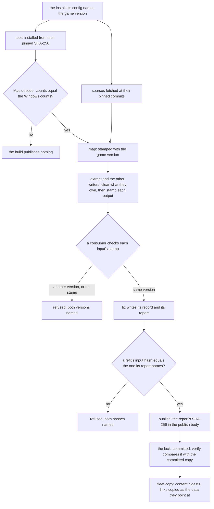

# Genshin reproducible pipeline

The conversion pipeline from the installed game to the published datasets and fits, made repeatable on a fresh PC and Mac pair: every output records what produced it, every source and tool is pinned, and a consumer refuses an input it cannot vouch for. It is the reproducibility unit of [Phase 0, Foundation](../genshin-phases/design.md), whose exit gate is a fresh pair reproducing every published dataset and fit from the install. The derived assets page it amends is [derived assets](../../specs/genshin/derived-assets/design.md).

## Decisions

- **One provenance stamp.** Every writer of an export, a fit's input or a record writes `provenance.json` beside its output, through one function and one schema. The stamp holds the game version read from the install's `config.ini`, the tool's name and version, the operating system and its build, and the command that ran. A version of the tool is the repository commit and its dirty flag for one of our commands, and the SHA-256 of the binary for a pinned tool. The stamp holds no absolute path, since the install is named by its version and not its folder. The `producer.json` that `extractComponent.ts` writes is generalised into this stamp, and the old file is deleted, so no second form survives. A consumer refuses an input whose stamp names another game version than the install's or has no stamp, and that refusal is one reader shared by a fit, the map and the fleet copy. Outputs made before this change are re-made by their writers and never stamped by a script, since a stamp written after the fact would vouch for output that no run of its writer produced. The map is the one large cost, a full run on each machine. Rejected: stamping only the lock, because the exports are what drift first; recording versions in docs, because a page cannot be compared by a command; a backfill that stamps the existing outputs, because it vouches for them.
- **Sources are pinned by commit.** Every external source a command fetches is fetched at a commit SHA kept in one constant per source, and that SHA goes into the output's stamp. The sources are the text repository, the asset-path index, the gcsim kits and the decoder constants. The decoder constants come from the pinned commit whose decoder matches the install's version, or from the install's own chunks when no commit does. A pin bump is a commit of its own. Rejected: following `main` or `master`, because a run against a moving branch cannot be repeated, and a stamp that names a commit no run fetched proves nothing.
- **Tools are installed pinned.** Every tool a stage runs comes through `installPinnedTool` with its SHA-256, and no stage reads `PATH`. The Windows AnimeStudio CLI, the vkd3d compiler, 3Dmigoto and vgmstream take that route, and the upstream AnimeStudio repository publishes no release to take the CLI from, so its Windows archive is the pinned commit built for Windows and held as a record. Beyond the disassembler, the stages also read `PATH` for ffmpeg outside Windows, for the GitHub CLI behind the gcsim kit read, and for the system `tar` that `installPinnedTool` runs to unpack a zip off Windows. ffmpeg's macOS archive is pinned, the kit is read raw at its pinned commit so the GitHub CLI drops out, and `tar` and `sysctl` are named by their system paths. vgmstream has only its Windows archive pinned, so its playlist decode runs on Windows alone until its macOS archive is pinned as well. Rejected: unpacking the Windows CLI by hand under the Downloads folder, a step that no command runs; and keeping the `PATH` lookups with a version written into a log, because a log does not stop the next machine running a different tool.
- **Paths are relative to the data root.** `{data-root}` is one constant, derived from the home folder in one place. Several constants restate the home folder today, among them the content cache, the fleet's parity default, the parity folder and the tools folder, and each derives from the one constant instead. An export or a record holds only paths relative to `{data-root}`, and a symlink in an export becomes a relative link or a recorded relative path. Rejected: keeping absolute paths and rewriting them on copy, because a copy that rewrites its paths is a second writer for every file, and a link made on one machine names a folder the other machine lacks.
- **Every record has one writer.** Each record is registered once, in one table that names the command that writes it. `references pack --kind record` reads that table and refuses a path that no row names. A record with no writer gets one when something reads it, and is retired when nothing does. The derived asset index, which the pipeline recomputes on each run, and the gate-walls archive, which nothing in the repository writes, are the first cases. One key already has two writers in the [hosted game data](../../specs/genshin/hosted-game-data/design.md) page: `catalogue/catalogue` is published both by the authored file and by the catalogue's outline fit. The fitted outlines become their own key, and the reader joins the two. Rejected: the hand-typed path list the pack takes today, which names nothing a family owns.
- **Fits write records, and only records.** A fit writes its record and the report beside it, into the records folder under `{data-root}/genshin-parity`, and never into a file a person edits. The publish reads the record from that file and puts the report's SHA-256 in its publish body. A refit of a published record (`notes`, `expression`, `instruments` and `calibrate --write`) names the hash of the record it reads in its report, and refuses to run when the record's last publish hashes differently. Rejected: in-place writes, which overwrite a file people edit and mix two histories into one; a printed report, which cannot be compared later; and a refit reading publish history unchecked, since its output would then depend on more than its exports.
- **Re-extraction clears what its writer owns, the fleet copy compares content, and verify compares the lock.** A writer clears each folder it owns before it writes, as the clips, shaders and avatar writers already do. The fleet copy decides each file by a digest of its content, and copies a link as the data it points at or refuses it. `genshin:data verify` fails when the generated lock differs from the committed one. Rejected: deciding by size and time, since a changed file of the same size passes; and committing the lock by hand, which no check sees.
- **The decoders are accepted by a parity record, and the game-running guard runs on macOS.** The file counts of the reference blocks, from the Windows build and from the macOS build, are committed beside the build, and the macOS build is accepted only when its counts equal the Windows counts. The game-running guard gains a macOS branch. Rejected: accepting the macOS build because it compiles and its exception check passes, since a decoder that writes fewer assets without raising an exception passes that check too, which is the shape of the defect the decoder upstream page records; and extracting only on Windows, since the Mac is the second machine and must decode its own.
- **Hand-set constants and measured values carry their basis.** Each hand-set fit constant and each value measured from a capture moves into a measurement file for its family, which names the capture, the frame and the value. The fit reads the constant from that file, and a reader refuses an entry that names no capture. Rejected: a comment beside the constant, which no reader can check.

## How it works

The pins gate what is fetched, the tool installs gate what runs, and the stamp gates what a consumer reads. Each fit and refit has its own gate before it publishes, and the lock is checked against the committed copy at the end.



Two machines split the work. A step that reads the installed game runs on a machine that holds the install. The Windows CLI and the Windows counts come from the PC, the macOS decoder and the game-running guard are checked on the Mac, and a fit or a publish needs only the exports or the container, so either machine runs it.

## Gaps and the decision that closes each

Each row is one gap in the pipeline as it runs today, with the file that shows it, the step it sits in and the machine that runs the step. The decision column names the decision above that closes the gap.

| Decision           | Gap                                                 | Step                    | Evidence                                                                                                                                                                                                                                                                                                                            | Runs on                                                                                 |
| :----------------- | :-------------------------------------------------- | :---------------------- | :---------------------------------------------------------------------------------------------------------------------------------------------------------------------------------------------------------------------------------------------------------------------------------------------------------------------------------- | :-------------------------------------------------------------------------------------- |
| Stamp              | Install version is unrecorded                       | install and its version | `scripts/src/services/genshinAssets/shared/readGameVersion.ts`:10-26 reads the version from `config.ini`, and no stamp carries it                                                                                                                                                                                                   | either machine, the install placed by hand                                              |
| Stamp              | Exports and lock carry no game version              | extraction, lock        | `scripts/src/services/producerStamp/writeProducerStamp.ts`:11 writes a commit and a dirty flag and no version; `scripts/src/services/gameData/formatGameDataLock.ts`:7-19 writes no version                                                                                                                                         | game-install for the exports, any machine for the lock                                  |
| Stamp              | Map is kept by presence                             | map                     | `scripts/src/services/genshinAssets/commands/mapCommand.ts`:40-43 skips while both of its files exist                                                                                                                                                                                                                               | game-install                                                                            |
| Stamp              | Adopted map has no origin                           | map adoption            | `scripts/src/services/genshinAssets/blocks/adoptCabMap.ts`:8-11 moves the CLI's map in with no record of its binary or version                                                                                                                                                                                                      | game-install                                                                            |
| Stamp              | Shaders omit the operating system                   | shader disassembly      | `scripts/src/services/genshinAssets/materials/disassembleDxbcDirectory.ts`:7 picks the disassembler by platform, and no output records the operating system's build                                                                                                                                                                 | game-install, with the Windows disassembler on the PC                                   |
| Pins               | Asset-path index on a moving branch                 | asset index             | `scripts/src/services/genshinAssets/world/constants.ts`:27 reads the `master` branch, and `scripts/src/services/genshinAssets/world/ensureAssetPathIndex.ts`:14-15 fetches only when the file is missing                                                                                                                            | either machine                                                                          |
| Pins               | Text, kits and decoder constants on moving branches | text and kits           | `scripts/src/services/genshinText/constants.ts`:173 names the `main` branch, `scripts/src/services/genshinAssets/kits/constants.ts`:11 names the kits' `main` branch, and the decoder constants predate the install ([game text](../../specs/genshin/game-text/design.md), Open)                                                    | either to fetch, game-install to decode                                                 |
| Tools              | Windows CLI unpacked by hand                        | Windows CLI             | `scripts/src/services/genshinAssets/shared/constants.ts`:52 defaults to a CLI under the Downloads folder, and no command builds it ([AnimeStudio on macOS](../../specs/genshin/derived-assets/animestudio-macos/design.md), Windows section)                                                                                        | PC only                                                                                 |
| Tools              | Compiler found on the PATH                          | vkd3d disassembly       | `scripts/src/services/genshinAssets/materials/disassembleWithVkd3d.ts`:17 reads `VKD3D_COMPILER` or the compiler on `PATH`                                                                                                                                                                                                          | Mac and PC, on the non-Windows branch                                                   |
| Paths              | Absolute paths in block links and map sources       | block links, map        | `scripts/src/services/genshinAssets/blocks/linkBlockFiles.ts`:13 links each block from its absolute source path, and the map holds this machine's folder                                                                                                                                                                            | game-install                                                                            |
| Paths              | Home folder restated across roots                   | roots                   | `scripts/src/services/genshinParity/shared/constants.ts`:10-11 and `scripts/src/services/recreation/animeStudio/constants.ts`:6 restate it, as `packages/shared-node/src/services/cache/constants.ts`:8 and `scripts/src/services/fleet/data/constants.ts`:18 do                                                                    | either                                                                                  |
| Records            | Derived asset index has no writer                   | asset index             | `scripts/src/services/genshinAssets/world/readDerivedPathNames.ts`:8-15 computes the names on each run, and its manifest row in `packages/genshin-world/parity/references/manifest.json` has no writer                                                                                                                              | either                                                                                  |
| Records            | Placements and gate walls have no writer            | references              | the records are named in [recoverability](../../specs/architecture/recoverability/design.md), and `scripts/src/services/genshinParity/reference/getRecordPath.test.ts`:14 is the only code that names the placements file                                                                                                           | game-install, by hand for the gate walls                                                |
| Records            | Packed records come from a typed list               | record packing          | `scripts/src/services/genshinParity/commands/referencesPackCommand.ts`:45 reads the record paths from the command line, and nothing names the records a family owns                                                                                                                                                                 | any machine with the container                                                          |
| Fits               | Fits write files people edit                        | fit outputs             | `scripts/src/services/genshinAssets/shared/writeWorldData.ts`:12-13 writes into the world data folder, which `scripts/src/services/genshinAssets/fit/fitAreaOutlines.ts`:88 and `scripts/src/services/genshinAssets/fit/fitRegionCamps.ts`:43 call, and `scripts/src/services/genshinAssets/fit/fitRegionCapitals.ts`:52 reads back | game-exports                                                                            |
| Fits               | Fit reports are not kept                            | fit reports             | [scene derivation](../../specs/genshin/scene-derivation/design.md), lines 178-179, says the printed report is not kept                                                                                                                                                                                                              | game-exports                                                                            |
| Fits               | Refits read the last publish, not a file            | refits                  | `.agents/skills/genshin-parity/references/data-sources.md`:13 has the refits read the record from its last publish and never from a file                                                                                                                                                                                            | any machine with the container                                                          |
| Clearing and fleet | Fleet copy compares size and time                   | fleet copy              | `scripts/src/services/fleet/data/selectChangedFiles.ts`:8 compares size and time, `scripts/src/services/fleet/data/getDirectoryDigest.ts`:11-12 digests names, sizes and times, and `scripts/src/services/fleet/data/getTarArguments.ts`:7-8 passes no dereference flag                                                             | either                                                                                  |
| Clearing and fleet | Re-extraction keeps stale files                     | re-extraction           | `scripts/src/services/genshinAssets/blocks/extractComponent.ts`:58 clears three folders, and the interface, playlist, inventory and witness writers clear none                                                                                                                                                                      | game-install for the interface and playlist, game-exports for the inventory and witness |
| Clearing and fleet | Lock verify never compares the lock                 | lock verify             | `scripts/src/services/gameData/commands/verifyCommand.ts`:16-23 checks each object's hash and never the lock against the committed copy, and `scripts/src/services/gameData/commitGameDataLock.ts`:19-20 writes the lock and its keys file                                                                                          | any machine                                                                             |
| Decoders           | Mac and Windows decoders differ                     | decoders                | [AnimeStudio upstream](../../specs/genshin/derived-assets/animestudio-upstream/design.md), lines 5-7 and 39, records the Ooz defect and a Leviathan count of 483 against the Windows count of 485                                                                                                                                   | PC for the Windows counts, Mac for its own                                              |
| Decoders           | Parity acceptance has never run                     | parity                  | [AnimeStudio on macOS](../../specs/genshin/derived-assets/animestudio-macos/design.md), line 45, records no parity output on disk, and the counts it checks are in `scripts/src/services/genshinAssets/shared/constants.ts`:71-80                                                                                                   | PC for the Windows counts                                                               |
| Decoders           | Game-running guard is off on macOS                  | guard                   | `scripts/src/services/genshinParity/shared/checkIsGameRunning.ts`:7 reports the game as not running on any platform but Windows                                                                                                                                                                                                     | Mac                                                                                     |
| Measured           | Glow scales have no basis                           | glow scales             | `scripts/src/services/genshinAssets/fit/fitLoginStone.ts`:30 sets the glow scales by hand, and their basis lives only in the fit's design                                                                                                                                                                                           | game-exports and the captures                                                           |
| Measured           | Measured spreads and colours have no file           | measured values         | [derived assets](../../specs/genshin/derived-assets/design.md), lines 216-217, records the spreads, colours and light strengths as measured with no checked file                                                                                                                                                                    | captures, on any machine                                                                |

## Scope and order

The stamp and the data root come first, since every writer, fit and copy goes through them. The pins and the tools follow, because a stamp names their commits and hashes. The record table and the fits depend on the stamp's refusals. Clearing, the fleet copy and the lock check do not depend on one another. The decoder record and the macOS guard need a machine with the install, and the measured values are independent of the rest. The reproduction check runs last, once the others are in.

Existing outputs are re-made rather than stamped, so the first run of each writer after the change is its real check. The derived assets requirement that an extraction records the code that produced it is superseded by the first requirement of this capability when the change ships, and its owning pages are carried in the same change.

## Key files

| File                                                                       | Role after the change                                                                               |
| :------------------------------------------------------------------------- | :-------------------------------------------------------------------------------------------------- |
| `scripts/src/services/producerStamp/writeProducerStamp.ts`                 | Generalised into the one stamp writer, then deleted                                                 |
| `scripts/src/services/producerStamp/readProducerStaleness.ts`              | Reads the stamp's commit, from the one reader                                                       |
| `scripts/src/services/genshinAssets/blocks/extractComponent.ts`            | Stamps each extraction and clears the folders its writer owns                                       |
| `scripts/src/services/genshinAssets/commands/mapCommand.ts`                | Skips a map only when its stamp names the install's version                                         |
| `scripts/src/services/genshinAssets/blocks/adoptCabMap.ts`                 | Refuses to adopt a map with no stamp                                                                |
| `scripts/src/services/genshinAssets/blocks/linkBlockFiles.ts`              | Links each block by a path relative to the data root                                                |
| `scripts/src/services/genshinAssets/blocks/rebaseSource.ts`                | Writes the map's sources relative to the data root                                                  |
| `scripts/src/services/genshinAssets/shared/readGameVersion.ts`             | The one reader of the install's version                                                             |
| `scripts/src/services/genshinAssets/shared/constants.ts`                   | Holds the vgmstream pins, and the reference blocks' counts, which move to the committed counts file |
| `scripts/src/services/genshinAssets/world/constants.ts`                    | Names the asset-path index at a pinned commit                                                       |
| `scripts/src/services/genshinAssets/world/ensureAssetPathIndex.ts`         | Fetches the pinned commit and records its SHA-256                                                   |
| `scripts/src/services/genshinAssets/world/readDerivedPathNames.ts`         | Computes the derived names for their one writer                                                     |
| `scripts/src/services/genshinText/constants.ts`                            | Names the text repository at a pinned commit                                                        |
| `scripts/src/services/genshinText/selectDumpFiles.ts`                      | Selects the dump files whose content hash differs from the pinned commit's                          |
| `scripts/src/services/genshinAssets/kits/constants.ts`                     | Names the kits' pinned commit                                                                       |
| `scripts/src/services/genshinAssets/kits/gcsim/readGcsimMainCharacters.ts` | Reads the kits raw at the pinned commit, not through the GitHub CLI                                 |
| `scripts/src/services/shared/runGh.ts`                                     | Removed once no stage calls the GitHub CLI                                                          |
| `scripts/src/services/shared/installPinnedTool.ts`                         | Unpacks a zip off Windows with the system `tar` at its fixed path                                   |
| `scripts/src/services/shared/resolvePinnedTool.ts`                         | Installs each pinned tool, the macOS archives included                                              |
| `scripts/src/services/genshinAssets/music/resolveVgmstream.ts`             | Picks the pinned archive for the platform                                                           |
| `scripts/src/services/recreation/video/resolveFfmpeg.ts`                   | Installs the pinned ffmpeg outside Windows, not the `PATH` lookup                                   |
| `scripts/src/services/genshinAssets/music/encodeMusicRecording.ts`         | Runs the pinned ffmpeg outside Windows                                                              |
| `scripts/src/services/genshinAssets/materials/disassembleWithVkd3d.ts`     | Runs the pinned vkd3d compiler only                                                                 |
| `scripts/src/services/genshinAssets/materials/disassembleDxbcDirectory.ts` | Writes the operating system's build into the shaders' stamp                                         |
| `scripts/src/services/recreation/animeStudio/constants.ts`                 | Places the tools under the data root and names the Windows archive                                  |
| `scripts/src/services/recreation/animeStudio/buildAnimeStudio.ts`          | Builds the Windows archive and records the macOS build's counts                                     |
| `scripts/src/animeStudio/index.ts`                                         | Passes the parity check the committed counts                                                        |
| `scripts/src/services/genshinAssets/shared/checkAnimeStudioParity.ts`      | Compares each reference block with the committed counts                                             |
| `scripts/src/services/genshinParity/shared/checkIsGameRunning.ts`          | Reads the process list on macOS too                                                                 |
| `scripts/src/services/genshinParity/shared/constants.ts`                   | Derives the parity folder from the one data root                                                    |
| `packages/shared-node/src/services/cache/constants.ts`                     | Derives the content cache from the one data root                                                    |
| `scripts/src/services/fleet/data/constants.ts`                             | Derives the fleet's parity default from the one data root                                           |
| `scripts/src/services/fleet/data/selectChangedFiles.ts`                    | Decides each file by its content digest                                                             |
| `scripts/src/services/fleet/data/getDirectoryDigest.ts`                    | Digests each file's content                                                                         |
| `scripts/src/services/fleet/data/getTarArguments.ts`                       | Dereferences each link into the data it points at                                                   |
| `scripts/src/services/genshinAssets/shared/writeWorldData.ts`              | Writes a fit's record and report into the records folder, not the world data folder                 |
| `scripts/src/services/genshinAssets/fit/fitAreaOutlines.ts`                | Publishes the outlines under their own key                                                          |
| `scripts/src/services/genshinAssets/fit/fitRegionCamps.ts`                 | Publishes the camps as a record                                                                     |
| `scripts/src/services/genshinAssets/fit/fitRegionCapitals.ts`              | Reads the published record, not a file a fit may have written                                       |
| `scripts/src/services/genshinAssets/fit/fitLoginStone.ts`                  | Reads its glow scales from the measurement file                                                     |
| `scripts/src/services/genshinAssets/commands/fitCommand.ts`                | Publishes each record with its report                                                               |
| `scripts/src/services/gameData/publishObjectsStep.ts`                      | Puts the report's SHA-256 in the publish body                                                       |
| `scripts/src/services/gameData/commands/verifyCommand.ts`                  | Fails when the lock differs from the committed copy                                                 |
| `scripts/src/services/genshinParity/commands/referencesPackCommand.ts`     | Packs only the paths the record table names                                                         |
| `scripts/src/services/genshinParity/commands/notesCommand.ts`              | Checks its input hash before a refit                                                                |
| `scripts/src/services/genshinParity/commands/expressionCommand.ts`         | Checks its input hash before a refit                                                                |
| `scripts/src/services/genshinParity/commands/instrumentsCommand.ts`        | Checks its input hash before a refit                                                                |
| `scripts/src/services/genshinParity/commands/calibrateCommand.ts`          | Checks its input hash before `calibrate --write`                                                    |
| `packages/genshin-world/parity/references/manifest.json`                   | Its records section gains only the rows the record table names                                      |

The change also creates these, which are named here and not linked:

```text
scripts/src/services/provenance/
  writeProvenance.ts        the one writer, its schema and the game version it reads
  readProvenance.ts         the one reader, refusing a stamp of another version or none
scripts/src/services/genshinParity/reference/
  recordTable.ts            each record, its path and its one writer command
packages/genshin-world/parity/
  measurements/             one file per family: each value, its capture and its frame
  animestudio/              the reference blocks' file counts for each build
{data-root}/genshin-parity/records/
  <key>.json                a fit's record, and <key>.report.txt beside it
```

## Sources

- [AnimeStudio](https://github.com/Escartem/AnimeStudio): the exporter the Windows archive and the macOS build are built from, pinned at the commit the constants name. Its default branch is `master`, and it publishes no release, which is why the Windows CLI is built from the pinned commit rather than downloaded.
- [DimbreathBot/AnimeGameData](https://github.com/DimbreathBot/AnimeGameData): the text source. Its `main` branch holds the TextMap folder the dump reads, and this change pins the text to a commit of its own.
- [radioegor146/gi-asset-indexes](https://github.com/radioegor146/gi-asset-indexes): the asset-path index. Its `mapped` folder holds the file the pipeline fetches, and this change pins the fetch to a commit.
- [genshinsim/gcsim](https://github.com/genshinsim/gcsim): the source of the character kits, which the pipeline reads on its `main` branch through the GitHub CLI today. This change reads the kits raw at a pinned commit.
- [3Dmigoto 1.3.16](https://github.com/bo3b/3Dmigoto/releases/tag/1.3.16): the release lists `cmd_Decompiler-1.3.16.zip`, the decompiler archive the pipeline already pins by SHA-256.
- [vgmstream r2117](https://github.com/vgmstream/vgmstream/releases/tag/r2117): the release lists `vgmstream-win64.zip`, pinned today, and `vgmstream-mac.zip`, the macOS archive this change pins beside it.
