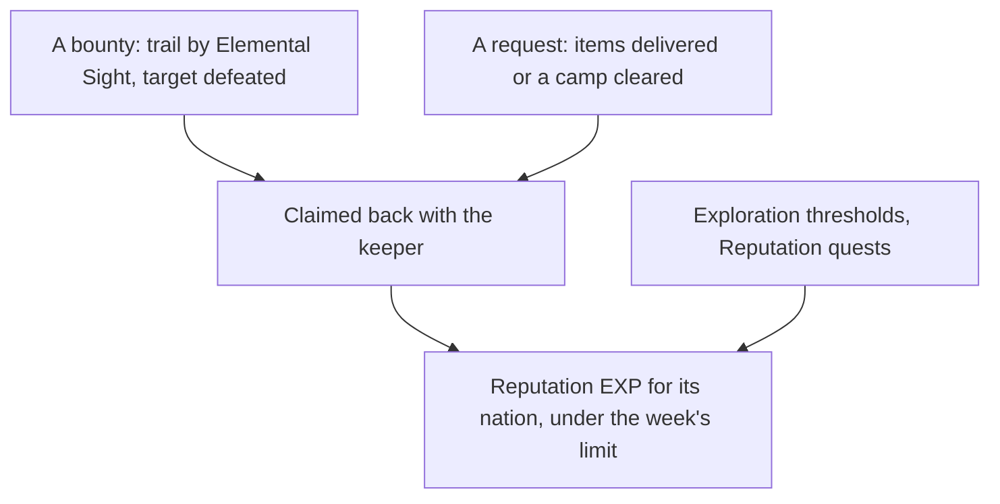

# Reputation

Each nation keeps a Reputation, raised by work done for its people. The [Reputation](../../specs/genshin/reputation/design.md) page holds Mondstadt's levels and the three-a-week claim limit across nations. What remains is what puts them in the world, and the later nations.

## Decisions

- **Requests run as world quests.** From level 2, requests are taken from the nation's keeper and run as world quests: deliver the items asked for, or clear the camp named. Each pays its Reputation EXP and Mora, and the three-a-week limit already counts them across nations.
- **Bounties are hunted with Elemental Sight.** From level 2 (level 1 in Natlan), the keeper offers bounties. The player goes to the place named, finds the target's trail with [Elemental Sight](../genshin-elemental-sight/design.md), defeats it and claims the bounty back with the keeper. The target is spawned when the bounty is taken.
- **Exploration and quests feed it.** Each nation's exploration progress, its chests, puzzles and statue offerings, raises its Reputation at the thresholds `ReputationExploreExcelConfigData` sets, and its Reputation quests give theirs once. A nation's exploration percentage is read off its areas as the [exploration progress](../genshin-exploration-progress/design.md) proposal settles, which also pays Mondstadt's thresholds; a threshold pays once, when the percentage passes it.
- **Mondstadt's keeper is Hertha, NPC 1663.** The wiki names each nation's keeper (Hertha, Ms. Yu, Madarame Hyakubei, Effendi, Euphrasie), and `genshin:text find "^Hertha$"` with the NPC table gives her id. Her id is the NPC table's row for the keeper, whose billboard is the reputation icon. The hosted `sceneNpcBorn/scene3` dataset holds no birth for NPC 1663 among its 1005, so her place is not in the dump's births. The [scene group record](../../specs/genshin/scene-groups/design.md) marks the spot she keeps, the scene's `Reputation` building point, and the wiki places her in Mondstadt by the Knights of Favonius Headquarters, so her place is an estimate marked provisional.
- **The Reputation screen is the keeper's.** Talking to the keeper opens the nation's Reputation screen: its level and EXP toward the next, each level's reward, and the four sources (bounties, requests, exploration and quests). It is drawn from a public clip, opened by the keeper's talk once she stands; until then it is reached only through its fixture on the parity page.
- **A discount is the shop's own.** The shops apply it to a named shop's prices once they have a screen, and each discount's shops are the ones its function's text names, joined to the shops' ids then.
- **Natlan's tribes and supply notices.** Natlan keeps a Reputation per tribe, and its supply notices take donated items, three a week shared between tribes, each 160 to its tribe and a Sanctifying Unction, as the wiki gives them.
- **A Reputation quest is bound to the quest its parentQuestId names.** A Reputation quest row pays when the quest its `parentQuestId` names finishes, and a request pays when the quest its `questId` names finishes. The reward's own row names no quest, so the binding is the quest's id, and the reward is paid on the move that finishes that quest, never on a move from a progress already finished. Settles task 2.3.
- **Requests and bounties open at level two, on the dump's one-based levels.** The dump's `level` starts at one: its row for level 2 holds the Mining Outcrop Search (function 1001) the wiki gives level two, so no offset applies. The unlock is the wiki's "unlocked upon reaching Reputation Level 2", not the level of the first row that names a request group, since the rows for levels 1 to 4 all name group 5 and a gate read off them would open requests at level one. A request is drawn by weight from the group the nation's current level's row names.

## How it works

## Scope and order

**Today:** Mondstadt's Reputation is data and rules, and its reward page is a component with a fixture on the parity page. Nothing places the keeper, draws a bounty's trail, counts exploration or applies a discount.

**This adds, in order:**

1. **Mondstadt's keeper**, placed in region data, opening the screen and offering its requests from level 2. Her place is estimated from the wiki's description of where she stands in Mondstadt, by the Knights of Favonius Headquarters, marked provisional; the record's `Reputation` building point already marks the spot she keeps.
2. **Requests**, as world quests the quest reader carries.
3. **Bounties**, once Elemental Sight draws a trail and the target spawns.
4. **The discount at the shops**, once the shops page has a screen.
5. **Each later nation**, and Natlan's tribes and supply notices, as their regions are built.

## Data and measures

- **Read from the game's tables, still to read:** `ReputationQuestExcelConfigData`, the Reputation quests with their rewards, once the quest reader carries them. Its rows name a quest by `parentQuestId` and a reward, but not the quest that pays, so the binding is the quest reader's to settle.
- **Read from the wiki:** which shops each discount covers, as the ids of the shops its function's text names.

## Key files

| File                                                    | Role after the change                              |
| :------------------------------------------------------ | :------------------------------------------------- |
| `packages/genshin-world/src/models/world/Resident.ts`   | A nation's Reputation keeper, placed as a resident |
| `packages/genshin-world/src/models/quest/QuestKind.ts`  | Requests and Reputation quests as world quests     |
| `packages/genshin-world/src/models/enemy/EnemyCamp.ts`  | A bounty's target, spawned when it is taken        |
| `packages/genshin-world/src/models/inventory/Wallet.ts` | The Mora a request gives                           |

## Sources

- [Reputation](https://genshin-impact.fandom.com/wiki/Reputation), Genshin Impact Wiki: the unlock at rank 25 with each nation's quests, Natlan's supply notices, exploration's share and which shops each discount covers.
- [AnimeGameData](https://github.com/DimbreathBot/AnimeGameData), the community's per-patch dump: the Reputation quest and exploration tables still to read.
