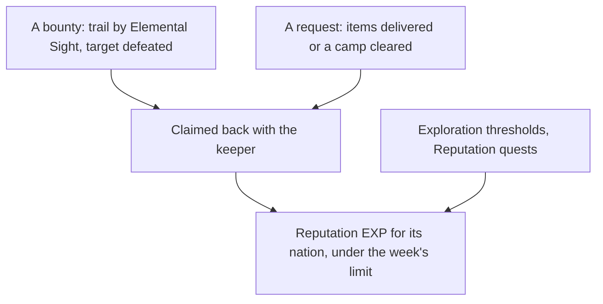

# Reputation

Each nation keeps a Reputation, raised by work done for its people. The [Reputation](../../specs/genshin/reputation/design.md) page holds Mondstadt's levels and the three-a-week claim limit across nations. What remains is what puts them in the world, and the later nations.

## Decisions

- **An objective is met by any one of its targets.** A Collect of a food group names each of the group's items, so an objective's `targetIds` is the list of the targets that meet it, and a single-target objective is a one-item list. Event matching, the talk offers, the step's named and reached targets and the quest's talk check read the list. Considered and not taken: a second optional list on Collect alone, which keeps two shapes for one concept in the model and the readers.

- **Requests run as world quests.** From level 2, requests are taken from the nation's keeper and run as world quests: deliver the items asked for, the exact items or any of a food group. Each pays its Reputation EXP and Mora, and the three-a-week limit already counts them across nations.
- **Bounties are hunted with Elemental Sight.** From level 2 (level 1 in Natlan), the keeper offers bounties. The player goes to the place named, finds the target's trail with [Elemental Sight](../genshin-elemental-sight/design.md), defeats it and claims the bounty back with the keeper. The target is spawned when the bounty is taken.
- **Exploration and quests feed it.** Each nation's exploration progress, its chests, puzzles and statue offerings, raises its Reputation at the thresholds `ReputationExploreExcelConfigData` sets, and its Reputation quests give theirs once. A nation's exploration percentage is read off its areas as the [exploration progress](../genshin-exploration-progress/design.md) proposal settles, which also pays Mondstadt's thresholds; a threshold pays once, when the percentage passes it.
- **Mondstadt's keeper is Hertha, NPC 1663.** The wiki names each nation's keeper (Hertha, Ms. Yu, Madarame Hyakubei, Effendi, Euphrasie), and `genshin:text find "^Hertha$"` with the NPC table gives her id. Her id is the NPC table's row for the keeper, whose billboard is the reputation icon. The hosted `sceneNpcBorn/scene3` dataset holds no birth for NPC 1663 among its 1005, so her place is not in the dump's births. The [scene group record](../../specs/genshin/scene-groups/design.md) marks the spot she keeps, the scene's `Reputation` building point, and the wiki places her in Mondstadt by the Knights of Favonius Headquarters, so her place is an estimate marked provisional.
- **The Reputation screen is the keeper's.** Talking to the keeper opens the nation's Reputation screen: its level and EXP toward the next, each level's reward, and the four sources (bounties, requests, exploration and quests). It is drawn from a public clip, opened by the keeper's talk once she stands; until then it is reached only through its fixture on the parity page.
- **A discount is the shop's own.** The shops apply it to a named shop's prices once they have a screen, and each discount's shops are the ones its function's text names, joined to the shops' ids then.
- **Natlan's tribes and supply notices.** Natlan keeps a Reputation per tribe, and its supply notices take donated items, three a week shared between tribes, each 160 to its tribe and a Sanctifying Unction, as the wiki gives them.
- **A Reputation quest is bound to the quest its parentQuestId names.** A Reputation quest row pays when the quest its `parentQuestId` names finishes, and a request pays when the quest its `questId` names finishes. The reward's own row names no quest, so the binding is the quest's id, and the reward is paid on the move that finishes that quest, never on a move from a progress already finished. Settles task 2.3. `getFinishedReputationRewards` is that rule, and `useWorldMap` calls it for the city's `quests` as well as its requests, so a Reputation quest pays once its parent is carried and its record is published.
- **A discount applies only at the shop it names.** The shop rows whose `vipFuncID` is the function the level names are the named shops: 203 (the grocery) and 204 (the food shop) for function 1002, each with `cityDiscountLevel` 4. The grocery's goods are filed under shop type 1004, which the shops page reads as the grocery, and no dump field joins that type to shop row 203, so the join is the shops page's mapping. The food shop's goods are not published. The Shop screen is mounted and discounts only the goods that carry a level, so the grocery's discount applies at its shop; the food shop's goods are not published, so it takes none yet.
- **Requests and bounties open at level two, on the dump's one-based levels.** The dump's `level` starts at one: its row for level 2 holds the Mining Outcrop Search (function 1001) the wiki gives level two, so no offset applies. The unlock is the wiki's "unlocked upon reaching Reputation Level 2", not the level of the first row that names a request group, since the rows for levels 1 to 4 all name group 5 and a gate read off them would open requests at level one. A request is drawn by weight from the group the nation's current level's row names.
- **A delivery request is carried as the world quest its row names, a Collect of the items it asks for.** The Mondstadt request rows name twelve sub quests that are deliveries: each has a Giving row with the items and count, and its accepting NPC is in the sub quest's accept condition. The carried quest's id is the request's `questId` (for example 7070101, the sub quest, so the reward binding matches the quest's id), its title and description are its main quest's (the sub quest's `mainId`), its one step is a Collect of each item by the Giving row's count, the same objective `QUEST_CONTENT_OBTAIN_ITEM` already maps to, and it has no offer talk, since the keeper's request board offers it. The hand-in is not an event in the world yet, so a delivery counts the items picked up, provisional. The three food requests 7070901, 7071001 and 7071101 are carried the same way from their food group rows (`GIVING_METHOD_GROUP`, tab `TAB_FOOD`), see the food decision below. The carried set's additions stay one line each in `QuestId`, its loaders and the builder.
- **An accepted request starts its quest.** `startQuests` takes the id of an accepted quest and starts it at its first step, once, if it is carried and not yet started. The keeper's offer calls it on accept, through `acceptQuest` in `useWorldQuests`.
- **A bounty's target is drawn from the wiki's list for its difficulty, and spawned at its region's centre.** The wiki's Targets table names each tier's possible enemies, three, four and five stars. The dump's bounty difficulties are those tiers by their Reputation: `HUNTING_DIFFICULTY_EASY` (the default, 120 EXP) is three-star, `MEDIUM` (160) four-star, `HARD` (200) five-star. Each named enemy resolves to one monster by its English name through the dump's monster names: the lowest id whose name is the wiki's, else the lowest whose name ends in it, since the wiki's family names (Abyss Mage, Mitachurl) are the dump's element variants. A taken bounty draws its target from its difficulty's list by the roll and spawns at the centre of its hunting region, which the dump places for all four Mondstadt regions. Provisional: the variant and the draw stand until the game or the wiki names them. The nearest-camp fallback for a region the dump does not place is not built, since no Mondstadt region lacks one; it needs the spawned camps. The kinds' table held only the camps' kinds, so 30 of the 34 Mondstadt bounty kinds were not in it. `collectEnemyKindIds` now takes the bounty kinds beside the camps' kinds, once each, and `buildEnemyKinds` reads each one's codex row and curves, which the dump holds for all 34. The published table already holds all 30, so publish adds no kind rows. The 30 are in `EnemyKindId` with traits: their family's poise and drop family, their element only where the dump's name carries one, and no energy drops, which the wiki gives and this change has not read. Task 2.2 stays open on the target's spawn in the world (the Enemies component is outside this change) and on the Elemental Sight trail.
- **A finished request pays through the quest-finished event.** The world emits `finishQuest` with the quest and its progress before and after, on the one move that finishes it. The Mondstadt requests bind their quests (`getReputationRequestBindings`, a quest the groups repeat bound by its first row) into `getFinishedReputationRewards`, which pays each reward through the same payment the exploration thresholds make. Only requests pay: the Reputation quest rows that bind by `parentQuestId` are not read yet, so task 3.1 stays open on that half.
- **A Reputation quest pays through the same event its parent raises.** The city's `quests` join the request bindings in `useWorldMap`, so the move that finishes the parent pays the quest's reward once. Mondstadt's 20 parents are carried as `QuestId` members named `ReputationParent<id>`, so the move that finishes one pays its reward; the decision below says what waits on their records.
- **Parents 311, 418, 70061, 70078 and 76096 are not carried, so the Reputation quests they parent wait on their steps (decided).** Parent 311's one sub quest is hidden with no English words, parent 418's sub quests finish on `QUEST_CONTENT_LUA_NOTIFY`, a script's own notice, which the condition map leaves out on purpose, and each of 70061, 70078 and 76096 has steps that are scripted talks with no lines in the dump or that ask nothing of the Traveler its conditions name. None has a shown step the reader can take, and a quest with no steps fails the quest schema, which the list must pass whole. Carrying a parent with no steps, by letting the schema take none, was the alternative not taken: it would add a quest the Traveler cannot finish. They stay unpaid until a step source reads their steps: for 311 and 418, the PC's Lua quest export.
- **The 20 parents are carried by their game ids, ahead of their records publishing (provisional).** Each parent is a `QuestId` member named by its id and listed in the city's reading order, so each one's loader is the line the other carried quests take. Naming them by English title was the alternative; all twenty have one in the dump's text map. Carrying them now means `readQuests` requires `quests/<id>` for each, a `Promise.all` over every carried quest, so the quest list stays unloadable until `genshin:text quests` publishes all twenty. That publish needs `BinOutput/Quest/<id>.json` for each, which the fetch in the next decision brings. The fetch and the publish order are the main session's.
- **The fetch brings the binary of every quest the reader carries, not only the ones the dump holds.** The tables come down first; then each carried quest's binary is named by its main quest row (a sub quest's by its world quest, a Reputation request by none) and listed from `BinOutput/Quest`, and a binary the source lacks fails the fetch by name. The tree listings take `GITHUB_TOKEN` when one is set, the API's anonymous limit being 60 requests an hour. The three food requests' 70709 to 70711 and the 20 parents are among them.
- **The three food requests are group deliveries, not camps (provisional).** The binaries of 70709 to 70711 are world quests (`type` WQ) whose first step finishes on a `QUEST_CONTENT_FINISH_ITEM_GIVING` for the request, then a talk to NPC 1656. Their Giving rows are `GIVING_METHOD_GROUP` with `givingGroupCount` 3, 2 and 3, and each names a food group in `GivingGroupExcelConfigData` (7070901 lists items 108012 and 108013). The fifteen Mondstadt requests are all deliveries: twelve exact, these three by group. A Collect names one item, so the three are one Collect step of any one of the group's items, by the row's `givingGroupCount`, which the any-of objective decided above carries. The hand-in talk to NPC 1656 is not carried, as an exact delivery's hand-in is not (provisional).
- **An offer is drawn as the keeper's screen opens, from the requests the world carries that the player has not started.** The draw is not kept with the save, and a request the player has started or finished is not offered again. Both are provisional until the weekly refresh is read; the draw takes `Math.random()` at the talk.
- **Task 3.2 is built for the grocery.** The named-shop rule is `toShopGoodSlice`'s `shopTypes`, which the grocery builder names alone, and its named tests read fixture rows. The food shop has no goods published, so no discount applies there yet.
- **Task 4.1 waits on three things.** Natlan's keeper has no placed resident, its bounties have no hunting rows (the dump's `HuntingRefresh` names no city 6), and the notice-to-tribe mapping is not in the tables read. Nothing of Natlan is built yet.
- **One change, one `x-waiting`, naming only what blocks.** Tasks 2.1 and 2.2 wait on the screen's offer, 2.2 also on the target's spawn and its trail, 3.1 on the Reputation quest rows, and 4.1 on Natlan's data. The change is not split: the offer joins 2.1 and 2.2, and the rest of the change is built on the same screen. The metadata rule now names a partly blocked change's wait, as the roadmap's decision settles.

## How it works

## Scope and order

**Today:** Mondstadt's Reputation is data and rules, and its reward page is a component with a fixture on the parity page. Nothing places the keeper, draws a bounty's trail, counts exploration or applies a discount.

**This adds, in order:**

1. **Mondstadt's keeper**, placed in region data, opening the screen and offering its requests from level 2. Her place is estimated from the wiki's description of where she stands in Mondstadt, by the Knights of Favonius Headquarters, marked provisional; the record's `Reputation` building point already marks the spot she keeps.
2. **Requests**, as world quests the quest reader carries.
3. **Bounties**, once Elemental Sight draws a trail and the target spawns.
4. **The discount at the shops**, its grocery's part built by the shops change, its tests here.
5. **Each later nation**, and Natlan's tribes and supply notices, as their regions are built.

## Data and measures

- **Read from the game's tables:** `ReputationQuestExcelConfigData`, Mondstadt's rows read by `toReputationQuests` into the city's `quests`. Each row names the quest that pays by its `parentQuestId`, the binding of decision 2.3, and its reward by `rewardId`. The binding pays once that quest is carried and its record is published: Mondstadt's 20 parents are carried as `ReputationParent<id>`, and their records wait on their binaries in the dump (decision on the parents above).
- **Read from the wiki:** which shops each discount covers, as the ids of the shops its function's text names.

## Key files

| File                                                             | Role after the change                                         |
| :--------------------------------------------------------------- | :------------------------------------------------------------ |
| `packages/genshin-world/src/models/world/Resident.ts`            | A nation's Reputation keeper, placed as a resident            |
| `packages/genshin-world/src/models/quest/QuestKind.ts`           | Requests and Reputation quests as world quests                |
| `packages/genshin-world/src/models/enemy/EnemyCamp.ts`           | A bounty's target, spawned when it is taken                   |
| `packages/genshin-world/src/models/inventory/Wallet.ts`          | The Mora a request gives                                      |
| `packages/genshin-world/src/models/quest/QuestId.ts`             | The delivery requests carried as world quests                 |
| `scripts/src/services/genshinText/readReputationRequestQuest.ts` | A delivery request's quest, from its sub quest and giving row |

## Sources

- [Reputation](https://genshin-impact.fandom.com/wiki/Reputation), Genshin Impact Wiki: the unlock at rank 25 with each nation's quests, Natlan's supply notices, exploration's share and which shops each discount covers.
- [AnimeGameData](https://github.com/DimbreathBot/AnimeGameData), the community's per-patch dump: the Reputation quest and exploration tables still to read.
