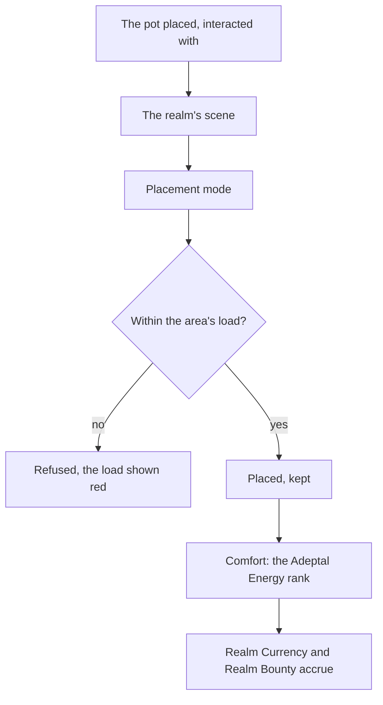

# Serenitea Pot

The Serenitea Pot is a realm the player owns and furnishes: an island, a mansion and its grounds, decorated with furnishings and lived in by the player's characters. Its spirit, Tubby, makes furnishings, keeps the Trust Rank and sells from the Realm Depot. It is a world of its own beside the open world, entered through a gadget ([gadgets](../genshin-gadgets/design.md)), and its companions earn [companionship](../genshin-companionship/design.md).

## Today

Tubby's making, the Trust Rank, Adeptal Energy and the realm's Realm Currency and Realm Bounty stores are built, as the [Serenitea Pot](../../specs/genshin/serenitea-pot/design.md) page describes. The world still holds no realm: nothing is placed, entered or seen. What follows is what remains.

## Decisions

- **A realm is a scene of its own.** Each realm layout, the Floating Abode, Emerald Peak, Cool Isle, Silken Courtyard and the rest, is the game's own scene, laid out from its data and derived as a region is ([scene derivation](../../specs/genshin/scene-derivation/design.md)), its mansion one of the game's own. Placing the Serenitea Pot gadget on a valid surface and interacting with it fades into the realm; the gadget or any teleport in the open world fades back out to where the player went in.
- **The editor places furnishings.** In the realm, the furnishing placement mode places, moves, turns and stacks furnishings on the ground, on each other and in the mansion's rooms, by the pointer and the keys. Each area has a load, every furnishing, animal and companion counting its own, and the editor refuses a placement past it, showing green, orange and red as the game does. A layout's placements are kept with the player's progress.
- **Furnishings are drawn by their kits.** Each furnishing is drawn by its own generated kit at the measures of its export, as every building is ([derived assets](../../specs/genshin/derived-assets/design.md)). Its comfort comes from `HomeWorldFurnitureExcelConfigData`, which the editor reads once it places anything.
- **Companions live there.** From its quest on, characters other than the Traveler are invited to live in the realm, up to eight at the highest Trust Rank. They earn Companionship EXP as Realm Bounty, and a character invited to a gift set they favour speaks its dialogue and gives its one-time rewards.
- **The Realm Depot and the Adeptal Mirror.** Tubby's depot sells blueprints, furnishings and materials for Realm Currency from the game's shop rows, and the Adeptal Mirror's missions reward blueprints as the handbook rewards its chapters.
- **Gardens and ponds.** A garden's fields grow seeds over real time and a pond holds fish, by `HomeWorldFarmFieldExcelConfigData`, `HomeWorldPlantExcelConfigData` and `HomeWorldRaiseFishExcelConfigData`.
- **A pond holds its fish and grows none.** Fish placed in a pond stay in it, and nothing grows them until the fish rule is known. `HomeWorldRaiseFishExcelConfigData` holds three ponds, each a name and one list entry, with no time or count, and the furnishing table gives the fish no load, so the placement rule refuses a fish for now. The rule is a recording of a pond or the game's own, which the change's `x-waiting` names, and 5.1's pond half waits on it.
- **The realm is left through a seam.** `leaveHomeRealm` decides where the gadget or a teleport returns the player. It has no caller yet, since no realm visit is created until the realm's own scene exists (Scope item 3), so the seam is wired with that scene and not before.
- **The placement editor is built in the realm.** Furnishing mode places a held furnishing on the ground the pointer picks, and refuses it past either limit of its area, as the furnishing load bullet sets out. The game holds two notices for the limits, `RetHomeFurnitureArrangeLimit` ("Furnishing limit reached") and `RetHomeFurnitureExceedLimit` ("Furnishings exceed placement limit"). Their text does not say which one a load's refusal shows, so the editor shows the notice a refusal of each kind names once a refusal is seen in the game. The load meter reads the area's `orangeLoad` and `redLoad` and turns green, orange and red. The panel follows the shape of `CraftingScreen` and `ForgeScreen` in `genshin-interface`, taking its words resolved, and it mounts once the realm's scene exists (Scope item 3), so no key is added to `GameTextKey` before then.
- **A gift set is placed whole, and its favour is read from the dump.** The favour rows are `HomeWorldEventExcelConfigData`: 236 `HOME_AVATAR_REWARD_EVENT` rows, each with a suite id, a companion, a one-time `rewardID` and a `talkID` for the companion's dialogue, and 236 `HOME_AVATAR_SUMMON_EVENT` rows with a `talkID` and a `lasttime`. `FurnitureSuiteExcelConfigData` names each suite and lists the companions who favour it, but holds no members, and the furnishing table holds no suite id either, so no table in the dump says which furnishings a set holds. The wiki's set pages list each set's required furnishings. A set placed whole needs that list, and reading it from the wiki is a source the change has not taken, so task 2.2 waits on that decision. The favour reader and the dialogue's text (`genshin:text find`) wait with it, and nothing of them is built yet.
- **A seed is a crop once its plant's time has passed.** `HomeWorldPlantExcelConfigData` gives each seed a `time` in seconds, 252000 for 47 of its 50 plants and 600 for the other three, and a `sproutTime` the seed shows before it is ripe. The growth rule reads `time` alone, from the moment the seed is planted: a seed is a crop once `time` seconds have passed since then, and not before. The sprout stage is the sprout gadget's and is not read yet, so the rule's measure is provisional until a recording of a garden shows the ripe moment.
- **Companions earn the whole bounty.** Each companion living in the realm gains the whole Realm Bounty its store holds, not a share of it, as the Companionship EXP claims do for the deployed team. The store fills per real hour at the Adeptal Energy rank's `companionshipExpProduceRate`, provisional until a recording settles the hour, up to the Trust Rank's `homeFetterExpStoreLimit`. A claim pays what the store holds at its moment to each companion and empties the store. The grant is capped at the top Friendship Level as any Companionship EXP is, through `gainCompanionshipExp`, which now takes the characters it is given rather than the party's team.
- **Opened at Adventure Rank 28** with its quests.
- **A companion is invited within the Trust Rank's count.** Any character the player owns but the Traveler may live in the realm, one character once, as many as the Trust Rank's `npcCount` in the built `levels.json` allows, one companion at Trust Rank 1 rising to eight at Trust Rank 10. Inviting takes no furnishing; the gift sets are the furnishing sets' and wait on the placement editor.
- **The Realm Depot is the shop table's.** Its goods are the rows of `ShopGoodsExcelConfigData` filed under `shopType` 1048 (goods ids 213xxx and 214xxx; the shop table's rows 213 and 214 are the realm's two shop types, not the goods' filing), split by `subTabId` as the wiki's Realm Depot page lists them: 1 the weekly Realm Treasures (eight goods), 2 the daily Furnishings, 3 the Furnishing Blueprints, 4 Riches of the Realm, 5 the weekly Creatures of the Realm and 6 the weekly Wood. Every good is priced in Realm Currency, item 204, which the wallet holds once its save carries every currency as a key of its record.
- **The depot publishes as six tab records.** `buildRealmDepotGoods` writes each sub tab as a record of the shops dataset (`realmDepotTreasures`, `realmDepotFurnishings`, `realmDepotBlueprints`, `realmDepotRiches`, `realmDepotCreatures`, `realmDepotWood`), each row the shape Mondstadt's general goods have. The 7.1 dump holds 1173 goods, 8, 264, 794, 27, 47 and 33 across the six, and the dry run builds every one. A good the table leaves no refresh for is none, the table's zero, which the dump omits from the row.
- **The weekly refresh is the Monday at the game's hour.** The depot's weekly goods restock at four in the morning on the Monday, as the game's own Realm Depot text reads (from 4:00 AM every Friday to 4:00 AM on the Monday of the next week). `ShopRefresh.Weekly` counts the week's Monday at that hour the way the monthly refresh counts the first of the month. The as-built shops spec names only the daily and monthly refreshes, so its weekly line is owed when this change archives.
- **A depot good's furnishing goes to the bag.** `buyHomeDepotGood` is `buyShopGood` given the furnishing's own definition, since a furnishing has no row in the material table: a currency goes to the wallet, any other item to the bag as that definition takes it, and the purchase is refused where the bag has no room, so nothing is spent. The depot's purchases are passed in: the realm's progress does not hold them yet, so where a weekly limit's purchases are kept waits on the realm's save.
- **A furnishing's load is its `cost`, and each further copy's its `discountCost`.** `HomeWorldFurnitureExcelConfigData` gives each furnishing a `cost` and a `discountCost`. The first copy of a furnishing in an area takes its `cost` and each further copy its `discountCost`, as the wiki's [Load](https://genshin-impact.fandom.com/wiki/Serenitea_Pot/Load) page's reduced load reads. 2188 of the table's 2513 rows carry both. The other 325 (the mansion's structures, the fish, the virtual and block-dependent furnishings) carry neither, so the record leaves them out and a placement of one is refused until its load is known. An area's limit is the `MMLKIBLLOGP` field of `HomeWorldAreaComfortExcelConfigData`, which the dump obfuscates: 16,000 in an exterior area and 6,400 in a room. The per-area furnishing count is not in the dump. It is the wiki's, 449 an exterior area and 149 a room, and it counts the ceiling lamps the wiki excludes, so it overcounts a room by its lamps until a room's lamps are read. A placement is refused where the area's furnishings pass either limit, a limit itself allowed. The home dataset publishes `home/areas`, each area with its limit, whether it is exterior and its orange and red thresholds (`highLoadLimit` and `lowLoadLimit`: 10,000 and 15,000 in an exterior area, 4,000 and 6,000 in a room), and `home/furnishings`, each furnishing with its `load` and `discountLoad`.

- **A realm's placements are a save slice of their own.** `homePlacements` holds each furnishing placed in a realm, by its item id, the area of its scene it stands in, where it stands and its turn, in the order placed. It follows the other slices: a model beside the save's schema, a converter each way, and a merge that keeps the account's copy, as the bag and the party do, since a realm belongs to the account. Its list is bounded by `MAX_HOME_PLACEMENT_COUNT`, 22,712, the most the eight realms' areas hold at the furnishing counts the wiki's Load page gives (449 an exterior area, 149 a room). The dump's own scenes hold fewer, so the bound is a ceiling. A stored save that predates the slice has no `homePlacements`, and is refused rather than defaulted, so it is backfilled to an empty list.

- **Realm Currency and Realm Bounty settle on one clock.** Both stores fill from the `accruedAt` the realm shares, so `settleHomeStores` settles both to the claim's time, and a claim pays out and empties only its own store. A clock read before the last settle moves nothing and keeps the later `accruedAt`, so no span counts twice. Each store fills at the Adeptal Energy rank the realm's comfort reaches when it is settled, the rank in force as the spec's accrual requirement reads. The fill rates and limits are the game's tables and stand until a recording of a store's hour confirms them; no such recording has been found on the wiki or YouTube.

- **The save written before the placements slice is backfilled, not defaulted.** The genshin save is one blob per player, `{userId}/save.json` in the `genshin-assets` container, holding the session lease beside the save. A blob without `homePlacements` fails the schema and is never overwritten, so the start and the save answer an error until it is brought to shape. The run is the backfills skill's: a scratchpad script adds `homePlacements: []` to each blob that lacks it, keeps the session field and the zstd frame, and writes under the listed etag, a dry run and then a write on dev, then prod, re-running until nothing changes, then deleting the script. It is owed once this schema reaches dev; the main session runs it, and nothing is committed.

- **The placement editor is a Genshin screen on the interface's parts, and its meter reads the area's own loads.** The editor is `components/World/Realm/PlacementEditor`, built on `genshin-interface`'s `GameScreen`, `GameButton` and `ProgressBar`. Its load is `computeHomeAreaLoad` over the area's placements with the candidate on them, and its state is `computeHomeLoadState` against the area's `orangeLoad` and `redLoad`, so the meter and the refusal, `placeHomeFurnishing`, read one computation. Its Confirm label is `UI_BEYOND_CONFIRM` until the placement mode's own word is read from a recording, and a refused placement shows a disabled Confirm rather than the notices, which have no text keys yet. The colours and layout are provisional until the parity pass reads the game's placement mode.

## How it works

## Scope and order

**Still to build, in order:**

1. **Companions invited.** `models/home/HomeProgress.ts` gains `companionIds`, the characters living in the realm. A new `services/home/inviteHomeCompanion.ts` adds one, refusing the Traveler (`TRAVELER_CHARACTER_ID`), a character the player does not own, one already living there, and one past the `npcCount` of the Trust Rank `computeHomeTrustRank` reads from the progress's Trust EXP; `services/home/dismissHomeCompanion.ts` takes one out. Test: `inviteHomeCompanion.test.ts` (a rank-one realm takes one companion and refuses a second, the Traveler is refused, and a character already living there is refused).
2. **The Realm Depot.** Realm Currency joins the wallet as a currency, item 204 in `CurrencyItemIdMap` and `ShopItemCurrencyMap`, its name a `GameTextKey` written by `genshin:text`, and the save's currencies record with it; then the depot's tabs are written from the goods rows the Decisions name through the shops' `buildShopGoodSlice`, and bought through `buyShopGood` at each tab's refresh.
3. **The gadget and one realm layout**, entered and left, once the first layout's scene (world scene 2001 of `HomeworldModuleExcelConfigData`) is extracted as a region's is.
4. **The placement editor and its load.** The refusal is built with the per-area furnishing count and the reduced load of a second copy (`placeHomeFurnishing`, over the `home/areas` and `home/furnishings` records). Still to build: the editor's surface and the load meter, which need item 3's realm scene.
5. **Gift sets.** `services/home/placeHomeFurnishingSet.ts` places a set whole: each of its furnishings goes through `placeHomeFurnishing` in turn, and the set is refused whole when one would not fit (`placeHomeFurnishingSet.test.ts`). The favour's dialogue and one-time reward wait on the favour rows being published and on the dialogue's game text.
6. **Gardens, ponds, the other layouts and the Adeptal Mirror.**

## Data and measures

- **Read from the game's data, not yet read:** the layouts' own scene data, the furnishings' comfort and types from `HomeWorldFurnitureExcelConfigData`, and the fish-raising table's pond rule (its fish kinds are not yet read).
- **Read:** the load each area holds, from `HomeWorldAreaComfortExcelConfigData`, matching the wiki's Load page: an exterior area's traffic light turns orange at `highLoadLimit` (10,000) and red at `lowLoadLimit` (15,000), and its limit is 16,000. Those two lines are read but not yet drawn; a recording of one area's load would confirm them, and is listed as owed.
- **Not located:** how a pond's fish change over real time. `HomeWorldRaiseFishExcelConfigData` names only the fish each pond kind holds, three rows with no count or time, and the wiki's Furnishing Subsystem page gives the ornamental fish no real-time rule. The seed half of the garden is read: the wiki's Gardening page gives two days and twenty-two hours to grow, the table's 252000 seconds.
- **Measured:** each furnishing's shape against its export, as every building's is, and the editor's movement and snapping off a recording of placement mode, provisional until then.

## What this does not propose

- **Visiting another player's realm.** It needs other players, which [co-op](../../deferred/genshin/co-op/design.md) defers.

## Key files

| File                                                                          | Role after the change                                    |
| :---------------------------------------------------------------------------- | :------------------------------------------------------- |
| `packages/genshin-world/src/components/World/Session/Index.vue`               | Enters a realm's scene and returns to the world          |
| `packages/genshin-world/src/models/world/BuildingKit.ts`                      | The kits a furnishing is drawn by                        |
| `packages/genshin-world/src/models/inventory/Currency.ts`                     | Gains Realm Currency, once its game text name has a key  |
| `packages/genshin-world/src/models/inventory/Inventory.ts`                    | Furnishings and blueprints, in the bag's Furnishings tab |
| `packages/genshin-world/src/services/home/settleHomeStores.ts`                | Settles Realm Currency and Realm Bounty on the one clock |
| `packages/genshin-world/src/services/home/claimHomeCurrency.ts`               | Pays out the Realm Currency a store holds at the claim   |
| `packages/genshin-world/src/components/World/Realm/PlacementEditor/Index.vue` | Picks a held furnishing and places it within load        |
| `packages/genshin-world/src/services/home/computeHomeAreaLoad.ts`             | The load an area's placements hold, read once            |
| `packages/genshin-world/src/services/home/computeHomeLoadState.ts`            | The green, orange or red state a load reads at           |
| `packages/genshin-world/src/services/shop/VendorShopTypeMap.ts`               | Tubby, keyed to the realm depot's shop type              |

## Sources

- [Serenitea Pot](https://genshin-impact.fandom.com/wiki/Serenitea_Pot), Genshin Impact Wiki: the unlock at rank 28, the gadget and entering and leaving, the realm layouts, furnishings and their sources, the furnishing sets and gift sets, the companions, the load's traffic light, the Adeptal Mirror and the Trust Rank's bonuses.
- [Companionship EXP](https://genshin-impact.fandom.com/wiki/Companionship_EXP), Genshin Impact Wiki: Realm Bounty's rate by Adeptal Energy and its store by Trust Rank.
- [Serenitea Pot/Load](https://genshin-impact.fandom.com/wiki/Serenitea_Pot/Load), Genshin Impact Wiki: the load limits of an exterior area and a room, the furnishing counts (449 and 149, excluding ceiling lamps) and the reduced load of a second copy. The count is not in the dump.
- [Serenitea Pot/Sets](https://genshin-impact.fandom.com/wiki/Serenitea_Pot/Sets) and each set's page (the Dawn Orchard page read), Genshin Impact Wiki: the furnishing sets, each set's required furnishings and the companions who favour it. The dump holds no set members, so the list is the wiki's, and it is not taken by this change yet.
- [AnimeGameData](https://github.com/DimbreathBot/AnimeGameData), the community's per-patch dump: the realm, furniture, comfort, farm, plant, fish-raising and furniture-making tables.

## Reference

- `realm-store-start.png`, `realm-store-hour.png` — two stills, not a clip, of one realm's Realm Currency and Realm Bounty stores an hour of real time apart, with its Adeptal Energy rank and Trust Rank shown beside them; they read whether a store fills per real hour at the table's rate ([Serenitea Pot](../../specs/genshin/serenitea-pot/design.md)). `realm-store-start.png` searched 2026-10-11 on the wiki and YouTube, none found; `realm-store-hour.png` searched 2026-10-11 on the wiki and YouTube, none found.
- `trust-queues.mkv` — Tubby's making at two Trust Ranks, the rank read off the Trust screen, a furnishing started in each queue, 30 seconds at most; it shows whether each rank holds one queue more than the rank below it ([Serenitea Pot](../../specs/genshin/serenitea-pot/design.md)). On the wiki and YouTube, none found (searched 2026-10-11).
- `realm-load.png` — one realm area's load traffic light at a few placements, with its load figure visible; it confirms the limits read from the game's area table and the traffic light's two thresholds ([Serenitea Pot](design.md)). On the wiki and YouTube, none found (searched 2026-10-11).
