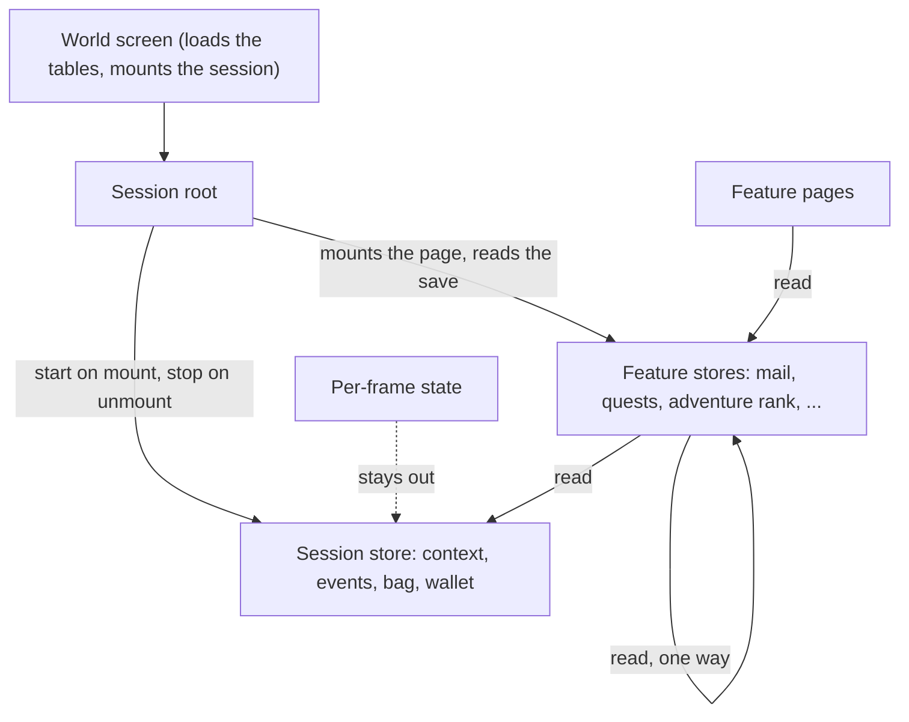

# The session's shared state in stores: design

The measurements behind this are in [the investigation](investigation.md); the tasks that carry it out are in [the tasks](tasks.md).

## The decision

**Shared state lives in Pinia stores that own it, as the app's does: one session store for the context every feature shares, and one store for each feature whose state another feature reads.** A feature that only it reads stays in its composable.

A store is the owner and not a bridge. A value a component copies onto a store in `setup` for code outside its subtree is what the Pinia skill's blade-scoped-state page warns against, and it would leave the root's wiring in place under another name. The store creates the state, and the root and the features read it.

## Why this, and why not the others

| Alternative                              | Why it lost                                                                                                                                                                                                                     |
| :--------------------------------------- | :------------------------------------------------------------------------------------------------------------------------------------------------------------------------------------------------------------------------------ |
| `provide` / `inject`                     | The repo forbids it by lint (the `vue` skill gives the reasons). One `inject` is left, for the scene witness key.                                                                                                               |
| One options object for the shared values | Already done where the types allowed: the bag bundle took 47 lines out of the root and added none, and it is the most bundling does. It carries the values, and a composable still declares them.                               |
| Cutting the root into group composables  | Measured: five cuts by feature took 9 to 35 lines out of the root and put 117 to 222 net lines into the package, because each group restated the shared list as its options.                                                    |
| Overlay layers as child components       | Measured and undone: five children with no state or logic, each with a props interface longer than its template, grew the package by about 540 lines. A layer is a cut only when it owns state, a composable, a style or logic. |
| Module-level refs in a composable file   | State outside any component instance is shared by every mount, so two sessions in one page (a visual suite, a parity page) corrupt each other, and nothing resets it between tests.                                             |
| One store holding the whole save         | It moves the root's fields into a store and leaves every feature reading one object of several hundred fields, a global with a type. Stores are cut by feature, as the app's are.                                               |
| A session store alone                    | The shared context is a quarter of the options keys. The other three quarters are one feature's results given to another, and only a feature that owns its state in a store lets the next feature read it without a list.       |

## The shape

- **The session store** holds what no feature owns: the data URL, the language, the text and name maps, the material data, the clock's reader, the events emitter, and the bag and wallet with their setters (the setter emits the bag-change and obtain events, so the emitter lives beside it). The session starts it from the loaded tables and the saved state on mount and clears it on unmount.
- **A feature store** owns a feature's state and actions and reads the session store, and other feature stores only one way: no module cycle, auto-imports included (the Pinia skill). The first feature store is the mailbox; the order after it is the fan-out table in the investigation, which a later change takes.
- **The root** starts the session store, mounts the pages, and reads the stores when it writes the save. It stops being the place the features meet.
- **A page owns its composable** when the composable's inputs are the session store and its own state, which is the split the guide's second step asks for and could not reach before.

## Guidelines for a store here

- **Setup stores, as the app's are.** One binding per store named after it, `storeToRefs` for the refs and a destructure for the actions; inside a store, nested stores are declared at the setup root and read by dot, with no `storeToRefs` (the Pinia skill, "Consuming a Store").
- **A store's state is the feature's low-frequency state** (the save's systems, what is open, what is claimed). A value that changes every frame stays local: the frame step, the HUD frame, the camera and the input. It is read by the scene alone, and a store would add a reactive path to the hottest loop for no reader.
- **Frame code reads refs it took at setup,** not properties through the store object each frame, and does no `$patch`, `$subscribe` or watcher on a store in the frame path.
- **The save is read from the stores when it is written.** The save sync reads the stores' refs, as it reads the root's refs now, and the saved state is read once to start each store.
- **A store is mount-lifetime in effect.** The session starts it and clears it on unmount, so a second mount starts clean; the world screen is the only mount site, so one session is live at a time and no store is keyed. A test that mounts and unmounts twice proves it.
- **No bridging.** No component copies its refs onto a store for another feature to read. If a feature's state is read elsewhere, it is born in a store.
- **No `provide` / `inject`,** and no store reading a component's props.
- **A feature that only itself reads stays a composable** with its own options. The change moves what is shared, not everything.
- **Names and places, settled by the first slice:** a store is `useWorld<Feature>Store`, in `src/store/<feature>.ts` as `vue-phaserjs` keeps its stores, with the id `world/<feature>`, one store per file. The binding is named after it (`worldSessionStore`, enforced by `pinia-store/require-store-binding`). `defineStore`, `storeToRefs` and the Vue functions are explicit imports in a `.ts` file here, as the composables write them, and the shared build and test configuration auto-imports them in a `.vue` file. A suite that tests a feature over the store starts it with `startTestWorldSession` from `src/store/session.fixture.ts`, which sets a fresh active Pinia. `toThrow` is replaced by an inline snapshot, and a throw names its store by a literal, since `defineStore` returns a function named `useStore`. The package's lint reaches the stores; the only change to the package's manifest is the Pinia peer.

## Testing

- **A store has a test that seeds it and reads the state back,** and one that drives each action to its result, with an active Pinia created in the test.
- **A composable that read options and now reads a store keeps its test,** with the options replaced by a seeded store. The 21 composables with a test beside them are converted, not deleted; the ones with none get a test where they hold logic, as the `testing` skill's "What to Test" decides.
- **The suites that mount the session** (the package's visual and browser suites and the parity page) create a Pinia once. They stay otherwise unchanged and are the check that a player sees no difference.

## Performance

- **The frame step must not slow.** The session's per-frame work runs before every draw, so the change adds no store property read, subscription, patch or watcher to it. The check is the frame step's CPU time over a recorded walk, measured before the first slice and after each, and a slice that raises it by more than the bench's noise is not taken. If the frame step has no harness that runs without a canvas, the first task builds the smallest one; the existing benches cover the kit and camp services, which this change does not touch.
- **The cost of a store read is measured once,** by a bench comparing a ref read with the same read through a store, so the guideline above rests on a figure and not on a belief.
- **Mount cost.** Starting the stores adds work at mount; it must not move the time to the first ready event by more than the noise of the visual suite's load.
- **The package's size snapshot** moves with the lines the change adds and removes, and Pinia is a peer, never bundled (the build skill's dependency placement). The snapshot is updated by the package's own suite.

## Definition of done

For a slice:

1. **The count is negative.** The lines the slice adds (stores, tests, pages) less the lines it removes (options lists, their type declarations and destructures in the composables, the bindings in the root), over the slice's files, as `git diff --shortstat` reports it. A slice that is not negative is recorded as a refusal with its numbers, and the change stops.
2. **The keys fall.** The investigation's count script reports fewer option keys, and the shared keys the slice owned are 0 in every call that took them.
3. **The checks pass for what the slice touched:** the package's typecheck through the mapper reports nothing, ESLint and oxlint are clean, the touched tests and the stores' tests pass, and the visual and browser suites that mount the session are unchanged.
4. **The lifetime test passes:** a second mount starts clean.
5. **Performance is within the noise** of the frame-step measure and the mount measure above.
6. **No bridge, no `provide` / `inject`, no store cycle** (the lint rule and the module-cycle test).
7. **The prose follows:** the guides, the ledger rows and the specs that name a moved composable or options list, found by the lookup in `AGENTS.md`'s finishing step.

For the change: the shared keys are 0 in every call the root makes, the keys that one feature hands another are reported with the reasons for any that remain, the package is smaller than the investigation's baseline, and the guides state the pattern as the rule.

## The read bench

`packages/genshin-world/src/store/session.bench.md` holds the cost of one thousand reads of the same value: a ref reads at about 0.34 ms, a store's getter at about 0.57 ms and a field of a store's ref at about 0.78 ms, so a store read costs between 0.2 and 0.45 microseconds more than a ref read. The frame step reads the context a few dozen times at most, which is under a hundredth of a millisecond against a sixteen-millisecond frame, and the guideline stands as written: per-frame state stays out of stores and is read once into a local where a loop needs it. The frame step and the mount have no canvas-free harness here, and the hosted data they read cannot be reached from this container, so their baseline (tasks 0.2 and 4.2) is still to measure on a machine that has it.

## The count

Over `packages/genshin-world`, from the commit before the session store to the mailbox store (`git diff --shortstat 2e8b89230~1 a4709257a`): 84 files, 1,043 added and 1,164 removed, **121 lines fewer**, with the stores' tests and the page counted among the additions. The count is negative, so the change goes on to the performance measures. The root went from 2,082 to 1,918 lines, and the script prints `48 388 0` from `51 518 128`.

## What it costs

- **A new peer.** `genshin-world` becomes a Pinia peer, as `vue-phaserjs` lists it, since a store is a singleton the app and the package must share.
- **Tests install Pinia.** A composable tested with plain arguments needs an active Pinia and a seeded store.
- **Every mount installs Pinia.** The world screen's visual and browser suites mount the session.
- **State is no longer visible in a call's arguments.** A composable's reads are in its body. The store's typed state and the lint rules on store use are what keep that readable.

## Where it stops and what follows

This change is the foundation: the session store, the bag and the mailbox, with the gate and the performance measures. If it passes, the later slices (the adventure rank, the combat, the quests, the map, then the features that read those) are a second change written from the fan-out table, each judged by the same definition of done. If it does not, it is recorded as a refusal and the root stays as it is, which the guides already allow.

## Playtest

None. Where state lives changes and the player sees no difference; the session's parity and visual suites are the check.

## Key files

| Path                                                                        | Role                                            |
| :-------------------------------------------------------------------------- | :---------------------------------------------- |
| `packages/genshin-world/src/components/World/Session/Index.vue`             | The root whose options lists the stores replace |
| `packages/genshin-world/src/composables/useWorldSave.ts`                    | Owns the bag today, and emits its events        |
| `packages/genshin-world/src/store/mail.ts`                                  | The first feature                               |
| `packages/genshin-world/src/composables/useWorldFrame.ts`                   | The per-frame step the change must not slow     |
| `.agents/skills/vue-component-patterns/references/splitting-a-component.md` | The measure every cut is judged by              |
| `.agents/skills/pinia/SKILL.md`                                             | How a store is consumed, owned and torn down    |
| `openspec/rejected/genshin/session-menu-layer/design.md`                    | The measurements this change is the way out of  |
