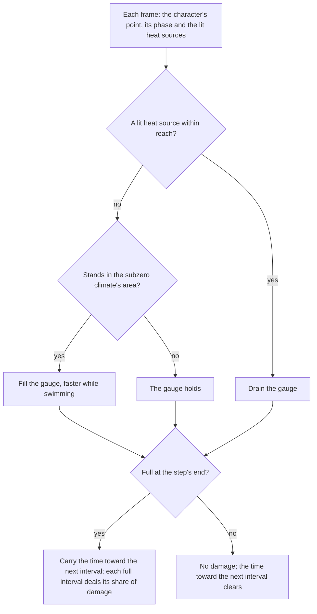

# Sheer Cold

Dragonspine's Sheer Cold is the subzero climate's gauge. Standing in the climate fills it, heat drains it, and once it is full the character loses HP at intervals. The rules come from the game's own climate data and its guide text, and the numbers the data leaves out are provisional constants.

## Decisions

- **The climate is an area, not a weather.** The gauge fills where `findAreaAt` names an area in the climate's list, which is Dragonspine alone. Keying on the Snow weather was rejected: the catalogue gives Snow to other areas, and the game ties the climate to the place, not to the weather that falls there.
- **The dump's rules are used, its missing numbers are provisional.** The climate's buffs give the fill's trigger (Cryo, Frozen or Wet), the damage (a share of max HP every two seconds, at the second level) and the residency in a snow mountain area. They give no rate, no full scale and no drain. Those are provisional constants in `services/sheerCold/constants.ts`, to be read off a recording.
- **Heat drains the gauge wherever it stands, and overrides the fill.** The guide says heat diminishes the gauge without naming a place, so a lit campfire outside the climate drains it too. Limiting the drain to the climate was rejected: it would leave a campfire outside Dragonspine with nothing to do, which the guide does not say.
- **A full gauge stays full outside the climate.** With no heat near, the gauge holds its value, full included, so a character who leaves the climate full keeps losing HP until heat drains it below full. The guide names no point at which the loss stops, so the hold is the reading that adds nothing.
- **Pyro does not drain the gauge.** The dump's Pyro rule is for the hot bar of the Boss zones (`ClimateAbility_HotMonster`), a separate gauge. The cold gauge's drain is a heat source's presence, and the world has rules for one heat source, the campfire.
- **Damage is computed, then handed on.** The step returns the share of max HP its full intervals cost, and Windrise emits it as `coldDamage`. No health path reaches the world yet, so the damage waits for one.
- **The bar has no words.** The game's own name for the gauge is not in the reader's texts, and a `GameTextKey` member for it waits on the text write. The guide's link text "View Sheer Cold Details" is in the dump.

## Mechanism

## Key files

| Path                                                               | Role                                                                    |
| :----------------------------------------------------------------- | :---------------------------------------------------------------------- |
| `packages/genshin-world/src/services/sheerCold/constants.ts`       | The climate's area list and the provisional rates, with their sources   |
| `packages/genshin-world/src/services/sheerCold/isSheerColdArea.ts` | Whether the area the character stands in holds the climate              |
| `packages/genshin-world/src/services/sheerCold/isHeatedBy.ts`      | Whether a lit heat source is within reach of the character              |
| `packages/genshin-world/src/services/sheerCold/stepSheerCold.ts`   | One step of the gauge: drain, fill, hold, and the damage at intervals   |
| `packages/genshin-world/src/composables/useSheerCold.ts`           | Steps the gauge each frame and hands its damage on                      |
| `packages/genshin-world/src/components/World/Windrise/Index.vue`   | Mounts the gauge beside the area weather and emits its value and damage |
| `packages/genshin-world/src/components/World/Session/Index.vue`    | Writes the gauge's value into the HUD frame                             |
| `packages/genshin-world/src/components/World/Character/Index.vue`  | Exposes the character's locomotion phase for the swimming rule          |
| `packages/genshin-world/src/components/Hud/SheerCold/Index.vue`    | The bar across the top of the screen                                    |
| `packages/genshin-world/src/components/Hud/Screen/Index.vue`       | Mounts the bar beside the stamina meter                                 |
| `packages/genshin-world/src/models/hud/HudFrame.ts`                | The gauge's value in the frame the HUD reads                            |
| `packages/genshin-world/src/models/sheerCold/SheerCold.ts`         | The gauge's value and the time it has stayed full                       |
| `packages/genshin-world/src/models/sheerCold/SheerColdStep.ts`     | What one step reads off the world                                       |
| `packages/genshin-world/src/models/sheerCold/HeatSource.ts`        | A point that gives off heat, and whether it is lit                      |

## Sources

- The game's own climate data, read from the dump: the rows of `BuffExcelConfigData` named `ClimateAbility_Cold`, with their Chinese `name` and `desc` (the Lv1 fill, the Lv2 damage and the area residency), and the anti-cold food rows `Anti_Cold_Food_Buff`, whose `desc` says each suppresses the bar's rise by a ratio.
- The game's English guide text, `TextMap_MediumEN.json`, under the hash `2536823179` that `UI_GUIDE_COLDCLIMATE_DESC` names in `ManualTextMapConfigData.json`: the climate fills the gauge, its limit costs HP, heat diminishes it, and snowstorms and swimming accelerate it.
- The Fandom wiki's Sheer Cold page was not read: the session's fetch of it returned HTTP 402.

## Notes

- The rates, the full scale and the bar's placement are provisional until a recording of each is read. The guide names no number, and the dump's buffs give none.
- Campfires are not placed in the world. The campfire rules (`applyCampfireElement` and `applyCampfireWeather`) are the only heat rules the world has, and no placed campfire feeds the gauge yet.
- The world's `WeatherKind` holds only Snow, so the snowstorm the guide names cannot quicken the fill until its weather exists.
- The gauge's damage is computed and emitted, and no code applies it to HP yet. The session has no health path the world can call.
