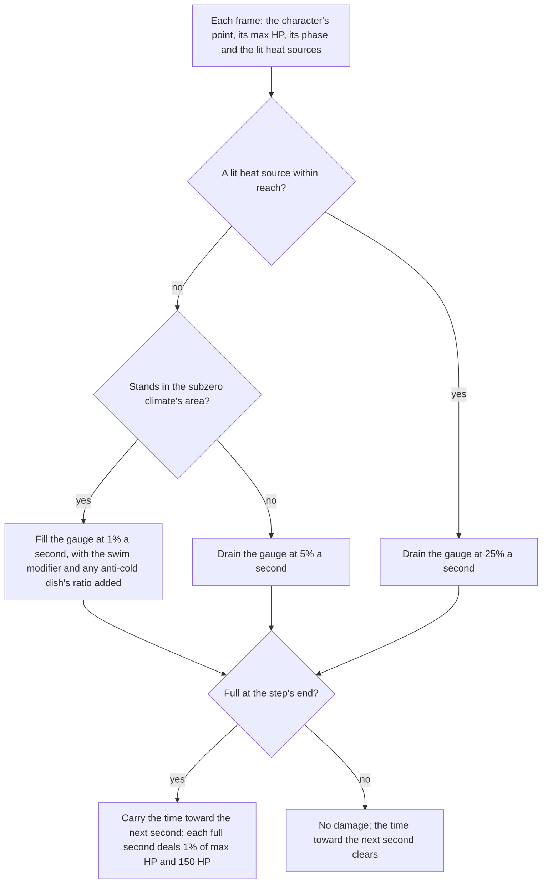

# Sheer Cold

Dragonspine's Sheer Cold is the subzero climate's gauge. Standing in the climate fills it, heat drains it, leaving the climate drains it, and once it is full the character loses HP each second. The rates and the damage are the wiki's; the heat's reach and the bar's look are provisional.

## Decisions

- **The climate is an area, not a weather.** The gauge fills where `findAreaAt` names an area in the climate's list, which is Dragonspine alone. Keying on the Snow weather was rejected: the catalogue gives Snow to other areas, and the game ties the climate to the place, not to the weather that falls there.
- **The wiki's numbers are used; the dump gives the rules.** The wiki's Sheer Cold page gives the accumulation rate and its modifiers, the warmth and leaving rates, and the HP loss each second. The dump's climate buffs name the same rules (the fill's triggers, the residency) and give no figure the wiki lacks, so the wiki's figures are the constants. The heat's reach is the one number neither source gives, so it stays provisional.
- **Heat drains the gauge wherever it stands, and overrides the fill.** The wiki says a source of warmth reduces the gauge in the subzero climate and names no reach for it. A lit campfire outside the climate drains it too, since limiting the drain to the climate would leave a campfire outside Dragonspine doing nothing the game does not say.
- **Outside the climate with no heat, the gauge drains at 5% a second.** The wiki's "Leaving the Area" section names it: leaving an area with the gauge drains it at 5% a second. This replaces an earlier hold that had no source, so a character who leaves the climate full drains back down.
- **An anti-cold dish holds the fill down by its ratio.** The dump's `Anti_Cold_Food_Buff` rows give the ratios -0.3, -0.4 and -0.5, and the wiki's Goulash and Borscht modifiers (-30%, -40%, -50%) are the same three. Each dish's ratio is read off the item row its buff names, so no dish is named in code. The ratio adds to the swim modifier, and the fill stops at none where the sum is -100% or lower, as the wiki says. The team holds one anti-cold, and eating another restarts it, as the kit restarts a buff of the same source.
- **Pyro does not drain the gauge.** The dump's Pyro rule is `ClimateAbility_HotMonster`, which belongs to the hot Boss bar, a separate gauge. The wiki agrees: Pyro is an accumulation modifier of -20%, not a drain, and its aura is not read by this change (named open below). So heat is the only drain, and the world's one heat rule is the campfire's.
- **Scarlet Quartz is not a source of warmth.** The wiki says so outright. Its pickup takes 5% of the gauge and halts accumulation for 25 seconds, and the world has no Scarlet Quartz to pick up, so that is named open rather than built.
- **Damage is 1% of max HP plus 150 HP each second the gauge stays full, handed on in HP.** The step returns the HP its full seconds cost, from the character's max HP, and Windrise emits it as `coldDamage`. The session takes it the way a boar's charge is taken: the team's shields absorb it first, and the member loses the share of max HP left over (`hitPartyMember`, which the enemy strike and the charge share too).
- **The bar shows no words, and its label is the game's own name.** The gauge's name is the game's text `694190546`, "Sheer Cold" in English and "严寒" in Chinese, held as `GameTextKey.SheerCold`. The bar labels itself with it for assistive technology, and draws no words.

## Mechanism

## Key files

| Path                                                                    | Role                                                                      |
| :---------------------------------------------------------------------- | :------------------------------------------------------------------------ |
| `packages/genshin-world/src/services/sheerCold/constants.ts`            | The climate's area list and the rates and damage, with their sources      |
| `packages/genshin-world/src/services/sheerCold/isSheerColdArea.ts`      | Whether the area the character stands in holds the climate                |
| `packages/genshin-world/src/services/sheerCold/isHeatedBy.ts`           | Whether a lit heat source is within reach of the character                |
| `packages/genshin-world/src/services/sheerCold/stepSheerCold.ts`        | One step of the gauge: drain, fill, the leaving drain, and the damage     |
| `packages/genshin-world/src/composables/useSheerCold.ts`                | Steps the gauge each frame and hands its damage on                        |
| `packages/genshin-world/src/components/World/Windrise/Index.vue`        | Mounts the gauge beside the area weather and emits its value and damage   |
| `packages/genshin-world/src/components/World/Session/Index.vue`         | Reads the active character into the gauge and writes its value to the HUD |
| `packages/genshin-world/src/components/World/Character/Index.vue`       | Exposes the character's locomotion phase for the swimming rule            |
| `packages/genshin-world/src/components/Hud/SheerCold/Index.vue`         | The bar across the top of the screen                                      |
| `packages/genshin-world/src/components/Hud/Screen/Index.vue`            | Mounts the bar beside the stamina meter                                   |
| `packages/genshin-world/src/models/hud/HudFrame.ts`                     | The gauge's value in the frame the HUD reads                              |
| `packages/genshin-world/src/models/sheerCold/SheerCold.ts`              | The gauge's value and the time it has stayed full                         |
| `packages/genshin-world/src/models/sheerCold/SheerColdStep.ts`          | What one step reads off the world                                         |
| `packages/genshin-world/src/models/sheerCold/HeatSource.ts`             | A point that gives off heat, and whether it is lit                        |
| `packages/genshin-world/src/services/sheerCold/getTeamAntiColdRatio.ts` | The ratio the team's anti-colds hold the fill down by                     |
| `packages/genshin-world/src/models/kit/KitAntiCold.ts`                  | The team's anti-cold, held for the seconds its dish gives it              |
| `packages/genshin-world/src/services/cooking/eatDish.ts`                | Holds the team's anti-cold a dish gives                                   |
| `scripts/src/services/genshinAssets/cooking/toDishUse.ts`               | Reads a dish's anti-cold ratio and seconds off its buff                   |

## Sources

- The game's own climate data, read from the dump: the rows of `BuffExcelConfigData` named `ClimateAbility_Cold`, with their Chinese `name` and `desc` (the Lv1 fill, the Lv2 damage and the area residency), and the anti-cold food rows `Anti_Cold_Food_Buff`, whose `desc` writes the ratio each holds the fill down by (`ratio-0.3`, `-0.4`, `-0.5`) and whose `time` gives the seconds it lasts (900, or 1500 for the last -0.5).
- The game's English guide text, `TextMap_MediumEN.json`, under the hash `2536823179` that `UI_GUIDE_COLDCLIMATE_DESC` names in `ManualTextMapConfigData.json`: the climate fills the gauge, its limit costs HP, heat diminishes it, and snowstorms and swimming accelerate it.
- The game's name for the gauge: `TextMap_MediumEN.json` and `TextMap_MediumCHS.json` under the hash `694190546`, which the `genshin:text write` run puts in the reader's texts.
- The Fandom wiki's Sheer Cold page, read through its wikitext API with a browser User-Agent (a bare client gets HTTP 402, a missing header): the accumulation rates and modifiers, the warmth and leaving rates, and the HP loss each second. Its HP table is the check: 30 seconds at 1% of max HP plus 150 HP empties 6,428 HP, which the per-second rule reproduces.

## Notes

- The rates and the damage are the wiki's. Still provisional: the heat's reach (`SHEER_COLD_HEAT_RADIUS`) and the bar's placement and look. The wiki puts the gauge over the active character's HP bar; the built bar sits across the top until a recording settles it (task 3.4).
- The wiki's modifiers the world cannot read yet are named open, not built: a snowstorm (+200%, task 3.3), Pyro (-20%) and Cryo or Hydro (+20%) on the character's aura, cold platforms and Cryo hypostases (+200%), and wind currents (+50%). The wiki's pause during dialogue and the Paimon menu is not built either.
- Campfires are not placed in the world (task 3.2). The wiki's other sources of warmth (braziers, Seelies, statues, waypoints, the Frostbearing Tree) are not placed either.
- The world's `WeatherKind` holds only Snow, so the snowstorm the guide names cannot quicken the fill until its weather exists.
- The anti-cold reaches the world through the published cooking dishes. Until `genshin:assets cooking` publishes them again, the dishes carry no anti-cold and the fill is not suppressed.
