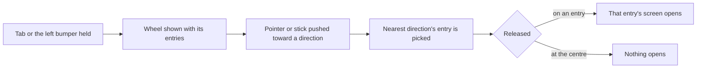

# Shortcut Wheel

The Shortcut Wheel opens the game's menus from the world without the Paimon menu. Its entries and its direction logic are pure; the drawn wheel is the parity loop's.

## How it works



The default entries are the wiki's, in its order clockwise from the top. An 8-direction wheel is Wish, Adventurer Handbook, Inventory, Character, Map, Quests, Events and Battle Pass. A 4-direction wheel is Wish, Inventory, Map and Events.

## Decisions

- **Gadgets are not on the wheel.** The wiki's Shortcut Wheel lists menus only. Gadgets are used from Z, which `genshin-gadgets` builds, so the wheel does not take `quickSwapItemIds`.
- **Customization is not gated by this change.** The wiki gates customizing the entries on Adventure Rank 20, not the wheel, so the wheel is open from the start with its defaults.
- **Hold to open, release to choose** is provisional. The wiki gives no hold length, so the wheel opens on a press and the choice is read on release; the same hold rule as the quick swap's is not reused.
- **The wheel's layout is provisional.** The wiki's eight-direction screenshot sits on a CDN that refused the download from this machine, so the wheel is drawn from the wiki's description: eight entries clockwise from the top, four on the other layout. The parity trace of the game's own wheel replaces the drawing. The Tab and bumper hold that opens it is not wired yet (task 2.1).

## Key files

The session file already exists and changes; the wheel's new files sit in a tree:

| File                                                            | Role                                                                                                 |
| --------------------------------------------------------------- | ---------------------------------------------------------------------------------------------------- |
| `packages/genshin-world/src/components/World/Session/Index.vue` | Holds the wheel's step each frame, draws the wheel while its key is held, opens the entry on release |

```text
packages/genshin-world/src/services/shortcutWheel/   ← the entries, the direction and the hold and release step, pure and tested
packages/genshin-world/src/models/shortcutWheel/     ← the direction count, as an enum, and the step between two frames
packages/genshin-world/src/components/Hud/ShortcutWheel/ ← the wheel drawn from the picked direction count, with its browser test
```

## Notes

- The wheel is an overlay over the world, not a screen in `ScreenKind`, so `getNextScreenKind` does not change: the entry it picks is opened through the same screen path a shortcut takes.
- The 8- and 4-direction counts come from Settings once customization lands, so the direction count is a parameter here, not a constant the wheel reads.
- The move that picks the entry is the stick's or the keys' move. While the wheel is open the character holds still on it: `WorldCharacter` takes `isMoveHeld`, which steps the body on the still input as a kit action does, and the wheel reads the raw move.
