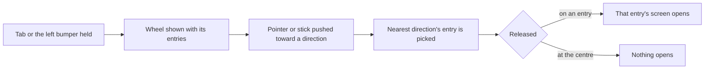

# Shortcut Wheel

The Shortcut Wheel opens the game's menus from the world without the Paimon menu. Its entries and its direction logic are pure; the drawn wheel is the parity loop's.

## How it works



The default entries are the wiki's, in its order clockwise from the top. An 8-direction wheel is Wish, Adventurer Handbook, Inventory, Character, Map, Quests, Events and Battle Pass. A 4-direction wheel is Wish, Inventory, Map and Events.

## Decisions

- **Gadgets are not on the wheel.** The wiki's Shortcut Wheel lists menus only. Gadgets are used from Z, which `genshin-gadgets` builds, so the wheel does not take `quickSwapItemIds`.
- **Customization is not gated by this change.** The wiki gates customizing the entries on Adventure Rank 20, not the wheel, so the wheel is open from the start with its defaults.
- **Hold to open, release to choose** is provisional. The wiki gives no hold length, so the wheel opens on a press and the choice is read on release; the same hold rule as the quick swap's is not reused.

## Key files

The work adds new files only, so the wheel's layout is a tree, not a table:

```text
packages/genshin-world/src/services/shortcutWheel/   ← the entries and the direction, pure and tested
packages/genshin-world/src/models/shortcutWheel/     ← the direction count, as an enum
```

## Notes

- The wheel is an overlay over the world, not a screen in `ScreenKind`, so `getNextScreenKind` does not change: the entry it picks is opened through the same screen path a shortcut takes.
- The 8- and 4-direction counts come from Settings once customization lands, so the direction count is a parameter here, not a constant the wheel reads.
