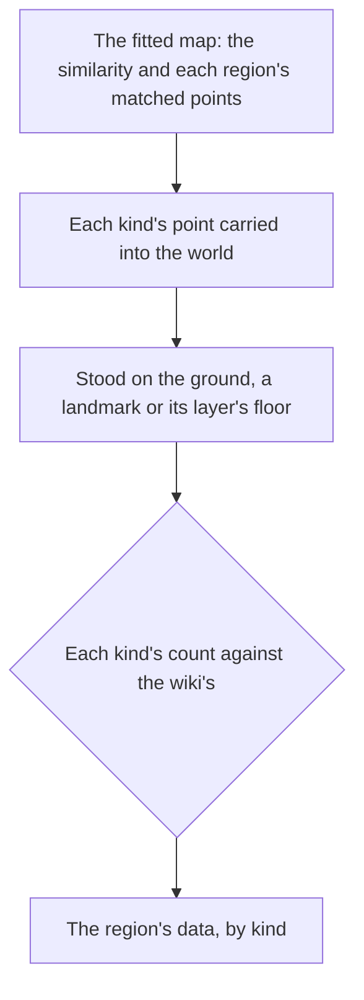

# Spawned places

The servers' spawned places are not in the client's data, so the world holds none of them yet. The official map's public points stand in for them. Its points are read and fitted onto the scene's transport points as the [as-built page](../../specs/genshin/spawned-places/design.md) describes, one similarity over the whole map with its residual reported, Mondstadt checked first. What is left is writing each kind's places into region data, and standing each on the ground that holds it. Nearly every system after this one stands on such a place, so this proposal comes before them.

## Decisions

- **The fit needs no waypoint landmark.** The map's statues and waypoints are fitted against the scene's transport points, which the dump holds for every nation but Snezhnaya, so the fit does not wait on [exploring](../../specs/genshin/exploring/design.md) placing the waypoints into region data. The fit's own calls are on the [as-built page](../../specs/genshin/spawned-places/design.md).
- **Only fitted places ship.** The map's data stays a reference; what enters the repository is each place's kind and its fitted position in the region's slice, as the chests' and the Oculi's are.
- **Stood on what is beneath.** A map point has no height, so a fitted place stands on the ground under it, or on the top of a landmark whose collision holds it. An underground layer's points stand on that layer's own floor. A place whose height the ground cannot give is reported, never guessed.
- **Camps come from the map's enemy marks, clustered.** The map marks each enemy by a family label (its Hilichurl label alone covers every kind of hilichurl), with no level and no camp. Each family label's points are clustered by distance into camps, the clustering radius an estimate marked provisional. A camp's kinds are its points' labels, and its levels are estimated from the region's world-level band, marked provisional. The map gives neither level nor camp membership, so both are estimates, and the wiki's counts check the camps as they check every kind.
- **Each kind is checked against the wiki's count.** The map's points are contributed by its users, so each kind's count in a region is held to the wiki's, and a shortfall or a surplus is reported per kind. The other kinds take their wiki counts as their pages land.
- **A family is one kind (provisional).** Each family label maps to one kind in `FamilyLabelEnemyKindIdMap`: the first variant on the wiki's family page whose English name the dump's monster table holds, read as its lowest monster id. Slime, Samachurl and Whopperflower take their first listed elemental variant, Mitachurl its first listed shield variant (Ice Shieldwall), and Hilichurl the Hilichurl. A family whose variants the dump lacks, or whose poise the wiki's table does not list, is left out and named in the report: 55 of 104 families (25 with no dump variant, 30 with no poise row).
- **One World Level band for every region (provisional).** The enemy band the Adventure Rank page gives at World Level 0, levels 1 to 36, is one constant, `CAMP_LEVEL_BAND`. Each camp member takes its middle, `CAMP_LEVEL`, until a camp's level is read from the game.
- **Treasure Hoarder is Scout (provisional).** The wiki's Treasure Hoarder page links one variant, Wallenstein, which the dump has only without an archive entry, so the Enemy Group subpage the page links is read instead: its variants in order, the first the dump holds with an archive entry and no boss rank is Scout (25010201). Its traits are Minion poise and energy drops at 66, 33 and 0 percent from the Scout page, and `TreasureHoarderScout` is the kind the family's camps place.
- **Each added kind's traits come from the wiki (provisional).** A kind's poise is its row of the Interruption Resistance/Poise table, its element and energy drops the Energy Drops template of its variant's page. Every energy drop is a particle, since the template names no orb kind. A drop family is set only for the Hilichurls the world already tables. Anemo Hypostasis is added by its own change.
- **Camps are written into each fitted region's data (provisional).** `genshin:assets enemy-camps` clusters each region's marks into camps and replaces its `enemyCamps`, so the Mondstadt stand-in goes. Marks are grouped by the catalogue area `findAreaAt` finds at their position, so a camp takes its enemies' area and never spans two; a mark in no drawn outline is left out and counted in the run's report (32 of about 6,000 in the first run, most of them in Natlan and Nod-Krai, where the outlines leave gaps). At the provisional radius most camps in the first run are a single enemy, so the radius is the first thing to check against the game.
- **Enemies stand on the ground (1.2, partial).** A camp's enemy stands at the ground height the world gives its position, as the Enemies component already does, so a fitted place stores no height. The fit reports the marks on layers under the ground, which have no floor in the data: the first run has none, since no enemy mark is underground. The landmark top waits on a collision top on the landmark model, and the layer floor on the underground layers' ground data, which neither the catalogue nor the dump holds, so both stay open.
- **The Oculi and the chests are checked (3.1, partial).** Each region's Oculi and chests are compared with the wiki's count and the difference reported in the build's notes. The wiki's chest count per region is the sum of its Chest page's route notes that name the region (`ChestWikiCountMap`), and the routes count some chests for a neighbouring region, so the difference is read as approximate. The first run is short in every region, from 159 in Snezhnaya to 794 in Sumeru, and 44 underground chests are left out. Enemy kinds wait on per-region counts the wiki does not give.

## How it works

## Scope and order

**Today:** the map's points are read and fitted, the chests are published into their slices by [chests](../../specs/genshin/chests/design.md), the Oculi into theirs by the [spawned places](../../specs/genshin/spawned-places/design.md) page, and region data holds what the client's data places, beside one stand-in enemy camp in Mondstadt, written by hand with the enemies.

**Still to add:**

1. **The camps**, for [enemies](../../specs/genshin/enemies/design.md): each family label's points clustered into camps and written into its region's `enemyCamps`, replacing Mondstadt's stand-in camp, each enemy with its family's kind as `EnemyKindId`, its estimated level and its place, through the same region-axes step `placeMapPoints` takes. The kinds the camps place are then published to the enemies dataset by `genshin:assets enemies`, which reads them from the region data. The gathering points are placed by the [gathering](../../specs/genshin/gathering/design.md) page.

## Data and measures

- **Measured:** each kind's count in each region against the wiki's, and each kind's height against the ground the place stands on.

## Key files

| File                                                               | Role after the change                               |
| :----------------------------------------------------------------- | :-------------------------------------------------- |
| `scripts/src/services/genshinAssets/points/placeMapPoints.ts`      | Carries each kind's points into its region          |
| `scripts/src/services/genshinAssets/oculi/buildOculusPlaces.ts`    | Builds the Oculi slices from the points and the fit |
| `scripts/src/services/genshinAssets/points/buildMapPointSlices.ts` | Builds each kind's places as one record a region    |
| `packages/genshin-world/src/services/world/createWorldHeight.ts`   | The ground a fitted place stands on                 |

## Sources

- [Teyvat Interactive Map](https://act.hoyolab.com/ys/app/interactive-map/index.html), HoYoLAB: the official map, whose points the fit reads, and the label tree the points are labelled by.
- [Oculus](https://genshin-impact.fandom.com/wiki/Oculus), Genshin Impact Wiki: each region's count of Oculi, one of the counts a fit is held to.
- [Chest](https://genshin-impact.fandom.com/wiki/Chest), Genshin Impact Wiki: the chests and their kinds the map marks.
- [Adventure Rank](https://genshin-impact.fandom.com/wiki/Adventure_Rank), Genshin Impact Wiki: the World Level's enemy level band; [Interruption Resistance/Poise](https://genshin-impact.fandom.com/wiki/Interruption_Resistance/Poise): each kind's poise. The family pages Slime, Hilichurl, Samachurl, Mitachurl and Whopperflower were read through the wiki's `api.php` wikitext endpoint, since the pages refuse scripted fetches.
