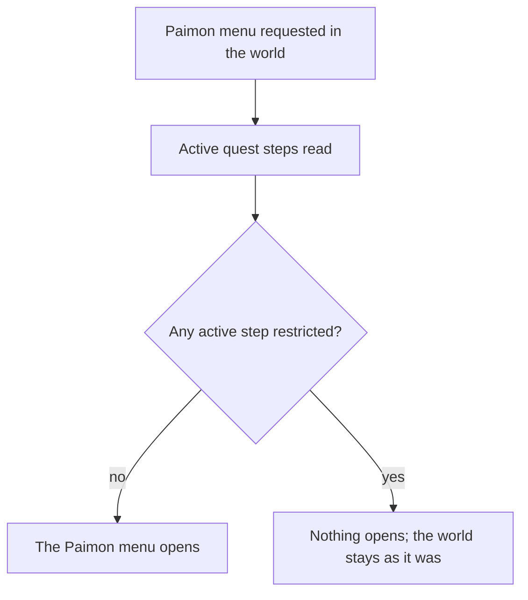

# Special Story Mode

A story quest's step can restrict the player while it is the active step. The Paimon menu is the restriction every restricted step shares, so this change locks it and leaves the rest of each restriction to the export.

## How it works

The restriction is a field on the quest step, present only on a restricted step. Its absence means no restriction, so the step model reads it as optional.

## Decisions

- **Keyed to the active step's restriction, not the quest's kind.** The wiki lists the restricted quests by step, and the game's `QuestKind.Story` covers story quests that restrict nothing. The quest table marks 203 steps across 103 quests with a restriction, so the step is the unit.
- **The Paimon menu is the one lock built now.** The wiki says the Paimon menu is not accessible in this mode, and every restricted step shares it. The map and transport restrictions name ban groups whose contents the client's scripts hold, so they wait on the export rather than being guessed.
- **The table's restriction is taken as the wiki's Special Story Mode.** Provisional: the wiki lists the restricted quests by step, and this change reads the same step-level mark from the game's quest table, without yet checking the two lists match one for one.

## Key files

The work changes these existing files:

| File                                                              | Role after the change                                                     |
| ----------------------------------------------------------------- | ------------------------------------------------------------------------- |
| `packages/genshin-world/src/models/quest/QuestStep.ts`            | Carries the optional restriction on a step, absent when the step has none |
| `packages/genshin-world/src/services/screen/getNextScreenKind.ts` | Keeps the Paimon menu shut while the active step is restricted            |

## Notes

- The quest table's restriction names are the game's own ban-group keys; the groups' contents are not in the excel tables, so the field stores the key and the lock reads only whether one is present.
- A restricted step the wiki does not list is not this change's to explain; it is checked against the wiki when the dataset ships.
